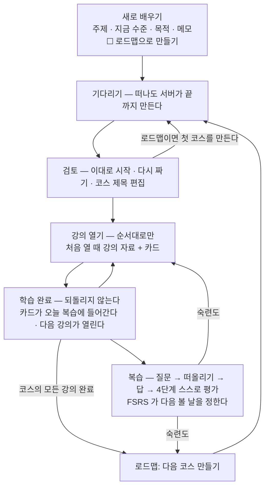

# 01. 개요 — 무엇을 · 누구에게 · 어디까지

> 서비스가 무엇이고, 누구에게 열고, 무엇을 만들고 무엇을 만들지 않는지, 무엇을 성공으로 보는지를 정한다.
> 데이터는 [02](./02-domain-data.md), 생성은 [03](./03-generation.md), 서버 · 작업 · 비용은 [04](./04-jobs-and-cost.md), API 는 [05](./05-api.md), 화면은 [06](./06-screens.md), 시험은 [07](./07-testing.md), 일정은 [SCHEDULE](./SCHEDULE.md). 이름은 [GLOSSARY](./GLOSSARY.md), 결정과 이유는 [ADR](./ADR.md).

**설계 범위** — 흐름 · 범위 · 큰 구조까지 정한다. 테이블은 미리 정한다(ADR-152). 경로 · 오류 코드 · 수치 같은 세부는 각 TASK 에서 정한다(README 2026-11-02 · 2026-11-03 · 2026-11-04 · 2026-11-07). 서버가 여러 대가 되어도 구조가 바뀌지 않게 설계한다(README 2026-11-04).

---

## 1. 한 줄

**주제를 넣으면 머금이 강의를 만들고, 사용자는 그 강의로 배우고 카드로 굳히며, 복습 결과가 다음 강의를 내 수준에 맞춘다.**

## 2. 문제와 가설

**문제** — 배울 때는 다 이해되는데, 조금만 시간이 지나면 배운 기억이 많이 사라진다. 배운 것을 따로 애쓰지 않아도 장기 기억으로 가져가고 싶다.

**가설** — 배우는 곳과 굳히는 곳이 같고, 굳힌 결과(숙련도)가 다음 배움을 바꾸면 장기 기억으로 가져갈 수 있다.

- **머금에서 배우고 머금에서 굳힌다** — 주제를 넣으면 강의를 만들고, 그 강의의 카드로 복습한다(ADR-001).
- **강의 생성기에서 끝나지 않는다** — 간격 반복(FSRS)으로 언제 어디서나 복습한다.
- **쓰면서 맞춰진다** — 처음에는 고른 지금 수준 · 목적과 강의 목록 검토로, 그 뒤로는 복습 결과로 맞춘다 — 잘 기억하는 개념은 짧게, 흔들리는 개념과 처음 보는 개념은 자세히(ADR-002).

**고리** — 복습 결과(숙련도)가 다음 강의(처음 열 때 만든다 — ADR-011)와 로드맵의 다음 코스(눌러서 만든다 — ADR-018)에 반영된다.

## 3. 사용자

- 효율적으로 배우고, 배운 것을 오래 기억하고 싶은 누구나 — 예: 개발 실무 지식을 익히는 사람 · 면접을 준비하는 사람.
- 받는 학습은 **개념 · 지식형**이다 — 배운 개념을 이해하고 오래 기억하는 것(ADR-003).

## 4. 누구에게 여나 — 정원제

**MVP 는 정원제로 공개한다 — 운영자가 승인한 사람만 쓴다**(ADR-055). 나만 쓰는 도구도, 누구나 가입하는 서비스도 아니다. 실제 사용자로 「쓰면서 맞춰진다」를 확인하고, 사람 수가 정해져 비용의 상한도 묶인다.

- **정원은 운영자를 포함해 10명**(ADR-061) — 운영자가 승인할 때 지키고, 서버는 검사하지 않는다.
- **로그인은 구글 로그인 하나**(ADR-057) — 다른 소셜 로그인 · 이메일 로그인은 두지 않는다.
- **누구나 로그인해 신청하고, 운영자가 하나씩 승인한다**(ADR-056) — 신청하면 승인 대기가 된다. 승인됐다는 사실은 따로 알리지 않는다 — 다시 들어와야 안다.
- **운영자는 거절할 수 있다**(ADR-058) — 거절된 사람이 다시 들어오면 거절됐다고 알린다. 스스로 다시 신청하지 못하고, 운영자가 풀어 줘야 한다. 거절한 사람의 구글 이메일 · 이름은 남는다.
- **승인 · 거절은 운영자가 DB 에 직접 SQL 로 한다**(ADR-060) — 신청 목록 · 승인 · 거절 · 거절 풀기 · 요청받은 계정 지우기. 관리 화면은 두지 않는다. 자주 쓰는 SQL 은 운영 문서에 적는다.
- **화면에서 탈퇴하는 것은 승인된 사람만이다**(ADR-059) — 신청 중 · 거절됨인 사람은 운영자에게 요청해 지운다. 요청 방법은 개인정보처리방침에 적는다.
- **탈퇴한 사람이 다시 오면 처음 온 사람과 같다**(ADR-084) — 다시 신청하고 승인받는다. 이전 기록 · 크레딧은 이어지지 않는다.
- **이용약관은 두지 않고 개인정보처리방침만 공개한다**(ADR-062) — 받는 정보는 구글 이메일 · 이름뿐이고, 동의 체크 · 동의 기록은 두지 않는다. 처리방침에 적을 것은 §10. 정원제를 풀면 이용약관을 더한다.

## 5. 제약

- **생성은 느리고 돈이 들고 실패한다** — 강의 목록 수십 초(옛 실험 16~24초), 강의 자료 1분 안팎(옛 실험 46~62초). 만들기는 DB 에 작업으로 적고 워커가 꺼내 만든다 — 떠나도 끝까지 만든다(ADR-006 · ADR-103).
- **비용은 사용자마다 크레딧으로 묶는다** — 한 달 몫 = 운영자의 한 달 예산 ÷ 정원 10명. 서비스 전체 상한은 따로 두지 않는다(ADR-106 · ADR-107 · ADR-115).
- **서버가 여러 대여도 구조가 그대로다** — 함께 지킬 것(한 사람이 건 수 · 크레딧 · 잠금 · 세션)은 DB 에 둔다(ADR-133).
- **모바일 우선 · 앱처럼 보이는 웹**(ADR-063 · ADR-068).
- **하루의 경계는 한국 시간 새벽 4시**(ADR-017).
- **MVP 는 모든 경우를 다루지 않는다** — 드문 경우에 안내 · 버튼 · 규칙을 더해 빠짐없이 막으려 하지 않고 우선 넘어간다. 쓰면서 문제가 보이면 고친다(ADR-102).

## 6. 만들지 않는 것 — 다시 넣는 조건과 함께

**미루는 것 — 다시 볼 조건이 있다.** 조건 없이 넣지 않는다 — 필요해 보이면 조건부터 확인하고 문서를 먼저 고친다.

| 미루는 것 | 다시 볼 때 |
|---|---|
| 시작 전 수준 진단(ADR-002) | 첫 코스가 너무 안 맞는다는 근거가 생길 때 |
| 빈칸 카드(ADR-005) | 질문형이 너무 길다고 느낄 때 |
| 강의 자료 미리 만들기(ADR-011) | 기다림이 문제가 될 때 |
| 복습 때 핵심 포인트 보여 주기(ADR-015) | 평가가 부풀려지는 게 보일 때 |
| Vega-Lite 그래프(ADR-022) | 곡선이 꼭 필요한 강의가 반복될 때 |
| 계획의 개념을 빠짐없이 다뤘는지 검사(ADR-035) | 품질이 떨어진다는 근거가 생길 때 |
| 반영하지 못한 요청 안내(ADR-045) | 같은 요청이 반복될 때 |
| 개념 바로잡기 — 합치기 · 가르기(ADR-050) | 잘못 합친 사례가 보일 때 |
| 「두 번 짜기」(ADR-120) | 관련 개념 검색의 놓침이 잦을 때 |
| 깨진 그림을 서버에 알려 기록하기(ADR-117) | 잦아 튜닝 근거가 필요할 때 |
| 강의 자료를 먼저 꺼내기(ADR-128) | 강의 자료를 기다리는 시간이 문제로 보일 때 |
| 관리 화면(ADR-060) · 이용약관(ADR-062) | 정원제를 풀 때 |
| 「홈 화면에 추가」(PWA)(ADR-068) | 나중에 더할 예정 — 조건 없음 |
| 스트릭(ADR-016) · 만든 뒤 메모 바꾸기(ADR-041) | 조건 없음 |
| 크레딧 충전 · 결제(ADR-064 · ADR-107) | 조건 없음 — 크레딧 모양만 나눌 수 있게 둔다(ADR-131) |
| 내 자료로 카드 만들기(ADR-001) · 강사(말투) 선택(ADR-004) | 나중 기능 후보 — 조건 없음 |
| 학습 플랜(기간 · 주당 학습량 · 예상 완료 기간) · 카드 직접 추가 · 편집 · 오류 신고 · 카드별 복습 멈추기 · FSRS 매개변수를 사람마다 맞추기 · 강의 품질 평가 버튼 · 학습 통계 화면 · 소셜 · 모바일 앱 · 다국어 · 다크 모드 · 로그인 기기 목록 · 원격 로그아웃 · 휴면 사용자 자리 회수(ADR-064) | 조건 없음 — 틀린 카드는 사용자가 지운다(ADR-065) |

**하지 않는 것 — 다시 볼 조건이 없다**

- 다른 곳(책 · 인강)에서 배운 것을 가져와 굳히기(ADR-001)
- 시험 · 자격증 준비 · 연습형 학습(문제풀이 · 객관식 · 계산 반복 · 회화 · 실기)(ADR-003)
- 강의 자료 다시 만들기 · 학습 중에 강의 자료에 바라는 것을 전하기(ADR-025 · ADR-123)
- 이메일 · 웹 푸시 알림(ADR-016)
- 복습의 LLM 채점(ADR-015) · 이미지(ADR-022)
- 학습 완료 되돌리기 · 진도 되돌리기 · 처음부터 다시 하기 · 「같은 입력으로 새로 만들기」(ADR-007 · ADR-012) — 다시 하려면 새로 만든다
- 시작한 뒤 강의 목록 · 로드맵 계획 다시 짜기(ADR-007 · ADR-009) · 로드맵의 코스 하나만 지우기(ADR-027)
- 학습과 상관없는 요청을 미리 막기(ADR-114)
- 따로 된 메시지 큐(ADR-103) · 서버가 끝났을 때 밀어 주는 연결(ADR-143)

## 7. 알려진 한계

설계에서 감수하기로 한 것 가운데 사용자가 겪는 것이다. 근거는 각 ADR 의 「감수하는 것」.

- 처음 쓰는 사람은 개인화가 약하다 — 복습 기록이 없다(ADR-002).
- 다시 들어오게 하는 장치가 없다 — 알림 · 스트릭이 없다(ADR-016).
- 강의 자료가 수준에 맞지 않아도 다시 만들지 않는다 — 다음 강의부터 숙련도로 맞춰진다(ADR-025).
- 같은 개념 판정이 틀려도 바로잡지 못한다(ADR-050).
- LLM 이 적은 숙련도 반영 내역은 실제 배치와 다를 수 있다(ADR-121).
- 그림 · 수식이 깨지면 화면에 오류를 그대로 보인다(ADR-023 · ADR-117).
- 공부하는 도중에 크레딧이 모자라 다음 강의를 열지 못할 수 있다(ADR-107).
- 서버가 갑자기 죽으면 시한이 지날 때까지 그 작업이 멈춘다(ADR-126).
- 기다리는 화면은 다시 읽는 간격만큼 늦게 넘어간다(ADR-143).
- 구글 계정이 없는 사람은 들어오지 못한다(ADR-057). 거절된 사람은 이유를 모른다(ADR-094).

## 8. 성공 기준

**MVP 는 공개 전 품질 점검을 통과해 정원 사용자에게 열면 끝난다**(ADR-066).

- 넣기로 한 것이 모두 동작한다 — 02 ~ 06 에 정한 것.
- 공개 전에 만든 강의 · 카드 표본이 품질 점검을 통과한다 — 통과하지 못하면 공개하지 않는다. 형식은 서버가 검사하지만(ADR-120) 그림 · 수식(ADR-117)과 내용의 품질은 검사로 보장되지 않는다. 점검 방법은 [07 §3](./07-testing.md#3-공개-전-품질-점검).
- 점검한 표본이 통과해도 그 뒤의 모든 강의가 맞다는 보장은 아니다.
- 공개 뒤 「쓰면서 맞춰진다」의 검증은 완료 기준에 넣지 않는다.

## 9. 진행 순서

[SCHEDULE](./SCHEDULE.md) — 한 바퀴(코스 → 강의 → 카드 → 복습)가 먼저 돌게 쌓고, 숙련도 고리와 나머지를 그 위에 얹는다(ADR-150).

## 10. 공개 필수 목록

- [ ] 02 ~ 06 에 정한 것이 모두 동작한다
- [ ] 품질 점검 통과([07 §3](./07-testing.md#3-공개-전-품질-점검))
- [ ] 개인정보처리방침 공개 — 지운 코스의 카드(질문 · 답 · 복습 기록)가 남는다(ADR-165) · 거절한 사람의 정보가 남는다(ADR-058) · 신청 중 · 거절됨인 사람의 삭제 요청 방법(ADR-059) · 외부 서비스(LLM 프로바이더 · 구글 등)로 가는 정보(ADR-062)
- [ ] 처리방침 내용 확인 — 법률 판단은 설계 중의 이해를 바탕으로 했다(ADR-062)
- [ ] 구글 로그인의 앱 확인에 처리방침 링크가 필요한지 확인(ADR-091)
- [ ] 자주 쓰는 운영자 SQL(신청 목록 · 승인 · 거절 · 거절 풀기 · 계정 지우기)을 운영 문서에 적기(ADR-060) — 승인 SQL 은 다음에 채우는 때(`credit_refill_at`)도 넣는다(ADR-175)

## 11. 아직 정하지 않은 값

모두 TASK 에서 재 보고 정한다. 값마다 그 값을 쓰는 문서의 끝에 둔다 — [02 §9](./02-domain-data.md#9-아직-정하지-않은-값) · [03 §7](./03-generation.md#7-아직-정하지-않은-값) · [04 §10](./04-jobs-and-cost.md#10-아직-정하지-않은-값) · [05 §5](./05-api.md#5-아직-정하지-않은-값) · [06 §15](./06-screens.md#15-정할-것) · [07 §5](./07-testing.md#5-아직-정하지-않은-값).

## 12. 용어

이름은 [GLOSSARY](./GLOSSARY.md)가 단일 출처다 — 새 이름은 여기 먼저 넣고, 이름을 바꾸면 GLOSSARY 와 ADR 을 함께 고친다. 「커리큘럼」 · 「단계」는 쓰지 않는다(ADR-069 · ADR-070).
