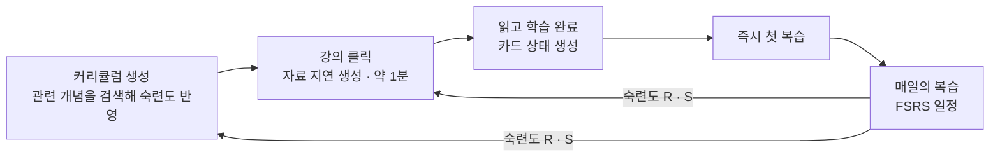
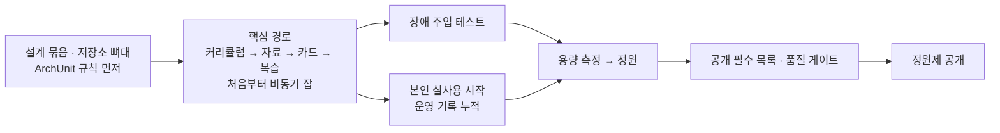

# 01. 개요 — 무엇을 · 누구에게 · 어디까지

> 이 묶음의 첫 문서다. 서비스가 무엇이고, 무엇을 만들고 무엇을 만들지 않는지, 무엇을 성공으로 보는지를 정한다.
> 용어는 §12, 데이터는 [02](./02-domain-data.md), 생성 파이프라인은 [03](./03-generation.md), 서버 구조는 [04](./04-jobs-and-cost.md).

**기획 진행 기준 — 사용자 결정.** 사전 기획은 MVP 범위와 주요 사용자 흐름을 중심으로 마무리하고 개발로 넘어간다. DB/API/경합/수치 등 세부와 이 문서들의 ‘구현 전 확정’ 항목은 관련 TASK에서 Codex가 설계·문서화·검증한다. 모든 세부를 미리 확정할 때까지 전체 개발을 기다리지 않는다. 기존 제약은 유지하며 MVP 범위/주요 사용자 동작 변경만 사용자와 다시 결정한다.

---

## 1. 한 줄

**주제를 정하면 AI 가 커리큘럼과 강의를 만들고, 강의를 끝내면 플래시카드로 복습하며, 복습 결과가 다음 강의의 내용을 바꾸는 학습 서비스.**
서비스 이름은 **머금 · Mogum** — *「배운 건 머금고, 흔들리는 건 다시 한 모금」*. 머금다(오래 담아 둔다) · 한 모금(조금씩, 알맞은 때에 복습) · gum(곱씹고 달라붙는다).
⚠️ **가확정** — 상표 · 도메인 확인 전. *모금(募金)* 으로 오해되지 않게 마시는 *모금* 이 드러나게 쓴다.

## 2. 문제와 가설

AI 로 공부하면 설명은 빨리 얻지만 **기억에 남지 않는다.** SRS 앱(Anki 등)은 복습을 관리하지만 **카드를 직접 만들어야** 한다.
둘을 잇는다 — 학습한 내용이 복습으로 이어지고, **복습 결과가 다음 강의 자료를 바꾼다.** 이미 굳은 개념은 짧게, 흔들리는 개념은 자세히.

> **가설** — 복습 결과를 다음 자료 생성에 반영하면 같은 설명을 반복하는 낭비가 줄고, 흔들리는 개념에 분량이 모인다.
> 성립 조건은 **숙련도 데이터가 실제로 쌓이는 것**이다. 그래서 *학습 완료 → 즉시 첫 복습* 을 흐름으로 이끌고, 건너뛰어도 카드가 오늘의 복습에 남게 한다.

## 3. 사용자

- **한 주제를 자신의 속도로 체계적으로 배우려는 일반 학습자.** 분야를 가리지 않는다 — 경제 · 역사 · 법 · 과학 · 자격증 · 프로그래밍.
- 받는 학습은 **개념 · 지식형**이다. 연습형(회화 · 발음 · 문제풀이 반복 · 실기)은 *"질문 → 답 떠올리기"* 카드와 맞지 않아 받지 않는다.
- 강의(U4) · 복습(U5)은 **모바일 우선** — 이동 중에 읽고 자투리 시간에 복습한다.
- **실사용자를 받는 서비스다.** 가입은 **정원제** — 정원을 넘으면 대기 명단에 오르고 관리자가 승인한다.
- 공개 전에는 제작자 본인이 먼저 쓴다. 그 기록이 공개 전 설계 근거가 된다.

## 4. 제약

| | 값 |
|---|---|
| 개발 | 1인 · 기간과 예산은 유연(기준선만 있다) |
| 예산 | **LLM 월 3만원 목표**(절대 상한이 아니다 — 사후 기록이라 넘칠 수 있다, §7). AWS · 도메인 같은 고정비는 따로 본다. 예산을 올리면 정원도 올린다 — ADR-073 |
| 서버 | **AWS EC2 한 대**(서울 `t4g.small` · 메모리 2GB — ADR-072) · 앱 프로세스 하나. 화면은 Vercel 에 정적 파일로(ADR-060) |
| 정원 `U_max` | **10명**(관리자 포함) — 예산 쪽 계산(1인 월 쿼터 2,000원 × 10 = 월 2만원, 나머지는 사후 초과분 · 단가 오차 몫). 최종값은 **min(예산, 서버 한 대의 측정 용량)** ([04 §7](./04-jobs-and-cost.md) · [07 §2](./07-testing.md)) |
| LLM | OpenAI — 채팅 `gpt-5.6-terra`(중상위) · `gpt-5.6-luna`(하위), 임베딩 `text-embedding-3-large`. 계정 등급 Tier 1(분당 500회 · 50만 토큰) |
| 생성 1건 | 강의 자료 1건 = LLM 4회 · **46~62초 · 약 82원**(실측). 커리큘럼 1건 = 1회 · 약 16~24초 · 약 35원 — **1단계 v5 실험 프롬프트 기준.** 운영 프롬프트를 만들면 다시 잰다([03 §1](./03-generation.md)) |

## 5. 만들 것

| 영역 | 내용 |
|---|---|
| **커리큘럼** | 주제(100자) · 목적(200자) 입력 → 순서가 있는 강의 목록(제목 · 목표 · 키워드, 총 1~40강). 주제/목적의 의미 · 키워드 검색으로 **사용자가 학습한 관련 개념을 선별**해 숙련도를 주입하고, 백엔드 판정에 따라 아는 개념은 빼거나 줄인다. 강의 수는 주제 · 목적 · 숙련도에 맞춰 정하며 상한을 채우려고 늘리지 않는다. 기간 · 주당 학습량 입력과 일정 생성은 없으며, 학습 시점과 속도는 사용자가 정한다. 승인 또는 피드백 첨부 후 **전체 다시 짜기**(커리큘럼당 하루 3회 — 평생 횟수가 아니라 커리큘럼을 버리고 새로 만들 이유를 줄인다). **커리큘럼 완전 삭제**를 제공한다(검토 중 · 학습 중 · 완료 · 생성 중). 삭제 전에 강의 자료 · 학습 기록 · 관련 플래시카드도 제거되고 복구할 수 없음을 안내한다. 다룰 수 없는 주제는 LLM 이 **거절**한다(`TOPIC_REJECTED`). 강의 순서는 강제하지 않는다 |
| **강의 자료** | 강의를 처음 열 때 **1개씩 지연 생성.** 고정 6섹션 · 강사 말투 · 숙련도별 분량 · 수식(KaTeX) · 그림(mermaid, 최대 2개) ([03](./03-generation.md)) |
| **넓은 주제의 분할안** | 첫 생성 호출에서 LLM이 주제/목적의 목표 일관성과 선행 관계로 단일/그룹을 판단하고 해당 강의 목록 또는 분할안을 함께 반환한다. 사용자가 결과를 검토한다([03 §2.1](./03-generation.md)). 목표 · 선행 지식을 기준으로 여러 커리큘럼의 제목/범위/목적/순서를 제안한다. 1단계부터 사용자가 생성 · 검토 · 승인해 학습하고, 전 강의 완료 후 다음 단계 생성 버튼을 제공한다. 다음 단계의 상세 목록은 클릭 시 최신 숙련도로 생성한다. 완료 시 자동 생성/일괄 선행 생성은 없고, 복습 완료를 다음 단계 조건으로 두지 않는다. 단계별 상세 목록의 기존 1~40강 상한은 유지한다. 화면은 묶음 화면(U11) 하나를 더하고 단계 커리큘럼은 기존 U3 를 쓴다. 묶음 삭제와 단계 커리큘럼 개별 삭제를 제공하며, 지운 단계는 미생성으로 돌아가 기존 조건으로 다시 만든다([06 §9](./06-screens.md)). 묶음/단계 모델은 확정했고 초기 입력은 잡 I(`CURRICULUM_INITIAL`)에 저장한 뒤 성공 시 결과 리소스를 생성/연결한다([02 §6.2.1](./02-domain-data.md)). 그룹 조회/단계 생성 API · 초기 생성 호출/출력 규약 · 요청 식별자 기반 중복 처리의 세부와 분할 개수 상한은 해당 TASK의 설계 항목. 실패한 초기 요청은 사용자가 지울 수 있다([02 §2.1](./02-domain-data.md) · [05 §2.1](./05-api.md)) |
| **플래시카드** | 자료와 함께 최대 10장. **이해형 · 적용형 위주, 용어형 최대 2장.** 카드마다 **모범 답안 + 채점 포인트.** 질문만 봐도 분야 · 대상을 안다. **이미 아는(`SKIP`) 개념으로는 만들지 않는다** |
| **복습** | 4단계 자가평가 · FSRS 라이브러리(기본 파라미터 · **단기 학습 단계 끔** — 간격은 1일 이상) · 오늘의 복습 = **한국 날짜로 오늘 안에 예정된 카드** · 일일 개수 제한 없이 원하는 만큼 진행한다. 중간에 나가도 평가한 내용은 저장된다. 밀려도 다음 강의는 막지 않는다 |
| **숙련도** | 개념(사용자별 사전)별 `R`(지금 기억) · `S`(얼마나 버티나). **저장하지 않고 조회 때 계산** ([02 §4](./02-domain-data.md)) |
| **개념 동일성** | 한 줄 정의를 임베딩해 동의어는 합치고 동명이의는 가른다 ([02 §5](./02-domain-data.md)) |
| **생성 작업** | 비동기 잡. 중복 방지 · 실패한 단계부터 재개 · 장애 회수. 성공/실패/회수를 DB 이벤트로 기록해 재시도 후에도 운영 이력을 유지한다([02 §6.9](./02-domain-data.md) · [04](./04-jobs-and-cost.md)) |
| **비용 통제** | 구조 상한 · 사용자 **월 · 일일 비용** 쿼터(2,000원 · 500원) · 진행 중 생성 2개 · 전역 **월** 킬스위치 ([04 §7](./04-jobs-and-cost.md)) |
| **운영 알림** | 슬랙 웹훅(크레딧 소진 · 킬스위치 발동 · 요청 거부) + 외부 헬스체크 ([04 §9.1](./04-jobs-and-cost.md)) |
| **계정** | 구글 OAuth + **쿠키 세션(Postgres 저장 · 비활동 7일 만료)** · 기기별 로그아웃 · 약관 동의 · 정원 · 대기 명단 · 회원 탈퇴(세션 전부 삭제) · 관리자 역할. 로그인 식별자는 `users(provider, subject)`에 저장한다([02 §6.1](./02-domain-data.md), ADR-066). 로그인 제공자는 현재 구글 하나다 |
| **화면** | 사용자 10개 + 관리자 1개 + 약관 2장 ([06](./06-screens.md)) |

## 6. 만들지 않는 것 — 다시 넣는 조건과 함께

> 조건(트리거)이 있는 항목은 *"아직 안 할 것"* 이다. **조건이 오기 전에 넣지 않는다.**

**기술 · 구조**

| 안 만드는 것 | 대신 | 다시 넣는 조건 |
|---|---|---|
| 가상 스레드 | 플랫폼 스레드 + 워커 고정 실행기 `N` | 오래 기다리는 연결이 **수백 개 동시에** 생기는 기능(예: 사용자별 실시간 스트리밍) |
| WebFlux · Kotlin 코루틴 | 명령형 Spring MVC | 초당 수만 건의 가벼운 요청이 주 워크로드가 된다 |
| Spring AI · LangChain4j | OpenAI SDK + 자체 인터페이스(`LlmClient`) | 프로바이더를 **상시 여럿** 지원해야 한다 |
| Redis · Kafka · 두 번째 저장소 | PostgreSQL 하나(큐는 `SKIP LOCKED`) | 큐가 초당 수백 건 · 프로세스 간 공유 카운터가 필요해진다 |
| 일일 비용 요약 테이블(`daily_usage`) | 쿼터 · 킬스위치의 일일 · 월 합계를 원장 `llm_calls` 에서 조회 때 더한다([02 §6.6](./02-domain-data.md)) | 한 달 원장 행이 수십만 건이 되어 적재 전 합계 조회가 느려진다 |
| 레이트리미터(토큰 버킷) | 실행기 `N` + 429 백오프 + 한도 헤더 게이지 | 한도 여유가 3배 아래 · 429 가 실제로 관측된다 |
| 예산 선차감 · 정산 · degrade 3단 · 호출 등록 때 월 합계 검사 | 사후 기록 + 월 킬스위치 — 월 예산은 목표치다(ADR-073) | 월 실제 지출이 목표를 넘은 달이 생기고, 원인이 킬스위치 뒤 초과분이다([04 §7.3](./04-jobs-and-cost.md)) |
| 전역 대기 잡 상한(`Q_max`) | 정원 × 진행 중 2개가 대기 수를 묶는다 | 정원을 **측정 용량보다 크게** 잡는다 |
| 프로세스 분리(api / worker) | 한 프로세스(`app.role=all`) — **역할 전환 배선은 비상용으로 들어 있다**([04 §3.1](./04-jobs-and-cost.md)) | 워커가 API 지연에 영향을 주는 것이 관측된다 → 실행 인자만 바꿔 나눈다 |
| 무중단 배포(블루-그린 등) | 정상 종료 반납 — 배포 중 최대 약 2분 중단 · 사람이 적은 시간에 배포([04 §4.5](./04-jobs-and-cost.md)) | 공개 후 넣는다 — 사용자 결정(ADR-061) |
| 분산 트레이싱 | 단계별 duration 메트릭 + 로그 MDC `jobId` | *"왜 오래 걸렸나"* 를 메트릭과 로그로 답하지 못한다 |
| 중앙 로그 수집(CloudWatch Logs · Loki 등) · 로그 수집 에이전트 | 서버 journald 에 총 14일 · 500MB — SSM 에서 `docker logs` · `journalctl` 로 본다(ADR-075) | 서버가 2대 이상이 된다 · 로그 검색이나 로그 기반 알림이 반복해서 필요해진다 |
| 멀티모듈 | 단일 모듈 + ArchUnit | ArchUnit 규칙이 버거워지거나 배포 단위가 갈린다 |
| JWT · 리프레시 토큰 | 쿠키 세션(DB) — 어차피 요청마다 DB 를 봐서 JWT 의 이점이 없다 | 모바일 앱 · 다른 도메인 서비스가 같은 인증을 써야 한다 |
| SSE · WebSocket · 스트리밍 응답 | 폴링 2초 | 폴링 부하가 측정에서 문제로 보인다 |
| pgvector 인덱스 | 사용자 개념 안의 순차 스캔(100% 정확) | **한 사용자의** 개념이 수만 개가 된다 — 3072차원은 `halfvec` 표현식 인덱스로([02 §5.2](./02-domain-data.md)) |
| 프롬프트 캐싱 | 끔 | 개요 단계의 누적 입력이 커서 이득이 보인다 |
| Moderation API(적재 전 검사) | 초기 잡 I · 잡 A 의 거절 출력(`TOPIC_REJECTED`) | 거절을 피해 부적절한 자료가 실제로 생성된 사례가 관측된다 |

**제품**

| 안 만드는 것 | 다시 넣는 조건 |
|---|---|
| **학습 플랜** — 기간 · 주당 학습 가능 시간/학습량 입력, 예상 완료 기간, 주차별 일정 · 일정 재조정 | MVP 이후 후속 기능으로 범위 · 시간 추정 기준을 사용자와 결정했을 때. MVP는 커리큘럼 내용과 학습 순서만 제안하며 FSRS 복습 일정은 유지한다 |
| **선행 생성**(다음 강의 미리 만들기) · 전경/배경 우선순위 | 실사용에서 강의 대기(약 1분) 때문에 이탈이 관측된다 |
| 사전 진단 평가 | — (콜드 스타트는 한계로 인정한다) |
| 커리큘럼 강의 단위 편집 · 강의 자료 개별 재생성 | — |
| 객관식 · 빈칸 카드 · 카드 수동 추가 · 편집 | — |
| 오류 신고 · 카드별 복습 일시중지 | MVP 이후 사용자와 필요성 · 범위를 재검토하고 포함하기로 결정했을 때 |
| 학습 통계 대시보드 · 결제 · 소셜 · 모바일 앱 · 다국어 | — |
| 이메일+비밀번호 로그인 | 구글 계정이 없는 사용자 |
| 로그인 기기 목록 · 원격 로그아웃 화면 | 사용자 요청이 반복된다 |
| 관리 UI(정원 조정 · 대기 승인 · 개념 병합) | 사용자가 수십 명을 넘는다 — 그전에는 SQL 로 |
| 연습형 학습 · 분야별 자료 틀 · 수준 선택 입력 | 연습형 주제 입력이 반복된다 · `예시` 품질이 특정 분야에 몰려 낮다 · 수준 틀림 피드백이 잦다 |
| Vega-Lite · 이미지 · mermaid 서버 검사 | 연속 곡선이 핵심인 그림이 반복해 낮게 나온다 · 그림 없이는 설명이 안 되는 분야가 다수 · 렌더 실패율 10% 초과 |
| 사용자 평가 버튼 · LLM 자동 채점 | 재방문율이 낮은데 원인을 모른다 · 수동 채점이 주 30분을 넘는다 |
| FSRS 파라미터 개인화 | 복습 로그 수천 건 |
| FSRS 단기 학습 단계(같은 날 다시 보기) | 「틀린 카드를 오늘 다시 보고 싶다」 는 요청이 반복된다 |
| 휴면 사용자 자리 회수 — **관리자가 정원을 늘린다** | 정원을 더 늘릴 예산이 없는데 대기 명단이 쌓인다 |
| 다크 모드 | 밤에 읽는다는 요청이 반복된다 |
| 표기 쌍 묶음 병합(U6 에서 쌍으로 묶어 여러 사용자에게 한 번에 적용) — **지금은 사용자별 병합 SQL**([02 §5.3](./02-domain-data.md)) | 같은 표기 쌍을 여러 사용자에게 병합하는 일이 반복된다 |
| 관리자 전역 동의어 표(`concept_aliases` — 이름 정규화 단계에서 적용) — **지금은 연결 · 병합된 적 있는 이름을 판정 기록으로 조회 · 매칭한다**([02 §5.1 · §6.4](./02-domain-data.md)) | 묶음 병합을 써도 새 사용자에게서 같은 표기 쌍이 계속 갈린다 |
| 숙련도 선별 검색의 고도화(추가 검색어 생성 · 재정렬 모델 등) | 현재 임베딩 + 키워드 검색의 관련 개념 누락이 검증 자료에서 반복된다. 기본 선별 정책은 [02 §5.4](./02-domain-data.md) |

## 7. 알려진 한계

| 한계 | 대응 |
|---|---|
| **콜드 스타트** — 첫 커리큘럼은 숙련도가 없어 개인화가 안 된다 | 해결하지 않는다. *"참조 개념 중 숙련도 보유 비율"* 메트릭으로 언제부터 작동하는지 보인다 |
| 자가평가는 주관적이다 | 인정한다. 첫 복습에는 안내 한 줄을 둔다 |
| 생성 품질은 제작자 혼자 채점한다 | §9 기준표로 **공개 전에 거른다.** 품질을 팔지는 않는다 |
| 잘못 생성된 카드를 사용자가 신고하거나 복습에서 일시 제외할 수 없다 | 오류 신고 · 카드별 일시중지는 MVP에서 제외한다. 공개 전 품질 채점은 유지하지만, 이후 생성된 오류 카드를 사용자가 즉시 제외하는 경로는 없다 |
| 비용 상한을 **정확히** 지키지 못한다 — LLM 월 3만원은 목표치다 | 사후 기록이라 초과분이 생긴다. 월 킬스위치(2.7만원)를 목표 아래에 걸어 보통의 초과분을 흡수하고, 최악의 초과분(수만 원)은 감수한다. 누적 호출 · 단계별 입력/출력 상한을 두고 입력 초과 시 전송하지 않는다. 금액은 바이트 상한으로 계산한 **증명된 천장**(느슨함)과 재료 상한의 합으로 계산한 **현실적 최대**(구조 여유분은 실측)를 따로 본다 ([04 §7.3](./04-jobs-and-cost.md)) |
| 숙련도 목록 등 요청 전체가 입력 상한을 넘으면 생성이 중단된다 | 주제 관련 개념을 의미/키워드 검색으로 선별해 개수 · 입력 예산 안에서 주입한다. 그래도 전체 요청이 초과하면 전송 전에 거절하며 임의로 내용을 자르지 않는다 ([02 §5.4](./02-domain-data.md) · [03 §8.7](./03-generation.md)) |
| 관련 개념 검색이 선수 개념을 놓치거나 다른 분야의 개념을 고를 수 있다 | 사용자 학습 개념으로 후보를 한정하고, 주입하지 못한 숙련도는 상세 설명 쪽으로 처리한다. 검색 관련도와 숙련도 판정을 분리하고 주제별 검색 · 콘텐츠 품질을 검증한다 |
| 응답을 못 받았거나 사용량 기록 전에 죽은 호출은 비용이 미확인이다(과금됐을 수 있다) | 호출 전 등록한 `llm_calls` 로 미확인 건수를 남기고, 확인된 사용량 합계와 구분해 본다 |
| 표기 쌍(`인플레이션`/`inflation`)이 가끔 갈린다 | 보수적 임계값의 대가. 첫 방어선은 프롬프트의 표기 규칙([03 §6](./03-generation.md))이고, 빠져나온 쌍은 수동 병합 SQL([02 §5.3](./02-domain-data.md)) — 병합 뒤에는 두 표기 모두로 조회 · 매칭되어 다시 갈리지 않는다. 개념 사전이 사용자별이라 같은 쌍도 사용자마다 따로 병합한다 |
| 임베딩 실패 시 같은 개념이 중복될 수 있다 | 기존 개념에 연결하지 않고 이름 · 정의를 보존한 별도 개념으로 저장해 자료 생성은 계속한다. 판정 기록으로 찾아 검토 후 수동 병합한다 |
| 정의 구조가 비슷한 개념(`명목금리`/`실질금리`)이 합쳐질 위험 | 임계값 + *"정의를 구별되게 쓰라"* 는 프롬프트. 합쳐진 것은 U6 경계 판정에서 찾아 되돌리기 SQL 로 떼어 낸다([02 §5.3](./02-domain-data.md)) |
| 임계값 표본이 47쌍이다 | 실사용 판정 기록으로 다시 계산한다 |
| 타임아웃은 표본 6~18회로 정한 잠정값이다 | 실사용 기록으로 다시 계산한다 |

## 8. 성공 기준

**제품**
- **피드백 루프가 실제로 돈다** — 본인이 학습 · 복습한 개념이 다음 자료에서 `BRIEF` 또는 `SKIP` 으로 판정된 사례 **1건 이상** + `agent.mastery.coverage` > 0.
- **공개 후** — 실사용자가 커리큘럼을 만들고 **3강 이상 학습**한다. 몇 명이 그랬는지와 **2주 재방문율**을 센다.

**포트폴리오** — 구성은 기획 저장소의 *포트폴리오 구성 v2* 를 따른다. 개발 중 남길 증거는 셋이다.
1. **유료 작업을 한 번만 · 끝까지** — 장애 주입 테스트 결과 + 실사용 운영 기록(막은 중복 · 재개한 단계 · 잘림 · `no_usage` · 사용자당 월 비용) ([07](./07-testing.md))
2. **개념 동일성** — 실사용 판정 기록(`concept_match_logs`) · 수동 병합 이력
3. **측정으로 고르고 계산으로 자른다** — 용량 측정 → 정원 · 트리거 발동 여부 · 월 비용 vs 상한

> **고장을 연출하지 않는다.** 이 규모(정원 10명 · 서버 한 대)에서 일어나지 않는 문제를 일부러 만들어 고치지 않는다.

## 9. 콘텐츠 품질 — 채점표와 공개 게이트

> 품질은 **파는 것이 아니라 거르는 것**이다. 틀린 카드를 외우게 하는 서비스는 열면 안 된다.

**① 치명 결함 — 하나라도 있으면 그 강의는 불합격**

| | 결함 | 확인 |
|---|---|---|
| K1 | 사실 오류 | 의심 가는 문장을 공식 자료와 대조 |
| K2 | 예시가 틀렸다 — 코드가 안 돈다 · 계산 오류 · 사례가 사실과 다름 · 그림이 내용과 어긋남 | 코드 실행 · 다시 풀기 · 출처 대조 |
| K3 | 카드의 답이 틀렸다 | 자료 · 공식 자료와 대조 |

**② 점수 — `0` 못 쓴다 / `1` 쓸 만하다 / `2` 좋다** (해당 없으면 `—`)

| | 대상 | 항목 | `2` 의 모습 |
|---|---|---|---|
| A1 | 커리큘럼 | 순서 | 앞 강의가 뒤 강의의 전제가 된다 |
| A2 | 커리큘럼 | 범위 | 주제 · 목적에 맞고 필요한 개념의 빠짐 · 곁가지가 없다 |
| A3 | 커리큘럼 | 승인 판단 | 제목 · 키워드만 보고 시작을 고를 수 있다 |
| B1 | 자료 | 목표 달성 | 읽고 나면 강의 목표를 설명할 수 있다 |
| B2 | 자료 | 깊이 | 목적이 말한 수준(없으면 입문자)에 맞다 |
| B3 | 자료 | 예시 · 그림 | 예시가 개념을 보여준다. 장식용 그림은 `1` |
| B4 | 자료 | 확인 질문 | 스스로 답해 보며 이해를 확인할 수 있다 |
| B5 | 자료 | ⭐ 숙련도 반영 | `SKIP` · `BRIEF` 개념이 실제로 짧고 `DETAIL` 은 줄지 않았다 |
| B6 | 자료 | 강사처럼 쉽다 | 쉬운 말로 먼저 풀고 정리 · 예고로 맺는다 |
| C1 | 카드 | 한 장에 하나 | 한 가지만 묻는다 |
| C2 | 카드 | 답과 채점 기준 | 모범 답안이 정확하고 채점 포인트로 판단할 수 있다 |
| C3 | 카드 | 자료 안에서 | 자료에 없는 것을 묻지 않는다 |
| C4 | 카드 | 이해를 묻는다 | 용어형 2장 이하 |
| C5 | 카드 | 맥락 | 다른 분야 카드와 섞여도 무엇을 묻는지 안다 |

**③ 공개 통과선** — 검증 표본 강의 10개에서 다음을 **모두** 충족해야 한다: 치명 결함 강의 **0개** · 점수 평균 **1.5 이상** · 평균 1.0 미만인 항목 없음. K1~K3 중 하나라도 결함이 있으면 평균 점수와 관계없이 공개 게이트 불합격이다. 10개 미만을 검사한 상태도 통과로 표시하지 않는다.
표본은 **제작자가 아는 분야 2~3개**에서 고르고, 채점 후 고치지 않는다. 오류가 있는 강의를 빼고 좋은 강의로 채우거나 수동 수정한 결과만으로 통과시키지 않는다. 결함을 발견해 프롬프트 · 모델 · 생성/후처리 방식을 고쳤으면 변경된 구성으로 **새 표본 10개를 생성해 다시 채점**한다. 이전 결과는 실패한 검증 기록으로 유지한다.
기록은 강의 하나에 한 줄(CSV) — `lesson_id` · 모델 · 프롬프트 버전 · K1~K3 · A1~C5 · 메모.
K1~K3의 결함 유무를 기록하고 사실/예시/답을 대조한 근거와 오류 메모를 남긴다. 이 통과선은 검사한 표본의 공개 전 기준이며, 이후 생성되는 모든 콘텐츠에 오류가 없다는 보장을 뜻하지 않는다.

## 10. 공개 필수 목록

- [ ] 구조 상한 · 사용자 월 · 일일 쿼터 · 진행 중 2개 · 전역 월 킬스위치 작동 · OpenAI 프로젝트 사용 한도(비상 상한) 설정
- [ ] 429 · 실패 시 사용자 화면이 막힘 · 실패 문구로 정직하게 바뀐다
- [ ] 로그아웃 · 탈퇴 시 세션 무효화 · 세션 쿠키 보안 속성 · CSRF · 우리 API 레이트리밋
- [ ] 약관 · 개인정보처리방침 + 처음 로그인 때 동의
- [ ] 커리큘럼 완전 삭제 — 연결 학습 기록/카드 삭제 안내 · 생성/복습 경합 시 데이터 복원 방지 · 비용 기록 유지
- [ ] 회원 탈퇴 — 사용자 학습 데이터 삭제 · 호출 비용 기록의 계정 및 작업 연결 해제
- [ ] 가입 정원 · 대기 명단
- [ ] 온보딩 — 처음 온 사람이 첫 커리큘럼까지 간다
- [ ] 사용자 화면에 시스템 정보 없음 · U6 관리자 전용
- [ ] 도메인(화면 → Vercel · `api.` → EC2) · HTTPS · DB 백업 · 슬랙 알림 · 외부 헬스체크 — 도메인 · HTTPS · DB 백업/복원 연습은 2026-10-26 확인, 슬랙 알림 · 외부 헬스체크는 아직
- [ ] 운영 도메인에서 로그인 · CSRF · 화면 주소 새로고침 확인(화면과 API 의 출처가 다르다 — [05 §1.1](./05-api.md)) · Vercel 요금제 약관(비상업 조건) 확인 — 관리자 로그인 · 새로고침 · CORS는 2026-10-26 확인, CSRF · 약관은 아직
- [ ] 콘텐츠 품질 게이트 통과 — 새 구성의 검증 표본 10개에서 치명 결함 0개 · 점수 평균 1.5 이상 · 항목별 평균 1.0 이상(§9)
- [ ] 용량 측정으로 정원 확정([07 §2](./07-testing.md))

## 11. 진행 순서

날짜가 아니라 **순서**로 읽는다. 날짜와 TASK 를 붙인 일정은 [SCHEDULE](./SCHEDULE.md).

> **본인 실사용은 핵심 경로가 돌자마자 시작한다.** 복습 주기가 쌓여야 피드백 루프를 볼 수 있어서, 늦게 시작하면 성공 기준(§8)을 볼 데이터가 없다.
> 비용 추정 예시로 사용자가 주 3~5강을 생성하면 주 수백 원이다. 이는 학습량 가정이며 MVP가 지정하는 학습 속도가 아니다.

---

## 12. 용어

> **모든 이름의 단일 출처.** 클래스 · 테이블 · API · 프롬프트 · 화면이 이 표를 따른다. 새 용어는 여기 먼저 넣는다.
> **테이블 이름은 복수형**이다(`users` · `jobs` · `curriculums` · `card_states` · `llm_calls` …). FK 컬럼은 단수(`curriculum_id` · `concept_id`)다. 새 테이블도 이 규칙을 따른다.

| 한국어 | 코드 | 정의 | 아닌 것 |
|---|---|---|---|
| 사용자 | `User` / `users` | 서비스 회원. 학습 데이터 · 쿼터 · 숙련도 · 권한의 주체 | 외부 로그인 제공자의 계정 자체가 아니다 |
| 외부 로그인 식별자 | `users(provider, subject)` | 제공자와 제공자 계정 식별자의 쌍. 회원 테이블에서 복합 UNIQUE · 각 NOT NULL로 저장한다 | 이메일 · 서비스 사용자 ID가 아니다 |
| 외부 로그인 입력 | `ExternalAccount` | 인증을 마친 외부 식별자 · 이메일 · 이메일 검증 여부를 전달하는 값 | DB 엔티티 · OAuth 토큰이 아니다 |
| 커리큘럼 묶음 | `CurriculumGroup` / `curriculum_groups` | 넓은 주제의 전체 목표와 단계별 분할안을 보관하는 사용자 소유 묶음 | 기간 · 일정을 배정하는 학습 플랜이 아니다 |
| 커리큘럼 단계 | `CurriculumStep` / `curriculum_steps` | 묶음 안의 순서 · 제목 · 범위 · 생성용 주제/목적. 실제 커리큘럼은 필요할 때 연결된다 | 미생성 단계는 초안 커리큘럼이 아니다 |
| 커리큘럼 | `Curriculum` / `curriculums` | 주제 · 목적으로 생성하는 학습 내용과 순서. 강의 여러 개로 구성 | 날짜 · 기간을 배정하는 학습 플랜이 아니다 · 자료의 묶음이 아니다 |
| 강의 | `Lesson` / `lessons` | 커리큘럼의 한 칸. 생성 때 **제목 · 목표 · 키워드 · 순서만** 생긴다 | 강의 자료가 아니다 |
| 키워드 | `Lesson.keywords` | 자유 텍스트 목록(`text[]`) | 정식 개념이 아니다 |
| 강의 자료 | `Material` / `materials` | 처음 열 때 생성되는 마크다운 6섹션. 강의당 최대 1개 | 강의가 아니다 |
| 플래시카드 | `Flashcard` / `flashcards` | 자료에서 뽑은 질문 + 모범 답안 + 채점 포인트 | — |
| 개념 | `Concept` / `concepts` | 숙련도의 단위. **사용자별 사전 · 계층 없음.** `name` + `definition` | 강의가 아니다 · **`name` 은 유일하지 않다** |
| 숙련도 | `Mastery` (값 객체) | 사용자 × 개념의 `R` 평균 · `S` 평균 · 가장 적게 복습한 카드의 복습 횟수(`minReviewCount`). **조회 때 계산** | 정답률이 아니다 · 저장하지 않는다 |
| 카드 상태 | `CardState` / `card_states` | 카드별 FSRS 상태(`D` · `S` · 다음 복습일) | 숙련도가 아니다 |
| 복습 | `Review` / `reviews` | 카드 1장에 대한 평가 1회 기록 | 학습이 아니다 |
| 등급 | `Rating` | `AGAIN` / `HARD` / `GOOD` / `EASY` | — |
| 생성 작업 | `GenerationJob` / **`jobs`** | 비동기 생성 1건. 테이블이 큐를 겸한다 | — |
| 작업 이벤트 | `JobEvent` / `job_events` | 작업의 성공 · 실패 · 리스 만료 회수가 DB에 반영된 시점의 이력. 운영 집계에 사용 | 현재 작업 상태나 LLM 호출 원장이 아니다 |
| 실행기 | Executor | 워커 안에서 잡 하나를 끝까지 처리하는 루프. `N` 개 | — |
| 수령 · 리스 · 회수 · 반납 | Claim · Lease · Reclaim · Release | 잡을 집기 · 점유 시한(5분) · 시한 지난 잡 다시 집기 · 정상 종료 때 되돌리기 | — |
| 수령 회차 | `jobs.lease_epoch` | 수령마다 +1. 워커의 모든 `jobs` 쓰기 조건(fencing token) | JPA `@Version` 이 아니다 |
| 구조 상한 · 쿼터 · 킬스위치 | — | 비용 방어 1 · 2 · 3층 | — |
| 가입 정원 · 대기 명단 | `U_max` · `WAITLISTED` | 받을 사용자 수 상한 · 정원 초과 가입자 상태 | — |

**동사 — 섞지 않는다**: **생성**(시스템이 LLM 으로 만든다) · **학습**(사용자가 자료를 읽고 완료) · **복습**(사용자가 카드를 평가).

**혼동 주의**: 강의 ↔ 강의 자료(생기는 시점이 다르다) · 개념 ↔ 강의(사용자 소속으로 커리큘럼을 가로지름 ↔ 커리큘럼 소속) · 숙련도 ↔ 카드 상태(개념 집계 ↔ 카드 원본) · 학습 ↔ 복습.

**금지 표현** — 생성물 · 화면 · 코드에 쓰지 않는다

| 쓰지 않는 말 | 쓸 말 |
|---|---|
| 교재 · 학습자료 · 수업 · 콘텐츠 | 강의 자료 |
| 챕터 · 단원 · 차시 | 강의 |
| 토픽 · 주제 *(숙련도 단위 뜻으로)* | 개념 |
| 정답률 · 이해도 점수 | 숙련도 |
| 카드 *(단독)* | 플래시카드 |
| 학습 데이터 | 학습 이력 / 복습 이력 |
