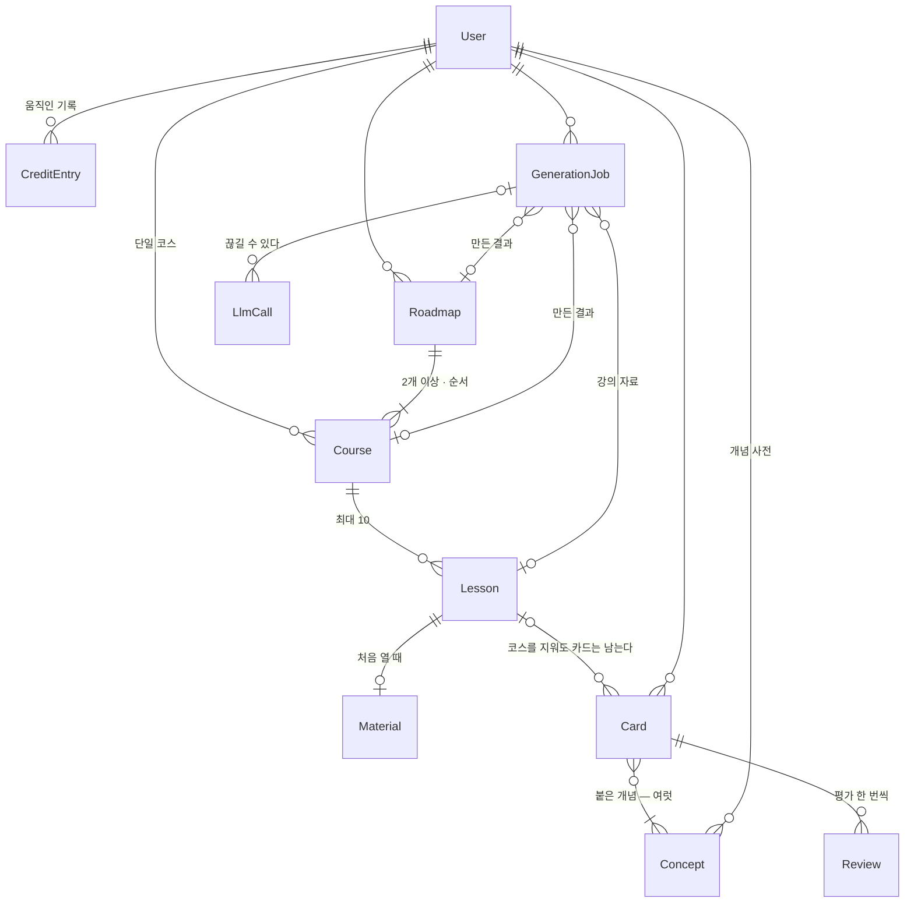

# 02. 도메인 · 데이터

> 무엇을 단위로 담고, 단위끼리 어떻게 이어지며, 어떤 상태를 갖는가 — 학습 · 복습 규칙 · 숙련도 · 개념 · 지우기 범위까지.
> 이름은 [GLOSSARY](./GLOSSARY.md), 만드는 작업의 수명은 [04 §4](./04-jobs-and-cost.md#4-만드는-작업), 생성에 넣는 재료는 [03](./03-generation.md).
> **테이블까지 미리 정한다**(ADR-152) — 테이블 · 칸 · 타입 · 키 · 제약 · 주요 색인 · 상태 값은 §8. 길이 상한도 §8.1 에서 정했다(ADR-158). 쿼리는 TASK 에서 정한다. 마이그레이션은 Flyway 다 — 운영에 적용한 마이그레이션은 고치지 않는다(ADR-148).

---

## 1. 단위와 관계

| 단위 | 코드 | 테이블 | 속하는 곳 | 상태 |
|---|---|---|---|---|
| 사용자 | `User` | `users` | — | 신청 · 승인 · 거절됨(ADR-056 · ADR-058) |
| 크레딧 | — | `users` 의 칸(ADR-153) | 사용자 | — |
| 크레딧 기록 | `CreditEntry` | `credit_entries` | 사용자 | — |
| 로드맵 | `Roadmap` | `roadmaps` | 사용자 | 검토 중 · 진행 중 · 다 마침(ADR-136 · ADR-176) |
| 코스 | `Course` | `courses` | 사용자 · 로드맵의 코스면 로드맵에도 | 짜기 전(로드맵의 코스만) · 검토 중 · 학습 중 · 다 마침(ADR-136) |
| 강의 | `Lesson` | `lessons` | 코스 — 최대 10(ADR-024) | — |
| 강의 자료 | `Material` | `materials` | 강의 — 0~1(ADR-011) | — |
| 카드 | `Card` | `cards` · `card_concepts` | 사용자 · 강의(코스를 지우면 강의와는 끊긴다) | 쓰는 중 · 코스 지워짐(ADR-165). FSRS 의 상태(`fsrs_state`)는 따로 |
| 복습 | `Review` | `reviews` | 카드 | — |
| 개념 | `Concept` | `concepts` | 사용자 — 개념 사전(ADR-029) | — |
| 만드는 작업 | `GenerationJob` | `generation_jobs` | 사용자 | 기다림 · 만드는 중 · 성공 · 실패([04 §4.2](./04-jobs-and-cost.md#42-상태)) |
| 호출 기록 | `LlmCall` | `llm_calls` | 만드는 작업 — 끊길 수 있다(ADR-139) | — |

- 무엇을 담는지는 §8 의 테이블마다 있다. 상태의 코드 값은 [§8.7](#87-값-목록).
- 숙련도(`Mastery`)는 담지 않는다 — 쓸 때마다 카드로 계산한다(§5).
- 워커(`Worker`)는 담는 단위가 아니다 — 서버 안에서 작업을 꺼내 만드는 일꾼이다(ADR-103).
- 새로 배우기는 화면 이름이고 단위가 아니다 — 받은 입력은 만드는 작업에 담긴다(ADR-141).
- 로드맵 계획의 칸을 따로 담는 단위는 없다 — 계획의 칸이 곧 코스다(ADR-132). 「단계」를 두지 않는다(ADR-070).
- 사용자에는 대기자 · 약관 동의 · 역할을 두지 않는다(ADR-147).

## 2. 결과와 상태

### 2.1 결과는 만들기가 성공할 때 생긴다

**코스 · 로드맵 · 강의 목록 · 강의 자료는 만들기가 성공할 때 생긴다. 그 전에는 만드는 작업에만 입력과 상태가 있다**(ADR-130).

- 빈 코스를 미리 만들지 않는다. 실패하거나 버리면(ADR-086) 치울 결과가 없어 작업만 지운다.
- 만드는 중이거나 실패한 것은 작업으로만 보인다. 결과가 생기면 작업이 그 결과를 가리킨다(ADR-134).
- 다시 짜기는 새로 짠 목록 · 계획을 성공할 때 이전 것과 바꾼다. 그 전까지 결과에는 이전 것만 있다(ADR-085).
- 강의 자료와 카드는 성공할 때 그 강의에 붙는다.

### 2.2 로드맵의 코스 — 계획이 성공할 때 「짜기 전」으로 만든다

**로드맵 계획이 성공하면 로드맵과 함께 그 코스들을 모두 만든다. 계획에서 코스마다 정한 제목 · 한두 줄 설명 · 다룰 개념이 그 코스에 붙고, 강의 목록은 차례가 오면 채운다**(ADR-132).

- 계획을 검토할 때 고친 코스 제목(ADR-009)이 곧 코스의 제목이다.
- 첫 코스는 계획에서 「이대로 시작」하면(ADR-079), 그 뒤 코스는 「다음 코스 만들기」를 누르면(ADR-018) 강의 목록을 짠다. 성공하면 그 코스가 검토 중이 된다.
- 실패를 버리면 그 코스는 짜기 전으로 남고, 「다음 코스 만들기」가 다시 보인다.
- 로드맵 계획을 다시 짜면(검토 중에만 — ADR-009) 짜기 전 코스들을 통째로 바꾼다 — 그때는 강의 목록이 있는 코스가 없다.
- 짜기 전 코스는 코스 탭에 보이지 않고 로드맵 화면에서만 본다(ADR-072).

### 2.3 코스 · 로드맵의 상태 — 담아 두고, 바뀌는 동작에서 함께 고친다

**코스와 로드맵은 상태를 하나씩 담고, 상태가 바뀌는 동작에서 함께 고친다. 상태는 앞으로만 간다**(ADR-136).

| 바뀌는 것 | 언제 |
|---|---|
| 처음 — 단일 코스 · 로드맵은 검토 중, 로드맵의 코스는 짜기 전 | 만들기가 성공해 생길 때(ADR-130 · ADR-132) |
| 코스 짜기 전 → 검토 중(로드맵의 코스만) | 그 코스의 강의 목록 만들기가 성공할 때 |
| 코스 검토 중 → 학습 중 | 「이대로 시작」(ADR-007) |
| 로드맵 검토 중 → 진행 중 | 「이대로 시작」 — 첫 코스의 작업을 받을 때(ADR-009 · ADR-143) |
| 코스 학습 중 → 다 마침 | 마지막 강의를 학습 완료할 때(ADR-101) — 다 마친 때(`completed_at`)도 함께 적는다(ADR-169) |
| 로드맵 진행 중 → 다 마침 | 마지막 순서의 코스가 다 마침이 될 때 — 같은 트랜잭션에서(ADR-176). 마지막인지는 더 뒤 순서의 코스가 있는지로 본다 |

- 앞으로만 가는 이유 — 시작한 뒤에는 다시 짜지 않고(ADR-007), 학습 완료는 되돌리지 않는다(ADR-012).
- 이 상태를 읽는 곳 — 코스 탭(ADR-072) · 로드맵 탭 · 로드맵 화면 · 홈의 할 일 · 이어서 배우기(ADR-075) · 「다음 코스 만들기」 조건(ADR-018).
- 만드는 중인지는 상태가 아니라 작업으로 본다(ADR-130).
- 「다 마침」은 강의들의 학습 완료(로드맵은 코스들의 다 마침)와, 「검토 중」은 강의 목록이 있는지와 같은 사실을 두 곳에 담는다 — 바뀌는 동작에서 함께 고친다.

### 2.4 입력 — 성공할 때 결과에 옮겨 담는다

**만들 때 넣은 입력(주제 · 지금 수준 · 목적 · 메모 — ADR-004)은 만들기가 성공할 때 결과에 옮겨 담는다 — 단일 코스는 코스에, 로드맵은 로드맵에**(ADR-137).

- 로드맵의 코스는 입력을 따로 담지 않고 로드맵의 것을 쓴다(ADR-046).
- 뒤에 만드는 것 — 강의 자료 · 다시 짜기 · 다음 코스 — 은 결과에서 입력을 읽는다. 작업에 있던 입력은 작업과 함께 그대로 남는다(ADR-134).
- 입력은 만든 뒤 바꾸지 않는다(ADR-041) — 작업과 결과 두 곳에 있어도 어긋나지 않는다.
- 다시 짜기의 피드백(ADR-037)은 그 작업에만 둔다 — 그 다시 짜기에만 쓴다(ADR-040).

## 3. 학습과 복습

- **강의는 순서대로만 연다**(ADR-019) — 앞 강의를 학습 완료해야 다음 강의가 열린다. 이미 아는 강의도 열고 학습 완료를 눌러 넘어간다 — 그래서 강의 자료를 만들 때 앞 강의는 언제나 모두 학습 완료돼 있다.
- **강의 자료와 카드는 강의를 처음 열 때 함께 만든다**(ADR-011 · ADR-013).
- **학습 완료는 사용자가 누를 때다**(ADR-012) — 다 읽고도 누르지 않으면 마치지 않은 강의다. **되돌리지 않는다** — 카드 공개 · 다음 강의 열림 · 다음 코스 조건이 모두 한 방향이다. 학습 완료한 강의는 언제든 다시 연다.
- **학습 완료 전 카드는 숨긴다**(ADR-014) — 보이지 않고 복습 대상도 아니다. 학습 완료할 때 그 강의의 카드에 다음 볼 때를 채워 드러낸다(ADR-155 — §8.4).
- **학습 완료를 누르면 그 강의의 카드가 오늘 복습할 카드에 들어간다**(ADR-014) — 그 자리에서 첫 복습으로 이어지지 않는다(ADR-080).
- **마지막 강의를 학습 완료하면 코스가 다 마침이 된다**(ADR-101).
- **로드맵의 다음 코스는 앞 코스의 모든 강의를 학습 완료하면 만들 수 있다**(ADR-018) — 카드 복습은 조건이 아니다. 사용자가 눌러서 만든다 — 저절로 만들지 않는다.
- **오늘 복습할 카드** — FSRS 가 정한 다음 볼 때가 된 카드. 학습 완료 전 · 지운 카드는 빠진다. 코스로 거를 수 있다 — 거르면 그 코스의 강의에 달린 카드만이고, 일정은 그대로다(ADR-172).
    - 날 단위로 도는 카드(복습 중)는 다음 볼 날이 오늘이면 들어간다. 하루는 한국 시간 새벽 4시에 바뀐다 — 새벽 1시의 복습은 그날 밤의 복습이다(ADR-017).
    - **같은 날 다시 본다**(ADR-164) — 처음 배우는 카드와 「다시」를 누른 카드는 분 단위 학습 단계를 돈다(Anki 기본값 — 처음 배울 때 1분 · 10분, 다시 배울 때 10분). 다음 볼 때가 지나면 들어가고, 볼 카드가 이것만 남으면 20분 안에 돌아올 것은 앞당겨 보인다(Anki 기본값). 예: 「다시」를 누른 카드는 10분 뒤에, 다른 카드를 다 봤으면 바로 다시 나온다.
    - 학습 단계를 마친 카드는 날 단위로 넘어간다.
- **복습은 스스로 평가한다**(ADR-015) — 질문 → 떠올리기 → 답 → 4단계(다시 · 어려움 · 좋음 · 쉬움). 등급이 FSRS 에 그대로 들어가 다음 볼 날을 정한다. 카드 형식은 질문형 하나다(ADR-005).
- **틀린 카드는 사용자가 지운다**(ADR-065) — 복습에 들어간 카드의 답이 틀렸거나 질문이 모호하면 지운다. 지운 카드는 복습에 나오지 않고 숙련도에서도 뺀다.
- **스트릭은 채운 날의 연속 일수다**(ADR-016) — 하루(새벽 4시 경계)에 복습을 1장 이상 하거나 강의를 하나 이상 학습 완료한 날이 채운 날이다. 오늘을 아직 채우지 않았으면 어제까지 이어진 수이고, 어제도 채우지 않았으면 0일이다.
    - **저장하지 않고 계산한다**(ADR-178) — 복습 기록이 생긴 때(`reviews.created_at`)와 강의를 학습 완료한 때(`lessons.completed_at`)에서 센다. 테이블 · 칸이 없다.
    - 지우면 줄 수 있다 — 코스를 지우면 그 강의들의 학습 완료한 때가, 카드를 지우면 그 복습 기록이 사라진다. 코스를 지워도 카드 · 복습 기록은 남는다(ADR-165).

## 4. 카드

**카드는 한 테이블에 담는다 — 질문 · 답, 붙은 개념(ADR-033), 복습 기록(ADR-015), 지금의 FSRS 상태가 모두 카드에 있다. 코스를 지우면 카드를 지우지 않고 상태만 「코스 지워짐」으로 바꾼다**(ADR-165).

| | 코스를 지우면(ADR-026) | 사용자가 카드를 지우면(ADR-065) | 탈퇴하면 |
|---|---|---|---|
| 카드 — 질문 · 답 · FSRS 상태 | 남긴다 — 상태만 바꿔 숨긴다 | 지운다 — 숙련도에서도 빠진다(ADR-155) | 지운다 |
| 붙은 개념 · 복습 기록 | 남긴다 | 지운다 | 지운다 |

- 카드는 강의 자료와 함께 만든다(ADR-119). 주인은 사용자다 — 코스를 지워도 누구의 카드인지 남는다.
- 지운 코스의 카드는 복습 · 화면 어디에도 나오지 않고, 숙련도 계산에만 쓰인다(§5).
- 카드 하나에 개념이 여러 개 붙을 수 있다 — 비교 · 연결 카드(ADR-033). 평가는 카드 한 장에 한 번이고, 붙은 개념 모두의 숙련도에 반영된다.

## 5. 숙련도 — 저장하지 않고 계산한다

- **숙련도는 개념 단위로 매긴다**(ADR-028) — 코스가 달라도 같은 개념이면 이어진다.
- **카드로 계산한다 — 지운 코스의 카드도 함께 센다**(ADR-165) — 상태와 상관없이 같은 길이다.
- **계산하는 시각을 기준으로 FSRS 공식으로 계산한다 — 지운 코스의 카드도 같은 무게다**(ADR-054). 더 복습하지 않는 개념은 시간이 지나면 저절로 흐려진다.
- **개념의 숙련도는 그 개념 카드들의 상태를 평균해 모은다**(ADR-034) — 떠올릴 확률과 기억의 단단함. 충분히 여러 번 복습했고 단단한 개념만 「잘 앎」이다 — 복습 직후에는 누구나 떠올릴 확률이 거의 100% 이기 때문이다.
- **서버가 개념마다 판정해 지시로 넘긴다**(ADR-031) — LLM 에 숫자를 넘기지 않는다. 같은 복습 기록이면 언제나 같은 판정이다.

| 판정 | 하는 일 |
|---|---|
| 잘 앎 | 짧게 다룬다 |
| 흔들림 | 자세히 다룬다 |
| 기록 없음 | 자세히 다룬다 — 처음 배우는 것으로 본다 |

**계산**(ADR-162) — 처음 값이고 쓰면서 고친다.

- 센다 — 개념에 붙은 카드(코스 지워짐 포함) 가운데 복습 기록이 하나라도 있는 것. 학습 완료만 하고 아직 복습하지 않은 카드는 세지 않는다.
- 카드마다 — 지금 떠올릴 확률은 FSRS 라이브러리의 계산을 그대로 쓰고, 단단함은 `stability`(일)다. 서버(Java)에서 계산한다.
- 개념마다 — 센 카드가 없으면 기록 없음. 떠올릴 확률의 평균이 **0.9 이상**이고 단단함의 평균이 **21일 이상**이면 잘 앎. 나머지는 흔들림.
- 0.9 는 FSRS 가 다음 볼 날을 잡는 목표 확률이다 — 예정대로 복습해 왔으면 넘는다. 단단함 21일은 보통 첫날 학습 단계를 마친 뒤 다른 날 「좋음」을 두 번 더 눌러야(3주쯤) 닿는다 — 「충분히 여러 번」을 횟수 대신 단단함으로 본다.

- 어떤 개념도 판정으로 빼지 않는다 — 얼마나 자세히 다룰지만 바꾼다. 판정을 생성에 쓰는 곳은 [03 §2 · §3](./03-generation.md#2-강의-목록--로드맵-계획).

## 6. 개념

- **개념 사전은 사용자마다 따로 둔다**(ADR-029) — 같은 개념인지도 그 사람의 사전 안에서만 판정한다. 다른 사람의 생성이 내 사전을 바꾸지 않는다.
- **개념은 카드가 생길 때 사전에 들어간다**(ADR-048) — 강의를 처음 열어 강의 자료와 카드를 만들 때 같은 개념 판정을 거친다. 로드맵 계획 · 강의 목록을 짤 때는 사전을 읽기만 한다(관련 개념 찾기 — ADR-032). 다시 짜기로 빠진 개념 · 열지 않은 강의 · 아직 만들지 않은 코스의 개념은 사전에 들어오지 않는다.
- **강의 · 로드맵 코스의 「다룰 개념」은 이름과 한 줄 정의의 글로만 담는다 — 사전과 잇지 않는다**(ADR-138). 사전과 이어지는 것은 카드뿐이다. 「이 강의가 사전의 어떤 개념을 다뤘나」는 그 강의의 카드를 거쳐 안다. 목록의 개념과 카드의 개념이 이름이 달라도 서버는 맞춰 보지 않는다.
- **같은 개념인지는 한 줄 정의의 의미(임베딩)로 판정한다**(ADR-030) — 이름이 달라도 같은 개념을 찾고(「격리 수준」 · 「트랜잭션 격리 수준」), 이름이 같아도 정의가 다르면 가른다. 정의는 LLM 이 목록 · 계획을 짤 때 개념 이름과 함께 만든다.
- **가장 가까운 개념 하나가 기준값을 넘으면 같다**(ADR-161) — 정의의 임베딩이 그 사용자의 사전에서 가장 가까운 개념과 코사인 유사도가 기준값 이상이면 그 개념에 붙이고, 아니면 새 개념으로 넣는다. 애매할 때 LLM 에게 다시 묻지 않는다. 기준값은 임베딩 모델을 고른 뒤 실제 개념 쌍으로 재서 정한다.
- **한 번 들어간 개념은 카드가 모두 사라져도 지우지 않는다**(ADR-049) — 같은 개념이 다시 나오면 그 개념에 붙는다. 사전은 탈퇴할 때만 지운다.
- **판정이 틀려도 바로잡는 방법은 두지 않는다**(ADR-050) — 기준을 잘 맞추는 것으로 대신한다.

## 7. 지우기 · 탈퇴 — 함께 사라지는 범위

**지우기 · 탈퇴 때 사라지는 것과 남는 것**(ADR-140).

| | 코스를 지울 때(ADR-026 · ADR-100) | 로드맵을 지울 때(ADR-027) | 탈퇴할 때(ADR-059) |
|---|---|---|---|
| 코스 · 강의 · 강의 자료 · 숙련도 반영 내역 | 그 코스의 것을 지운다 | 모든 코스(짜기 전 코스까지)의 것을 지운다 | 모두 지운다 |
| 입력(ADR-137) | 단일 코스면 코스와 함께 지운다 | 로드맵과 함께 지운다 | 모두 지운다 |
| 만드는 작업(ADR-134) | 그 코스의 것을 지운다 | 그 로드맵과 코스의 것을 지운다 | 모두 지운다 |
| 카드 — 질문 · 답 · 붙은 개념 · 복습 기록(ADR-165) | 남기고 숨긴다 — 상태만 바꾼다 | 남기고 숨긴다 | 지운다 |
| 개념 사전(ADR-049) | 남긴다 | 남긴다 | 지운다 |
| 크레딧 · 크레딧 기록(ADR-131) | 남긴다 | 남긴다 | 지운다 |
| 호출 기록(ADR-139) | 작업과의 연결만 끊는다 | 작업과의 연결만 끊는다 | 작업 · 사람과의 연결을 끊고 남긴다 |

- 지울 때 그 결과의 작업은 상태와 상관없이 함께 지운다. 만드는 중이던 워커는 결과를 저장할 때 자기 작업이 없어 쓰지 않고(ADR-126), 성공하지 않은 작업에 쓴 크레딧은 복구한다(ADR-112 · ADR-166). 이미 나간 호출의 비용은 운영자가 낸다.
- 로드맵의 코스 하나만 지우지는 않는다(ADR-027). 검토 중인 단일 코스도 지울 수 있다(ADR-100).
- 실패를 버리면(ADR-086) 그 작업만 지운다 — 결과가 없다(ADR-130).
- 탈퇴하면 정말 아무것도 남지 않는다 — 탈퇴한 계정을 기억해 두지 않는다(ADR-084).
- 스트릭은 따로 담지 않아 지울 것이 없다 — 지운 강의 · 카드의 기록만큼 줄 수 있다(§3 · ADR-178).
- **새로 만드는 단위가 사용자 것이면 이 표에 넣는다.**

## 8. 테이블

PostgreSQL 기준이다(ADR-152). 한 장으로 보는 그림은 [ERD](./ERD.md) — 이 절을 고치면 ERD 도 같은 변경에서 고친다. `users` 를 고치고 `credit_entries` 를 만드는 것은 계정 TASK 의 마이그레이션이다(ADR-147 · ADR-173) — 신청할 때 채움 기록이 생기기 때문이다. 그때는 가리킬 `generation_jobs` 가 없어 `credit_entries.job_id` 를 빼고 만들고, `generation_jobs` 를 만드는 마이그레이션이 그 칸과 연결을 더한다(사용자 확인 2026-11-08). 배우는 것 · 기억 · 개념의 테이블(§8.3 · §8.4 — 여덟 개)은 배우는 단위 모델 TASK(`5-learning-model`)가 새 마이그레이션 하나로 옛 커리큘럼 테이블(`curriculum_groups` · `curriculum_steps` · `curriculums` · `lessons`)을 지우고 만든다(ADR-148). `generation_jobs` 와 `credit_entries.job_id` 는 만드는 작업 TASK 가, `llm_calls` 는 강의 목록 TASK 가 그 테이블을 쓰는 코드와 함께 만든다(사용자 확인 2026-11-10). 로그인 세션 테이블(`SPRING_SESSION` · `SPRING_SESSION_ATTRIBUTES`)은 그대로다.

### 8.1 공통 규칙

- **키** — `id bigserial PRIMARY KEY`. 예외는 `card_concepts`(두 칸이 키).
- **시각** — 모든 테이블에 `created_at` · `updated_at`(`timestamptz NOT NULL`). 기존 코드처럼 엔티티 공통 상위 클래스가 채운다.
- **글** — `text`. 빈 글은 `CHECK (칸 ~ '[^[:space:]]')` 로 막는다.
- **길이 상한은 사용자가 쓰는 칸에만 둔다**(ADR-158) — `CHECK (char_length(칸) <= N)` 으로 막고 API 도 같은 값으로 검사한다.

| 칸 | 상한(글자) |
|---|---|
| `topic` · `title`(코스 · 로드맵) | 100 |
| `level_other` · `purpose_other` | 50 |
| `memo` · `feedback` | 500 |

- LLM 이 만든 글(강의 제목 · 설명 · 개념 · 로드맵 설명 · 강의 자료 · 카드)에는 상한을 두지 않는다 — 출력 제한(ADR-119)이 묶는다. 코스 · 로드맵 제목은 LLM 이 만들 때도 100자를 넘으면 형식 검사 불합격이다. 구글이 준 `email` · `name` 에도 두지 않는다.
- **값 목록** — `text` + `CHECK (칸 IN (…))`. 칸마다 값과 뜻은 [§8.7](#87-값-목록).
- **제약 이름** — 기존 마이그레이션처럼 `{테이블}_{칸}_{key|check|not_blank|idx}`.
- **지울 때**(ADR-156) — 연결(FK)은 기본 동작(`NO ACTION`)으로 두고 자식부터 지운다. **지워도 남기는 쪽이 지워지는 쪽을 가리키는 연결만** `ON DELETE SET NULL` 이다 — `cards.lesson_id` · `credit_entries.job_id` · `llm_calls.job_id` · `llm_calls.user_id`.
- **입력 칸 묶음** — `roadmaps` · `courses` · `generation_jobs` 가 같은 칸을 쓴다(ADR-137).

| 칸 | 타입 | 뜻 |
|---|---|---|
| `topic` | text | 주제 |
| `level` | text | 지금 수준 — 값은 §8.7 |
| `level_other` | text | `level = 'OTHER'` 일 때만 있다 |
| `purpose` | text | 목적 — 값은 §8.7 |
| `purpose_other` | text | `purpose = 'OTHER'` 일 때만 있다 |
| `memo` | text | 메모 — 없을 수 있다 |

### 8.2 계정 · 크레딧

**`users`** — 신청한 사람부터 있다. 신청 전에는 행을 만들지 않고, 구글 신원을 로그인 세션에만 잠시 둔다(ADR-154).

| 칸 | 타입 | 빈 값 | 뜻 |
|---|---|---|---|
| `provider` · `subject` | text | 아니오 | 로그인 수단과 그 안의 계정 ID — `UNIQUE (provider, subject)`. 기존 칸 그대로 |
| `email` · `name` | text | 아니오 | 구글 이메일 · 이름(ADR-062) — `name` 은 새로 더한다. 구글이 이름을 주지 않으면 이메일의 `@` 앞부분을 쓴다(`test123@gmail.com` → `test123` · 사용자 확인 2026-11-08) |
| `status` | text | 아니오 | 계정 상태 — 값은 §8.7 |
| `approved_at` | timestamptz | `APPROVED` 일 때만 있다 | 승인한 때 — 다음에 채우는 때는 `credit_refill_at` 이 담는다(ADR-175) |
| `credit_balance` | integer | 아니오 | 지금 쓸 수 있는 크레딧 — 신청할 때 한 달 몫으로 채운다(ADR-173). `CHECK (credit_balance >= 0)` |
| `credit_refill_at` | timestamptz | `APPROVED` 일 때만 있다 | 다음에 채우는 때 — 승인 SQL 이 「승인한 날(하루의 경계 — ADR-017) + 30일 새벽 4시」로 넣고, 채울 때마다 30일 뒤로 옮긴다(ADR-110 · ADR-175). `CHECK ((status = 'APPROVED') = (credit_refill_at IS NOT NULL))` |

- 지우는 칸 — `role` · `terms_agreed_at` · `terms_version`(ADR-147). 옛 `ACTIVE` 는 `APPROVED` 로 옮기고, 한 달 몫을 채움 기록과 함께 채우고 `credit_refill_at` 을 넣는다(운영자뿐이다). 옛 `PENDING` · `WAITLISTED` 가 있으면 `APPLIED` 로 옮기고 한 달 몫을 채움 기록과 함께 채운다. 옮기는 행의 `name` 은 이메일의 `@` 앞부분이고, 한 달 몫은 그때의 임시 값(100)을 마이그레이션에 숫자로 쓴다(사용자 확인 2026-11-08).
- `created_at` 이 신청한 때다. 거절을 풀면 `APPLIED` 로 돌린다(ADR-058).
- **첫 크레딧은 신청할 때 넣는다**(ADR-173) — 행을 만들 때 한 달 몫을 채우고 채움 기록을 남긴다. 승인 전에는 만들기를 받지 않아 쓰지 못한다. 운영자의 승인 SQL 은 `status` · `approved_at` · `credit_refill_at` 을 바꾼다 — 다음에 채우는 때를 빠뜨리면 `CHECK` 가 막는다(ADR-175).
- **그 뒤 채우기는 서버가 매일 새벽 4시에 한다**(ADR-110 · ADR-173 · [04 §8](./04-jobs-and-cost.md#8-서버가-정해진-때-하는-일)) — `credit_refill_at` 이 지난 승인된 사람을 한 달 몫으로 다시 맞추고 `credit_refill_at` 을 30일 뒤로 옮긴다. 채움 기록이 곧 주기의 경계다.
- **크레딧은 계정 패키지(`account`)가 다룬다** — 채움 · 씀 · 복구 모두 `users` 행을 잠그고 바꾼다. 다른 패키지는 계정 서비스를 부른다.

**`credit_entries`** — 크레딧이 움직인 한 번(ADR-131).

| 칸 | 타입 | 빈 값 | 뜻 |
|---|---|---|---|
| `user_id` | bigint → `users` | 아니오 | |
| `type` | text | 아니오 | 채움 · 씀 · 복구 — 값은 §8.7(ADR-166) |
| `amount` | integer | 아니오 | `credit_balance` 가 바뀐 만큼 — 채움은 한 달 몫으로 다시 맞춘 만큼, 씀은 −(받을 때 · 다시 시도할 때), 복구는 +(실패 · 버리기 · 지우기) |
| `job_id` | bigint → `generation_jobs` `ON DELETE SET NULL` | 예 | 씀 · 복구의 작업 — `generation_jobs` 를 만드는 마이그레이션이 더한다(§8 머리말) |

- **`users.credit_balance` 는 그 사용자 `amount` 의 합과 늘 같다 — 어긋나면 기록이 맞다**(ADR-153). 둘은 같은 트랜잭션에서 바꾼다.
- **성공은 기록하지 않는다** — 쓴 채로 두면 쓴 것이다. 확정됐는지는 작업의 상태로, 성공한 때는 작업의 `finished_at` 으로 안다(ADR-166).
- **복구는 성공하지 않은 작업이고, 그 작업의 마지막 기록이 그 사람의 마지막 채움 기록 뒤의 씀일 때만 한다**(ADR-166 · ADR-175) — 성공한 작업의 결과를 지울 때 돌려주지 않고, 한 작업을 두 번 복구하지 않으며(실패한 뒤 버리기), 지난 주기에 쓴 몫은 채움이 이미 한 달 몫으로 메웠으므로 돌려주지 않는다.
- 색인 — `(user_id, created_at)`.

### 8.3 배우는 것

**`roadmaps`**

| 칸 | 타입 | 빈 값 | 뜻 |
|---|---|---|---|
| `user_id` | bigint → `users` | 아니오 | |
| `title` | text | 아니오 | 로드맵 제목 — 계획과 함께 만든다 |
| `description` | text | 아니오 | 로드맵 설명 한 단락 — 이 로드맵을 마치면 무엇을 할 수 있게 되나. 계획과 함께 만들고 다시 짜면 바뀐다(ADR-167) |
| `status` | text | 아니오 | 값은 §8.7 |
| 입력 칸 묶음 | | `memo` 만 예 | 성공할 때 작업에서 옮겨 담는다(ADR-137) |

- 색인 — `user_id`.

**`courses`**

| 칸 | 타입 | 빈 값 | 뜻 |
|---|---|---|---|
| `user_id` | bigint → `users` | 아니오 | 로드맵의 코스도 채운다 — 목록 · 주인 확인 |
| `roadmap_id` | bigint → `roadmaps` | 단일 코스면 비어 있다 | |
| `position` | integer | 단일 코스면 비어 있다 | 로드맵 안의 순서(1부터) — `UNIQUE (roadmap_id, position)` · `CHECK (position >= 1)`(사용자 확인 2026-11-10) |
| `title` | text | 아니오 | 고칠 수 있다(ADR-007 · ADR-009) |
| `status` | text | 아니오 | 값은 §8.7 — `NOT_PLANNED` 는 로드맵의 코스만 |
| 입력 칸 묶음 | | 로드맵의 코스면 모두 비어 있다 | 단일 코스만(ADR-137) |
| `plan_description` | text | 단일 코스면 비어 있다 | 로드맵 계획의 한두 줄 설명(ADR-132) |
| `plan_concepts` | jsonb | 단일 코스면 비어 있다 | 계획의 다룰 개념 — `[{name, definition}]`(ADR-138) |
| `mastery_report` | jsonb | 강의 목록 전에는 비어 있다 | 숙련도 반영 내역 — 짧게 다룬 개념 · 다시 짚은 개념의 이름 목록(ADR-121) |
| `started_at` | timestamptz | 시작 전에는 비어 있다 | 「이대로 시작」한 때 — 이어서 배우기(ADR-099). `LEARNING` · `COMPLETED` 일 때만 차도록 `CHECK` 로 묶는다(사용자 확인 2026-11-10) |
| `last_lesson_opened_at` | timestamptz | 예 | 이 코스의 강의를 마지막으로 연 때 — 이어서 배우기(ADR-099) |
| `completed_at` | timestamptz | 다 마침 전에는 비어 있다 | 다 마친 때 — 마지막 강의를 학습 완료할 때 상태와 함께 적는다(ADR-169). `COMPLETED` 일 때만 차도록 `CHECK` 로 묶는다 |

- 단일 코스인지(`roadmap_id` 가 비었나)에 따라 위 칸이 함께 차거나 비도록 `CHECK` 로 묶는다.
- 색인 — `user_id`.

**`lessons`**

| 칸 | 타입 | 빈 값 | 뜻 |
|---|---|---|---|
| `course_id` | bigint → `courses` | 아니오 | |
| `position` | integer | 아니오 | 1~10 — `UNIQUE (course_id, position)` · `CHECK (position BETWEEN 1 AND 10)` |
| `title` · `description` | text | 아니오 | 제목 · 한 줄 설명(ADR-020) |
| `concepts` | jsonb | 아니오 | 다룰 개념 — `[{name, definition}]`. 개념 사전과 잇지 않는다(ADR-138) |
| `completed_at` | timestamptz | 학습 완료 전이면 비어 있다 | 학습 완료한 때(ADR-012) |

**`materials`** — `lesson_id`(→ `lessons`, `UNIQUE`) · `body`(text — 마크다운 본문 · [03 §3](./03-generation.md#3-강의-자료와-카드)).

**`cards`** — 복습 상태까지 담아 §8.4 에 둔다(ADR-165).

### 8.4 기억 · 개념

**`cards`** — 카드 하나. 질문 · 답과 지금의 FSRS 상태를 함께 담는다(ADR-155 · ADR-165).

| 칸 | 타입 | 빈 값 | 뜻 |
|---|---|---|---|
| `user_id` | bigint → `users` | 아니오 | 주인 — 코스를 지워도 남는다 |
| `lesson_id` | bigint → `lessons` `ON DELETE SET NULL` | 코스를 지우면 비어 있다 | |
| `position` | integer | 아니오 | 강의 안의 순서 — `UNIQUE (lesson_id, position)` |
| `question` · `answer` | text | 아니오 | 질문 · 답 — 코스를 지워도 남는다 |
| `status` | text | 아니오 | 값은 §8.7 — `CHECK (status = 'COURSE_DELETED' OR lesson_id IS NOT NULL)` |
| `due_at` | timestamptz | 학습 완료 전이면 비어 있다 | 다음 볼 때 — 학습 완료할 때 채워 오늘 복습에 들어간다(ADR-014) |
| `fsrs_state` | text | 아니오 | FSRS 의 상태 — 값은 §8.7(ADR-164). 만들 때 `LEARNING` |
| `fsrs_step` | integer | `REVIEW` 면 비어 있다 | 학습 단계의 몇 번째인지(0부터) — FSRS. 만들 때 0 |
| `stability` | double precision | 복습 전이면 비어 있다 | 기억의 단단함(일) — FSRS |
| `difficulty` | double precision | 복습 전이면 비어 있다 | 어려움 — FSRS |
| `last_reviewed_at` | timestamptz | 복습 전이면 비어 있다 | 마지막으로 평가한 때 |

- **FSRS 라이브러리는 `io.github.open-spaced-repetition:fsrs` 를 쓰고, 학습 단계는 라이브러리 기본값(Anki 기본과 같다)으로 둔다**(ADR-159 · ADR-164) — `fsrs_state` · `fsrs_step` · `stability` · `difficulty` · `due_at` · `last_reviewed_at` 이 라이브러리 카드의 칸과 하나씩 맞는다. `status` 와 헷갈리지 않게 `fsrs_` 를 붙인다. 복습 횟수 칸은 두지 않는다 — 필요하면 `reviews` 를 센다.
- `CHECK ((fsrs_state = 'REVIEW') = (fsrs_step IS NULL))`.
- **코스를 지울 때** — 그 강의들의 카드를 `COURSE_DELETED` 로 바꾼 뒤 강의를 지운다. `lesson_id` 는 저절로 빈다. 상태를 바꾸지 않고 강의를 지우면 `CHECK` 에 걸려 지우기가 실패한다 — 상태를 빠뜨릴 수 없다.

- 색인 — `(user_id, due_at)` · `lesson_id`. 오늘 복습할 카드는 `ACTIVE` 인 것 가운데 §3 의 규칙을 따른다 — `REVIEW` 는 `due_at` 이 하루의 경계(ADR-017) 안, 학습 단계(`LEARNING` · `RELEARNING`)는 `due_at` 이 지금까지(볼 카드가 이것만 남으면 20분 뒤까지).

**`card_concepts`** — `card_id`(→ `cards`) · `concept_id`(→ `concepts`). 키는 두 칸. 색인 — `concept_id`.

**`reviews`** — `card_id`(→ `cards`) · `rating`(text — 값은 §8.7). 평가한 때는 `created_at`. 색인 — `card_id`.

**`concepts`** — 사용자의 개념 사전(ADR-029).

| 칸 | 타입 | 빈 값 | 뜻 |
|---|---|---|---|
| `user_id` | bigint → `users` | 아니오 | |
| `name` · `definition` | text | 아니오 | 이름 · 한 줄 정의(ADR-030) — 이름은 겹칠 수 있다 |
| `embedding` | vector — 차원을 고정하지 않는다 | 아니오 | 정의의 임베딩(ADR-160) |

- 색인 — `user_id`. 임베딩의 근사 검색 색인은 두지 않는다 — 같은 개념을 찾을 때 그 사용자의 개념을 모두 비교한다(ADR-160). 임베딩 모델을 바꾸면 모든 개념을 다시 임베딩한다.

### 8.5 만들기 · 호출

**`generation_jobs`** — 만드는 작업(ADR-134).

| 칸 | 타입 | 빈 값 | 뜻 |
|---|---|---|---|
| `user_id` | bigint → `users` | 아니오 | |
| `type` | text | 아니오 | 아래 표 |
| `status` | text | 아니오 | 값은 §8.7 |
| 입력 칸 묶음 | | `NEW_*` 가 아니면 모두 비어 있다 | 새로 배우기의 입력(ADR-137) |
| `feedback` | text | `REPLAN_*` 가 아니면 비어 있다 | 다시 짜기 피드백(ADR-037) |
| `course_id` · `roadmap_id` · `lesson_id` | bigint → 각 테이블 | 아래 표 — 많아야 하나만 찬다 | 대상이자 결과(ADR-130 · ADR-177) |
| `claim_count` | integer | 아니오(0) | 꺼낼 때마다 1 늘린다 — 결과를 저장할 때 같은지 확인한다(ADR-126) |
| `lease_until` | timestamptz | `RUNNING` 일 때만 있다 | 시한(ADR-126) |
| `error_type` | text | `FAILED` 일 때만 있다 | 실패한 까닭 — 값은 §8.7(ADR-163) |
| `started_at` · `finished_at` | timestamptz | 예 | 마지막 시도를 꺼낸 때 · 끝난 때 — 운영자가 걸린 시간을 본다 |

`type` 의 값 — 무슨 만들기이고, 대상 · 결과를 어느 칸에 담나(테이블이 아니라 위 `type` 칸의 값 목록이다):

| `type` | 만들기 | 대상 · 결과 칸 |
|---|---|---|
| `NEW_COURSE` | 새로 배우기 — 코스 | 성공하면 `course_id` |
| `NEW_ROADMAP` | 새로 배우기 — 로드맵 | 성공하면 `roadmap_id` |
| `PLAN_ROADMAP_COURSE` | 로드맵의 첫 코스 · 다음 코스의 강의 목록 | `course_id`(짜기 전 코스) |
| `REPLAN_COURSE` | 다시 짜기 — 코스 | `course_id` |
| `REPLAN_ROADMAP` | 다시 짜기 — 로드맵 계획 | `roadmap_id` |
| `MATERIAL` | 강의 자료 + 카드 | `lesson_id` |

- **대상 칸은 `CHECK` 둘로 묶는다**(ADR-177) — `num_nonnulls(course_id, roadmap_id, lesson_id) <= 1` · `type` 마다 위 표의 칸만 찬다. 대상이 있는 만들기(`PLAN_ROADMAP_COURSE` · `REPLAN_*` · `MATERIAL`)는 그 칸이 늘 차 있고, 새로 배우기(`NEW_*`)는 `SUCCEEDED` 일 때만 찬다.
- 화면에 보이는 오류 묶음([05 §1.2](./05-api.md#12-오류--묶음-이름과-서버가-정한-문구))은 서버가 `error_type` 로 고른다 — `INPUT_TOO_LARGE` 는 입력 문제, 나머지는 일시적(ADR-163).
- 받은 순서는 `created_at` 이다(ADR-128). 색인 — `(status, created_at)` 꺼내기 · `(user_id, status)` 한 사람이 건 수 · 홈.
- **같은 대상에 같은 만들기가 둘 생기지 않게 한다**(ADR-157) — `MATERIAL` 은 `lesson_id` 마다 하나, `PLAN_ROADMAP_COURSE` 는 `course_id` 마다 하나, `REPLAN_*` 는 대상마다 성공하지 않은 것 하나. 막는 방법(고유 색인 · 잠금)은 TASK 에서 정한다(§9).

**`llm_calls`** — 호출 기록(ADR-139). 원문은 담지 않는다.

| 칸 | 타입 | 빈 값 | 뜻 |
|---|---|---|---|
| `job_id` | bigint → `generation_jobs` `ON DELETE SET NULL` | 예 | 지우면 끊긴다 |
| `user_id` | bigint → `users` `ON DELETE SET NULL` | 예 | 탈퇴하면 끊긴다 |
| `job_type` | text | 아니오 | 무슨 만들기였나 — `generation_jobs.type` 과 같은 값. 끊겨도 남는다 |
| `call_type` | text | 아니오 | 값은 §8.7 |
| `model` | text | 아니오 | |
| `input_tokens` · `output_tokens` | integer | 예 | 프로바이더가 사용량을 주지 않으면 비어 있다 |
| `cost` | numeric | 예 | 같다 |
| `duration_ms` | integer | 예 | 끝나기 전에는 비어 있다 |
| `outcome` | text | 끝나기 전에는 비어 있다 | 호출 결과 — 값은 §8.7(ADR-163 · [04 §4.6](./04-jobs-and-cost.md#46-실패--다시-시도)) |

- 색인 — `created_at`(한 달 합계) · `job_id`.

### 8.6 지우는 순서

§7 의 범위를 자식부터 지운다. `ON DELETE SET NULL` 연결은 저절로 끊긴다.

- **코스** — 그 코스 · 강의를 대상으로 한 `generation_jobs` → `cards` 의 상태를 `COURSE_DELETED` 로(지우지 않는다 — `lesson_id` 는 강의를 지울 때 저절로 빈다) → `materials` → `lessons` → `courses`. 성공하지 않은 작업에 쓴 크레딧은 작업을 지우기 전에 복구한다(§8.2 의 조건).
- **로드맵** — 로드맵과 그 코스들의 `generation_jobs` → 코스마다 위 순서 → `roadmaps`.
- **탈퇴** — `generation_jobs` → `reviews` → `card_concepts` → `cards` → `materials` → `lessons` → `courses` → `roadmaps` → `concepts` → `credit_entries` → 로그인 세션 → `users`.
- **사용자가 카드를 지울 때**(ADR-155) — `reviews` → `card_concepts` → `cards`.
- **운영자가 신청 중 · 거절됨인 계정을 지울 때**(ADR-059) — `credit_entries` → 로그인 세션 → `users`. 신청할 때 채움 기록이 생긴다(ADR-173).

### 8.7 값 목록

값이 정해진 칸은 모두 `text` + `CHECK (칸 IN (…))` 다(§8.1). API 도 이 코드 이름을 그대로 쓴다([05](./05-api.md)). 이름은 [GLOSSARY](./GLOSSARY.md) 를 따른다.

**`users.status`** — 계정 상태(ADR-056 · ADR-058)

| 값 | 이름 | 뜻 |
|---|---|---|
| `APPLIED` | 신청 | 신청하고 승인을 기다린다 — 거절을 풀어도 여기로 돌아온다 |
| `APPROVED` | 승인 | 운영자가 승인했다 — 머금을 쓴다 |
| `REJECTED` | 거절됨 | 운영자가 거절했다 — 스스로 다시 신청하지 못한다 |

**`credit_entries.type`** — 크레딧이 움직인 까닭(ADR-166)

| 값 | 이름 | 언제 |
|---|---|---|
| `REFILL` | 채움 | 신청할 때 · 다음에 채우는 때(`credit_refill_at`)가 지났을 때 — 한 달 몫으로 다시 맞춘다 |
| `CONSUME` | 씀 | 만들기를 받을 때 · 다시 시도할 때(−) |
| `RESTORE` | 복구 | 성공하지 않은 작업이 실패 · 버리기 · 지우기로 끝날 때(+) — 조건은 §8.2 |

**`roadmaps.status`** — 로드맵 상태(ADR-136 · ADR-176 · 바뀌는 때는 §2.3)

| 값 | 이름 | 뜻 |
|---|---|---|
| `REVIEWING` | 검토 중 | 로드맵 계획이 나왔다 — 이대로 시작 · 다시 짜기 · 계획의 코스 제목 고치기 |
| `IN_PROGRESS` | 진행 중 | 「이대로 시작」 — 첫 코스의 작업을 받았다 |
| `COMPLETED` | 다 마침 | 마지막 코스를 다 마쳤다 |

**`courses.status`** — 코스 상태(ADR-132 · ADR-136 · 바뀌는 때는 §2.3)

| 값 | 이름 | 뜻 |
|---|---|---|
| `NOT_PLANNED` | 짜기 전 | 로드맵의 코스만 — 강의 목록이 아직 없다. 코스 탭에 보이지 않는다 |
| `REVIEWING` | 검토 중 | 강의 목록이 나왔다 — 강의는 아직 열 수 없다 |
| `LEARNING` | 학습 중 | 「이대로 시작」했다 |
| `COMPLETED` | 다 마침 | 모든 강의를 학습 완료했다 — `completed_at` 이 찬다 |

**`level`** — 지금 수준(입력 칸 묶음 · ADR-004). 목록에 미치는 영향은 [03 §1.2](./03-generation.md#12-입력--새로-배우기)

| 값 | 화면 |
|---|---|
| `BEGINNER` | 처음 배워요 |
| `BASICS` | 기초는 알아요 |
| `FAMILIAR` | 익숙해요 |
| `OTHER` | 기타 — `level_other` 에 적은 글 |

**`purpose`** — 목적(입력 칸 묶음 · ADR-004). 강의 · 카드에 미치는 영향은 [03 §1.2](./03-generation.md#12-입력--새로-배우기)

| 값 | 화면 |
|---|---|
| `WORK` | 업무에 쓰려고요 |
| `INTERVIEW` | 면접 준비 |
| `GENERAL` | 교양 · 관심 |
| `OTHER` | 기타 — `purpose_other` 에 적은 글 |

**`cards.status`** — 카드 상태(ADR-165)

| 값 | 이름 | 뜻 |
|---|---|---|
| `ACTIVE` | 쓰는 중 | 강의에 달려 있다 — 학습 완료 뒤(`due_at` 이 차면) 복습에 나온다 |
| `COURSE_DELETED` | 코스 지워짐 | 코스를 지웠다 — 복습 · 화면에 나오지 않고 숙련도 계산에만 쓴다. `lesson_id` 가 비어 있다 |

**`cards.fsrs_state`** — FSRS 의 상태(ADR-159 · ADR-164 · 규칙은 §3)

| 값 | 이름 | 뜻 |
|---|---|---|
| `LEARNING` | 처음 배우는 중 | 만들 때의 값 — 분 단위 학습 단계(1분 · 10분)를 돈다 |
| `REVIEW` | 복습 중 | 날 단위로 돈다 — `fsrs_step` 이 비어 있다 |
| `RELEARNING` | 다시 배우는 중 | 복습 중에 「다시」를 눌렀다 — 10분 학습 단계를 돈 뒤 복습 중으로 |

**`reviews.rating`** — 스스로 평가(ADR-015). FSRS 의 등급에 그대로 들어간다

| 값 | 화면 |
|---|---|
| `AGAIN` | 다시 |
| `HARD` | 어려움 |
| `GOOD` | 좋음 |
| `EASY` | 쉬움 |

**`generation_jobs.status`** — 작업 상태([04 §4.2](./04-jobs-and-cost.md#42-상태))

| 값 | 이름 | 언제 |
|---|---|---|
| `QUEUED` | 기다림 | 받았을 때 · 실패를 다시 시도할 때 · 정상적으로 끄는 서버가 돌려놓을 때 |
| `RUNNING` | 만드는 중 | 워커가 집었을 때 — `lease_until` 이 찬다 |
| `SUCCEEDED` | 성공 | 결과가 생겼을 때 — 결과를 가리킨다 |
| `FAILED` | 실패 | 자동 다시 시도로도 안 됐을 때 — `error_type` 이 찬다 |

**`generation_jobs.type` · `llm_calls.job_type`** — 만들기 종류. 값과 대상 칸은 §8.5 의 표.

**`generation_jobs.error_type`** — 실패한 까닭(ADR-163)

| 값 | 뜻 | 화면의 묶음([05 §1.2](./05-api.md#12-오류--묶음-이름과-서버가-정한-문구)) |
|---|---|---|
| `PROVIDER_UNAVAILABLE` | 연결 오류 · 시간 초과 · 몰림이 자동 다시 시도 뒤에도 이어졌다 | 일시적 — 다시 시도 · 버리기 |
| `INVALID_OUTPUT` | 형식 검사 불합격이 이어졌다 · 이어 써도 끝나지 않았다 | 일시적 |
| `PROVIDER_REJECTED` | 키 · 쿼터 같은 설정 문제 | 일시적 |
| `INPUT_TOO_LARGE` | 입력이 너무 크다 | 입력 문제 — 버리기만(ADR-174) |

**`llm_calls.call_type`** — 호출 종류(ADR-139)

| 값 | 뜻 |
|---|---|
| `CHAT` | 한 시도의 생성 호출 |
| `CONTINUATION` | 잘린 출력을 이어 받는 호출(ADR-127) |
| `EMBEDDING` | 임베딩 — 관련 개념 검색 · 같은 개념 판정(ADR-030 · ADR-032) |

**`llm_calls.outcome`** — 호출 한 번의 결과(ADR-163). 끝나기 전에는 비어 있다

| 값 | 뜻 |
|---|---|
| `SUCCEEDED` | 성공 |
| `TRUNCATED` | 출력이 잘렸다 — 이어 쓴다 |
| `INVALID_OUTPUT` | 형식 검사 불합격 |
| `TIMEOUT` | 시간 초과 |
| `RATE_LIMITED` | 몰림(429) |
| `PROVIDER_ERROR` | 프로바이더 · 연결 오류 |
| `REJECTED` | 키 · 쿼터 같은, 다시 해도 같은 거절 |

## 9. 아직 정하지 않은 값

| 것 | 근거 |
|---|---|
| 같은 개념 판정의 기준값 — 임베딩 모델을 고른 뒤 실제 개념 쌍으로 잰다 | ADR-030 · ADR-161 |
| 같은 대상에 같은 만들기가 둘 생기지 않게 막는 방법 — 고유 색인 · 잠근 뒤 확인 등. 서버가 여러 대여도 막아야 한다 | ADR-157 · ADR-133 |
