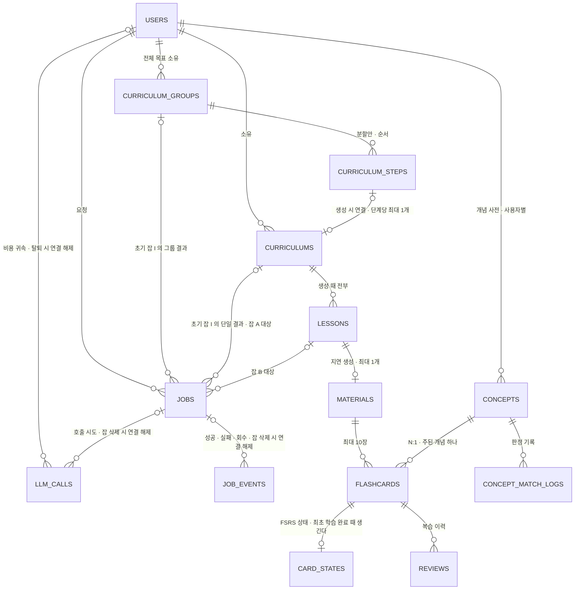
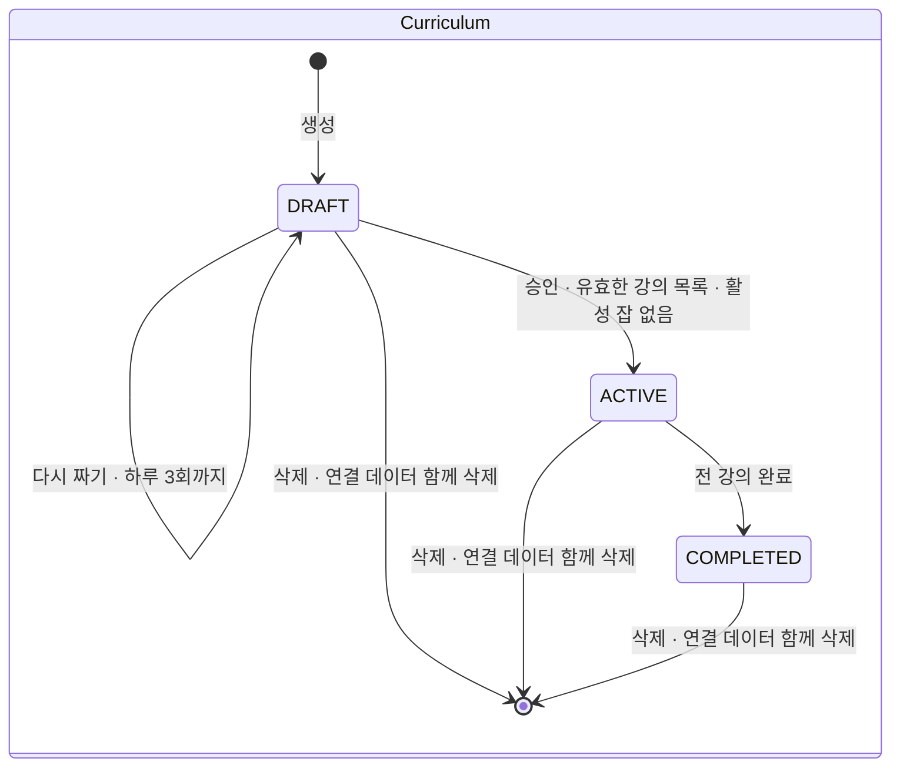
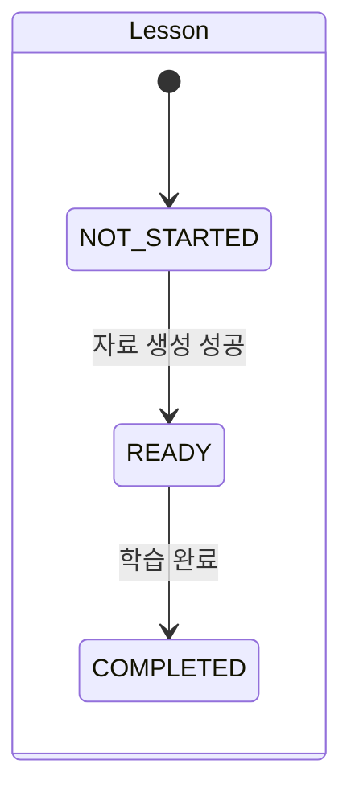
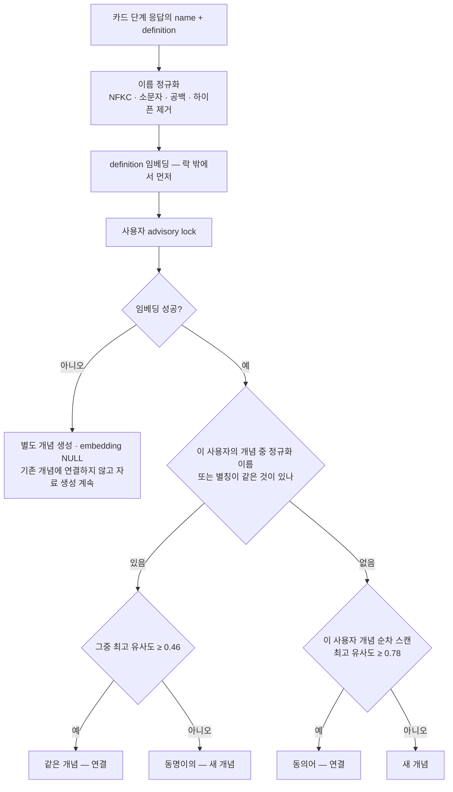

# 02. 도메인 · 데이터

> 엔티티 · 상태 · 숙련도 · 개념 동일성 · 테이블 · 핵심 쿼리. 이름은 [01 §12](./01-overview.md). `jobs` 테이블은 [04 §4](./04-jobs-and-cost.md).
> 마이그레이션은 **Flyway**(버전드 SQL) — `SKIP LOCKED` · 부분 인덱스 · `vector` 같은 Postgres 문법을 그대로 쓴다.

---

## 1. ERD



**없는 것이 설계다.**

| 없는 것 | 왜 |
|---|---|
| `mastery` 테이블 | 시간의 함수라 저장하면 바로 낡는다 — §4 |
| `material_concepts` 조인 | 자료의 개념은 `SELECT DISTINCT concept_id FROM flashcards WHERE material_id=?` 로 나온다 |
| 전역 개념 사전 | 숙련도는 사용자 × 개념이라 다른 사용자의 개념에 연결할 이유가 없다. 전역이면 다른 사용자가 먼저 붙인 이름 때문에 조회가 빗나가고, 쓰기 스캔 · 락 · 병합 · 탈퇴 범위가 서비스 전체로 커진다 — §5.2 |
| `Lesson.GENERATING` · `Curriculum.GENERATING` · 미완성 `Material` | **"생성 중 · 실패"는 잡으로 판단한다.** 두 곳에서 관리하면 잡은 실패했는데 강의는 생성 중에 멈춰 있는 사고가 난다 |
| 일일 비용 합계 테이블(`daily_usage`) | 원장 `llm_calls` 의 합일 뿐이다. 저장하면 원장과 두 곳이 되어 같은 트랜잭션 · 중복 합산 방지 · 락 순서 · 날짜 보정 같은 맞추는 장치가 붙는다. **조회 때 원장에서 더한다** — §6.6 |

## 2. 상태





잡 상태는 [04 §4](./04-jobs-and-cost.md).

- **승인은 `DRAFT` 이고 활성 생성 잡(`QUEUED` / `RUNNING`)이 없으며, 검증을 통과해 저장된 강의 목록이 있을 때만** 가능하다. 그룹 단계의 상세 생성이 최초에 실패해 강의가 0개면 `409 CURRICULUM_NOT_READY` 다(초기 잡 I 가 실패하면 커리큘럼 자체가 없다). 다시 짜기가 실패해도 이전에 성공한 목록이 남아 있으면 승인할 수 있다 — 최근 잡의 성공 여부만으로 승인 가능 여부를 판단하지 않는다.
- 승인 · 다시 짜기 적재 · 커리큘럼 잡 재시도 · 생성 결과 저장은 같은 커리큘럼의 advisory lock으로 직렬화하고, 잠금 안에서 상태와 활성 잡을 다시 확인한다. 승인 이후에는 이전 커리큘럼 잡을 재시도할 수 없고, 생성 결과도 `DRAFT` 에만 저장한다([04 §4.4 · §4.6](./04-jobs-and-cost.md)).
- **그만두기 대신 완전 삭제를 제공한다.** `DRAFT` / `ACTIVE` / `COMPLETED` 모두 삭제할 수 있고 별도 보관 상태를 두지 않는다. 커리큘럼 · 강의 · 자료 · 플래시카드 · 해당 카드의 상태/복습 이력 · 해당 자료의 개념 판정 기록을 함께 지운다. 삭제된 카드는 오늘의 복습과 이후 숙련도 집계에서 제외되며, 다른 커리큘럼의 카드 · 기록은 유지한다.
- **생성 중에도 삭제할 수 있다.** 대기 · 실행 중을 포함한 연결 잡을 먼저 삭제해 워커의 실행 권한을 없앤다. 이미 전송한 외부 요청 자체를 취소했다고 보장하지 않으며, 늦게 온 생성 결과는 버리되 사용량은 기록한다. 삭제 트랜잭션 · 잠금 순서는 §6.2를 따른다.
- 삭제 확인에 **「이 커리큘럼과 강의 자료, 학습 기록, 관련 플래시카드가 모두 삭제돼요. 삭제한 플래시카드의 학습 기록은 앞으로의 맞춤 학습에 반영되지 않아요. 삭제하면 되돌릴 수 없어요.」**를 표시한 뒤 사용자가 `삭제하기` 를 눌러야 실행한다([06 §2.7](./06-screens.md)).

### 2.1 넓은 주제의 분할안 — 순차 생성 계약

- 주제/목적이 하나의 일관된 목표인지, 독립적인 여러 목표와 선행 단계로 나눌지 **LLM이 판단**한다([03 §2.1](./03-generation.md)). 단일이면 기존 커리큘럼, 그룹이면 묶음/단계 모델로 결과를 보관하며, 사용자가 검토 후 생성/학습을 진행한다. 서버는 판단 결과의 구조/제약을 검증하고 의미 분할을 대신 판단하지 않는다. 첫 생성 호출에서 유형과 결과를 함께 받고, 입력은 초기 잡에 먼저 보존한 뒤 성공 시 해당 커리큘럼/그룹을 만든다([04 §4.2](./04-jobs-and-cost.md))
- 전체 목표와 각 단계의 제목 · 범위 · 생성용 주제/목적 · 선행 관계/순서를 서버에 보존한다. 단순 브라우저 상태나 완료 화면에서 다시 추측한 주제로 다음 단계를 만들지 않는다. 분할안은 상세 강의가 있는 `Curriculum`과 구분하며, 미생성 단계에는 강의/자료/카드를 만들지 않는다
- 최초에는 1단계만 생성한다. 같은 분할안의 다음 단계 생성 가능 여부는 직전 커리큘럼의 `COMPLETED`로 판단하며, 남은 복습 카드 수나 `R/S` 조건을 더하지 않는다. 독립적인 다른 주제의 커리큘럼 생성은 기존대로 가능하고, 단계 안의 강의 순서도 자유다
- 다음 단계 생성 요청에서 소유권 · 직전 단계 완료 · 대상 단계의 기존 커리큘럼/활성 잡을 서버에서 다시 확인한다. 같은 분할안/단계에 동시 요청이 와도 새 커리큘럼/잡은 하나이며, 기존 것이 있으면 그 결과로 연결한다. 실패/새로고침으로 연결을 잃거나 같은 단계를 새로 생성하지 않는다
- 다음 단계는 사용자 요청 시점의 관련 숙련도를 새로 선별한다. 분할안 작성 당시나 이전 단계의 스냅숏을 현재 숙련도로 재사용하지 않는다. 같은 생성 잡의 실패 재개는 기존 체크포인트 규칙을 따른다
- **모델 확정** — `CurriculumGroup` → `CurriculumStep` → 필요할 때 생성하는 `Curriculum`으로 분리한다(§6.2.1). 독립 커리큘럼은 단계 연결 없이 생성할 수 있다. 이미 생성된 단계별 커리큘럼은 기존 승인 · 학습 완료 · 완전 삭제 계약을 따른다. 단계 커리큘럼을 지우면 그 단계는 미생성으로 돌아가 위의 생성 조건(1단계이거나 직전 단계 `COMPLETED`)으로 다시 만든다. 묶음 전체 삭제는 §6.2.1. 생성/조회 API · 분할안 출력/호출 예산은 후속 확정 항목이다

## 3. 학습 완료와 카드 상태

**`card_states` 는 최초 학습 완료 트랜잭션에서 한 번만 만든다** — `fsrs_state='NEW'` · `next_review_at=now()` · `version=0`. 학습 완료를 재요청해도 기존 상태를 초기화하거나 복습 이력을 추가하지 않는다.

| 다른 시점이면 | 생기는 일 |
|---|---|
| 첫 복습 때 만들면 | 첫 복습을 건너뛴 카드는 상태가 없어 **영원히 복습에 안 뜬다** — 루프가 끊긴다 |
| 자료 생성 때 만들면 | 아직 읽지 않은 강의의 카드가 오늘의 복습에 섞인다 |

학습 완료 응답에 그 강의의 아직 첫 평가를 하지 않은 카드를 담아 **즉시 첫 복습**으로 이끈다. 사용자가 건너뛰어도 카드는 이미 오늘의 복습에 있다.

**학습 완료의 중복 처리** — `POST /lessons/{id}/complete` 는 강의 ID를 기준으로 같은 완료를 한 번만 반영한다. 별도 요청 ID나 최초 응답 저장 컬럼을 추가하지 않는다.

1. 같은 커리큘럼의 advisory transaction lock을 얻고, 소유권 · 커리큘럼/강의 존재 · 강의 상태를 다시 읽는다. 삭제되었거나 남의 것이면 `404` 다. 생성 완료/삭제와 같은 잠금을 쓰며 트랜잭션 안에서만 유지한다.
2. 강의가 이미 `COMPLETED` 면 **`200` 으로 응답하고 쓰지 않는다.** 커리큘럼 전체가 `COMPLETED` 가 된 뒤의 재요청도 성공이다. FSRS 상태 · 복습 횟수/버전 · 다음 복습일 · 복습 이력 · 강의/커리큘럼 진도를 변경하지 않는다. 누락 상태를 재생성하거나 기존 상태를 upsert로 초기화하지 않는다.
3. 최초 완료는 `Curriculum.ACTIVE` 와 `Lesson.READY` 및 저장된 자료를 확인한다. 커리큘럼 상태가 맞지 않으면 `409 CURRICULUM_NOT_ACTIVE`, 강의가 준비되지 않았으면 `409 LESSON_NOT_READY`. 강의를 `COMPLETED` 로 바꾸고 카드별 `card_states` 를 최초 삽입한다. 삽입 충돌/오류는 트랜잭션 전체를 롤백하며 기존 행을 덮어쓰지 않는다.
4. 같은 트랜잭션에서 전 강의 완료 여부를 확인해 모두 완료됐으면 커리큘럼도 `COMPLETED` 로 바꾼다. 서로 다른 마지막 강의들의 동시 완료도 커리큘럼 잠금으로 직렬화해 전환을 놓치지 않는다.
5. 최초/중복 요청 모두 `lessonStatus=COMPLETED` 와 **현재 그 강의의 `review_count=0` 카드만** `reviewCards` 로 반환한다. 현재 `cardVersion` 을 담고 첫 평가를 이미 한 카드를 다시 첫 복습으로 제공하지 않는다. 모델/FSRS를 재실행하지 않고 상태를 읽는다. 남은 첫 복습 카드가 없으면 빈 배열이다.

완료 반영의 중복 방지가 목적이며 응답 본문을 최초 시점으로 고정하지 않는다. 응답 유실 뒤에도 다시 요청할 수 있고, 그 사이 첫 평가가 있었다면 반환 목록은 줄어들 수 있다. 응답 뒤 다른 탭의 평가와 경합하면 기존 카드 버전 검증으로 처리한다([05 §3.2 · §6](./05-api.md)).

## 4. 숙련도 — 저장하지 않는다

FSRS 의 인출확률 `R` 은 **마지막 복습 이후 경과 시간과 `S` 의 함수**라 아무 일 없어도 시간이 지나면 떨어진다. 저장하면 즉시 낡는다.
그래서 **`card_states` 만 저장하고, 숙련도는 조회 때 계산**한다. 카드 수백 장을 계산해도 1ms 미만이다.

| | 담당 |
|---|---|
| 복습 때 `D` · `S` · 다음 복습일 갱신(**쓰기**) | FSRS 라이브러리 `io.github.open-spaced-repetition:fsrs:1.0.0` · 기본 파라미터 · **학습 · 재학습 단계를 비운다** |
| `R` 조회 · 집계(**읽기**) | SQL (§8.3) |
| 설명 깊이 · 커리큘럼 반영 판정 | 백엔드의 공통 순수 함수 `MasteryPolicy` — 잡 A · B가 같은 규칙을 쓴다 |

**단기 학습 단계(1분 · 10분)를 쓰지 않는다.** 복습은 *"하루 한 번 · 자투리 시간"* 모델이라 몇 분 뒤 다시 보는 단계가 세션 구조와 맞지 않는다(세션은 목록을 한 번 받는다).
단계를 비우면 카드는 처음부터 복습 상태로 들어가고 간격은 `S` 로 정해진다 — **일 단위 · 최소 1일**. `AGAIN` 은 결과적으로 대개 1일 뒤다.
- **간격을 직접 덮어쓰지 않는다**(*"AGAIN 은 무조건 1일"* 같은 규칙 금지) — 라이브러리의 `S` 와 실제 간격이 어긋나 숙련도 판정(`S ≥ 1일 · 7일`)과 `R` 일치 테스트의 전제가 틀어진다.
- **확인(2026-10-12)** — `1.0.0` 은 `learningSteps` · `relearningSteps` 에 빈 `Duration[]` 을 지원한다. 기본 파라미터에서 새 카드의 네 평가와 복습 카드의 `AGAIN` 모두 다음 복습 간격이 최소 1일임을 학습 테스트로 확인했다.

> ⚠️ `R` 공식이 두 곳(라이브러리 · SQL)에 있다 → **일치 테스트**: 같은 `(S, 정수 경과일)` 에서 둘의 `R` 이 같은지(라이브러리는 경과일을 정수로 자르고 SQL 은 실제 경과 시간을 쓴다 — §8.3). 라이브러리를 올려 상수가 바뀌면 이 테스트가 깨진다. 상수(`factor` · `decay`)는 채택 버전에 맞추고 **테스트가 단일 출처**다.

**숙련도 = 개념 카드들의 `R` 평균 + `S` 평균 + 가장 적게 복습한 카드의 복습 횟수(`minReviewCount`).** 집계 대상은 해당 사용자가 학습 완료해 `card_states` 가 생긴 카드다. `R` · `S` 평균은 복습한 카드만으로 계산하지만, **`minReviewCount` 는 미복습(`0회`)까지 포함한 모든 대상 카드**에서 구한다.
**`R` 하나로 판정하지 않는다** — 복습 직후엔 누구나 `R ≈ 1` 이다. 그리고 첫 평가 `EASY` 의 초기 `S` 가 약 16일이라 `S` 하한만으로는 *방금 배운 개념* 을 못 거른다.

| 판정 | 조건 | 강의 자료(잡 B ①) | 커리큘럼(잡 A) |
|---|---|---|---|
| 충분히 안다 | `R ≥ 0.9` ∧ `S ≥ 7일` ∧ `minReviewCount ≥ 2` | `SKIP` — 생략 · 한 줄 | `EXCLUDED` — 그 개념만의 강의는 안 만든다 |
| 어느 정도 안다 | `R ≥ 0.6` ∧ `S ≥ 1일` (위 제외) | `BRIEF` — 간단 복기 | `COMPRESSED` — 분량을 줄인다 |
| 흐릿함 · 굳지 않음 | 그 외 | `DETAIL` — 상세 | `EXPANDED` — 늘리거나 나눈다 |
| 대상 카드는 있으나 전부 미복습 | `R = null` · `S = null` · `minReviewCount = 0` | `DETAIL` | `EXPANDED` |
| 카드 없음(미학습) | `matched = false` | `DETAIL` | `EXPANDED` |

- 판정은 **백엔드 `MasteryPolicy` 가 계산**한다. 카드 없음 · 전부 미복습이면 `DETAIL` / `EXPANDED`, 그 외에는 충분히 안다 → 어느 정도 안다 → 나머지 순으로 위 조건을 적용한다. 화면 · 프롬프트용으로 반올림하기 전 수치로 비교한다. LLM 은 전달받은 판정에 맞춰 개념 선택 · 설명 순서 · 내용을 구성한다.
- 잡 A에는 `curriculumAction`, 잡 B의 툴 응답에는 `decision` 을 수치 근거와 함께 전달한다. 백엔드는 모델 출력의 판정을 신뢰하지 않고 주입 · 조회한 개념별 결과로 검증하거나 채운다([03 §2 · §3](./03-generation.md)).
- **세 가지 "모름"을 구분한다** — 카드 없음 · 미복습(`R = null`) · 복습했지만 흐릿함. 섞이면 개인화가 엉뚱해진다.
- **생략은 모든 대상 카드를 최소 2회 복습한 뒤에만 허용한다.** 복습 횟수가 `3회 · 0회` 또는 `3회 · 1회`라면 평균 `R` · `S` 가 높아도 `SKIP` · `EXCLUDED` 는 금지한다. `BRIEF` · `COMPRESSED` 는 기존 `R` · `S` 조건으로 판단한다. 이미 아는 개념도 새 강의를 학습 완료해 미복습 카드가 추가되면 다시 생략되지 않을 수 있다. 다만 `SKIP` 으로 다룬 강의에서는 그 개념의 카드를 만들지 않으므로([03 §5](./03-generation.md)), 미복습 카드가 추가되는 것은 그 개념을 `BRIEF` · `DETAIL` 로 다룬 강의뿐이다 — 생략이 그 강의 자신의 카드 때문에 풀리지 않는다. 생성만 하고 학습 완료하지 않은 카드는 이 집계에 들어오지 않는다.
- 🅿️ `S` 하한 7일 · 1일은 잠정값 — 실사용 판정 기록으로 조정한다.

## 5. 개념 — 읽기와 쓰기가 다르다

| 작업 | 이름 | 어디서 | 누가 | 하는 일 |
|---|---|---|---|---|
| 읽기 — 관련 개념 선별 | `selectMasteryConcepts` → `loadUserMastery` | 커리큘럼 생성 | 백엔드(LLM 호출 전) | 주제 · 목적의 임베딩 검색과 키워드 검색으로 개념을 선별하고, 선택한 ID의 숙련도 + 백엔드 판정을 입력 예산 안에서 주입한다(§5.4) |
| 읽기 — 지정 | `lookupMastery` | 강의 자료 ① | LLM(툴) | LLM 이 이름을 지정한 개념만 조회하고 백엔드 판정을 함께 반환. **정규화 이름 일치** — 개념의 이름 또는 그 개념에 연결된 적 있는 이름(§6.4 판정 기록의 `input_name`) |
| **쓰기** | `resolveConcepts` | 강의 자료 생성 후처리 | 백엔드 | 개념을 확정 · 생성하고 같은 개념인지 판정해 카드에 잇는다. **동일 개념 판정과 연결 변경은 여기서만** |

> 읽기 경로(`lookupMastery`)는 **한 번이라도 연결된 표기**는 판정 기록으로 찾는다 — `Opportunity Cost` 로 만든 개념에 `기회비용` 카드가 연결된 적 있으면 `기회비용` 으로도 찾는다. 처음 보는 동의어는 못 잡는다 — LLM 은 이름만 넘긴다. 이 실패는 **안전한 쪽**이다(`DETAIL` 로 가서 과하게 설명할 뿐 틀리지 않는다).

### 5.1 동일성 판정 — 정의를 임베딩한다

| 틀리는 방향 | 예 | 결과 |
|---|---|---|
| 동의어가 갈라짐 | `기회비용` / `Opportunity Cost` | 숙련도가 나뉜다 — **병합하면 된다** |
| 동명이의가 합쳐짐 | `엔트로피`@열역학 / `엔트로피`@정보이론 | 숙련도가 오염된다 — **알아채기 어렵고**, 사람이 찾아 되돌려야 한다(§5.3) |

**임베딩 대상은 `definition`(한 줄 정의) 하나다.** 이름을 넣으면 같은 문자열이 같은 벡터가 되어 동명이의를 못 가르고, 이름은 정규화 비교에서 이미 쓰인다.
LLM 에게 *"같은 개념인가"* 를 묻지 않는다 — 매번 답이 달라지고 테스트할 수 없다.



| 분기 | 임계값 | 근거 |
|---|---|---|
| 이름이 같다 — 같은 개념 또는 동명이의 | **0.46** | 표기 변이는 정규화가 흡수했으니 남는 건 둘뿐. 낮게 두면 동명이의가 합쳐진다. 이름에는 그 개념에 연결 · 병합된 적 있는 이름(별칭 — 판정 기록의 `input_name`)도 포함한다 |
| 이름이 다르다 | **0.78** | 유사 개념(`명목금리`/`실질금리`)이 합쳐지는 것을 막는다 |

- 값은 실측 47쌍(같은 이름 27 · 다른 이름 20) × 모델 4개 비교에서 나왔다. `text-embedding-3-large` 만 두 분기 모두 마진이 양수(+0.009 · +0.047)였다. 라벨은 초안 — 확정 후 다시 계산한다.
- 후보가 여럿이면 **가장 가까운 하나(argmax)** 가 임계값을 넘을 때만 연결한다.
- **별칭도 이름 같음 분기로 본다** — 병합하거나 한 번 연결된 표기의 다음 카드는 0.46 기준으로 연결된다. 이게 없으면 `inflation` 을 `인플레이션` 에 병합해도 다음 `inflation` 카드가 이름 다름 분기(0.78)에서 다시 갈려 병합이 풀린다. 뜻이 다른 같은 표기(우주론의 `inflation`)는 정의 유사도가 0.46 아래라 지금처럼 갈린다. 대가 — 잘못 연결된 별칭은 이후 같은 표기의 카드도 끌어오므로 U6 경계 판정에서 보고 되돌린다.
- **같은 개념의 두 번째 표기를 막는 첫 방어선은 프롬프트의 표기 규칙**이다([03 §6](./03-generation.md)). 별칭 · 병합은 규칙을 빠져나온 경우의 뒷수습이다. 규칙이 얼마나 통하는지는 판정 기록으로 잰다 — 이름이 다른데 연결된 건수 · 임계값 바로 아래에서 갈린 건수.
- 임베딩 재시도까지 실패하면 **기존 개념에 연결하지 않고 별도 개념을 만든다**. 입력의 이름 · 정규화 이름 · 정의는 보존하고 `embedding = NULL` 로 저장한 뒤, 해당 카드를 새 개념에 연결해 **자료 생성은 계속한다**. 이름이 같은 기존 개념이 하나뿐이어도 이 규칙을 따른다 — 이름만으로 동명이의를 구별할 수 없기 때문이다.
- **예외 — 이번 강의의 `SKIP` 개념과 정규화 이름(또는 별칭)이 같은 카드는 임베딩이 실패하면 버린다**([03 §5](./03-generation.md)). 카드 단계는 `SKIP` 개념의 이름을 받고 그 개념으로는 카드를 만들지 말라는 지시를 받았으므로, 같은 강의에서 같은 이름이 나오면 거의 그 개념이다. 별도 개념으로 만들면 새 ID 라 `SKIP` 검사를 빠져나가 생략이 풀린다. 연결하는 것이 아니라 버리는 것이라 동명이의가 섞이지는 않는다 — 드물게 진짜 동명이의 카드 한 장을 잃는 것을 받아들인다.
- NULL 행은 이후 임베딩 유사도 비교에서도 제외한다. 같은 개념이 중복될 수 있음을 받아들이고, 사람이 정의를 검토한 뒤 수동 병합할 수 있다. 자동으로 임베딩을 채우거나 병합하는 배치는 두지 않는다. `concept.embedding.missing` 과 `concept_match_logs.branch = 'EMBEDDING_UNAVAILABLE'` 로 이 경로를 확인한다.

### 5.2 유일성은 테이블이 아니라 코드가 만든다

- **개념 사전은 사용자별이다**(`concepts.user_id`). 매칭 · 조회 · 병합은 모두 그 사용자의 개념 안에서만 한다. 전역으로 두면 아끼는 것은 사용자 간 중복 저장뿐인데(개념 행은 카드 하나당 최대 하나라 사용자별로 두어도 `flashcards` 행 수를 넘지 않는다), 쓰기 스캔이 모든 사용자의 개념을 읽고, 다른 사용자가 붙인 이름 때문에 `lookupMastery` 가 빗나가고, 병합 한 번이 모든 사용자의 카드를 옮기고, 탈퇴 뒤에도 사용자 주제에서 나온 이름 · 정의가 남는다.
- 동명이의를 허용하려고 **`name` · `name_normalized` 에 unique 를 걸지 않는다.** 유일성은 `resolveConcepts` **한 곳**의 규칙이다.
- 같은 사용자의 잡 두 개(진행 중 2개)가 동시에 같은 개념을 만들 수 있으므로 **사용자 advisory lock** 으로 쓰기를 직렬화한다 — 이름 단위 락으로는 `인플레이션` / `inflation` 이 동시에 들어오는 동의어 경합을 못 막는다. 다른 사용자끼리는 서로 기다리지 않는다. 락 구간은 그 사용자 개념의 스캔 + INSERT 뿐이다.
- 임베딩 실패 시 별도 개념을 만드는 경로도 같은 락과 완료 트랜잭션 안에서 쓴다. 이때의 중복은 숙련도 오염을 피하기 위해 의도적으로 허용한다.
- `embedding` 은 **차원 미지정 `vector`**, 인덱스 없음(한 사용자의 개념은 1년을 꽉 채워도 수천 행 안쪽이라 순차 스캔이 100% 정확하고 1분짜리 호출 뒤에 붙는다). `embedding_model` 이 같은 행끼리만 비교한다. 인덱스가 필요해지면 3072차원은 pgvector `vector` 인덱스 한도(2,000차원)를 넘으므로 `halfvec` 표현식 + `embedding_model` 부분 인덱스로 건다.

### 5.3 병합 · 되돌리기 — 각각 한 트랜잭션

표기 쌍이 갈리는 것을 대가로 받아들였으므로 병합 절차가 있어야 한다. 후보는 U6 의 *병합 후보* 목록(이름 다름 분기 · 임계값 −0.05 안에서 새로 만든 쌍 — 같은 사용자의 개념끼리만 나온다).
임베딩 실패로 만든 개념은 유사도가 없어 이 후보 목록에 포함되지 않는다. `EMBEDDING_UNAVAILABLE` 판정 기록과 `embedding IS NULL` 개념을 별도로 조회하고, 정의를 검토해 병합 여부를 판단한다.

```sql
BEGIN;
SELECT pg_advisory_xact_lock(hashtext('concept-write'), :u::int);   -- resolveConcepts 와 같은 사용자 락
SELECT count(*) FROM jobs WHERE user_id = :u AND status IN ('QUEUED', 'RUNNING');   -- 0 이어야 한다 — 아래 jsonb 근거
SELECT id FROM concepts WHERE id IN (:keep, :drop) AND user_id = :u;  -- 2행이어야 한다 — 둘 다 이 사용자의 개념
UPDATE flashcards         SET concept_id   = :keep WHERE concept_id   = :drop;
UPDATE concept_match_logs SET concept_id   = :keep, corrected_at = now()
 WHERE concept_id = :drop;                                            -- 지우지 않고 옮긴다 · 사람이 고친 판정
UPDATE concept_match_logs SET candidate_id = :keep WHERE candidate_id = :drop;
DELETE FROM concepts WHERE id = :drop AND user_id = :u;
COMMIT;
```

이것으로 끝나는 이유 — 복습 이력이 개념이 아니라 **카드**에 붙어 있고, 숙련도를 저장하지 않아 재계산할 것이 없다. 판정 기록은 지우지 않고 옮기므로 `:drop` 의 이름(만들 때의 `input_name`)은 `:keep` 의 별칭이 된다(§6.4) — 그 이름으로 조회되고, 그 이름의 다음 카드도 이름 같음 분기로 `:keep` 에 연결되어 병합이 풀리지 않는다(§5.1). 관리 UI 는 만들지 않는다.

개념 사전이 사용자별이라 같은 표기 쌍이 여러 사용자에게서 갈리면 사용자마다 이 SQL 을 돌린다. 표기 규칙 덕분에 드물 것으로 보고 지금은 이대로 둔다 — 쌍으로 묶은 일괄 병합 · 관리자 전역 동의어 표의 트리거는 [01 §6](./01-overview.md).

**되돌리기 — 잘못 합친 판정 하나를 새 개념으로 떼어 낸다.** 후보는 U6 의 *경계 근처 판정*(임계값 위에서 연결한 판정). 예: 정보이론 강의의 `엔트로피`(정보의 불확실성)가 열역학 `엔트로피`(#201)에 유사도 0.48 로 연결됐다.

```sql
-- 0) 트랜잭션 밖에서 확인 — 잘못된 판정과 옮길 카드
SELECT l.id, l.material_id, l.concept_id, l.input_name, l.input_definition, l.similarity
  FROM concept_match_logs l JOIN concepts c ON c.id = l.concept_id
 WHERE l.id = :logId AND l.action = 'LINKED' AND c.user_id = :u;
SELECT f.id, f.question FROM flashcards f
 WHERE f.material_id = :m AND f.concept_id = :wrong;       -- 같은 자료에 제대로 연결된 카드가 있을 수 있어 눈으로 고른다

BEGIN;
SELECT pg_advisory_xact_lock(hashtext('concept-write'), :u::int);
SELECT count(*) FROM jobs WHERE user_id = :u AND status IN ('QUEUED', 'RUNNING');   -- 0 이어야 한다
INSERT INTO concepts (user_id, name, name_normalized, definition, embedding, embedding_model)
SELECT c.user_id, l.input_name, l.input_name_normalized, l.input_definition, l.input_embedding, c.embedding_model
  FROM concept_match_logs l JOIN concepts c ON c.id = l.concept_id
 WHERE l.id = :logId AND l.action = 'LINKED' AND c.user_id = :u
RETURNING id;                                                               -- :new
UPDATE flashcards SET concept_id = :new
 WHERE id IN (:cardIds) AND material_id = :m AND concept_id = :wrong;       -- 0)에서 고른 카드만
UPDATE concept_match_logs SET concept_id = :new, corrected_at = now()
 WHERE id = :logId;                                                         -- 잘못된 별칭이 사라진다
COMMIT;
```

- **새 개념에 들어온 정의의 벡터(`input_embedding`)를 넣는다.** 벡터 없이(`NULL`) 만들면 이후 비교에서 빠져 다음 정보이론 `엔트로피` 카드가 또 #201 에 붙는다. 벡터가 있으면 이름이 같은 두 개념 중 정의가 가까운 쪽으로 갈린다.
- **판정 기록 행을 새 개념으로 옮긴다.** 다른 이름끼리 잘못 합쳐진 경우(`명목금리` → `실질금리`) 그 이름이 잘못된 개념의 별칭으로 남아 다음 카드도 끌어오기 때문이다.
- 카드는 눈으로 고른다 — 어느 카드가 어느 이름으로 들어왔는지는 카드에 남지 않는다. 확인은 트랜잭션 밖에서 해서 락을 오래 쥐지 않는다.

**jsonb 근거의 개념 ID는 고치지 않는다.** 병합 · 되돌리기로 ID 가 사라지거나 바뀌어도 그렇다.
- 완료된 근거(`materials.outline` · `materials.mastery_findings` · `curriculums.mastery_reflection` · `curriculums.mastery_selection`)는 생성 당시 스냅숏이다. 이름까지 담고 있고 화면(U3 의 반영 내역)은 jsonb 의 이름을 쓴다. 현재 숙련도 조회에도 재사용하지 않는다 — **이 근거들은 `concepts` 과 조인하지 않는다.**
- 진행 중인 잡의 `payload` 는 카드 단계의 `SKIP` 검사가 개념 ID 로 비교한다([03 §5](./03-generation.md)). 그래서 병합 · 되돌리기는 **그 사용자의 진행 중 잡이 없을 때만** 한다(위 SQL 의 확인 쿼리). 실패한 채 산출물이 남은 잡이 나중에 재시도되면 `SKIP` 검사를 한 번 빠져나갈 수 있다 — 영향이 카드 한 장이라 받아들인다.

### 5.4 커리큘럼 숙련도 선별 — 임베딩 검색 + 키워드 검색

초기 잡 I도 이 선별/백엔드 판정/스냅숏 재사용 정책을 적용한다. 아래 잡 A의 호출/입력 예산 수치는 A의 설정이며 I의 공통/유형별 출력 예산은 별도로 확정한다. 초기 단일 결과도 같은 개인화 검증을 통과해야 한다([03 §2.1](./03-generation.md)).

`selectMasteryConcepts` 는 관련 개념의 **읽기 전용 후보 선별**이다. 검색 유사도로 같은 개념이라고 판정하거나 카드 연결을 변경하지 않으며, `concept_match_logs` 에 병합 판정을 기록하지 않는다. `lookupMastery` 의 이름 조회 계약도 그대로다.

1. 후보 범위는 **해당 사용자가 학습 완료해 `card_states` 가 있는 개념**의 서로 다른 ID다. 그 사용자 사전에 있어도 생성만 하고 학습 완료하지 않은 카드의 개념은 제외한다. `R` 이 높은 순으로 먼저 500개를 자르지 않는다. 후보가 없으면 검색용 외부 호출도 하지 않는다.
2. `topic + purpose` 를 고정된 형식으로 합쳐 검색 문장으로 쓴다. 완성된 커리큘럼 · 강의 목록은 아직 없으므로 검색 입력으로 쓰지 않는다. 추가 LLM으로 키워드를 생성하지 않는다. 검색 문장을 기존 정의 임베딩과 같은 모델 · 차원으로 한 번 임베딩한다. 전송 재시도는 기존 최대 3회 규약과 작업 전체 누적 몫을 따른다([03 §8.5](./03-generation.md)).
3. 의미 검색은 후보의 `definition` 임베딩과 코사인 유사도를 비교한다. `embedding IS NULL`, 모델 · 차원 불일치는 비교에서 제외한다. 별도의 검색 관련도 임계값 이상인 후보를 유사도 내림차순 · ID 오름차순으로 정렬한다. 동일성 판정의 `0.46/0.78` 을 검색 임계값으로 재사용하지 않는다.
4. 키워드 검색은 같은 후보의 이름 · 정의에 적용한다. 쿼리와 검색 필드에 NFKC · 소문자 변환을 적용하고 쿼리를 공백/구두점으로 나눈다. 불용어 목록 · 최소 토큰 길이와 규칙은 검색 설정 버전에 둔다. 후보 이름의 쿼리 전체 문구 일치 → 이름에 일치한 서로 다른 검색어 수 → 정의에 일치한 검색어 수 → ID 순으로 정렬한다. 일치가 없는 개념은 이 목록에 넣지 않는다. 임베딩 없는 개념도 이 경로로 찾을 수 있다.
5. 두 결과를 **개념 ID 기준으로 합친다**. 각 목록의 순위는 1부터 시작하고, 없는 목록의 기여는 0으로 하여 `score = 1 / (1 + semanticRank) + 1 / (1 + keywordRank)` 로 순위를 합친다. 합산 점수 내림차순, 의미 검색 순위(없으면 마지막), ID 순으로 정렬한다. 이 합산 규칙도 버전으로 관리하고 검증한다. 같은 이름의 서로 다른 개념을 합치지 않는다.
6. 순위가 높은 후보부터 `loadUserMastery(userId, selectedConceptIds)` 로 현재 수치를 계산하고 `MasteryPolicy` 를 적용해 주입한다. 개념별 이름 · 정의 · 수치 · 판정의 **완전한 항목**을 개수 상한과 숙련도 입력 예산(항목의 UTF-8 바이트로 센다) 안에서 선택한다. 개념 설명을 중간에서 자르지 않는다. 기본 프롬프트와 합친 전체 요청도 A의 입력 상한을 검사한다([03 §8.7](./03-generation.md)).

검색 설정에는 `selectionLimit` · `semanticMinSimilarity` · 숙련도 입력 예산 · 키워드 규칙 · 순위 합산 버전 · 임베딩 모델/차원을 둔다. 값은 관련 개념 라벨이 있는 검증 자료로 정한 뒤 기동 설정에 명시하고 잡 적재 시 버전을 고정한다. **50개는 설명용 예시이며 확정값이 아니다.** 낮은 관련도로 탈락한 후보로 개수를 채우지 않는다. 검증 자료 측정은 공개 후에 한다([ADR-057](./ADR.md) · [07 §1.3](./07-testing.md)) — 그전에는 **잠정 설정 버전**을 기동 설정에 명시해 쓰고, 측정으로 확정하면 버전을 올린다. 설정 없이 코드 기본값으로 동작하지 않으며, 잠정값을 확정값이나 검증된 값으로 기록하지 않는다.

정상 임베딩 실패는 키워드 결과만으로 선별한다. 전체 전량 주입으로 되돌아가지 않고, 키워드도 없으면 주입 목록을 비운다. 리스 상실 · 사용량 기록 실패 · 호출 몫 소진 · 입력 초과는 fallback으로 삼키지 않는다. NULL 벡터를 자동으로 채우는 배치도 추가하지 않는다.

선별되지 않은 개념은 미학습이라고 단정하지 않지만, 생성에는 확인되지 않은 숙련도이므로 `EXPANDED` 를 적용한다. 검색 관련도는 `EXCLUDED/COMPRESSED` 의 근거가 아니다. 해당 개념을 실제 다룰 때만 기존 숙련도 판정을 적용한다. 선수 개념 누락 · 넓은 주제 · 동명이의 오선택은 콘텐츠 평가로 확인하며, 선별만으로 필요한 개념의 완전한 재현을 보장하지 않는다.

선별 목록 · 조회 시각 · 수치/판정 · 설정 버전 · 검색 모드(`HYBRID` / `KEYWORD_ONLY` / `EMPTY`)와 후보 건수를 `jobs.payload.masterySelection` 에 체크포인트로 저장한다. 저장 이후 같은 잡의 재시도 · 형식 수정은 이 근거를 재사용하며 검색용 임베딩을 다시 생성하지 않는다. 저장 전에 죽은 경우의 재호출은 누적 몫으로 제한된다. 별도 다시 짜기 잡은 최신 이력으로 다시 선별한다. 완료 시 `curriculums.mastery_selection` 에 옮기며, 이는 생성 당시의 근거로만 사용하고 현재 숙련도 조회에 재사용하지 않는다.

---

## 6. 테이블

### 6.1 `users`

> **2026-10-20 구현·검증 완료(ADR-066).** 회원당 로그인 수단 하나를 `users(provider, subject)`에 저장한다. V1~V5 이력은 보존하고 `V6__generalize_user_login_identity.sql`로 구글 전용 컬럼을 일반화했다. V3/V4/V5 이전과 기존 세션 보존을 포함해 전체 서버 테스트 192개가 통과했다.

| 컬럼 | 타입 | 비고 |
|---|---|---|
| `id` | `bigserial` PK | 서비스 사용자 식별자. 학습 데이터 · 비용 · 세션의 기준 |
| `provider` | `text` **NOT NULL** | 서버가 검증한 로그인 제공자. 현재 활성 값은 `google`. 빈 값 금지 |
| `subject` | `text` **NOT NULL** | 제공자가 발급한 계정 식별자. 빈 값 금지. 대소문자 변경 · 공백 보정 없이 원문 보존 |
| `email` | `text` **NOT NULL** | 가입 시 이메일 · 표시용. 재로그인으로 바꾸지 않으며 unique 제약도 두지 않는다 |
| `status` | `text` **NOT NULL** | CHECK: `PENDING`(약관 전) / `ACTIVE` / `WAITLISTED` |
| `role` | `text` **NOT NULL** | CHECK: `USER` / `ADMIN` — 신규 가입 시 관리자 이메일 목록으로 초기값을 정하고 재로그인에서는 저장된 값 유지 |
| `terms_agreed_at` · `terms_version` | `timestamptz` · `text` | 약관 버전이 바뀌면 다시 동의 |
| `created_at` | `timestamptz` **NOT NULL** | 대기 명단 순서 |

**`UNIQUE(provider, subject)`**로 외부 계정 하나당 회원 하나를 보장한다. 서로 다른 제공자의 같은 `subject`는 서로 다른 계정이다. 회원당 로그인 수단은 하나이며 별도 연결 테이블은 두지 않는다. 현재 활성 제공자는 구글 하나다. 추가 제공자의 인증 설정·응답 변환·이메일 신뢰 정책은 해당 기능에서 구현하며, 저장 모델의 제공자 구분 테스트가 실제 로그인을 활성화하는 것은 아니다. 복수 로그인 연결·해제·계정 병합은 범위 밖이다.

`User`는 `users`를 매핑한 회원 엔티티다. `provider`·`subject`는 사용자 API 응답에 넣지 않는다. 로그인 입력 `ExternalAccount(provider, subject, email, emailVerified)`로 회원을 생성하고, 조회는 `UserRepository.findByProviderAndSubject`로 한다. 세션과 학습 데이터의 기준은 계속 `users.id`다. 이메일은 로그인 키나 자동 병합 근거가 아니며 원본 프로필과 구글 접근/ID 토큰은 보관하지 않는다.

**재로그인은 계정 정보를 변경하지 않는다.** 같은 `(provider, subject)`의 회원이 있으면 기존 ID로 로그인하고 이메일·역할·상태·약관·가입 시각을 보존한다. 이번 인증 이메일과 관리자 목록은 로그인 허용 여부를 확인하는 데 사용하며 저장된 역할은 덮어쓰지 않는다. 이메일·역할 변경은 별도의 명시적 변경 절차에서 수행한다.

**세션 테이블** — `spring_session` · `spring_session_attributes`는 Flyway로 관리하며 자동 생성을 끈다. V3는 Spring Session JDBC 4.1.1의 Postgres 스키마다. `principal_name`과 세션 속성에는 `users.id`만 두며 만료 정리는 라이브러리에 맡긴다([04 §3.2](./04-jobs-and-cost.md)).

#### 6.1.1 로그인 · 가입 불변조건

1. `auth.GoogleAccountMapper`가 검증된 Google 등록과 응답을 `ExternalAccount(provider, subject, email, emailVerified)`로 변환한다. `provider`는 요청 매개변수·원본 프로필에서 믿지 않고 검증된 서버 등록으로 정한다. 현재 매퍼는 구글만 수락한다. `account`는 Spring Security 타입·OAuth 토큰·원본 응답을 알지 않는다.
2. 이메일 검증·관리자 허용 목록 검사는 DB 접근 전에 수행한다. 허용 여부는 이번 인증 이메일로 확인하며 기존 이메일을 바꾸지 않는다.
3. `LoginService`가 `UserRepository.findByProviderAndSubject`로 조회한다. 있으면 기존 ID를 반환하고 회원을 쓰지 않는다. 없으면 `User.join`으로 식별자와 신규 이메일·초기 역할·가입 시각을 한 행에 저장한다(처음 상태 `ACTIVE`는 `join` 안에 고정 — ADR-071). 이메일이 같은 기존 회원을 자동 병합하지 않는다.
4. 같은 외부 식별자의 동시 첫 로그인은 복합 unique 제약으로 회원 하나만 남긴다. 충돌 요청은 실패해도 되며 다음 로그인은 기존 회원을 찾는다. 추가 잠금·자동 재시도는 넣지 않는다.
5. 세션에는 `users.id`만 저장하고 상태·역할은 요청마다 DB에서 읽는다. 외부 식별자는 사용자 API 응답에 추가하지 않는다. 탈퇴 시 식별자도 회원 행과 함께 삭제한다.

#### 6.1.2 기존 데이터 이전

- 기존 V1~V5는 수정하지 않는다. V4에서 분리했던 연결은 V5가 회원 행으로 통합했고 V6가 구글 전용 컬럼을 일반화한다. 새 DB도 V1~V6를 순서대로 적용한다.
- V5의 회원당 구글 연결 하나 검사와 잘못된 연결의 이전 거절 계약은 유지한다. V6는 기존 `google_sub`를 `subject`로 이름 변경하고 기존 회원의 `provider`를 `google`로 채운다. provider의 이전용 기본값은 제거해 이후 생성에서 제공자를 명시하게 한다.
- 구글 전용 unique 제약은 `UNIQUE(provider, subject)`로 교체하고 각 컬럼의 NOT NULL·빈 값 금지 제약을 유지한다. 단일 마이그레이션 트랜잭션으로 적용한다.
- 회원 ID·전체 회원 정보·식별자 원문·ID 세션을 보존한다. `LoginIdentityMigrationIT`에서 V3/V4/V5부터 최신 스키마까지의 이전, 기존 세션의 실제 `/api/me`, 정보 보존 재로그인, 구글 전용 컬럼과 연결 테이블 제거를 검증한다. 지원하지 않는 V4 연결의 이전 거절·롤백도 유지한다.

### 6.2 `curriculums` · `lessons`

| `curriculums` | 비고 |
|---|---|
| `user_id` · `topic` · `purpose` | 소유자 · 입력. 기간 · 주당 학습량은 받거나 저장하지 않는다 |
| `step_id` | nullable FK → `curriculum_steps.id`, **unique**. NULL이면 독립 커리큘럼, 값이 있으면 해당 단계에서 생성한 실제 커리큘럼 |
| `title` | LLM 이 지은 제목 |
| `status` | `DRAFT` / `ACTIVE` / `COMPLETED` — 삭제는 행 제거 |
| `mastery_reflection` | `jsonb` — 초기 단일 결과 또는 잡 A의 반영 내역을 백엔드 판정과 대조해 검증한 결과 + 생성 시점 수치 근거. U3 에서 *"이미 아셔서 별도 강의로 만들지 않았어요"* 로 보인다 |
| `mastery_selection` | `jsonb` — 생성 당시 선별한 ID · 이름/정의 · 수치/판정 · 조회 시각 · 검색 순위/모드 · 후보 수 · 설정 버전 · 주입 바이트 수. 조회 근거이며 현재 숙련도 캐시가 아니다. 생성 성공 때 갱신, 실패한 다시 짜기는 이전 근거 유지 |

| `lessons` | 비고 |
|---|---|
| `curriculum_id` · `order_no` | 권장 학습 순서. 주차를 배정하지 않는다 |
| `title` · `objective` | |
| `keywords` | **`text[]`** — 배열이라 개념과 조인할 수 없다. 타입이 *"키워드는 개념이 아니다"* 를 강제한다 |
| `status` | `NOT_STARTED` / `READY` / `COMPLETED` |

- 초기 주제/목적 요청은 `CURRICULUM_INITIAL` 잡에 입력을 저장하고, 단일 결과의 검증/저장 성공 시 강의가 있는 `DRAFT`를 만든다. 실패 시 빈 커리큘럼은 없고 초기 잡의 입력/체크포인트만 유지한다([04 §4.2](./04-jobs-and-cost.md)). 그룹의 단계 생성은 유형/대상이 이미 정해져 있으므로 기존대로 `DRAFT(step_id)`와 잡 A를 함께 적재한다(§6.2.1).
- 다시 짜기는 검증을 통과한 새 목록을 저장하는 성공 트랜잭션에서 `lessons` 을 **지우고 새로 만든다**. 그 전에는 이전 강의 목록 · 제목 · 숙련도 반영/선별 근거를 보존한다. `DRAFT` 에는 자료가 없어 교체가 가능하며, 이전 버전을 별도로 보관하지 않는다.
- **다시 짜기는 커리큘럼당 하루 3회**(한국 날짜)다. 평생 횟수로 묶으면 마음에 드는 안이 나올 때까지 커리큘럼을 지우고 새로 만들게 되는데, 그룹의 단계 커리큘럼은 지우면 단계 연결까지 흔들린다(ADR-053). 횟수는 컬럼에 저장하지 않고 그날 이 커리큘럼에 적재된 다시 짜기 잡 수로 센다 — 잡 행은 커리큘럼 삭제 · 탈퇴 때만 지워진다. 실패한 다시 짜기 잡의 재시도는 같은 행이라 횟수를 쓰지 않는다. 다시 짜기 잡을 최초 생성 잡과 구별하는 방법은 해당 TASK 에서 정한다.
- 삭제(§2)는 아래 트랜잭션으로 처리한다. `llm_calls` 의 잡 연결만 해제하고 호출 기록은 남긴다 — 오늘 쓴 비용은 원장 합계(§6.6)로 계속 쿼터 · 킬스위치에 잡힌다. 생성 비용 한도는 삭제로 초기화하지 않는다.
- 입력 길이 — `topic` 100자 · `purpose` 200자 · 다시 짜기 피드백 500자. 넘으면 `400 STRUCTURAL_LIMIT`.
- 커리큘럼은 검증된 강의 1~40개로 구성한다. `weeks` · `week` · 예상 완료 기간/주당 학습량 필드는 MVP 스키마에 두지 않는다. 학습 플랜은 후속 기능이며, 권장 순서와 실제 학습 속도/시점은 분리한다.

**커리큘럼 완전 삭제 — 한 트랜잭션**

1. 해당 사용자의 `usage-user` advisory lock → `POST /reviews` 와 같은 사용자 복습 advisory lock → 단계 연결이 있으면 해당 묶음 advisory lock → 커리큘럼 advisory lock 순서로 얻고, 소유권과 존재 여부를 다시 확인한다. 없거나 남의 것이면 `404`. 묶음 잠금은 다음 단계 생성의 선행 완료 검사와 삭제를 직렬화한다(§6.2.1). 자료 생성/재시도 · 처음부터 다시 만들기 · 학습 완료 · 워커 완료도 기존 커리큘럼 잠금 안에서 존재를 다시 확인한다. 잠금은 외부 LLM 호출 중에는 유지하지 않는다.
2. 대상 강의 · 자료 · 카드 ID를 확정하고, 단일 결과를 연결한 초기 잡 I · 커리큘럼 잡 A · 해당 강의들의 잡 B **모두**의 `llm_calls.job_id` 를 NULL로 해제한 뒤 잡 행을 삭제한다. 대기/실행/성공/실패 여부와 무관하다. `job_events.job_id`도 FK로 NULL이 되며 사용자/콘텐츠 필드 없는 운영 이벤트는 보존한다(§6.9). 계정은 남으므로 원장의 `user_id` · 날짜 · 단가 · 사용량 · 비용은 유지한다.
3. 잡 행을 지운 뒤 사용자 `concept-write` lock을 얻는다. 대상 카드의 `reviews` · `card_states` → `flashcards` → 대상 자료의 `concept_match_logs` 순으로 삭제한다. 복습 이력에 함께 저장한 성공 요청/응답도 지우므로 삭제된 카드의 평가 재전송은 `404` 이며 이력을 다시 만들지 않는다.
4. 삭제 대상에서 사용하던 개념 중 남은 카드나 판정 기록의 `concept_id` 로 참조되지 않는 개념만 정리한다. 남은 판정 기록의 `candidate_id` 가 그 개념을 참조하면 NULL로 해제하고 삭제한다. 다른 커리큘럼이 사용하는 개념과 판정 기록은 유지한다. 삭제한 자료만 제공하던 별칭은 함께 사라진다.
5. `materials` → `lessons` → `curriculums` 순으로 삭제하고 커밋한다. 실패하면 잡/연결 해제를 포함해 전부 롤백한다. 세션과 계정은 유지한다.

워커 완료가 먼저 커밋됐으면 그 산출물까지 삭제한다. 삭제가 먼저 커밋됐으면 워커의 조건부 `UPDATE jobs` 는 `0 rows` 이므로 결과 저장/추가 호출을 중단한다. 비용은 독립 원장에 확정한다 — 사용자 · 전역 합계는 원장에서 더하므로 따로 반영할 것이 없다. 삭제 후 늦은 응답은 잡 연결이나 도메인 데이터를 복구하지 않는다([04 §4.4](./04-jobs-and-cost.md)).

### 6.2.1 `curriculum_groups` · `curriculum_steps`

**묶음은 전체 목표, 단계는 분할안, 커리큘럼은 실제 학습 내용이다.** 미생성 단계가 존재해도 빈 `DRAFT`를 미리 만들지 않는다. `curriculums.step_id`를 통해 단계별 실제 커리큘럼을 조회하며, 단계 테이블에 반대 방향의 `curriculum_id`를 중복 저장하지 않는다.

| `curriculum_groups` | 비고 |
|---|---|
| `id` | PK |
| `user_id` | FK → `users.id`. 전체 목표/분할안의 소유자 |
| `topic` · `purpose` | 최초 전체 목표. 기존 입력 길이(100자 · 200자) 적용 |
| `title` | 검증된 분할안의 묶음 제목. 초기 성공 시 전체 단계와 함께 저장하며 NOT NULL |
| `created_at` | 생성 시각 |

| `curriculum_steps` | 비고 |
|---|---|
| `id` | PK. 단계 생성/조회에 사용하는 안정적인 식별자 |
| `group_id` | FK → `curriculum_groups.id` |
| `order_no` | 1부터 시작하는 단계 순서. `UNIQUE(group_id, order_no)` · `CHECK(order_no >= 1)` |
| `title` · `scope` | 단계 제목 · 포함할 학습 범위. 전체 목표와 단계별 내용을 구별해 보여준다 |
| `topic` · `purpose` | 이 단계의 상세 커리큘럼 생성 입력. 기존 100자 · 200자 제한 적용 |

- **직선 순서** — MVP의 선행 관계는 같은 묶음의 `order_no - 1` 단계다. 별도 의존 그래프/조인 테이블은 두지 않는다. 워커는 분할안의 순서가 `1..N`으로 연속이고 목표/범위가 있는지 검증한 뒤 저장한다. 단계 개수와 제목/범위 길이 상한은 분할안 생성 규약에서 구현 전에 확정한다
- **분할안 저장** — 초기 잡 I에 주제/목적을 먼저 보존하고 그룹 결과의 검증/저장 성공 시 묶음 제목 · 전체 단계를 새로 만든다. 초기 성공 상태 · 그룹 결과 FK · 성공 이벤트까지 같은 트랜잭션으로 저장한다([04 §4.2](./04-jobs-and-cost.md)). 실패/거절/저장 오류에는 빈 묶음이나 일부 단계가 남지 않는다. 상세 커리큘럼이 하나라도 연결된 뒤에는 단계 순서/생성 입력을 자동으로 바꾸지 않는다. 묶음/단계 단위 편집과 분할안 다시 짜기는 이번 확정 범위에 포함하지 않는다
- **상태는 조회** — 미생성은 연결된 커리큘럼 없음, 생성 중/실패는 연결 커리큘럼의 잡, 검토/학습/완료는 그 커리큘럼 상태로 판단한다. 묶음의 현재 단계/진도/완료 상태와 단계의 학습 상태는 저장하지 않는다. 초기 생성 중/실패는 묶음이 아직 없으므로 사용자 소유 초기 잡에서 조회한다. 전체 완료는 단계가 1개 이상 있고 모든 단계에 연결된 커리큘럼이 `COMPLETED`인 경우다
- **단계 생성의 원자성** — 서버가 단계 → 묶음을 읽어 요청 사용자와 소유자가 같은지 확인한다. 이미 연결된 커리큘럼이 있으면 먼저 그것을 반환한다. 새 생성은 1단계 또는 직전 단계가 `COMPLETED`인지 확인한 뒤 `Curriculum(DRAFT, step_id)` 생성과 기존 잡 A 적재를 한 트랜잭션으로 처리한다. 주제/목적은 클라이언트가 대체하지 않고 단계의 저장값을 사용한다. 실제 커리큘럼 `user_id`도 묶음 소유자와 같아야 한다
- **중복/잠금** — 신규 적재에 필요한 기존 사용자 락(진행 중 2개 · 비용/탈퇴 경합) → 묶음 advisory lock → 필요한 선행/대상 커리큘럼 잠금 순서로 재검사한다. 커리큘럼 잠금이 여러 개면 ID 오름차순으로 얻는다. 대상 단계에 이미 커리큘럼이 있으면 그것으로 연결하고, 새 유료 작업 없이 조회만 하는 요청은 신규 생성 쿼터로 막지 않는다. 유일성은 `UNIQUE(curriculums.step_id)`가 최종 방어선이며, 충돌 뒤에는 롤백하고 새 트랜잭션에서 기존 결과를 읽는다. 다른 사용자의 커리큘럼 연결은 허용하지 않는다
- **연결의 수명** — 단계 연결은 해당 커리큘럼을 생성할 때 한 번 정하고 다시 짜기에서도 유지한다. 다른 묶음/단계로 옮기는 기능은 없다. 단계가 있는 기존 커리큘럼을 부모 삭제의 FK cascade로 지우지 않는다(`curriculums.step_id` FK는 `ON DELETE RESTRICT`). 개별 커리큘럼 삭제는 기존 범위만 제거하며 같은 묶음의 다른 커리큘럼을 지우지 않는다. 묶음/단계의 계획 정보는 남지만, 삭제한 학습 기록이나 완료 상태를 별도 사본으로 보존하지 않는다. 지운 단계는 미생성으로 보이고 기존 생성 조건(1단계이거나 직전 단계 `COMPLETED`)으로 다시 만든다. 이미 만들어진 뒤 단계는 그대로 둔다 — 지운 단계를 다시 완료할 때까지 그 다음의 미생성 단계만 만들 수 없다([06 §9](./06-screens.md))
- **묶음 삭제** — 사용자가 묶음을 통째로 지울 수 있다. 연결된 단계 커리큘럼마다 커리큘럼 완전 삭제(§6.2)의 범위를 적용한 뒤 단계 → 묶음을 지운다 — 한 트랜잭션. `step_id` FK 가 `RESTRICT` 라 커리큘럼을 먼저 지운다. 잠금은 커리큘럼 삭제의 사용자 락들 → 묶음 lock → 커리큘럼 lock(ID 오름차순) 순서다. 생성 중인 단계가 있어도 지울 수 있고, 늦은 워커 응답은 묶음 · 단계 · 커리큘럼을 복원하지 않는다. 생성 비용 기록은 커리큘럼 삭제와 같이 남는다. 세부 트랜잭션과 API 는 해당 TASK 에서 설계한다([05 §2.1](./05-api.md))
- **탈퇴** — 초기 잡을 포함한 사용자 잡 제거 → 기존 학습 데이터/커리큘럼 제거 → 단계 제거 → 묶음 제거 → 사용자 제거. 다른 사용자 데이터는 건드리지 않으며 늦은 워커 응답은 부모/단계를 복원하지 않는다(§7)

### 6.3 `materials` · `flashcards`

| `materials` | 비고 |
|---|---|
| `lesson_id` | **unique** — 강의당 최대 1개. **완성품만** 저장한다 |
| `body` | `text` — 정상 종료 · 필수 6섹션 검증을 통과한 마크다운 본문. 잘린 본문은 저장하지 않는다 |
| `outline` · `mastery_findings` | `jsonb` — 백엔드가 설명 깊이 · 목표 분량을 채운 개요와 생성 시점 판정 근거. 현재 숙련도 조회에는 재사용하지 않는다 |
| `prompt_version` · `model` | `text` — 품질 채점과 전후 비교용 |

| `flashcards` | 비고 |
|---|---|
| `material_id` · `concept_id` | 개념은 **N:1 — 주된 하나** |
| `type` | `UNDERSTAND` / `APPLY` / `TERM` — 종류별 등급 분포를 보려고. 지난 이력에는 나중에 붙일 수 없다 |
| `question` | 분야 · 대상을 질문 안에 넣는다 |
| `model_answer` | 모범 답안 — 단답 한 문장 · 설명형 2~4문장, *"~해요 · ~예요"* |
| `key_points` | `jsonb` 문자열 배열 1~3개 — 자기 채점 기준 |

### 6.4 `concepts` · `concept_match_logs`

| `concepts` | 비고 |
|---|---|
| `user_id` | FK → `users` · 개념 사전의 주인(§5.2). 탈퇴 때 함께 삭제 |
| `name` | **unique 없음** · 50자 이하(카드 단계 출력 검증 — [03 §5](./03-generation.md)) |
| `name_normalized` | `(user_id, name_normalized)` 인덱스 |
| `definition` | 임베딩 입력 · 200자 이하 — 숙련도 목록 · 툴 결과의 최대 크기를 정하는 재료 상한([03 §8.7](./03-generation.md)) |
| `embedding` | `vector` **차원 미지정** · 인덱스 없음 · NULL 가능 |
| `embedding_model` | |

| `concept_match_logs` | 비고 |
|---|---|
| `created_at` · `concept_id` | 판정 결과로 연결 · 생성된 개념 |
| `material_id` | 어느 강의 자료의 판정인가. 잘못 합친 판정을 되돌릴 때 옮길 카드 = 이 자료에서 `concept_id` 에 연결된 카드 |
| `input_name` · `input_name_normalized` | 카드 단계가 낸 이름 — 감사 · 별칭(`lookupMastery` 조회 · `resolveConcepts` 이름 같음 분기) |
| `input_definition` | 카드 단계가 낸 정의 — 감사 · 임계값 재계산 라벨 |
| `candidate_id` | 비교한 최고 후보. 없었으면 NULL |
| `branch` | `SAME_NAME` / `DIFF_NAME` / `EMBEDDING_UNAVAILABLE` |
| `similarity` | `real` · 임베딩 실패 등 비교하지 못한 경우 NULL |
| `action` | `LINKED` / `SPLIT` / `CREATED` |
| `borderline` | 임계값 ±0.05 안이었나 — 위쪽은 잘못 합쳤을 수 있는 연결, 아래쪽은 놓쳤을 수 있는 동의어 |
| `input_embedding` | `vector` · **연결(`LINKED`) 판정에만.** 연결되면 버려지는 들어온 정의의 벡터 — 잘못 합친 것을 되돌릴 때 새 개념의 벡터가 된다(§5.3). 다른 분기는 NULL(새 개념 행에 같은 벡터가 있다). 이미 계산한 벡터라 추가 호출은 없다 |
| `corrected_at` | 사람이 결과 개념을 바꾼 시각(병합 · 되돌리기). 이 행의 `branch` · `similarity` · `action` 은 원래 판정 그대로이고 `concept_id` 만 고친 결과다 — 임계값 재계산에서 *실제로 틀린 판정* 의 라벨 |

```sql
CREATE INDEX idx_match_log_alias ON concept_match_logs (concept_id, input_name_normalized);
```

판정마다 한 행(자료 1건에 최대 10행) — U6 의 경계 판정 · 병합 후보가 **쌍의 목록**이라 카운터 메트릭으로는 안 된다.
**들어온 이름 · 정의는 분기와 상관없이 모든 판정에 남긴다.** 연결(`LINKED`)되면 카드 단계가 낸 이름 · 정의가 개념 행에 남지 않으므로, 여기 없으면 ① 그 연결이 맞았는지 판단할 수 없어 임계값을 다시 계산할 표본이 한쪽(새로 만든 판정)으로 치우치고 ② 잘못 합친 동명이의를 찾거나 되돌릴 수 없고 ③ 같은 개념을 다른 표기로 조회하면 빗나간다.
임베딩 실패 기록은 `branch='EMBEDDING_UNAVAILABLE'` · `action='CREATED'` · `candidate_id=NULL` · `similarity=NULL` · `borderline=false`다(들어온 이름 · 정의는 채운다). 유사도 임계값으로 새로 만든 경우와 구분한다.
**판정 기록은 별칭 조회 · 매칭에도 쓰이므로 임의로 지우지 않는다.** 해당 커리큘럼을 완전 삭제할 때 그 자료의 기록을 지우며, 탈퇴 때는 해당 사용자의 기록을 전부 지운다. 병합은 행을 옮긴다(§5.3).

### 6.5 `card_states` · `reviews`

| `card_states` | 비고 |
|---|---|
| `flashcard_id` | PK · FK · 1:1 |
| `user_id` | **비정규화** — 오늘의 복습 조회가 4단 조인이 되지 않게 |
| `fsrs_state` · `fsrs_step` | 라이브러리 `Card` 의 `state` · `step`. 학습 단계를 비워 `step` 은 늘 비어 있지만(§4), 라이브러리 `Card` 를 그대로 복원하려고 둔다 |
| `difficulty` · `stability` | `NEW` 에서는 NULL |
| `last_reviewed_at` · `next_review_at` · `review_count` | `review_count = 0` = 미복습 |
| `version` | `bigint` · 처음 0, 평가 반영마다 +1. 화면이 읽은 상태와 제출 시점의 상태를 비교한다 |

| `reviews` | 비고 |
|---|---|
| `flashcard_id` · `user_id` · `rating` · `reviewed_at` | |
| `is_first` | 그 카드의 첫 복습이었나 — 이력 구분용. 복습 제공량을 제한하는 데 사용하지 않는다 |
| `request_id` | `uuid` · 클라이언트가 평가마다 생성. `(user_id, request_id)` unique |
| `expected_card_version` | 요청에 담긴 카드 상태 버전 — 같은 요청 ID의 다른 내용 재사용을 검사한다 |
| `response_payload` | `jsonb` · 최초 성공 응답(`nextReviewAt` · `remaining`). 재전송 때 그대로 반환한다 |

`reviews` 는 복습 이력과 성공 요청의 멱등 기록이다. **지나가면 복구할 수 없고**, 안 쌓으면 FSRS 개인화의 트리거(로그 수천 건)가 영원히 안 온다.
`POST /reviews` 하나가 `card_states` 갱신과 `reviews` 삽입을 **한 트랜잭션**으로 한다. `is_first` 는 갱신 전 `review_count = 0` 이었는지로 채운다.

**중복 제출 정책** — 같은 평가의 재전송은 최초 성공 결과를 반환한다. 다른 요청 ID로 이미 바뀐 카드 상태를 평가하면 반영하지 않는다.

1. 사용자 단위 복습 advisory transaction lock을 얻고 카드 소유권을 확인한다. 같은 사용자의 평가 저장을 직렬화한다.
2. `(user_id, request_id)`의 성공 기록을 **버전 검사보다 먼저** 조회한다. 카드 ID · 등급 · 요청 버전이 같으면 저장된 응답을 반환하고, 다르면 `409 REVIEW_REQUEST_CONFLICT`.
3. 카드 상태를 잠그고 `version = expectedCardVersion`인지 확인한다. 다르면 `409 REVIEW_ALREADY_PROCESSED` — FSRS · 복습 횟수 · 이력을 변경하지 않는다.
4. 정상 평가만 FSRS 상태 갱신 · 버전 +1 · 복습 기록 및 응답 저장을 함께 커밋한다. 실패하면 전부 롤백한다.

멱등 기록은 복습 이력과 함께 보존하고 해당 커리큘럼 삭제 · 탈퇴 때 함께 삭제한다. 삭제된 카드의 재전송은 소유권/존재 확인에서 `404` 다. 재전송 응답의 남은 장수는 최초 응답 시점 값이므로 화면은 처리 후 최신 복습 목록을 다시 조회한다.

### 6.6 일일 비용 합계 — 저장하지 않고 원장에서 더한다

```sql
-- 사용자 쿼터 — 오늘 이 사용자가 쓴 돈
SELECT COALESCE(SUM(cost), 0) FROM llm_calls
 WHERE user_id = :u AND usage_date = :today AND usage_status = 'KNOWN';

-- 전역 킬스위치 — 오늘 서비스 전체
SELECT COALESCE(SUM(cost), 0) FROM llm_calls
 WHERE usage_date = :today AND usage_status = 'KNOWN';
```

- **사용자 쿼터와 킬스위치는 둘 다 `cost`(원)로 잰다** — 토큰은 모델 · 방향마다 단가가 달라 같은 토큰이 다른 돈이다. 화면 · U6 의 토큰 수도 같은 조건으로 `input_tokens` · `output_tokens` · `embedding_tokens` 를 더한다.
- `usage_date` 는 호출 등록 때 고정한 한국 날짜다(§6.8). 늦게 확정된 사용량도 원래 날짜로 더해져 **날짜 보정이 따로 없다.** 리셋도 날짜 조건이라 리셋 작업이 없다.
- 미확인(`PENDING` · `UNKNOWN`) 호출은 합계에서 빠지고 별도 건수로 보여 준다. `cost` 는 확인된 사용량에 설정 단가를 적용한 **운영용 환산 비용**이며 프로바이더 청구액과 같다고 보장하지 않는다.
- 탈퇴로 `user_id` 가 비워진 행은 사용자 합계에서 빠지고 전역 합계에는 남는다 — 쓴 돈은 쓴 돈이다. 커리큘럼 삭제는 잡 연결만 풀어 두 합계 모두 그대로다.
- 하루 원장 행은 정원이 다 차도 천 단위라 매 적재 검사마다 더해도 가볍다. 요약 테이블을 다시 두는 조건은 [01 §6](./01-overview.md).

### 6.7 `alert_logs`

| 컬럼 | 비고 |
|---|---|
| `event` | `PROVIDER_SPEND_CAP` / `KILL_SWITCH` / `LLM_REQUEST_REJECTED` |
| `alert_date` | 한국 날짜 |
| `sent_at` | |

```sql
CREATE UNIQUE INDEX idx_alert_once ON alert_logs (event, alert_date);   -- INSERT … ON CONFLICT DO NOTHING 이 성공했을 때만 슬랙으로 보낸다
```

같은 이벤트를 **하루 한 번만** 보낸다 — 크레딧 소진이면 이후 모든 잡이 같은 이유로 실패한다. 사용자 소유가 아니라 탈퇴 목록에 없다. 알림 경로는 [04 §9.1](./04-jobs-and-cost.md).

### 6.8 `llm_calls` — 외부 호출 시도별 사용량 기록

채팅 · 임베딩 모두 **외부 전송 시도마다 한 행**이다. 재시도는 새 시도 ID를 쓰고, 같은 응답의 DB 기록을 재시도할 때만 기존 ID를 재사용한다. 잡 완료 · 실패 · 취소와 독립적으로 보존한다.

| 컬럼 | 비고 |
|---|---|
| `attempt_id` | `uuid` PK · 전송 전에 생성. 프로바이더의 중복 과금을 막는 키는 아니다 |
| `user_id` · `job_id` | nullable FK · `ON DELETE SET NULL`. 늦게 도착한 응답은 기존 행만 갱신하며 연결을 되살리지 않는다 |
| `step` · `lease_epoch` · `is_retry` | 호출 당시 단계 · 수령 회차 · 전송 재시도 여부 |
| `kind` · `provider` · `model` | `CHAT` / `EMBEDDING` · 실제 사용한 프로바이더 · 모델 |
| `registered_at` · `attempt_deadline_at` · `finished_at` | 등록 시각 · 해당 시도의 타임아웃 시각 · 관측한 종료 시각(NULL 가능). 등록 직후 죽으면 실제 전송 여부도 미확인 |
| `usage_date` | `(registered_at AT TIME ZONE 'Asia/Seoul')::date` · 불변 |
| `outcome` · `http_status` · `provider_request_id` | 성공 · HTTP 오류 · 타임아웃 등 관측 결과. 알 수 없는 항목은 NULL. 원문 요청 · 응답 · 오류 본문은 저장하지 않는다 |
| `usage_status` | `PENDING`(등록 후 결과 미기록) / `KNOWN`(사용량 확정) / `UNKNOWN`(종료했으나 사용량 없음) |
| `input_tokens` · `output_tokens` · `embedding_tokens` · `cost` | `KNOWN` 에만 값이 있다. `PENDING` · `UNKNOWN` 은 NULL이며 0으로 간주하지 않는다 |
| `pricing_snapshot` | 적용 단가 · 환율을 등록 시 고정. `cost` 는 `numeric`, 기록 재시도나 설정 변경으로 다시 계산하지 않는다 |
| `input_token_upper_bound` · `budget_snapshot` | 전송한 요청의 UTF-8 바이트 수(= 증명된 입력 토큰 상계 — [03 §8.7](./03-generation.md))와 설정 버전 · 바이트 상한 · 정적 최대 입력 · 출력 상한. 관측 사용량과 별도이며 요청 본문은 저장하지 않는다 |

조회 인덱스는 `(job_id, registered_at)` · `(user_id, usage_date)` · `(usage_date)` · `(usage_status, attempt_deadline_at)` — 가운데 둘이 쿼터 · 킬스위치 합계(§6.6)용이다. `attempt_id` PK가 기록의 멱등성을 지킨다.

**등록** — 짧은 트랜잭션에서 사용자별 `usage-user` advisory lock → 사용자 존재 확인 · 현재 잡 행 잠금 및 실행 권한 확인 → 동일 시도 ID 등록 확인 → 종류별 누적 호출 상한 검사 → 리스 갱신 · `PENDING` 행 삽입을 함께 커밋한다. 커밋 확인 후 외부 호출을 시작한다. 등록 실패 · 상한 소진이면 외부로 보내지 않는다([04 §4.8](./04-jobs-and-cost.md)).
입력 검사는 등록 전에 수행한다([03 §8.7](./03-generation.md)). 바이트 상한을 넘은 요청은 원장에 넣지 않으며, 등록 시 계산한 한도가 잡의 `generation_limits` 와 일치하는지 대조한다.
등록의 DB 재시도에서 같은 ID가 이미 있으면 불변 요청 메타데이터를 대조하고 기존 등록을 재사용한다. 날짜 · 단가를 새 값으로 덮어쓰지 않으며, 이미 결과가 기록된 ID로 외부 호출을 다시 시작하지 않는다.

**결과 기록** — 자료 저장 트랜잭션과 분리한다. **원장 행 하나만 고친다** — 일일 합계는 저장하지 않으므로(§6.6) 함께 갱신할 것이 없다. **리스 소유권 조건 없이** 관측 결과를 기록한다.

1. 처음 확인된 사용량은 조건부 UPDATE 한 문장으로 확정한다 — `UPDATE llm_calls SET usage_status = 'KNOWN', … WHERE attempt_id = :id AND usage_status <> 'KNOWN'`. 같은 응답을 다시 기록하면 `0 rows` 라 두 번 더해질 일이 없다. 같은 시도 ID에 다른 사용량이 들어오면 불일치로 기록하고 기존 확정값을 덮어쓰지 않는다.
2. 행 하나만 고치므로 사용자 락이 필요 없다 — 탈퇴와는 원장 행 잠금으로 직렬화된다. 탈퇴로 `user_id` 가 비었으면 `provider_request_id` 를 채우지 않는다.
3. 아직 확정되지 않은 시도에 사용량이 없으면 `UNKNOWN` 으로 결과만 기록한다. 나중에 같은 시도의 사용량을 확보하면 위 확정 경로로 한 번만 반영한다. `KNOWN` 을 `UNKNOWN/PENDING` 으로 되돌리지 않는다. `attempt_deadline_at` 을 넘긴 `PENDING` 도 조회 시 미확인 건수에 포함한다. 과금 여부를 추측해 0으로 채우지 않는다.

이 경로는 `jobs` · 자료 · 카드에 쓰지 않는다. 비용 기록이 끝난 뒤 별도 트랜잭션에서 리스를 확인하며, 실행 권한을 잃었다면 결과 저장 · 다음 외부 호출을 중단한다. 탈퇴와의 경합은 원장 행 잠금으로 직렬화된다(위 2).

**한계** — 프로바이더 응답과 DB 기록은 하나의 트랜잭션이 아니다. 응답 수신 직후 프로세스가 죽거나 DB 기록이 끝내 실패하면 행은 남아도 사용량은 복구하지 못할 수 있다. 이 경우 미확인으로 드러내며, 외부 호출이나 과금을 정확히 한 번으로 보장하지 않는다.

---

### 6.9 `job_events` — 성공 · 실패 · 회수의 운영 이력

`jobs`는 현재 상태이고, `job_events`는 실제로 커밋한 전환의 이력이다. 같은 잡이 실패한 뒤 재시도로 성공해도 실패 이벤트를 고치거나 지우지 않는다. LLM 사용량은 기존 `llm_calls`에서 읽는다.

| 컬럼 | 비고 |
|---|---|
| `id` | `bigint` identity PK |
| `job_id` | nullable FK → `jobs.id`, `ON DELETE SET NULL`. 잡이 있는 동안 진단 연결에만 사용 |
| `job_type` | 발생 당시 `CURRICULUM_INITIAL` / `CURRICULUM` / `MATERIAL`. 작업 종류별 집계용 스냅숏 |
| `lease_epoch` | 이벤트가 발생한 수령 회차. 회수는 새로 수령한 회차 |
| `event_type` | `SUCCEEDED` / `FAILED` / `RECLAIMED` |
| `occurred_at` | `timestamptz`. DB의 `statement_timestamp()`로 기록한 전환 시각 |
| `failure_code` | `FAILED`에만 정해진 실패 코드. 다른 이벤트는 NULL. 오류 원문/설명은 저장하지 않는다 |

`job_id` · `failure_code` 외에는 NOT NULL이다. 작업/이벤트 종류는 허용 값 CHECK, `lease_epoch >= 1` CHECK를 둔다. `FAILED`이면 `failure_code`가 필수이고 다른 이벤트면 NULL인 조합도 CHECK로 보장한다. 이벤트의 종류/시각/코드는 갱신하지 않으며 FK 연결 해제만 허용한다.

```sql
CREATE INDEX idx_job_event_time ON job_events (occurred_at);
CREATE UNIQUE INDEX idx_job_event_once ON job_events (job_id, lease_epoch, event_type)
 WHERE job_id IS NOT NULL;
CREATE UNIQUE INDEX idx_job_event_terminal ON job_events (job_id, lease_epoch)
 WHERE job_id IS NOT NULL AND event_type IN ('SUCCEEDED', 'FAILED');
```

- **원자 기록** — 성공/실패는 실행 권한 조건을 가진 `UPDATE jobs`가 1행을 바꾼 트랜잭션에서만 삽입한다. 성공은 자료/카드 또는 커리큘럼/분할안 저장까지 같은 커밋이다. 이벤트 삽입 실패도 전체 롤백하며 best-effort 후처리로 빼지 않는다. `0 rows`면 이벤트 0행이다. 커밋 응답 유실 후 같은 전환을 재요청해도 이미 종결된 상태에는 새 이벤트를 만들지 않는다
- **회수 기록** — 리스가 만료된 `RUNNING`을 새 회차로 수령한 경우에만 `RECLAIMED`를 수령 트랜잭션에 삽입한다. 최초 `QUEUED` 수령, 정상 반납 뒤 재수령, 실패 잡 재시도 수령은 회수가 아니다. 수령 직전 상태를 잡 잠금 안에서 읽어 판단하고 `lease_epoch > 1`로 추정하지 않는다([04 §4.3](./04-jobs-and-cost.md))
- **실패율의 단위** — 창 안의 `FAILED / (SUCCEEDED + FAILED)`이다. 서로 다른 수령 회차에서 실패 후 성공하면 각각 1건이므로 1/2다. 분모 0은 NULL로 반환하고 0%로 표시하지 않는다. `RECLAIMED`와 진행 중 잡은 분모에 넣지 않는다. 주제 거절 등 정식 `FAILED`도 포함하며 원인별 `failure_code`로 구분한다. 프로세스가 죽었다고 가상의 실패 이벤트를 쓰지 않고 회수 이벤트로 관측한다. 이 비율은 종결된 실행의 실패 비율이며 고유 작업의 최종 실패율이나 서비스 가용성이 아니다
- **조회 창** — API 조회에서 DB 기준 `asOf`를 한 번 정해 `[asOf - 24시간, asOf)`의 `occurred_at`으로 성공/실패/회수를 함께 집계한다. 재시도 적재 시각이나 현재 `jobs.status`를 이력 시각으로 쓰지 않는다. `asOf`와 분모/성공·실패 건수를 함께 반환한다([05 §7](./05-api.md))
- **삭제/탈퇴** — 운영 이력에는 사용자 ID · 커리큘럼/강의/묶음 ID · 제목/목적 · 프롬프트/본문 · 원문 오류를 저장하지 않는다. 커리큘럼 삭제와 탈퇴에서 `jobs`를 지우면 FK로 `job_id`만 NULL이 되며 비연결 운영 이벤트는 남긴다. 기존 이벤트 건수/시각/종류/실패 코드는 바꾸지 않으므로 삭제가 최근 실패율을 바꾸지 않는다. 삭제된 잡의 늦은 쓰기는 `0 rows`라 새 이벤트를 만들거나 연결을 복원하지 못한다. 학습 데이터 완전 삭제와 독립된 운영 기록이다
- **보관** — MVP에서는 별도 요약 카운터/캐시나 이력 정리 작업을 만들지 않는다. 운영 이벤트 자체를 집계하며, 데이터 증가로 보관 기간/정리가 필요해지면 별도 정책을 정한다. 실제 DB 구현/장애 검증은 아직 수행하지 않았다

## 7. 계정 — 정원 · 탈퇴

**가입 정원 검사는 약관에 동의할 때 한 번.** 동의가 먼저인 이유 — 대기 명단에 올리려면 이메일을 저장해야 하고, 저장하려면 동의가 필요하다.

```sql
SELECT pg_advisory_xact_lock(hashtext('signup'));          -- 마지막 자리를 둘이 같이 먹지 않게
SELECT count(*) FROM users WHERE status = 'ACTIVE';        -- < U_max 면 ACTIVE, 아니면 WAITLISTED
```

- 대기 순번 = `count(*) WHERE status='WAITLISTED' AND created_at < :mine` + 1. 승인은 관리자 SQL `UPDATE users SET status='ACTIVE' WHERE id=?`.
- 이미 가입한 사람은 정원이 줄어도 밀려나지 않는다. 동의하지 않고 나가면 `PENDING` 행을 지운다.
- **휴면 사용자도 밀려나지 않는다** — 오래 쓰지 않는 `ACTIVE` 를 내리거나 지우지 않는다. 대기 명단이 쌓이면 **관리자가 `U_max` 를 늘린다.** 휴면 사용자는 비용을 쓰지 않으므로, 늘릴 때 예산 쪽 계산은 *실제 활동 인원* 으로 다시 한다. 회수 조건은 [01 §6](./01-overview.md).

**회원 탈퇴 — 한 트랜잭션**

```sql
BEGIN;
SELECT pg_advisory_xact_lock(hashtext('usage-user'), :u::int);     -- 호출 등록과 같은 사용자 락
SELECT pg_advisory_xact_lock(hashtext('review'), :u::int);         -- POST /reviews 와 같은 복습 락 — 커리큘럼 삭제와 같은 순서
DELETE FROM spring_session WHERE principal_name = :u::text;        -- 모든 기기의 세션부터 끊는다(속성 행은 FK 로 함께)
UPDATE llm_calls SET user_id = NULL, job_id = NULL, provider_request_id = NULL
 WHERE user_id = :u;                                               -- 비용 기록은 남기고 계정 · 작업 연결 해제
DELETE FROM jobs              WHERE user_id = :u;                  -- lessons · curriculums 보다 먼저. job_events.job_id 는 FK 로 NULL
DELETE FROM reviews           WHERE user_id = :u;
DELETE FROM card_states       WHERE user_id = :u;
DELETE FROM flashcards        WHERE material_id IN (…이 사용자의 materials…);
DELETE FROM concept_match_logs WHERE concept_id IN (SELECT id FROM concepts WHERE user_id = :u);   -- candidate_id 도 같은 사용자의 개념이다
DELETE FROM concepts          WHERE user_id = :u;                  -- flashcards 다음 · 판정 기록 다음
DELETE FROM materials         WHERE lesson_id IN (…이 사용자의 lessons…);
DELETE FROM lessons           WHERE curriculum_id IN (SELECT id FROM curriculums WHERE user_id = :u);
DELETE FROM curriculums       WHERE user_id = :u;
DELETE FROM curriculum_steps  WHERE group_id IN (SELECT id FROM curriculum_groups WHERE user_id = :u);
DELETE FROM curriculum_groups WHERE user_id = :u;
DELETE FROM users             WHERE id = :u;
COMMIT;
```

- 남는 것 — 계정과 작업 연결을 해제한 `llm_calls`(쓴 돈은 쓴 돈이다)과 잡 연결을 해제한 `job_events`의 운영 이력(§6.9). 사용자 비용 합계에서는 빠지고 전역 합계(§6.6)에는 그대로 남는다. `concepts` · `concept_match_logs` · `curriculum_groups` · `curriculum_steps`는 사용자 소유라 함께 지우고 로그인 식별자는 `users` 행과 함께 지운다 — 사용자 주제에서 나온 이름 · 정의 · 전체 목표/분할안과 외부 로그인 식별자를 남기지 않는다.
- **복습 락을 잡는 이유** — 없으면 진행 중이던 평가 저장이 탈퇴 도중에 새 복습 기록을 커밋해, 뒤의 `flashcards` 삭제가 FK 오류로 실패하고 탈퇴 전체가 롤백된다. 커리큘럼 삭제(§6.2)와 같은 순서(사용량 → 복습)라 서로 교착하지 않는다.
- **이 트랜잭션은 개념 쓰기 락을 잡지 않는다.** 완료 트랜잭션이 `jobs` 행 → 개념 쓰기 락 순서로 잡으므로, 탈퇴가 개념 락을 먼저 잡고 `jobs` 를 지우면 서로 기다린다(교착). `jobs` 를 먼저 지우는 순서와 `concepts.user_id` FK 로 충분하다 — 완료가 먼저면 `DELETE FROM jobs` 가 기다렸다가 완료가 만든 개념까지 지우고, 탈퇴가 먼저면 완료의 첫 `UPDATE jobs` 가 `0 rows` 로 롤백된다.
- 탈퇴 뒤 돌아온 응답도 기존 `attempt_id` 의 사용량은 확정한다 — `user_id` 가 비어 있어 전역 합계에만 잡힌다. `user_id` · `job_id` · `provider_request_id` 를 다시 채우거나 잡을 재생성하지 않는다.
- **진행 중이던 잡은 따로 멈추지 않는다** — 행이 지워지면 워커의 다음 쓰기가 `0 rows` 가 되어 리스를 잃은 것과 같은 경로로 멈춘다([04 §4.4](./04-jobs-and-cost.md)).
- ⚠️ **사용자 소유 테이블을 새로 만들면 이 목록에 넣는다.** 탈퇴 테스트는 학습 데이터 삭제와 `llm_calls` 의 계정 · 작업 연결 해제를 모두 확인한다.

---

## 8. 핵심 쿼리

### 8.1 오늘의 복습 — 오늘 안에 예정된 카드 전부 · 일일 개수 제한 없음

```sql
CREATE INDEX idx_cardstate_due ON card_states (user_id, next_review_at);
```

```sql
-- :tomorrowStart = 내일 00:00 Asia/Seoul
SELECT * FROM card_states
 WHERE user_id = :u AND next_review_at < :tomorrowStart
 ORDER BY next_review_at, flashcard_id;
```

> **"오늘"은 시각이 아니라 한국 날짜다** — 간격이 일 단위인데 `next_review_at` 은 시각이라, `<= now()` 로 자르면 밤 9시에 1일 간격을 받은 카드가 다음 날 아침엔 안 나오고 배지가 하루 종일 늘어난다. 몇 시간 일찍 보는 것은 FSRS 가 실제 경과 시간으로 반영하고, 숙련도 `R` 도 실제 경과 시간으로 계산한다(§8.3).
> **복습 개수에는 일일 제한을 두지 않는다.** 첫 복습 카드와 기존 카드 모두 같은 예정일 조건으로 제공하고, 오래 밀린 순으로 정렬한다. 사용자는 원하는 만큼 진행하고 중간에 나갈 수 있으며, 저장된 평가 다음부터 이어간다. 한 세션에서 새로 조회한 카드를 자동으로 추가하지 않는 기존 화면 규칙은 유지한다([06 §11](./06-screens.md)).
> **커리큘럼 삭제 후 별도 당일 복습 카운터를 남기지 않는다.** 관련 카드와 복습 이력은 함께 삭제한다. `remaining` 은 오늘까지 예정된 남은 카드 수이며 일일 허용량이 아니다. 이미 평가한 카드는 FSRS가 정한 다음 복습일로 이동하므로, 개수 제한 제거만으로 같은 카드를 즉시 반복하는 기능을 추가하지 않는다.

### 8.2 개념 매칭

```sql
-- 이 사용자의 개념 중 이름 또는 별칭이 같은 후보 최고 — sim ≥ 0.46 이면 연결, 아니면 동명이의 신규
SELECT c.id, 1 - (c.embedding <=> :q) AS sim FROM concepts c
 WHERE c.user_id = :u AND c.embedding IS NOT NULL AND c.embedding_model = :model
   AND (c.name_normalized = :norm
        OR EXISTS (SELECT 1 FROM concept_match_logs l                 -- 연결 · 병합된 적 있는 이름(별칭)
                    WHERE l.concept_id = c.id AND l.input_name_normalized = :norm))
 ORDER BY c.embedding <=> :q LIMIT 1;

-- 이 사용자의 개념 전체 중 최고 — sim ≥ 0.78 이면 동의어 연결, 아니면 신규
SELECT id, 1 - (embedding <=> :q) AS sim FROM concepts
 WHERE user_id = :u AND embedding IS NOT NULL AND embedding_model = :model
 ORDER BY embedding <=> :q LIMIT 1;
```

```sql
SELECT pg_advisory_xact_lock(hashtext('concept-write'), :u::int);   -- 사용자 락 · 트랜잭션 끝에 자동 해제
```

### 8.2.1 이름 조회 — `lookupMastery`

```sql
-- 이 사용자의 학습한 개념을 이름으로 찾는다. 동명이의면 여러 행(최대 3) — 각각 정의를 붙여 돌려준다
SELECT c.id, c.name, c.definition, learned.cards
  FROM concepts c
  JOIN LATERAL (SELECT count(*) AS cards FROM flashcards f JOIN card_states cs ON cs.flashcard_id = f.id
                 WHERE f.concept_id = c.id AND cs.user_id = :u) learned ON learned.cards > 0   -- 학습 완료한 카드가 있어야 matched
 WHERE c.user_id = :u
   AND (c.name_normalized = :norm
        OR EXISTS (SELECT 1 FROM concept_match_logs l                 -- 연결된 적 있는 이름(별칭)
                    WHERE l.concept_id = c.id AND l.input_name_normalized = :norm))
 ORDER BY learned.cards DESC, c.id
 LIMIT 3;                                                             -- 재료 상한 — 빼면 툴 결과 크기가 묶이지 않는다
```

- 사용자 사전에는 자료만 생성하고 학습 완료하지 않은 카드의 개념도 있다. `user_id` 만으로 찾으면 미학습 개념이 `matched=true` 로 나가므로 **학습 완료한 카드(`card_states`)가 1장 이상**인 개념만 돌려준다. 나머지는 `matched=false`.
- 같은 이름의 후보는 **학습 완료한 카드가 많은 순으로 최대 3개**만 돌려준다 — 툴 결과의 최대 크기를 묶는 재료 상한이다([03 §8.7](./03-generation.md)).
- 찾은 ID 로 §8.3 을 돌려 수치와 판정을 붙인다.

### 8.3 숙련도 — `R` · `S` · `minReviewCount`

```sql
SELECT c.id, c.name, c.definition,
       AVG( POWER(1 + :factor * EXTRACT(EPOCH FROM (now() - cs.last_reviewed_at))
                                / 86400.0 / cs.stability, :decay) )
           FILTER (WHERE cs.review_count > 0) AS r,
       AVG(cs.stability) FILTER (WHERE cs.review_count > 0) AS s, -- 일 단위
       COUNT(*) AS card_count,
       SUM(cs.review_count) AS review_count,
       MIN(cs.review_count) AS min_review_count   -- 미복습도 포함. 0 또는 1이면 생략 금지
  FROM concepts c
  JOIN flashcards f   ON f.concept_id = c.id
  JOIN card_states cs ON cs.flashcard_id = f.id
 WHERE cs.user_id = :u AND c.id = ANY(:selectedConceptIds)
 GROUP BY c.id, c.name, c.definition
 ORDER BY c.id;
```

- `fsrs:1.0.0` 기본 파라미터 기준 `:factor = 0.6935087808430285` · `:decay = -0.2` (`DECAY = -parameters[20]`, `FACTOR = 0.9^(1/DECAY) - 1`). `backend/src/test/java/com/mogum/learning/FsrsLibraryLearningTest.java` 에서 라이브러리 상수와 정수 경과일의 공식 일치를 고정한다.
- 경과 시간은 **실제 경과 시간(소수 일)** 이다(§8.1). FSRS 라이브러리의 `R` 계산은 경과일을 정수로 잘라(`1.0.0` — `ChronoUnit.DAYS`) 같은 날 안에서는 값이 다르다. 숙련도는 읽기 전용 집계라 복습 일정(라이브러리가 정한다)에는 영향이 없다. 공식 · 상수의 일치는 정수 경과일에서 테스트한다([07 §1.2](./07-testing.md)). *(2026-10-12 사용자 결정 — 정수 일로 자르는 안을 대신했다)*
- 학습 완료한 카드가 전부 미복습인 개념도 결과에 남는다(`r=NULL` · `s=NULL` · `min_review_count=0`). 집계 대상 카드가 없는 개념과 구분한다.
- 복습한 카드와 미복습 카드가 섞여 있으면 평균은 복습한 카드로만 계산하고 `min_review_count=0` 으로 생략을 막는다. `loadUserMastery` 와 `lookupMastery` 는 같은 집계 규칙을 쓴다.
- `selectedConceptIds` 는 잡 I/A의 관련 개념 선별 결과 또는 잡 B의 이름 조회 결과다. 입력 ID가 비어 있으면 결과도 비어 있으며, 다른 사용자 소유 카드는 같은 ID여도 집계하지 않는다. A의 주입 순서는 §5.4의 관련도 순위로 구성하고 `R` 순으로 바꾸지 않는다. 모든 카드의 최소 복습 횟수 집계는 선별 이후에도 그대로 지킨다.
