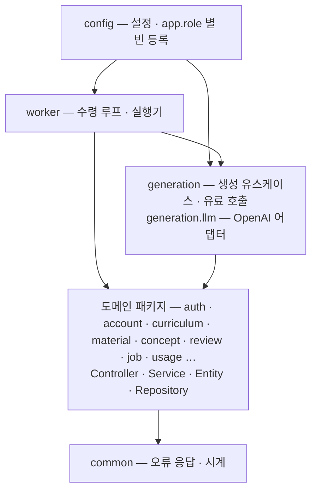
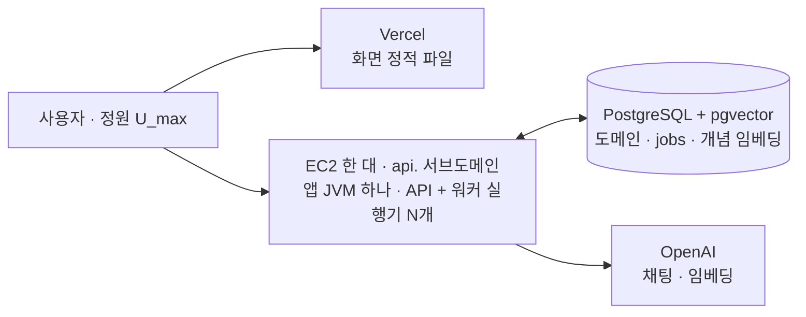
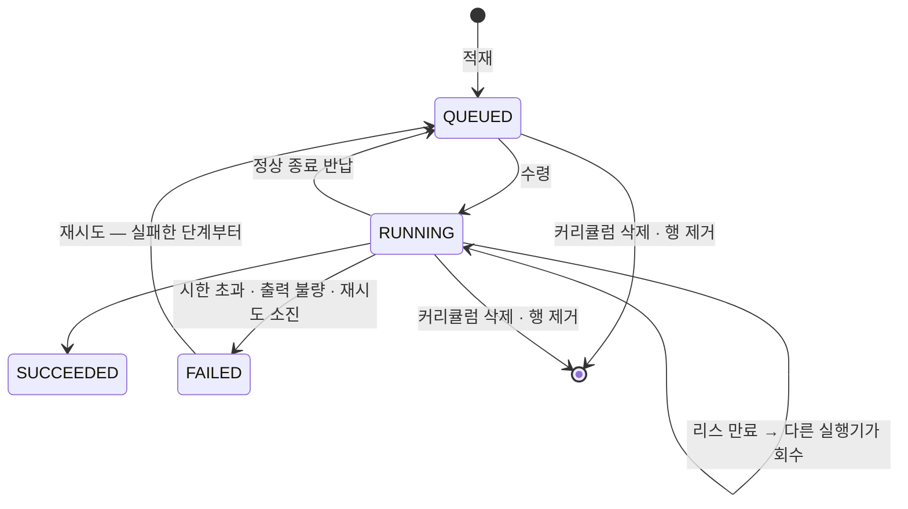
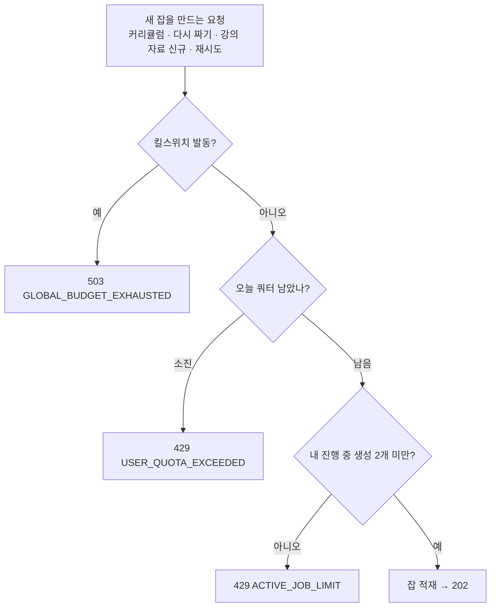

# 04. 서버 구조 · 생성 작업 · 비용 통제

> 기술 선택 · 패키지 경계 · 배포 · 잡 수명주기 · 트랜잭션 경계 · 비용 통제 · 관측.
> 이 문서의 전제는 하나다 — **LLM 호출은 느리고(수 초~1분), 매번 돈이 나가고, 실패한다.**

---

## 1. 기술 선택 — 무엇과 비교했고 언제 틀리나

| 영역 | 선택 | 비교한 것 | 이 선택이 틀리는 때 |
|---|---|---|---|
| 언어 · 런타임 | **Java 21**(LTS) | Java 17 · Kotlin | — (1단계 하네스 · SDK 를 21 에서 검증했다) |
| 프레임워크 | **Spring Boot 4 · Spring MVC** · 플랫폼 스레드 | WebFlux · 가상 스레드 | 초당 수만 건의 가벼운 요청 · 오래 기다리는 연결 수백 개 |
| LLM | **OpenAI 공식 SDK + 자체 인터페이스(`LlmClient`)** | Spring AI · Anthropic | 프로바이더를 상시 여럿 지원해야 할 때 |
| 저장소 | **PostgreSQL 하나 + pgvector** | MySQL + 벡터 DB · Redis | 개념 수십만 · 큐 초당 수백 건 |
| 큐 | **`jobs` 테이블 + `FOR UPDATE SKIP LOCKED`** | Redis ZSET · Kafka | 초당 수백 건(hot row · VACUUM) |
| DB 접근 | **Spring Data JPA 하나** — 도메인 테이블은 엔티티와 Spring Data 리포지토리(각 도메인 패키지 안)로 조회 · 저장한다. 일반 CRUD와 메서드 이름으로 표현할 수 있는 조회는 Spring Data JPA를 우선 사용한다. Postgres 고유 기능(`SKIP LOCKED` · advisory lock · `ON CONFLICT` · `RETURNING` · 벡터 거리)과 `jobs` · `job_events` · `llm_calls` 쓰기는 `EntityManager` 네이티브 쿼리 | MyBatis · `JdbcClient` · jOOQ · QueryDSL | 동적 SQL(조건이 이리저리 붙는 검색)이 많아질 때 |
| 마이그레이션 | Flyway | Liquibase | — |
| 화면 | **React SPA**(TypeScript · Vite · React Router · TanStack Query · Tailwind) — 빌드 결과를 **Vercel** 에 정적 파일로. API 는 `api.` 서브도메인의 EC2 — 같은 사이트 · 다른 출처(ADR-060) | Spring Boot `static/` 에 넣어 jar 하나(ADR-007 — 대체) · Vercel rewrites 프록시 · Next.js(Node 서버 별도) · Thymeleaf | 검색 노출(SSR)이 필요해진다 · 화면과 API 를 같은 등록 도메인에 둘 수 없다 |
| 경계 강제 | **단일 Gradle 모듈 + ArchUnit** | 멀티모듈 | 규칙이 버거워지거나 배포 단위가 갈릴 때 |
| 관측 | Micrometer · Prometheus · Grafana(**로컬**) · 운영은 관리자 화면 U6 | OpenTelemetry 트레이싱 | 메트릭 + 로그로 *"왜 오래 걸렸나"* 에 답하지 못할 때 |
| 부하 · 장애 테스트 | k6 + LLM 스텁 서버 · Testcontainers(Postgres) | 실제 API 부하 | — |
| 배포 | AWS EC2 한 대 · 앱 프로세스 하나 · 화면은 Vercel · 무중단 배포는 공개 후(ADR-061) | 2대 · 쿠버네티스 | 예산이 늘거나 워커가 API 를 방해할 때 |

> **가상 스레드를 쓰지 않는다.** 가상 스레드는 CPU 일을 늘리지 않고 *동시에 기다릴 수 있는 수* 를 늘린다.
> 이 구조에서 오래(약 1분) 기다리는 작업은 **워커 실행기 `N` 개**로 묶여 있고, API 요청은 수 ms~수십 ms 라 플랫폼 스레드로 충분하다.
> (1단계에서 JFR 로 SDK 경로에 pinning 이 없는 것까지 확인한 뒤 내린 결정이다.) 다시 볼 조건 — 오래 기다리는 연결이 수백 개 동시에 생기는 기능.

---

## 2. 패키지 경계

**도메인별 패키지 + 표준 Spring 계층(Controller → Service → Repository)이다**(ADR-067). 기능 하나의 컨트롤러 · 서비스 · 엔티티 · 리포지토리를 같은 도메인 패키지에 두고, 엔티티를 도메인 모델로 직접 쓴다. 서비스는 Spring Data 리포지토리를 바로 쓴다.

**도메인 패키지 안은 항상 계층 하위 패키지로 나눈다** — 파일이 하나뿐인 하위 패키지도 만든다. 도메인마다 모양이 같아야 어디에 둘지 판단할 여지가 없다. 테스트는 대응하는 구현과 같은 하위 패키지에 둔다.

| 하위 패키지 | 둘 것 |
|---|---|
| `controller` | `@RestController` |
| `service` | `@Service` · 서비스 메서드의 입력 · 결과 타입(예: `ExternalAccount` · `LoginResult`) |
| `repository` | Spring Data 리포지토리 · `EntityManager` 네이티브 쿼리 클래스 |
| `domain` | `@Entity` · enum · 값 타입 · 도메인 규칙(`MasteryPolicy` 등) |
| `dto` | HTTP 요청 · 응답 타입만 |

`generation` 은 계층이 아니라 용도로 나눈다(`generation.llm` · 잡 종류별 — 해당 TASK 에서 정한다). `auth` · `config` · `common` · `worker` 는 계층 구분이 맞지 않는 기술 코드라 평평하게 둔다. 하위 패키지끼리 참조하므로 클래스와 그 생성자 · 메서드는 `public` 이다.

| 패키지 | 책임 |
|---|---|
| 루트 `MogumApplication` | 진입점 · `@ConfigurationPropertiesScan` |
| `config` | 설정 값(`WebProperties` · `AuthProperties`) · 시계 빈 · `app.role` 별 빈 등록(§3.1). `worker` · `generation` 을 조립하는 유일한 곳 |
| `common` | 공통 오류 응답(`ApiError` · `ApiExceptionHandler` · `NotFoundException` → 404) · `SeoulClock` |
| `auth` | Spring Security 설정 · 구글 OAuth 로그인 처리 · 세션 → 회원 필터 |
| `account` | 회원 엔티티 · 리포지토리 · 로그인 서비스 · `/api/me` |
| `curriculum` · `material` · `concept` · `review` … | 도메인마다 위 다섯 하위 패키지. `MasteryPolicy` 같은 도메인 규칙은 `domain` 에 둔다 |
| `job` | 적재(검사 · 적재 · 재시도 · 처음부터 다시 만들기) · 잡 조회 API · `jobs` · `job_events` 네이티브 SQL(`job.repository`) |
| `usage` | `llm_calls` 원장 기록 · 일일 합계(쿼터 · 킬스위치의 근거). 생성과 적재가 함께 쓰므로 `generation` 밖에 둔다 |
| `generation` | 생성 유스케이스(잡 I · A · B ①②③ · `resolveConcepts`) + **유료 호출**(`LlmClient` · `EmbeddingClient` · `GuardedLlmClient` · `InputBudget`). OpenAI 어댑터는 `generation.llm` |
| `worker` | 수령 루프 · 실행기 · 단계 실행 |



**`generation` 을 참조할 수 있는 것은 자기 자신 · `worker` · `config` 뿐이다.** "컨트롤러는 안 된다" 가 아니라 "이것들만 된다" 로 적는다 — ArchUnit 은 직접 참조만 보므로, 컨트롤러 금지만 두면 `컨트롤러 → job → EmbeddingClient` 처럼 다른 도메인 패키지를 거친 유료 호출이 빌드를 통과한다. 유료 호출 클라이언트를 모두 이 패키지에 두면 새 클라이언트가 생겨도 규칙에 클래스 이름을 더할 필요가 없다. **`worker` 를 참조할 수 있는 것은 `config` 뿐이다** — 실행기는 역할에 따라 켜고 끄는 진입점이라 도메인이 부르지 않는다.

**ArchUnit 규칙 — 첫 커밋에 쓴다.** 코드가 쌓인 뒤 붙이면 이미 깨져 있고, 그때는 규칙을 무르게 된다. 규칙마다 위반 픽스처(`backend/src/test/java/…/archfixture`)로 규칙이 실제로 걸리는지 확인한다.

```java
@Test void 생성은_worker만_부른다() {   // 1분짜리 요청 · 유료 호출이 요청 경로에 조용히 들어오는 것을 막는다 — job 을 거친 우회 포함
    noClasses().that().resideOutsideOfPackages("..generation..", "..worker..", "..config..")
        .should().dependOnClassesThat().resideInAPackage("..generation..").check(CLASSES);
}
@Test void worker를_부르는_곳은_config뿐이다() {
    noClasses().that().resideOutsideOfPackages("..worker..", "..config..")
        .should().dependOnClassesThat().resideInAPackage("..worker..").check(CLASSES);
}
@Test void LLM을_부르는_패키지는_Transactional을_쓰지_않는다() {   // §5 — 커넥션을 LLM 호출 너머로 끌고 가지 않게
    noClasses().that().resideInAnyPackage("..generation..", "..worker..")
        .should().beAnnotatedWith(SPRING_TRANSACTIONAL).orShould().beAnnotatedWith(JAKARTA_TRANSACTIONAL).check(CLASSES);
    noMethods().that().areDeclaredInClassesThat().resideInAnyPackage("..generation..", "..worker..")
        .should().beAnnotatedWith(SPRING_TRANSACTIONAL).orShould().beAnnotatedWith(JAKARTA_TRANSACTIONAL).check(CLASSES);
}
@Test void OpenAI_SDK는_LLM_어댑터에만_둔다() {
    noClasses().that().resideOutsideOfPackage("..generation.llm..")
        .should().dependOnClassesThat().resideInAPackage("com.openai..").check(CLASSES);
}
```

역할 설명만 담은 `package-info.java`는 구현이 없는 패키지(`job` · `generation` · `worker`)의 자리를 남기는 데 사용하고, 구현이 생기면 지운다.

**외부 인증과 회원 저장의 경계(ADR-066).** 별도 로그인 연결 테이블 없이 `users(provider, subject)`로 회원을 식별한다. 회원당 로그인 수단은 하나이며 현재 활성 제공자는 구글 하나다([02 §6.1](./02-domain-data.md)).

| 위치 | 책임 |
|---|---|
| `account.domain.User` | 회원 엔티티(`users`). `provider` · `subject` 컬럼을 매핑하지만 getter 로 내놓지 않고 API 응답에도 넣지 않는다 |
| `account.domain.ExternalIdentity` | `(provider, subject)` 값. 회원 테이블의 로그인 식별자를 표현한다 |
| `account.service.ExternalAccount` | 인증을 마친 외부 식별자·이메일·이메일 검증 여부를 전달하는 로그인 입력 |
| `account.service.LoginService` | 이메일 검증·허용 목록 검사(DB 접근 전) 후 `findByProviderAndSubject` 로 조회하거나 신규 회원 저장. 재로그인 정보 보존 |
| `account.repository.UserRepository` | `JpaRepository<User, Long>` · `findByProviderAndSubject` |
| `account.controller.MeController` · `account.dto.MeResponse` | `GET /api/me` |
| `auth` | `GoogleAccountMapper`가 검증된 Google 등록과 응답을 해석하고 `OAuthLoginHandler`가 `LoginService` 호출 후 ID 세션 생성. `SessionUserFilter`가 요청마다 `users`에서 회원을 읽는다 |

`LoginService` 는 메서드 전체에 `@Transactional` 을 붙이지 않는다 — 거절을 DB 접근 전에 하고([02 §6.1.1](./02-domain-data.md)), 조회와 저장은 Spring Data 리포지토리 메서드마다 짧은 트랜잭션이며, 동시 첫 로그인은 `(provider, subject)` unique 제약이 하나만 남긴다. 여러 행을 함께 바꾸는 서비스 메서드는 `@Transactional` 을 붙인다(§5).

제공자 구분은 두 컬럼과 값 타입으로 표현한다. 별도 연결 모델·저장소·동적 제공자 탐색기는 만들지 않는다. 추가 제공자에는 인증 설정·응답 변환·이메일 신뢰 정책이 필요하며 복수 로그인 연결이 필요할 때 테이블 분리를 다시 검토한다. 현재 구글 경로·요청 쿠키·PKCE·토큰 폐기 정책은 유지한다.

---

## 3. 배포

**한 프로세스가 API 와 워커를 함께 돌린다**(`app.role=all`). 로컬 · 운영 모두 같다. 나눌 수 있는 배선은 처음부터 넣어 둔다 — §3.1.



| | 로컬(Docker Compose) | 운영(AWS) |
|---|---|---|
| 구성 | 앱 · Postgres · LLM 스텁 · Prometheus · Grafana — **지금은 앱(`backend/Dockerfile` 이미지) · Postgres 만 있다**(ADR-069). LLM 스텁 · Prometheus · Grafana 는 쓰는 TASK 에서 더한다 | 앱 · Postgres · 화면은 Vercel. 앱 실행 방식(같은 이미지 · jar + systemd)은 `2-deploy` 에서 정한다 |
| 관측 | Grafana | **관리자 화면 U6**(DB 만 읽는다) — 1GB 에 관측 스택을 올리면 앱이 죽는다 |
| LLM | 스텁(테스트) · 실제 API(실사용 전 확인) | 실제 API |

- 🅿️ **AWS 계정 생성일을 먼저 확인한다** — 2025-07-15 이전 계정은 *월 750시간 합산*, 이후 계정은 *크레딧 방식* 이라 예산 계산이 갈린다.
- 🅿️ **Postgres 위치**(같은 인스턴스 vs RDS)는 실제 메모리 사용량을 보고 정한다. 백업 방식도 같이. **용량 측정 전에 정한다** — 측정은 운영과 같은 메모리 조건으로 잰다([07 §2](./07-testing.md)).

  | 후보 | 측정 조건 | 백업 | 추가 비용(월 · 프리티어 이후) |
  |---|---|---|---|
  | ① **같은 EC2 · 2GB 로 상향** — 1순위 | 앱 + Postgres 합쳐 2GB | `pg_dump` → S3 cron | 약 1.5만 원 |
  | ② RDS(db.t4g.micro) | 앱만 1GB | RDS 자동 백업 | 약 2만 원 |
  | ③ 같은 EC2 · 1GB 그대로 | 앱 + Postgres 합쳐 1GB — 매우 빠듯하다 | `pg_dump` → S3 cron | 0원 |

- 공개 운영에 더하는 것 — 도메인(화면 → Vercel · `api.` → EC2) · HTTPS(구글 콜백 · `Secure` 쿠키) · Vercel 프로젝트(API 주소 환경 변수 `VITE_API_BASE_URL` · 화면 주소 새로고침을 `index.html` 로 · 요금제 약관 확인) · DB 백업 · 슬랙 알림 · 외부 헬스체크(§9.1).

### 3.1 역할 전환 — 비상용 배선

**같은 jar 를 실행 인자만 바꿔 역할별로 띄울 수 있게 한다.** 평소에는 `all` 하나로 돈다.

```
java -jar app.jar                                   # app.role=all (기본) — 지금
java -jar app.jar --app.role=api                    # 나눌 때 — 웹 서버 · 컨트롤러만
java -jar app.jar --app.role=worker \
     --spring.main.web-application-type=none         #          수령 루프 · 실행기만
```

| `app.role` | 웹 서버 · 컨트롤러 | 수령 루프 · 실행기 `N` | 정상 종료 반납 |
|---|---|---|---|
| `all` (기본) | ✅ | ✅ | ✅ |
| `api` | ✅ | ❌ | — |
| `worker` | ❌ | ✅ | ✅ |

- 구현은 `config` 에서 빈 등록을 켜고 끄는 것뿐이다(`@ConditionalOnExpression` 등). 수령 루프 · 실행기 빈은 컴포넌트 스캔으로 올리지 않고 `config` 에서 등록한다 — 스캔으로 올리면 역할과 무관하게 항상 켜진다. 역할 판단을 컨트롤러 · 서비스 · `worker` · `generation` 코드 안에 넣지 않는다.
- **이건 평소 기능이 아니라 비상용 배선이다.** *"트리거 없이 미리 만들지 않는다"* 의 예외로 둔 이유 — 비용이 수십 줄인데, 장애 때 *"코드를 고쳐 다시 배포"* 와 *"실행 인자만 바꾸기"* 의 차이가 크다.
- 나누는 조건 — **워커가 API 응답을 느리게 만드는 것이 관측될 때**(예: 복습 조회 지연이 생성 중에만 튄다). 프로세스를 나누는 실험(격리 측정)은 하지 않는다.

**나눠도 그대로인 것** — 잡 수령(`SKIP LOCKED`) · 리스 · 수령 회차 펜싱 · 반납(`worker_id` 는 프로세스마다 유일) · 진행 중 2개 · 정원 · 개념 쓰기 잠금(전부 DB advisory lock) · 쿼터 · 킬스위치(DB) · **로그인 세션(DB)**. **주기 작업을 새로 넣으면** 프로세스를 나눴을 때 둘이 함께 돌아도 되는지(멱등인지) · 아니면 한 역할에서만 돌지를 같이 정한다(세션 정리는 §3.2).

**나눌 때 같이 바꾸는 것**

| 항목 | 바뀌는 것 |
|---|---|
| 동시 실행 | 실제 동시 호출 = `N × 워커 프로세스 수`. 한도 계산(§8) · U6 의 실행기 수를 같이 고친다 |
| 우리 API 레이트리밋 | 프로세스 메모리 버킷이다 — **API 프로세스가 하나**면 그대로. API 를 여러 개로 늘리면 버킷이 쪼개진다(Redis 재도입 조건) |
| 메모리 | 한 대(1GB)에 JVM 둘이면 빠듯하다 — 인스턴스 크기를 같이 본다 |
| 배포 순서 | 워커를 먼저 내리면 잡을 반납하고, 새 워커가 이어받는다 |

### 3.2 만료 세션 정리

로그인 세션은 Spring Session JDBC 로 Postgres 에 둔다([05 §1.1](./05-api.md)). 이 라이브러리는 **만료된 세션 행을 주기적으로 지우는 작업**을 스스로 돈다(기본 1분마다).

- `DELETE … WHERE 만료` 라 **멱등**이다 — 프로세스를 나눠 둘이 함께 돌아도 결과가 같다.
- 주기는 설정(`spring.session.jdbc.cleanup-cron`)으로 늦출 수 있다 — 25명 규모면 시간 단위로 충분하다.
- 주기 작업(스케줄러 · 배치)은 금지가 아니다. 다만 **파생값(숙련도 · `GENERATING` 상태)을 저장하는 배치는 만들지 않는다** — 저장한 값은 바로 낡는다([02 §1](./02-domain-data.md)).

---

## 4. 생성 작업 — `jobs` 테이블이 큐다

### 4.1 왜 잡인가

처리량 때문이 아니다(정원 약 25명이면 동시 생성은 몇 건이다). **돈이 드는 1분짜리 작업을 한 번만, 끝까지 하려면** 진행 중인 작업이 DB 에 한 줄씩 있어야 한다.

| 필요 | 잡 행이 주는 것 |
|---|---|
| 새로고침 · 두 번 누르기로 **같은 강의가 두 번 생성**되지 않게 | 강의당 활성 잡 하나(부분 unique 인덱스) — 재클릭은 기존 잡에 연결 |
| 사용자당 **진행 중 생성 2개** 세기 | `count(*)` 한 줄 |
| 카드 단계에서 실패해도 **앞 단계 비용(약 77원 · 94%)을 버리지 않게** | 단계 산출물을 잡에 저장 → 실패한 단계부터 재개 |
| 배포 · 프로세스 죽음 뒤에도 **진행 중 작업을 잃지 않게** | 반납 · 리스 만료 회수 |
| 화면이 떠났다 돌아와도 **같은 작업에 다시 붙게** | `jobId` · 진행 단계 · 대기 순번 |

### 4.2 테이블 · 상태

**초기 통합 생성은 잡 I(`CURRICULUM_INITIAL`)에 먼저 저장한다.** 사용자와 주제/목적을 잡에 보존하고 결과 검증/저장에 성공할 때 단일 커리큘럼 또는 그룹을 만든다. 별도 생성 요청 테이블이나 빈 단일/그룹을 만들지 않는다. 잡 종류는 결과 유형에 따라 바꾸지 않는다. 처음 검토했던 분할안 전용 잡(`CURRICULUM_GROUP`)은 두지 않는다(ADR-050 · [03 §2.1](./03-generation.md)).

| 컬럼 | 타입 | 비고 |
|---|---|---|
| `id` · `user_id` | | |
| `type` | `text` | `CURRICULUM_INITIAL`(초기 통합 생성) / `CURRICULUM`(단계 상세 목록 · 다시 짜기) / `MATERIAL`. 적재 후 종류는 불변 |
| `curriculum_group_id` · `curriculum_id` · `lesson_id` | FK **nullable** | 잡 I는 성공 전 모두 NULL, 성공 시 단일 결과의 `curriculum_id` 또는 그룹 결과의 `curriculum_group_id` 하나만 연결한다. 잡 A는 `curriculum_id`, 잡 B는 `lesson_id` 하나만 필수. 종류/상태별 조합을 CHECK로 보장한다. polymorphic `target_id`는 쓰지 않는다 |
| `status` | `text` | `QUEUED` / `RUNNING` / `SUCCEEDED` / `FAILED` |
| `enqueued_at` | `timestamptz` | **불변** — 큐 대기 시간 메트릭 |
| **`available_at`** | `timestamptz` | *"이 시각 이후 수령 가능"* — `QUEUED` 면 적재 시각, `RUNNING` 이면 **리스 만료 시각** |
| `claimed_at` · `worker_id` | | 마지막 수령 · 누가(호스트 + PID + 기동 시각, 프로세스마다 유일) |
| `started_at` | `timestamptz` | 첫 수령 시각 — **잡 시한 10분의 기준** |
| `step` | `smallint` | 완료한 단계 — 재개 지점 |
| `payload` | `jsonb` | 단계 산출물 · 다시 짜기 피드백. 잡 I의 `request: { topic, purpose }`와 숙련도 선별/검증된 생성 결과를 포함한다. 실패/반납/재시도 시 유지하고 **성공 시 비운다** — 성공한 원래 입력은 결과 리소스에 보존 |
| `failure_code` · `failure_reason` | `text` | [05 §5](./05-api.md) |
| **`lease_epoch`** | `bigint` | **수령 회차(fencing token).** 수령마다 +1 |
| `chat_attempt_limit` · `embedding_attempt_limit` | `integer` | 적재 시 확정하는 작업 전체 호출 상한. 수령 · 반납 · 재시도 · 설정 변경으로 초기화하지 않는다 |
| `generation_limits` | `jsonb` | 설정 버전 · 단계별 요청 바이트 상한 · 출력 토큰 상한. 적재 시 확정하고 재개 때 유지한다([03 §8.7](./03-generation.md)) |

```sql
CREATE INDEX idx_jobs_claim ON jobs (available_at) WHERE status IN ('QUEUED', 'RUNNING');
CREATE UNIQUE INDEX idx_jobs_one_active_per_lesson     ON jobs (lesson_id)     WHERE status IN ('QUEUED','RUNNING') AND lesson_id IS NOT NULL;
CREATE UNIQUE INDEX idx_jobs_one_active_per_curriculum ON jobs (curriculum_id) WHERE status IN ('QUEUED','RUNNING') AND curriculum_id IS NOT NULL;
CREATE INDEX idx_jobs_user_active ON jobs (user_id) WHERE status IN ('QUEUED', 'RUNNING');
```

완료 · 실패 행은 인덱스에 들어오지 않는다 → **행을 지우지 않아도** 수령 성능이 그대로다(정리 작업이 필요 없다).
호출 수 · 재시도 · 429 · 토큰 · 비용은 `llm_calls` 을 `job_id` 로 집계한다. `jobs` 에 같은 카운터를 중복 저장하지 않는다. U4 `retried` 는 해당 잡의 재시도 등록 여부(`is_retry`), U6 호출 통계는 원장에 남은 관측 결과로 조회한다([02 §6.8](./02-domain-data.md)).

**잡 I의 생애** — 접수 시 `payload.request`와 예산을 확정하고 활성 잡 수에 포함한다. 대기/실행/실패에는 결과 FK가 모두 NULL이다. 성공은 단일 결과면 강의 1~40개가 있는 `Curriculum(DRAFT, step_id=NULL)`, 그룹 결과면 전체 `CurriculumGroup`/`CurriculumStep`를 만든다. 그룹의 첫 상세 커리큘럼도 자동으로 만들지 않는다. 성공 시 원래 주제/목적을 결과 리소스에 보존하고, 단일 결과는 선별/검증된 숙련도 반영 근거도 함께 남긴다. 잡의 해당 FK를 채운 뒤 `payload`를 비운다. 결과는 API에서 연결된 FK에 따라 유형과 ID로 반환한다. `jobs.type`/원장/예산은 처음부터 끝까지 그대로다.

**종류/상태별 FK CHECK** — 잡 I는 `lesson_id IS NULL`이고 `SUCCEEDED`이면 `curriculum_id`/`curriculum_group_id` 중 정확히 하나가 NOT NULL, 그 외 상태이면 둘 다 NULL이다. 잡 A는 상태와 무관하게 `curriculum_id`만, 잡 B는 `lesson_id`만 NOT NULL이다. 각각의 FK는 실제 리소스를 참조한다. 초기 요청은 사용자/요청 식별자를 기준으로 중복 접수 시 기존 작업을 반환한다. 구체적인 저장/유일성/삭제 후 처리 방식은 해당 TASK에서 설계한다. 사용자당 활성 2개 검사와 동일 요청 중복 방지는 별개의 책임이다.

**초기 완료의 원자성** — 사용자 `usage-user` advisory lock을 얻어 계정 존재를 재확인한다. 아직 도메인 대상이 없으므로 묶음/커리큘럼 잠금 대신 조건부 잡 UPDATE로 실행 권한을 검사하며 이것이 첫 쓰기다. 아래 순서로 같은 트랜잭션을 커밋한다.

1. `UPDATE jobs SET step=step WHERE id=:id AND type='CURRICULUM_INITIAL' AND status='RUNNING' AND lease_epoch=:claimedEpoch AND available_at>now() RETURNING id` — 1행일 때만 계속한다. 이 쓰기는 행을 잠그며 상태는 `RUNNING`으로 유지한다. 0행이면 산출물/이벤트 쓰기 없이 중단한다
2. 검증된 단일 커리큘럼/강의 또는 그룹/전체 단계를 삽입한다. JPA 쓰기는 `flush()` 후 FK에 연결할 ID를 사용한다
3. 해당 결과 FK · `status='SUCCEEDED'` · `payload='{}'` · `available_at=NULL`을 함께 갱신하고 `SUCCEEDED` 이벤트를 기록한다. 실패 시 첫 UPDATE/결과 삽입/연결/상태/이벤트 전체를 롤백한다

성공 전 첫 UPDATE에서 상태만 `SUCCEEDED`로 바꾸면 필수 결과 FK CHECK를 위반하므로 그렇게 쓰지 않는다. 완료 응답 유실 후에는 같은 잡의 성공/연결 결과를 조회하며 새 결과를 만들지 않는다. 이미 검증된 응답이 체크포인트에 있으면 저장 재개에 LLM을 다시 호출하지 않는다. 탈퇴가 먼저면 잡이 없어 첫 쓰기 0행, 완료가 먼저면 탈퇴가 연결 결과까지 지운다. 원장 사용량은 독립 경로로 확정한다.



### 4.3 수령 · 실행기 · 리스

```sql
WITH candidate AS (
    SELECT id, status AS previous_status FROM jobs
     WHERE status IN ('QUEUED', 'RUNNING') AND available_at <= now()
     ORDER BY available_at, id
     LIMIT 1
     FOR UPDATE SKIP LOCKED
), claimed AS (
    UPDATE jobs j
       SET status = 'RUNNING', claimed_at = now(), started_at = COALESCE(j.started_at, now()),
           available_at = now() + interval '5 minutes', worker_id = :me, lease_epoch = j.lease_epoch + 1
      FROM candidate c
     WHERE j.id = c.id
    RETURNING j.*
), recorded AS (
    INSERT INTO job_events (job_id, job_type, lease_epoch, event_type, occurred_at, failure_code)
    SELECT j.id, j.type, j.lease_epoch, 'RECLAIMED', statement_timestamp(), NULL
      FROM claimed j JOIN candidate c ON c.id = j.id
     WHERE c.previous_status = 'RUNNING'
    RETURNING id
)
SELECT * FROM claimed;
```

이 한 문장이 FIFO · 동시 수령 방지 · **죽은 잡 회수** · 펜싱 회차 증가와 회수 이벤트 기록을 한다. 수령 전 상태가 `RUNNING`인 경우만 새 회차의 `RECLAIMED`를 남긴다. 이벤트 삽입 실패 시 수령도 롤백한다. CTE의 갱신 결과를 반환하므로 같은 문장에서 원본 `jobs`를 다시 읽어 갱신 전 스냅숏을 반환하지 않는다. 회수용 스케줄러가 없다.
⚠️ **`SKIP LOCKED` 를 빼면 실행기들이 같은 행에서 줄을 선다** — 기능 테스트는 통과하고 부하에서만 드러난다.

**실행기 `N` 개가 각자 빈손일 때만 잡 하나를 집어 끝까지 처리한다.** 그래서 동시에 도는 잡 = 동시 LLM 호출 ≤ `N`. 잡을 `N` 보다 많이 집으면 기다리는 동안 리스와 시한이 탄다. 빈 큐면 잠시 쉰다(🅿️ 폴링 주기).

**리스 5분 · 채팅과 임베딩의 시도 전 및 결과 기록 후 갱신.** 시도 전에는 원장 등록과 같은 짧은 트랜잭션, 결과 기록 후에는 별도 트랜잭션이다.

```sql
UPDATE jobs SET available_at = now() + interval '5 minutes'
 WHERE id = :id AND lease_epoch = :claimedEpoch
   AND status = 'RUNNING' AND available_at > now();   -- 0 rows → 추가 생성 작업 중단
```

**리스 부등식** — 살아 있는 실행기의 잡을 뺏기지 않으려면 갱신 사이의 최대 공백이 리스보다 짧아야 한다.

```
호출 1회의 최악(재시도 2회) = 100 + 60 + 100 + 60 + 100 = 420초  >  300초   ✗  → 갱신을 "호출"이 아니라 "시도"마다
리스 300초  >  백오프 상한 60 + 시도 타임아웃 최대 100 + DB 처리 최대 지연
임베딩도 매 시도 갱신 — 시도 타임아웃 10초 + 백오프 상한 2초 + DB 처리 최대 지연
```

DB 처리 최대 지연에는 원장 등록 · 결과 기록 · 리스 갱신의 커넥션 대기 · 트랜잭션 · DB 재시도 시간이 포함된다. 풀 대기 · 쿼리 · 트랜잭션 타임아웃과 DB 재시도(최대 3회)를 설정해 이 부등식을 만족시키고, 장애 주입으로 확인한다. 비용 기록 때문에 리스를 넘겼더라도 확인된 사용량은 남기고 생성은 중단한다.

> ⚠️ **타임아웃 · 백오프 상한 중 하나만 올려도 식이 깨진다. 타임아웃을 올리면 리스도 같이 올린다.**

### 4.4 `jobs` 는 JPA 엔티티가 아니다 — 쓰기는 전부 명시적 SQL

수령 회차인 `lease_epoch` 은 수령 · 반납 때 바뀌며 일반적인 행 버전과 역할이 다르다. 실행 권한 조건과 상태 전이를 SQL 에 명시하려고 `jobs` 는 엔티티로 매핑하지 않고 `job` 패키지의 저장 클래스가 `EntityManager` 네이티브 쿼리로 다룬다. 엔티티가 아니므로 Spring Data 리포지토리도 만들지 않는다. `llm_calls` 의 조건부 확정과 일일 합계 조회도 명시적 SQL 로 처리한다(합계는 저장하지 않는다). 도메인 테이블은 JPA 그대로다.

| 쓰기 | 조건 | `0 rows` 면 |
|---|---|---|
| 수령 | `SKIP LOCKED` · 회차 +1 | 빈 큐 |
| 리스 갱신 · 단계 산출물 · 완료 · 실패 | `lease_epoch = :claimed` · 실행 중이며 리스 유효 | **추가 생성 작업 중단**(`LeaseLostException`). 완료면 트랜잭션 전체 롤백 |
| 반납(정상 종료) | `worker_id = :me` · 회차 +1 | 들고 있던 잡이 없다 |
| 삭제(커리큘럼) | 소유권 확인 · 단일 결과를 연결한 초기 잡 I와 연결 잡 A/B 전체 삭제 | 삭제 후 잡 조회/재시도는 `404` |
| 재시도(API) | `status = 'FAILED'` · 주제 거절 · 호출 상한 소진 · 입력 상한 초과 제외 | `409 JOB_NOT_FAILED` · `409 JOB_NOT_RETRYABLE` |

커리큘럼 잡 A에는 추가로 **`curriculums.status='DRAFT'`** 를 적용한다. 승인 · 다시 짜기 적재 · 잡 A 재시도 · 결과 저장은 같은 커리큘럼의 트랜잭션 advisory lock을 먼저 잡아 직렬화한다. 사용자별 적재 검사 잠금도 필요한 API는 그 잠금 → 커리큘럼 advisory lock → 잡 행 잠금 순서로 처리한다. 이 잠금은 짧은 DB 트랜잭션에만 유지하며 외부 호출 중에는 잡지 않는다. 승인 시 활성 잡 확인과 상태 변경을 함께 수행하고, 재시도 시 `DRAFT` 와 활성 잡 없음을 함께 검사한다. 결과 저장도 잠금 안에서 `DRAFT` 를 확인해 승인된 목록을 덮어쓰지 않는다. 잡 A 완료는 이 advisory lock을 얻은 뒤 아래의 `jobs` UPDATE를 첫 쓰기로 수행하며, 도메인 상태가 맞지 않으면 트랜잭션 전체를 롤백한다.

**완료 트랜잭션은 `jobs` 의 `UPDATE` 를 맨 앞에 둔다** — 회차가 틀렸으면 자료 · 카드 · 개념을 쓰기 전에 롤백된다. 펜싱이 탈퇴까지 덮는다(행이 지워지면 다음 쓰기가 `0 rows`).
커리큘럼 삭제와의 경합을 막기 위해 잡 A/B 완료는 해당 커리큘럼 advisory lock을 먼저 잡고 존재를 다시 확인한 뒤, `jobs` UPDATE를 첫 쓰기로 수행한다. 자료 생성 적재/재시도 · 처음부터 다시 만들기와 학습 완료도 같은 잠금을 사용한다. 삭제는 사용자 사용량 → 복습 → (단계 연결이 있으면) 묶음 → 커리큘럼 잠금 후 연결 잡을 먼저 지우고 개념 잠금을 잡는다([02 §6.2](./02-domain-data.md)). 삭제 뒤 돌아온 외부 응답의 사용량은 원장에 남기지만 결과 저장 · 추가 호출 · 잡 복원은 하지 않는다.
이 조건은 **작업 진행 권한**이다. 이미 나간 호출의 사용량 기록은 별도 `llm_calls` 경로로 허용하며 `lease_epoch` 로 거부하지 않는다. 비용 기록 트랜잭션은 잡과 도메인 테이블에 쓰지 않는다.

**막는 것과 못 막는 것** — 회수된 옛 실행기는 다음 호출 전에 스스로 멈춘다. 못 막는 것은 **회수 시점에 이미 나간 호출 1회**다. `job.reclaimed` · `job.lease.lost` 로 실제 빈도를 본다. **정확히 한 번은 보장하지 않는다**(at-least-once).

### 4.5 반납 · 회수 · 시한

| 상황 | 동작 |
|---|---|
| **정상 종료(SIGTERM · 배포)** | **진행 중인 외부 호출 하나만 끝내고 반납한다.** ① 새 잡 수령을 멈춘다 ② 각 실행기는 지금 하던 호출이 끝날 때까지 기다려 사용량을 기록하고, 그 호출로 단계가 끝났으면 단계 산출물을 저장한다(①의 중간 라운드 · 이어 쓰기가 남은 본문처럼 단계가 안 끝났으면 저장할 것이 없다). 다음 호출 · 백오프 · 다음 단계는 시작하지 않는다 ③ 반납 — `status='QUEUED'` · `available_at = enqueued_at`(원래 순서 자리) · `started_at = NULL`(시한 새로) · `worker_id = NULL` · 회차 +1. 기다림은 **유예 120초**(시도 타임아웃 최대 100초 + 기록 여유) 안에서만 — 넘으면 즉시 반납하고, 늦게 돌아온 응답은 펜싱으로 버리되 사용량은 원장에 기록한다. 훅은 `SmartLifecycle.stop()` |
| **예고 없는 죽음(`kill -9` · OOM)** | 반납할 기회가 없다 → 리스 5분 만료 뒤 다음 수령이 회수 · **끝낸 단계 다음부터** 재개 |
| **잡이 안 끝난다** | 잡 시한 **10분**(`started_at` 기준). 시도 경계와 수령 직후에 검사 → 스스로 `FAILED`(`DEADLINE_EXCEEDED`). 산출물은 남아 재시도 때 재개 |

**왜 하던 호출을 끝내고 반납하나** — 즉시 반납하면 진행 중이던 호출의 결과는 펜싱으로 버려지고 새 프로세스가 그 단계를 처음부터 다시 한다. 본문 단계(약 30~100초 · 약 57원)가 80초째일 때 배포하면 그 비용이 그대로 버려진다 — 배포마다 최대 실행기 수 `N` 만큼. 호출 하나를 끝낼 시간만 주면 비싼 단계(잡 A · 본문 · 카드)는 대부분 한 번의 호출로 끝나므로 결과를 살린다. 리스(5분)가 유예(120초)보다 길어 기다리는 동안 회수되지 않는다.

**같이 맞출 설정** — 유예가 실제로 지켜지려면 바깥 쪽 대기 시간이 모두 그보다 길어야 한다.

| 설정 | 값 | 안 맞추면 |
|---|---|---|
| `spring.lifecycle.timeout-per-shutdown-phase` | 130초(유예 + 여유) | 기본 30초에 Spring 이 기다림을 끊는다 |
| `server.shutdown` | `graceful` | 진행 중 API 요청이 끊긴다(새 요청은 받지 않는다) |
| 프로세스 관리자의 강제 종료 대기 | 150초 이상 — systemd `TimeoutStopSec` · Docker `stop_grace_period`(로컬 `compose.yaml` 은 150초로 둔다. 이미지는 exec 형식 `ENTRYPOINT` 라 java 가 SIGTERM 을 직접 받는다) | **Docker 기본 10초 · systemd 기본 90초 뒤 SIGKILL** — 기다리는 도중 강제로 죽어 `kill -9` 경로(리스 만료 회수)가 된다 |

**대가** — 서버가 한 대라 배포 중 중단 시간이 하던 호출의 남은 시간만큼(최대 약 2분) 늘어난다. 사람이 적은 시간에 배포한다. 백오프 대기 중이던 실행기는 기다리지 않고 바로 반납한다. 무중단 배포는 공개 후에 넣는다(ADR-061).

### 4.6 단계 산출물 · 재시도 · 완료

```json
{ "outline": {}, "masteryFindings": [], "body": "## 오늘 배울 것 …", "cards": [] }
```

- 단계가 끝날 때마다 `step` · `payload` 를 저장한다(짧은 트랜잭션). `Material` 은 **성공 시에만** 만든다.
- 본문 ②는 정상 종료와 필수 섹션 검증까지 통과해야 완료 체크포인트로 저장한다. 이어 쓰기 1회 뒤에도 잘리면 `FAILED(LLM_OUTPUT_INVALID)` 이며 검증된 ①의 개요/숙련도 근거만 유지한다. 잘린 본문을 완료된 `payload.body` 로 쓰거나 카드 단계로 넘어가지 않는다. 명시적 사용자 재시도는 같은 잡의 ②부터 본문을 새로 생성하고, 누적 호출 몫은 유지한다. ②를 통과한 뒤 ③에서 실패했다면 기존처럼 본문을 재생성하지 않고 ③부터 재개한다([03 §4](./03-generation.md)).
- 완료 — 같은 트랜잭션에서 `status='SUCCEEDED'` · `payload='{}'` · `available_at=NULL` 후 `Material` · `Flashcard` · 개념 · `Lesson.READY`. payload 를 비우는 것이 정리 작업 없이 용량을 지키는 방법이다.
- **재시도는 같은 행을 되살린다** — `status='QUEUED'` · `available_at=now()` · `started_at=NULL` · 실패 사유 비움. 산출물 · 누적 호출 이력 · 적재 시 확정한 호출 상한은 유지한다. 실행 시한을 새로 주어도 호출 예산은 새로 주지 않는다. 상한 소진은 재시도할 수 없다(§4.8).
- 잡 A는 검증된 강의 목록 · 제목 · 숙련도 반영/선별 근거 교체와 `SUCCEEDED` 를 한 트랜잭션으로 저장한다. 실패 시 이전 안을 유지한다. 커리큘럼이 `DRAFT` 를 벗어나면 실패 잡의 재시도는 `409 JOB_NOT_RETRYABLE` 로 거절하며, 같은 커리큘럼의 활성 잡이 있으면 재적재하지 않는다(`409 CURRICULUM_GENERATING`).

**성공/실패 이벤트** — `RUNNING` · 수령 회차 · 리스 유효성을 검사한 조건부 상태 전환이 1행을 바꾼 경우만 `job_events`에 같은 회차의 `SUCCEEDED` 또는 `FAILED`를 남긴다. 성공은 도메인 산출물/잡 완료/이벤트를, 실패는 잡 실패/실패 코드/이벤트를 같은 트랜잭션으로 커밋한다. 이벤트 기록 실패도 전체 롤백한다. 커밋 응답 유실 뒤 재요청에서 이미 종결됐으면 추가 이벤트 0행이다. 이벤트 기록을 재시도하기 위해 LLM을 재전송하지 않는다. 늦은 실행기의 `0 rows`와 삭제/탈퇴는 실패 이벤트로 꾸미지 않는다([02 §6.9](./02-domain-data.md)).

### 4.7 중복 생성 방지

1. API 가 강의의 활성 잡을 찾는다 — 있으면 그 `jobId` 를 `202` 로 돌려준다. 최근 잡이 `FAILED` 면 재시도 가능 여부를 확인하고 **그 잡을 재시도**한다. 누적 호출 상한 소진 · 입력 상한 초과는 `409 JOB_NOT_RETRYABLE` 이고, 사용자가 *처음부터 다시 만들기* 를 고를 때만 새 잡을 만든다(§4.9).
2. 없으면 적재한다. 동시 요청 둘이 1을 함께 통과해도 **부분 unique 인덱스가 하나를 실패**시키고, API 가 그 예외를 잡아 기존 잡을 돌려준다. **제약이 최종 방어선이다.**
3. 중복 요청은 에러가 아니다 — 두 번 누르는 건 정상 행동이고 결과가 같다.

### 4.8 작업 전체의 누적 외부 호출 상한

전송 전에 등록한 `llm_calls` 을 `job_id` · `kind` 로 세어 상한과 비교한다. 성공 · HTTP 오류 · 타임아웃 · 사용량 미확인 · 등록 후 전송 전 종료 모두 1회다. DB 등록 재시도는 같은 ID이므로 추가 차감하지 않는다. 잡이 존재하는 동안 이력을 삭제하거나 연결을 해제하지 않는다.

| 작업 | 채팅 상한 | 임베딩 상한 | 초기값의 근거 |
|---|---|---|---|
| A 커리큘럼 | 6 | 4 | 대화 진행 최대 2회 × 전송 시도 최대 3회, 숙련도 검색 임베딩 1건 × 전송 시도 최대 4회 |
| B 강의 자료 | 24 | 40 | 대화 진행 최대 8회 × 전송 시도 최대 3회, 카드 최대 10개의 주된 개념 × 임베딩 시도 최대 4회 |
| I 초기 통합 생성(`CURRICULUM_INITIAL`) | 구현 전 확정 | 구현 전 확정 | 단일/그룹 공통 입력 · 유형별 출력/수정 규약과 함께 정한다. 결과 유형에 따라 A/B의 몫으로 전환하지 않는다 |

이 값은 현재 생성 경로에서 잡 적재 시 적용하는 초기 설정이다. 전송 실패 · 형식 수정 · 이어 쓰기 · 사용자 재시도 · SIGTERM · 리스 회수가 **같은 누적 몫**을 쓴다. 실사용과 장애 주입으로 충분한지 평가해 이후 새 잡의 설정을 조정하며, 기존 잡의 상한을 자동으로 늘리지 않는다. 두 종류의 몫은 서로 빌려 쓰지 않는다.

호출 등록 트랜잭션에서 사용자 `usage-user` lock → 현재 잡 행 잠금 및 실행 권한 확인 → 같은 시도 ID의 기존 등록 확인 → 종류별 누적 건수 검사 → 새 `PENDING` 삽입 순서로 처리한다. 같은 ID의 등록 재확인은 이미 소진한 마지막 1회를 다시 차감하지 않는다. 리스 갱신도 이 트랜잭션 안에서 한다. 외부 호출 동안 잡 행 잠금을 유지하지 않는다([02 §6.8](./02-domain-data.md)).

남은 몫이 없는데 새 호출이 필요하면 전송하지 않고 `FAILED(JOB_CALL_LIMIT_EXCEEDED)` 로 끝낸다. 임베딩 상한 소진도 생성 실패 fallback으로 삼키지 않는다. 마지막 허용 호출의 결과는 정상 기록 · 저장할 수 있고, 추가 호출 없이 완료할 수 있으면 성공한다. 이미 등록한 호출의 늦은 사용량 기록도 계속 허용한다.

`POST /jobs/{id}/retry` 와 강의 다시 열기의 자동 재시도 모두 소진한 잡에 `409 JOB_NOT_RETRYABLE` 을 반환한다. 소진한 잡을 **자동으로** 새 잡으로 바꿔 상한을 우회하지 않는다. 사용자가 명시적으로 고르는 새 작업은 **하루 횟수**로 따로 묶는다 — 커리큘럼 다시 짜기 커리큘럼당 하루 3회, 강의 자료 처음부터 다시 만들기 강의당 하루 2번(§4.9 · ADR-053).

### 4.9 처음부터 다시 만들기 — 실패한 강의의 출구

강의 자료 잡이 `JOB_CALL_LIMIT_EXCEEDED` · `INPUT_TOO_LARGE` 로 끝나면 그 잡은 재시도할 수 없다. 여기서 멈추면 **그 강의가 영원히 자료를 받지 못한다** — 학습 완료가 안 되고, 커리큘럼은 완료되지 않아 그룹이면 다음 단계도 열리지 않고, 홈의 다음 강의가 계속 그 강의를 가리킨다. 예: 프로바이더 장애 중 사용자가 강의를 여러 번 다시 열면 자동 재시도가 매번 시도 3회씩 쓰다 몫 24회가 바닥나고, 장애가 끝난 뒤에도 그 강의는 막힌다.

| 항목 | 규칙 |
|---|---|
| 대상 | 강의 자료 잡이 `JOB_CALL_LIMIT_EXCEEDED` · `INPUT_TOO_LARGE` 로 끝났을 때만. 커리큘럼 잡은 다시 짜기 · 완전 삭제라는 길이 이미 있어 넣지 않는다 |
| 동작 | **새 잡 행** — 새 호출 몫 · `step` 0 · 빈 `payload`. 옛 잡은 기록으로 남는다(원장 연결 포함). 입력 초과는 저장된 개요 · 본문이 원인이라 이어 하면 또 넘으므로 처음부터 한다. 호출 상한 소진도 규칙을 하나로 두려고 처음부터 한다 — 버리는 돈은 많아야 앞 단계 약 77원이다 |
| 누가 | **사용자가 버튼을 눌러야만**(`POST /lessons/{id}/materials` `{ "restart": true }`). 강의를 다시 열 때의 자동 재시도는 새 잡을 만들지 않는다 |
| 검사 | 새 잡과 같다 — 킬스위치 → 일일 쿼터 → 진행 중 2개(§7.1). 동시 요청은 부분 unique 인덱스가 하나만 통과시킨다(§4.7) |
| 횟수 | **강의당 하루 2번**(한국 날짜 · 🅿️ 잠정). 장애 중에는 비용이 미확인으로 남아 일일 쿼터에 잡히지 않으므로, 연타로 새 몫이 끝없이 생기지 않게 하는 브레이크다. 횟수는 저장하지 않고 그날 그 강의에 적재된 다시 만들기 잡 수로 센다. 넘으면 `409 LESSON_RESTART_LIMIT`(`Retry-After` = 한국 자정까지) |
| 다 쓰면 | 그날은 더 만들 수 없고 0시(한국)에 다시 열린다. 홈의 다음 강의는 그 강의를 그대로 가리킨다(하루면 풀리므로 건너뛰는 규칙을 두지 않는다). U6 에는 자료 없이 최근 잡이 위 두 코드로 실패한 강의 수(`stuckLessons`)가 보인다 — 장애 · 입력 초과가 계속되는지 보는 신호다 |

`restart` 는 최근 잡이 위 두 코드로 끝났을 때만 효과가 있다. 그 밖에는 일반 요청과 같다(자료 있음 · 진행 중 잡 반환 · 재시도).

**왜 평생 횟수가 아니라 하루 횟수인가** — 평생 2번이면 장애 한 번으로 강의가 영원히 막히고, 그 커리큘럼은 완료되지 않아 그룹의 다음 단계까지 막힌다. 사용자에게 남는 길은 커리큘럼을 지우고 새로 만드는 것뿐인데, 그룹이 생긴 뒤로는 커리큘럼을 버리는 일을 줄여야 한다(ADR-053). 하루 횟수면 막힘이 그날로 끝나고, 브레이크(하루 최대 새 잡 2개 × 잡 상한)는 그대로다.

---

## 5. 트랜잭션 경계 — LLM 호출 중에는 커넥션을 쥐지 않는다

1분짜리 응답을 기다리며 커넥션을 쥐면 풀이 금방 마르고 **복습 조회까지 멈춘다.**

```java
// generation · worker — TransactionTemplate 으로 경계를 드러낸다
var ctx    = tx.execute(status -> load(jobId));                 // 커밋 · 반납. 엔티티가 아니라 값(record)을 꺼낸다
var result = llmClient.call(ctx);                               // 커넥션 없음
             tx.executeWithoutResult(status -> save(jobId, result));   // ID 로 다시 읽어 바꾸고 커밋 · 반납
```

- **컨트롤러가 부르는 일반 서비스는 `@Transactional` 을 쓴다.** 요청 하나가 수 ms~수십 ms 라 메서드 경계가 곧 트랜잭션 경계여도 된다. 리포지토리 메서드 하나로 끝나는 일은 Spring Data 리포지토리의 트랜잭션으로 충분하다. 이 서비스들은 `generation` 을 참조할 수 없으므로(§2) LLM 을 부를 수 없다.
- **LLM 을 부르는 `generation` · `worker` 는 `@Transactional` 대신 `TransactionTemplate` 을 쓴다** — 어노테이션은 경계를 메서드 뒤에 숨겨 커넥션을 LLM 호출 너머로 끌고 가기 쉽고, 같은 클래스 안 호출(self-invocation)에서는 프록시를 거치지 않아 조용히 빠진다. ArchUnit 이 두 패키지의 `@Transactional` 을 막는다(§2).
- **LLM 호출을 사이에 둘 때는 엔티티 대신 ID 나 값(record)을 넘기고 다음 트랜잭션에서 다시 읽는다.** 트랜잭션 밖 엔티티는 detached 다 — 바꿔도 저장되지 않고(예외도 없다), 지연 로딩에서 `LazyInitializationException` 이 난다. 앞 트랜잭션에서 필요한 값을 record 로 꺼내 LLM 에 넘기고, 결과 저장 트랜잭션에서 엔티티를 ID 로 다시 조회해 바꾼다. `spring.jpa.open-in-view=false`.
- **JPA 와 네이티브 쿼리를 한 트랜잭션에서 섞을 때는 `flush()` 를 명시한다.** 엔티티 변경은 flush 때까지 미뤄지므로, JPA 로 바꾼 행을 같은 트랜잭션에서 네이티브 쿼리로 읽거나 참조하기 전에 flush 한다. 네이티브 쿼리 앞의 자동 flush 동작에 기대지 않는다.

```java
tx.executeWithoutResult(status -> {
    var lesson = lessons.findById(lessonId).orElseThrow();
    lesson.markReady();             // JPA — UPDATE 는 flush 때까지 미뤄진다
    em.flush();                     // 명시 — 없으면 아래 네이티브 쿼리가 옛 값을 볼 수 있다
    em.createNativeQuery("SELECT status FROM lessons WHERE id = ?1")...;
});
```

---

## 6. 동시 실행 `N`

| | |
|---|---|
| 뜻 | 실행기 수 = 동시에 도는 잡 = 동시 LLM 호출 상한 |
| 값 | 🅿️ **용량 측정에서 정한다**([07 §2](./07-testing.md)). 시작값 4 |
| 역할 | 서버 자원(메모리 · 커넥션)을 묶는다. **비용은 묶지 않는다** — 늦게 쓸 뿐 총량은 같다. 비용은 §7 이 묶는다 |
| 대가 | 실행기가 다 차면 새 잡은 앞선 잡 하나가 끝날 때까지 기다린다(선점 없음). 대기는 `QUEUED` 와 대기 순번으로만 드러난다 |

---

## 7. 비용 통제

### 7.1 세 층과 진행 중 2개

| 층 | 수단 | 걸리는 곳 |
|---|---|---|
| 1. 구조 상한 | 총 1~40강(기간/주당 강의 수 제한 없음) · 단계별 입력/전체 출력 토큰 상한 · 이어 쓰기 1회 · 카드 10장 · 툴 라운드 3 · 다시 짜기 커리큘럼당 하루 3회 · 처음부터 다시 만들기 강의당 하루 2번 · 작업 전체 누적 호출 상한 | 요청 검증 · 프롬프트 · 전송 전 입력 검사 · 호출 등록 트랜잭션 |
| 2. 사용자 | **일일 비용 쿼터**(원) · **진행 중 생성 ≤ 2** | API 진입(잡 적재 전) |
| 3. 전역 킬스위치 | 서비스 전체 일일 비용 상한 | API 진입(잡 적재 전) |



**진행 중 2개는 사용자 단위 락 안에서 센다** — 락 없이 세면 연타 두 번이 둘 다 *1개* 를 보고 통과한다.

```sql
SELECT pg_advisory_xact_lock(hashtext('enqueue'), :userId::int);   -- (int,int) 형태 — 첫 키가 락 종류다. 사용자 락(enqueue · usage-user · review · concept-write)은 첫 키로만 갈리므로 종류 키를 한 곳에 모으고 서로 다른지 테스트한다
SELECT count(*) FROM jobs WHERE user_id = :userId AND status IN ('QUEUED', 'RUNNING');   -- ≥ 2 → 429
-- 같은 트랜잭션에서 INSERT
```

같은 강의 재클릭(기존 잡 반환)은 새 잡이 아니라서 걸리지 않는다.

### 7.2 킬스위치

- 발동하면 **새 잡 적재를 전부 거부**한다. 이미 적재된 잡(대기 · 실행 중)은 킬스위치 때문에 중단하지 않고 남은 누적 호출 몫 안에서 계속 처리한다 — 사용자가 기다리고 있고, 도중에 끊으면 이미 쓴 돈이 버려진다.
- 학습 · 복습은 계속된다. 화면은 *"오늘은 새로 만들기가 마감됐어요"* 로 정직하게 보인다.
- 리셋은 **한국 날짜**가 바뀌면 0부터(원장 `llm_calls` 을 `usage_date` 로 더한다 — 리셋 작업도 합계 테이블도 없다. [02 §6.6](./02-domain-data.md)).
- 쿼터와 킬스위치는 **같은 단위(원)** 다 — 사용자당 월 비용 ≤ 예산 ÷ 정원을 그대로 계산할 수 있다. 화면은 비율(`usedRatio`)만 본다.
- 발동하면 슬랙으로 알린다(§9.1).

### 7.3 사후 기록 — 호출 상한과 비용 상한의 차이

일일 비용 검사는 **적재 전에만** 하고 비용은 **호출 뒤에** 기록한다. 그래서 일일 상한에 닿은 순간 이미 적재된 잡은 남은 누적 호출 몫을 쓸 수 있다. 작업당 호출 건수는 §4.8로 묶지만, 금액의 최대치를 보이려면 호출별 입력 · 출력 토큰의 검증된 상한과 적용 단가도 필요하다.

```
호출별 비용 최대치가 보장된다는 조건에서:
초과분 ≤ (진행 중 잡 수) × 잡 1건 최대비용
진행 중 잡 수 ≤ 2 × 활성 사용자 ≤ 2 × U_max
사용자 한 명 몫 ≤ 2 × 잡 1건 최대비용
```

- 잡 1건 실측 약 82원은 표본의 관측값이며 최대비용이 아니다. 최대치는 [03 §8.7](./03-generation.md)의 입력 상한과 출력 상한 · 호출 몫 · 단가로 계산하며 두 가지로 본다.
  - **증명된 천장** — 입력을 단계 **바이트 상한**으로 놓는다(토큰 수 ≤ 바이트 수). 증명되지만 한국어에서 약 3~4배 느슨하다.
  - **현실적 최대** — 입력을 단계 **정적 최대 입력**(재료 상한의 합)으로 놓는다. 시스템 프롬프트 · 툴 스키마 · 구조 여유분은 실측값이라 원장의 실제 사용량 대조로 확인한다. 킬스위치 금액 · 사용자 쿼터 값은 이 값으로 정한다.
- 고정한 설정과 단가에서 호출 1회 최대비용은 `(입력 × 입력 단가) + (전체 출력 상한 × 출력 단가)`다 — 입력에 위 둘 중 하나를 넣는다. A는 채팅 최대 × 6회 + `(임베딩 입력 × 임베딩 단가) × 4회`, B는 채팅 단계/허용 모델 중 최대 × 24회 + `(임베딩 입력 × 임베딩 단가) × 40회`로 보수적으로 계산할 수 있다. 임베딩 입력도 같은 기준을 따른다 — 증명된 천장은 바이트 상한 2,048, 현실적 최대는 정적 최대 입력 512. 캐시 할인은 기대하지 않으며 원 단위 계산은 상향 반올림한다. 단가 · 환율이 바뀌면 다시 계산한다. 초기 I도 자체 입력/출력 상한 · 채팅/임베딩 누적 몫으로 최대비용을 계산한다. 시스템의 잡 1건 최대비용은 I/A/B 중 최댓값이며 I 예산이 미확정인 상태를 전체 비용 천장이 확정된 것으로 쓰지 않는다. 이는 설정 단가의 운영 환산값이며 실제 청구액 보장은 아니다.
- 대가 — 상한을 **정확히** 지키지 못한다. 응답을 못 받았거나 기록 전에 죽은 호출은 `llm_calls` 에 미확인으로 남고 합계에는 비용이 없다. 호출 원장은 누락을 드러내지만 미확인 과금액까지 알아내지는 못한다.
- 선차감은 동시성이 커져 초과분 자체가 예산을 넘볼 때 필요하다 — 그 전에는 넣지 않는다.

---

## 8. 레이트리미터를 만들지 않는다 — 계산

프로바이더 한도는 API 키 전체에 걸린다. **우리 워크로드가 닿는가**를 실측 토큰으로 계산했다.

| | 우리 (`N` = 4) | OpenAI Tier 1 (`gpt-5.6-terra`) | 여유 |
|---|---|---|---|
| 분당 토큰 | 강의 1건 ≈ 1.5만 토큰 / 약 1분 → **약 6.4만** | 50만 | **약 8배** |
| 분당 요청 | 잡당 분당 약 4회 → **약 16** | 500 | **약 30배** |

- 대신 둘로 대응한다 — **실행기 `N`**(동시 호출 상한)과 **429 백오프**(`retry-after` 존중 · 지터).
- 응답 헤더 `x-ratelimit-remaining-*` 를 게이지(`llm.ratelimit.remaining`)로 남겨 추정을 **실측으로 감시**한다.
- **다시 넣는 조건** — 여유가 3배 아래로 내려간다 · 429 가 실제로 관측된다. `N` 을 크게 올리거나 정원을 늘릴 때 이 표를 다시 계산한다. 계정 등급(Tier 2 이상)은 사용액과 기간으로 자동으로 오른다.

---

## 9. 관측

| 계측점 | 남기는 것 |
|---|---|
| API | 엔드포인트별 지연 p50 · p95 · p99 · `api.reject{code}`(쿼터 · 진행 중 2개 · 킬스위치 · 레이트리밋) |
| 큐 | 대기 시간(`now() − enqueued_at`) · 대기 건수 · 실행 중 건수 |
| 잡 | `job.step.duration` · `job.reclaimed` · `job.released` · `job.lease.lost` · `job.write.fenced` · `job.deadline.exceeded` · 실패 코드별 건수 · 재개된 단계 |
| 중복 | 기존 잡에 연결된 생성 요청 수 — *막은 중복* |
| 비용 | `llm_calls` 기준 확인된 사용량 · 환산 비용과 그 일일 합계 · 쿼터 소진 · 킬스위치 발동 · 미확인 호출(`UNKNOWN` + 시한 지난 `PENDING`) |
| 커넥션 풀 | 활성 · 대기 — §5 규칙이 지켜지는 증거 |
| 호출 · 생성 | [03 §9](./03-generation.md) |

- **로그 상관은 `jobId`** — 적재 직후와 수령 직후 MDC 에 `jobId` · `step` 을 넣는다. *"왜 오래 걸렸나"* 는 `job.step.duration` 으로 단계를 찾고 `jobId` 로 로그를 긁는다.
- 운영 서버에는 Prometheus 가 없다 → **U6 는 DB 만 읽는다**(`jobs` · `job_events` · `llm_calls` · `concept_match_logs` · `users`). 현재 작업 상태는 `jobs`, 최근 24시간의 성공/실패/회수는 `job_events`, 외부 호출 재시도 등록 · 429 · 비용 합계는 `llm_calls`이 출처다. 메모리 메트릭을 최근 24시간의 영속 집계로 대신하지 않는다.
- 실패율은 창 안의 `FAILED / (SUCCEEDED + FAILED)`이며 실패 후 재시도 성공은 두 종결 이벤트로 센다. 회수는 별도 건수다. 분모 0은 NULL로 제공하고 관리자 화면에는 표본 없음으로 표시한다. 모든 집계에 공통 DB 조회 기준 시각을 사용한다([02 §6.9](./02-domain-data.md) · [05 §7](./05-api.md)).
- 운영 기록은 **주 1회 스냅숏**으로 남긴다 — 포트폴리오의 실사용 증거([01 §8](./01-overview.md)).

### 9.1 알림 — 슬랙

U6 는 들어가 봐야 보인다. **사람이 바로 움직여야 하는 일**만 슬랙 Incoming Webhook 으로 민다.

| 이벤트 | 왜 바로 알아야 하나 | 보내는 곳 |
|---|---|---|
| `PROVIDER_SPEND_CAP` | 크레딧을 채우기 전까지 **모든 생성이 실패**한다 | 앱 — 실패 판정 직후 |
| 킬스위치 발동 | 오늘 신규 생성이 닫혔다 | 앱 — 적재 거부 직후 |
| `LLM_REQUEST_REJECTED` | **우리 버그**다 — 다시 시도해도 같다 | 앱 — 실패 판정 직후 |
| 헬스체크 실패 | 앱이 죽으면 앱이 알릴 수 없다 | **외부 헬스체크**(UptimeRobot 등) → `/actuator/health` |

- 같은 이벤트는 **하루 한 번** — `alert_logs` 에 `INSERT … ON CONFLICT DO NOTHING` 이 성공했을 때만 보낸다([02 §6.7](./02-domain-data.md)). 프로세스를 나눠도 DB 라 한 번이다.
- 전송은 잡 · 요청 경로를 막지 않는다 — 짧은 타임아웃(3초) · 실패는 로그와 `alert.send.failure` 만. 알림 실패로 잡이 실패하지 않는다.
- 웹훅 URL 은 설정(환경 변수)이다. `.env` · 키는 읽거나 출력하지 않는다.

---

## 10. 🅿️ 아직 정하지 않은 값

- **초기 통합 생성/단계 생성 확장** — 초기 잡은 `CURRICULUM_INITIAL`이며 성공 전에는 도메인 대상 없이 입력/체크포인트를 보존하고 성공할 때 결과 리소스 하나에 연결한다. 단일/그룹 판단과 결과는 첫 생성 호출에서 함께 받는다. 공통/유형별 출력 스키마와 분할 개수 상한 · 입력/출력 및 누적 호출 몫 · 호출 타임아웃은 구현 전에 확정한다([03 §2.1](./03-generation.md) · [05 §2.1](./05-api.md)). 초기 잡의 필수 예산 설정이 없으면 적재하지 않는다. 유료 작업은 모두 기존 워커/원장/입력 검사/쿼터 경로를 거친다. 다음 단계는 이전 단계 완료 후 사용자 클릭으로만 적재하며, 미생성 단계는 진행 중 잡이나 생성된 커리큘럼으로 세지 않는다. 초기 단일/그룹 생성의 비용/지연을 기존 단일 커리큘럼 v5 실측으로 대신하지 않는다. 최초 접수 중복 방지는 요청 식별자로 기존 작업에 연결하는 방향을 확정했고 세부 설계는 해당 TASK에서 한다. 사용자는 `FAILED` 인 초기 잡만 지울 수 있다 — 잡 행을 지우고 `llm_calls` 의 잡 연결을 해제한다(커리큘럼 삭제와 같은 정리). 짜는 중인 초기 잡은 지우지 않는다([05 §2](./05-api.md)).

| 항목 | 어디서 |
|---|---|
| 실행기 `N` · 워커 폴링 주기 | 용량 측정 ([07 §2](./07-testing.md)) |
| 정원 `U_max` 최종값 | 용량 측정 vs 예산 중 작은 쪽 |
| 잡 1건 최대비용 · 사용자 일일 쿼터 값 · 전역 킬스위치 금액 | 호출별 토큰 상한 · 누적 호출 몫 · 적용 단가로 최대치 계산, 실사용 비용으로 적정성 평가 |
| AWS 계정 방식 · Postgres 위치 · 백업 | 배포 준비 — **Postgres 위치는 용량 측정 전에**(§3) |
| 타임아웃 재계산 · 백오프 상한 60초 적정성 | 실사용 기록 · 429 주입 테스트 |
