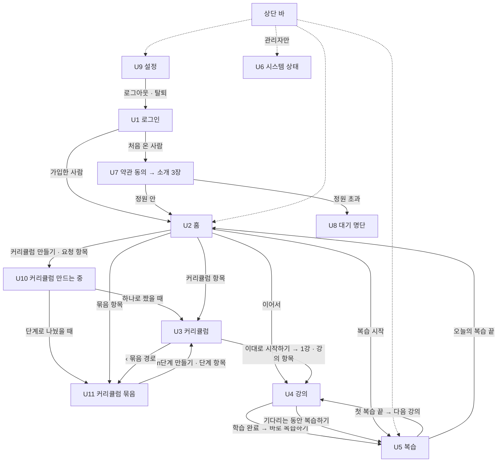
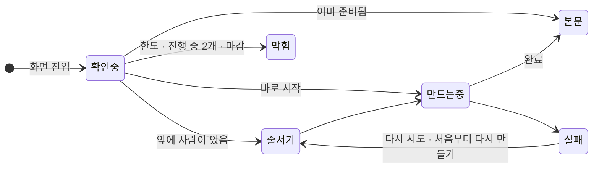

# 06. 화면 정의서

> **사용자가 보는 화면을 글로 정의한다** — 무엇이 · 어떤 순서로 · 어떤 상태에서 · 어떤 문구로 보이고, 누르면 어디로 가는가.
> 색 · 글꼴 · 간격 · 컴포넌트의 모양은 [UI_GUIDE](./UI_GUIDE.md)가 정한다. 데이터는 [05 API](./05-api.md), 용어는 [01 §12](./01-overview.md).

> **읽는 쪽이 셋이다** — 화면을 그리는 클로드 디자인(§17) · 구현하는 Codex · 기획 검토.
> 그래서 **화면 절 하나만 떼어 줘도 뜻이 통하게** 목적 · 진입 · 영역 · 상태 · 동작 · 문구를 각 절 안에 둔다.
> 여러 화면이 함께 쓰는 것(상단 바 · 대기 블록 · 확인 펼침 · 상태 글자 · 막힘 문구)만 §2 · §15 에 모았다.

> 사용자는 이 서비스를 처음 보는 **일반 학습자**다. 백엔드가 무엇을 하는지 알 필요가 없다 —
> 토큰 · 비용 · 재시도 · 큐 같은 시스템 정보는 사용자 화면에 없고 **관리자 화면(U6)** 에만 있다. 예외는 내 작업 앞의 대기 수(「앞에 N명」) 하나다.

---

## 1. 읽는 법

### 1.1 표기

| 표기 | 뜻 |
|---|---|
| **U3** | 화면 번호. 번호는 이름일 뿐 흐름 순서가 아니다(§2.3) |
| **[U3-2]** | 화면 U3 의 2번 영역. 클로드 디자인에 *"U3-2 를 바꿔 줘"* 처럼 부를 이름이다. 위→아래 순서는 각 화면 · 상태의 **배치** 줄이 정한다 |
| `버튼: 이대로 시작하기` | 버튼과 **그 위에 적히는 문구 그대로** |
| `링크: 홈으로` | 글자 링크(UI_GUIDE 의 Text · 링크) |
| `입력: 주제` · `체크: …` | 입력 칸 · 체크 상자와 그 라벨 |
| 「 」 | 화면에 **그대로 나가는 문구**. 바꾸려면 이 문서를 먼저 고친다 |
| ⟨6⟩ · ⟨title⟩ | 데이터가 들어가는 자리. 숫자 · 한글은 §1.2 예시 값, 영문은 [05](./05-api.md) 의 필드 이름 |
| **가장 강조** | 그 상태에서 Primary 버튼이 되는 것 — 화면에 하나뿐이다(UI_GUIDE) |

### 1.2 예시 데이터 — 모든 프레임이 같은 사람

프레임끼리 숫자가 이어져야 흐름이 읽힌다. 아래 한 사람으로 채운다.

| | 예시 |
|---|---|
| 사용자 | someone@gmail.com · 가입 3주째 · 일반 사용자 |
| 오늘의 복습 | **23장** — 예정일이 지난 4장 포함. 출처는 「경제 기초」 · 「Spring 핵심 원리」 · 「한국사 근현대」가 섞여 있다 |
| 오늘 생성량 | **60%** 사용 |
| 학습 중 커리큘럼 | 「경제 기초」 · 목적 「뉴스의 경제 기사를 이해하고 싶어요」 · 강의 16개 중 5개 완료 · 다음은 6강 |
| 지금 여는 강의 | 「경제 기초」 6강 「기준금리와 인플레이션」 · 학습 목표 「기준금리가 물가에 영향을 주는 경로를 설명할 수 있다」 · 플래시카드 8장. 다음 강의는 7강 「환율은 어떻게 정해지나」 |
| 검토 대기 커리큘럼 | 「금융 시장 입문」 · 목적 「금리 · 환율 기사를 이해하고 싶어요」 · 강의 10개 · 오늘 다시 짜기 1/3회 사용 · 반영 내역 — 기회비용 `EXCLUDED` · 수요와 공급 `COMPRESSED` · 가격 탄력성 `EXPANDED` |
| 커리큘럼 묶음 | 「Spring 백엔드 실무」 · 주제 「Spring 백엔드」 · 목적 「신입 백엔드 개발자로 실무에 투입될 수준까지」 · 3단계 |
| └ 1단계 | 「Spring 핵심 원리」 — 의존성 주입 · 빈 생명주기 · AOP · 트랜잭션의 동작 원리. **완료**(12/12강) |
| └ 2단계 | 「웹 MVC와 데이터 접근」 — 요청 처리 흐름 · REST API 설계 · JPA와 영속성 관리. **아직 만들지 않음 · 만들 수 있음** |
| └ 3단계 | 「운영과 배포」 — 설정과 프로필 · 로깅과 모니터링 · 컨테이너 배포. **아직 만들지 않음** |
| 끝난 커리큘럼 | 「한국사 근현대」 · 8/8강 |
| 새로 만드는 요청 | 「통계학 입문」 · 목적 「데이터 분석 업무에 쓰려고요」 (U10 · U2 ③ 프레임에서) |

- 상태가 다른 프레임(예: U11 *단계 검토*)은 **같은 대상의 다른 시점**으로 그린다. 새 사람 · 새 주제를 지어내지 않는다. 프레임별 대상과 시점은 §17.4.
- **예시 플래시카드**
  - 오늘의 복습 3번째 — 출처 「경제 기초 › 4강」 · 개념 「공급 변화」 · 질문 「원자재 가격이 올라 공급이 줄었어요. 수요가 그대로라면 시장 가격과 거래량은 각각 어떻게 변하나요?」 · 모범 답안 「공급 곡선이 왼쪽으로 이동해 균형 가격은 오르고 거래량은 줄어요.」 · 채점 포인트 「공급 곡선이 왼쪽으로 이동한다」 「균형 가격이 오른다」 「거래량이 줄어든다」
  - 첫 복습(6강) 1번째 — 출처 「경제 기초 › 6강」 · 개념 「기준금리」 · 질문 「기준금리를 올리면 물가 상승률이 낮아지는 경로를 두 단계로 설명해 보세요.」 · 모범 답안 「기준금리가 오르면 시중 금리가 따라 올라 대출 · 소비 · 투자가 줄고, 수요가 줄어 물가 상승 압력이 낮아져요.」 · 채점 포인트 「시중 금리가 오른다」 「소비 · 투자가 줄어든다」 「수요가 줄어 물가 압력이 낮아진다」
- **예시 강의 본문**(6강) — 「개념 설명」 에 그림 하나(기준금리 → 시중 금리 → 소비 · 투자 → 물가의 흐름도)와 수식 하나(실질금리 ≈ 명목금리 − 기대 인플레이션율), 「예시」 에 표 하나(연도별 기준금리와 물가 상승률).

---

## 2. 공통

### 2.1 누가 · 언제 쓰나 — 주요 사용 장면

화면을 판단하는 기준이다. 각 화면 절의 **누가 · 언제** 가 이 번호를 가리킨다.

| # | 장면 | 기기 · 시간 | 흐름 | 화면이 지킬 것 |
|---|---|---|---|---|
| S1 | **처음 온 사람** | 링크를 받은 휴대폰 · 5분 | U1 → U7 동의 · 소개 → U2 만들기 → U10(수십 초) → U3 검토 → U4 1강 | 설명을 더 끼우지 않는다. 누를 곳이 늘 하나로 보인다 |
| S2 | **매일 복습** | 휴대폰 · 자투리 3~5분 | U2 → U5 → 끝 | 홈 맨 위가 복습. 엄지 하나로 끝까지. 중간에 나가도 저장된다 |
| S3 | **강의 하나 학습** | 휴대폰 · 이동 중 10~20분 | U2 「이어서」 → U4 대기(1~2분) → 읽기 → 학습 완료 → U5 첫 복습 → 다음 강의 | 대기를 복습 시간으로 바꾼다. 다 읽으면 첫 복습으로, 첫 복습 뒤엔 다음 강의로 이끈다 |
| S4 | **새 주제 시작** | 아무 기기 | U2 만들기 → U10 → U3 검토 → 다시 짜기 또는 시작 | 내 복습 기록 때문에 무엇이 줄고 늘었는지 보인다 |
| S5 | **넓은 주제** | 아무 기기 · 몇 주에 걸쳐 | U2 만들기 → U10 → U11 단계 검토 → 1단계 만들기 → … 1단계 완료 → 2단계 만들기 | 지금 몇 단계인지, 다음에 무엇을 누르는지 한눈에. 다음 단계는 내가 누를 때만 만든다 |
| S6 | **막혔을 때** | — | 생성 한도 · 마감 · 진행 중 2개 · 오늘 횟수 소진 | 이유 · 언제 풀리나 · 지금 할 수 있는 것. 학습 · 복습은 계속된다 |
| S7 | **정리** | — | 커리큘럼 · 묶음 삭제, 실패한 요청 지우기, 탈퇴 | 무엇이 지워지는지 먼저 말하고 그 자리에서 한 번 더 묻는다 |

### 2.2 원칙

| # | 원칙 | 화면에서 |
|---|---|---|
| 1 | **처음 온 사람도 몇 분 안에 첫 강의까지** | 로그인 → 동의 → 소개 3장 → 만들기 폼. 생성량 · 다시 짜기 횟수 · 단계 나누기는 **그 상황이 올 때 그 자리에서** 알린다 |
| 2 | **기다림을 숨기지 않되, 사용자 말로** | 「앞에 2명」 · 쉬운 단계 이름 · 「평소보다 조금 더 걸리고 있어요」 · 「떠나도 계속 만들어요」 까지만. **가짜 퍼센트 막대를 쓰지 않는다**(§2.8) |
| 3 | **막힐 때는 이유 · 언제 풀리는지 · 지금 할 수 있는 것** | 모든 막힘 · 실패 문구가 이 세 부분이다(§15) |
| 4 | **학습은 막히지 않는다** | 생성이 막혀도 만든 강의와 복습은 된다. 복습이 밀려도 다음 강의는 열린다 — 밀린 복습은 상단 바 숫자와 홈 첫 줄로만 알린다. 경고색 · 재촉 문구를 쓰지 않는다 |
| 5 | **흐름은 이끌되 강제하지 않는다** | 강의를 끝내면 첫 복습으로, 첫 복습을 끝내면 다음 강의로 이끌지만 언제든 빠질 수 있다. 강의 순서 · 다음 단계를 만들 시점도 사용자가 정한다 |
| 6 | **다음 행동 하나가 가장 눈에 띈다** | 화면 · 상태마다 *가장 강조* 를 하나만 정한다. 위험한 동작(삭제 · 탈퇴)은 화면 맨 아래에 덜 눈에 띄게 둔다 |

### 2.3 화면 목록

| 번호 | 화면 | 주소(예) | 상단 바 | 기준 폭 |
|---|---|---|---|---|
| U1 | 로그인 | `/login` | 없음 | 모바일 |
| U7 | 가입 — 약관 동의 · 소개 | `/welcome` | 없음 | 모바일 |
| U8 | 대기 명단 | `/waitlist` | 없음 | 모바일 |
| U2 | 홈 | `/` | 있음 | 모바일 |
| U10 | 커리큘럼 만드는 중 | `/curriculum-requests/{jobId}` | 있음 | 모바일 |
| U3 | 커리큘럼 | `/curriculums/{id}` | 있음 | 모바일 |
| U11 | 커리큘럼 묶음 | `/groups/{id}` | 있음 | 모바일 |
| U4 | 강의 | `/lessons/{id}` | 있음 | 모바일 |
| U5 | 복습 | `/review` | 있음 | 모바일 |
| U9 | 설정 | `/settings` | 있음 | 모바일 |
| P1 · P2 | 이용약관 · 개인정보처리방침 | `/terms` · `/privacy` | 없음 | 모바일 |
| U6 | 시스템 상태 — 관리자 전용 | `/admin/status` | 있음 | **데스크톱** |

- 사용자 화면 10개 + 관리자 1개 + 약관 2장이다.
- 주소는 예시다 — 구현 TASK 에서 정한다. 다만 **U10 의 `jobId`, U3 · U11 · U4 의 id 는 주소에 둔다.** 새로고침 · 다른 탭 · 다른 기기에서도 같은 대상, 같은 작업에 다시 붙어야 한다([05 §2 · §4](./05-api.md)).
- 로그인하지 않은 채 열었던 주소는 기억해 두었다가, 로그인이 끝나면 그 주소로 보낸다(가입 중이면 가입을 마친 뒤).

### 2.4 화면 지도



**주요 이동만** 그린 지도다. 「나중에」 · 「커리큘럼으로」 · 「묶음 보기」 · 「지우고 다시 쓰기」 · U8 에서 나가기 같은 나머지 이동은 각 화면 절의 **진입 · 나가는 곳 · 동작**이 정한다.

### 2.5 상단 바 — U2 · U3 · U4 · U5 · U9 · U10 · U11 · U6

왼쪽에서 오른쪽.

- 서비스 이름(글자) 「머금」 — 누르면 U2
- `링크: 홈`
- `링크: 복습` + 오늘 복습할 장수 ⟨23⟩(`GET /reviews/due` 의 카드 수). 0장이면 숫자 없음. 밀린 것이 있어도 **경고색을 쓰지 않는다**(원칙 4)
- **관리자에게만** `링크: 시스템 상태`(`GET /me` 의 `role=ADMIN`). 일반 사용자에게는 자리도 없다
- 오른쪽 끝 `링크: 설정`

규칙

- 모바일 390 에서도 **한 줄**에 들어간다. 아이콘 · 햄버거 메뉴로 바꾸지 않는다.
- 지금 있는 화면의 링크를 구분되게 표시한다(UI_GUIDE).
- 화면 위에 **고정하지 않는다** — 스크롤하면 함께 올라간다. 휴대폰에서 강의 읽는 자리를 넓게 쓰기 위해서다.
- 로그아웃은 상단 바에 없다 — U9 안에 있다. 자주 누르는 버튼이 아니다.

> **복습을 상단에 두는 이유** — 복습은 커리큘럼에 속하지 않는 **매일의 일**이다. 어느 화면에서든 한 번에 간다.

### 2.6 공통 상태

| 상태 | 모든 화면에서 |
|---|---|
| 첫 로딩 | 영역 자리에 **회색 줄**(스켈레톤). 화면 가운데 스피너를 띄우지 않는다 — 생성 대기와 헷갈린다 |
| 로그인 만료 · 로그아웃된 세션 (`401`) | 즉시 U1. U1 에 「다시 로그인해 주세요.」 |
| 약관 동의 전 (`403 TERMS_REQUIRED`) | U7 약관 동의로 |
| 대기 명단 (`403 ACCOUNT_WAITLISTED`) | U8 로 |
| 없는 대상 (`404`) | 본문 자리에 「찾을 수 없어요. 삭제됐거나 볼 수 없는 항목이에요.」 + `링크: 홈으로`. 폴링 중이었으면 멈춘다 |
| 요청이 너무 잦음 (`429 RATE_LIMITED`) | 그 영역에 「잠시 후 다시 시도해 주세요.」. 폴링 중이면 문구 없이 **간격을 늘려** 다시 시도한다 |
| 네트워크 실패 | 그 영역 안에 「불러오지 못했어요.」 + `버튼: 다시 시도`. 화면 전체를 갈아엎지 않는다 |
| 버튼을 누르고 응답을 기다리는 중 | 그 버튼을 잠근다(연타 방지). 버튼 글자는 바꾸지 않는다 |
| 대상의 상태가 다른 탭에서 바뀜(`409`) | 그 대상을 다시 불러와 새 상태로 보인다. 같은 요청을 자동으로 다시 보내지 않는다 |

### 2.7 되돌릴 수 없는 동작 — 그 자리에서 한 번 더

**팝업(모달) · 브라우저 확인창을 쓰지 않는다.** 누른 버튼 · 링크 자리가 아래로 펼쳐져 무엇이 지워지는지 말하고, 한 번 더 누르게 한다.
펼쳐지면 포커스가 안내 문구로 가고, `취소` 하면 접히며 원래 버튼으로 돌아간다. 처리 중에는 펼친 버튼들을 잠근다.

| 동작 | 어디서 | 펼쳐지는 내용 |
|---|---|---|
| **커리큘럼 삭제** | U3 [U3-6] | 「이 커리큘럼과 강의 자료, 학습 기록, 관련 플래시카드가 모두 삭제돼요. 삭제한 플래시카드의 학습 기록은 앞으로의 맞춤 학습에 반영되지 않아요. 삭제하면 되돌릴 수 없어요.」 — 묶음의 단계면 한 줄 더: 「이 단계는 ‘아직 만들지 않음’으로 돌아가요. 나중에 다시 만들 수 있어요.」 · `버튼: 삭제하기` `버튼: 취소`. 짜는 중에도 할 수 있다 |
| **묶음 삭제** | U11 [U11-4] | 「이 묶음과 단계별 커리큘럼 ⟨1⟩개, 강의 자료, 학습 기록, 관련 플래시카드가 모두 삭제돼요. 삭제한 플래시카드의 학습 기록은 앞으로의 맞춤 학습에 반영되지 않아요. 삭제하면 되돌릴 수 없어요.」 · `버튼: 삭제하기` `버튼: 취소`. 짜는 중인 단계가 있어도 할 수 있다 |
| **묶음 지우고 다시 쓰기** | U11 [U11-4] — 만든 단계가 없을 때만 | 「나눈 단계 계획이 삭제돼요. 되돌릴 수 없어요.」 · `버튼: 지우고 다시 쓰기` `버튼: 취소` |
| **회원 탈퇴 · 대기 취소** | U9 [U9-4] · U8 [U8-2] | 지워지는 것 목록 + 확인 체크 → 체크해야 실행 버튼이 눌린다 |
| **실패한 요청 지우기** | U2 · U10 | **묻지 않는다** — 만들어진 것이 없어 잃을 것이 없다. 누르면 바로 사라진다 |

### 2.8 기다림 표시 — 대기 블록

U10 · U3 · U4 가 생성 작업을 기다릴 때 **같은 블록**을 쓴다. 서버가 알려 주는 것(`GET /jobs/{jobId}` — 2초마다)만 보여 준다.

| 서버 값 | 보이는 것 |
|---|---|
| `QUEUED` · ⟨aheadCount⟩ | 「앞에 ⟨2⟩명이 기다리고 있어요.」. `aheadCount` 가 0 이면(다음 차례) 이 줄 없이 나머지만 |
| `RUNNING` · ⟨stepName⟩ | **강의**(U4): 단계 목록 3줄 — 지난 단계 ✔ · 지금 ● · 남은 단계 ○. **커리큘럼**(U10 · U3): 단계 목록 없이 제목 한 줄 — 호출이 한 번이라 나눌 단계가 없다 |
| `retried=true` | 한 줄 더: 「평소보다 조금 더 걸리고 있어요.」 — 이유(재시도 · 429)는 말하지 않는다 |
| `FAILED` | 블록이 실패 문구(§15.2)로 바뀐다 |
| `SUCCEEDED` | 블록이 사라지고 그 자리에 결과가 나온다(U4 · U3), 또는 결과 화면으로 넘어간다(U10) |

늘 붙는 것

- **떠나도 된다는 한 줄** — 강의 「보통 1~2분 걸려요. 이 화면을 떠나도 계속 만들어요.」 / 커리큘럼 「수십 초 걸려요. 이 화면을 떠나도 계속 짜요.」
- 오늘 복습할 플래시카드가 있으면 `링크: 기다리는 동안 복습하기 (⟨23⟩장)` → U5 *기다리는 동안* 모드(§11). 복습하는 동안에도 이 작업을 지켜보다가 끝나면 복습 머리에서 알린다. 0장이면 없다 — **기다림을 학습 시간으로**(원칙 4)

하지 않는 것 — 퍼센트 막대 · 남은 시간 예측 · 화면 가운데 스피너 · 토큰 · 비용 · 재시도 횟수. 서버가 아는 것은 *단계*뿐이다. 단계 안의 퍼센트는 지어낸 숫자다.

### 2.9 상태 글자

목록 · 제목 옆에 붙는 짧은 상태. **글자로 쓰고 색에만 기대지 않는다.**

**커리큘럼** — 위에서부터 먼저 맞는 것

| 조건 | 글자 |
|---|---|
| 활성 생성 잡이 있다(짜는 중 · 다시 짜는 중) | 「짜는 중」 |
| `DRAFT` + 강의 없음 + 최근 잡 실패 | 「짜기 실패」 |
| `DRAFT` + 강의 있음 | 「검토 대기」 |
| `ACTIVE` | 「학습 중」 |
| `COMPLETED` | 「완료」 |

**만드는 중인 요청**(U2 의 초기 요청 항목) — 「짜는 중」 · 「짜기 실패」

**강의**(U3 강의 목록)

| 조건 | 글자 |
|---|---|
| `COMPLETED` | 「완료」 |
| 만드는 중 ⟨generating⟩ | 「만드는 중」 |
| 자료 있음 ⟨hasMaterial⟩ | 「바로 볼 수 있어요」 |
| 그 외 | 없음 |

**묶음** — **현재 단계**를 기준으로 쓴다. 현재 단계는 ① 연결된 커리큘럼이 짜는 중 · 짜기 실패 · 검토 대기 · 학습 중인 단계 가운데 순서가 가장 앞선 것, 없으면 ② 만들 수 있는 단계(1단계이거나 앞 단계가 완료) 가운데 가장 앞선 것이다. 둘 다 없으면 모든 단계가 완료다.

| 현재 단계 | 글자 |
|---|---|
| 아직 만들지 않음 | 「⟨2⟩단계 만들 차례」 |
| 짜는 중 · 짜기 실패 · 검토 대기 · 학습 중 | 「⟨2⟩단계 짜는 중」 · 「⟨2⟩단계 짜기 실패」 · 「⟨2⟩단계 검토 대기」 · 「⟨2⟩단계 학습 중」 |
| 없음(모든 단계 완료) | 「완료」 |

### 2.10 화면 폭

- **사용자 화면은 모두 한 단(single column)이고 모바일 390 을 기준으로 설계한다.** 일반 학습자는 강의를 이동 중에 읽고 복습을 자투리 시간에 하며, 그 둘의 출발점인 홈도 휴대폰에서 연다. 데스크톱 1280 은 **같은 한 단을 가운데 둔 것**이다 — 데스크톱용 2단 · 사이드바를 따로 만들지 않는다. 폭 값은 UI_GUIDE(U4 · U5 `max-w-prose`, 그 밖 `max-w-3xl`).
- **U6 관리자만 데스크톱 기준**이다. 모바일에서는 표가 가로로 스크롤되면 충분하다.
- 누르는 것은 모두 **44px 이상**. 모바일에서 붙어 있는 버튼끼리는 간격을 둔다.
- 화면 아래 고정 바(U3 [U3-5] · U5 [U5-3])는 맨 아래 내용을 가리지 않게 그만큼 여백을 두고, 모바일 키보드가 올라오면 숨긴다.
- 코드 블록 · 긴 수식 · 그림 · 표가 폭을 넘으면 **그 블록 안에서만** 가로로 스크롤한다. 본문 전체가 옆으로 밀리면 안 된다.

### 2.11 접근성 · 포커스 · 바뀐 내용 알리기

화면 이동 없이 영역이 바뀌는 곳이 많다. 키보드 · 스크린리더 사용자가 길을 잃지 않게:

- **영역이 바뀌면 포커스를 옮긴다** — 대기 → 본문이면 본문 제목으로, 학습 완료 후 [U4-4] 가 바뀌면 그 문구로, 확인 펼침(§2.7)이 열리면 안내 문구로, U5 에서 답을 보면 모범 답안으로, 다음 장으로 넘어가면 질문으로. 취소하면 원래 버튼으로.
- **폴링으로 바뀌는 문구는 조용히 읽어 준다**(aria-live polite) — 「앞에 ⟨2⟩명」 · 단계 변화 · 「평소보다 조금 더 걸리고 있어요.」 · 「이미 평가한 플래시카드예요.」
- **상태는 글자로도 말한다** — 색 · ✔ 표시만으로 완료 · 실패를 나타내지 않는다.
- 화면이 바뀌면 브라우저 탭 제목도 바꾼다 — 「⟨대상 이름 또는 화면 이름⟩ · 머금」.
- U5 단축키 — 스페이스(답 보기) · 1~4(평가). 버튼에 숫자를 작게 함께 적는다(UI_GUIDE).
- `prefers-reduced-motion` 이면 움직임을 끈다(UI_GUIDE).

---

## 3. U1 로그인

**목적** — 무엇을 하는 서비스인지 알고, 구글 계정으로 들어온다. 비밀번호 · 계정 만들기는 없다.
**누가 · 언제** — S1 처음 온 사람(공유 링크로) · 세션이 끝난 사람.
**진입** — 로그인하지 않은 채 아무 주소나 열었을 때 · 로그아웃 · 탈퇴 · 대기 취소 직후 · `401`.
**나가는 곳** — 구글 → 처음 온 사람은 U7, 대기 중이면 U8, 가입한 사람은 U2(열려던 주소가 있으면 그 주소 — §2.3).
**데이터** — `GET /auth/google` → `/auth/google/callback` → `GET /me`.
**상단 바 없음 · 가장 강조: `Google 계정으로 계속하기`.**

**배치** — [U1-1] · [U1-2] · [U1-3] · [U1-4]

- **[U1-1] 소개** — 가운데 정렬
  - 「머금」 + 슬로건 「배운 건 머금고, 흔들리는 건 다시 한 모금」
  - 제목: 「배운 걸 잊지 않게, 복습이 다음 강의를 바꾸는 학습」
  - 설명: 「주제만 정하면 AI가 강의를 짜고 만들어요. 복습 결과를 보고 이미 아는 건 짧게, 흔들리는 건 자세히 다음 강의를 만들어요.」
- **[U1-2] 로그인**
  - `버튼: Google 계정으로 계속하기` — 구글 로그인 브랜드 가이드의 표준 버튼 모양(G 로고 포함)을 따른다. 서비스 안에서 로고를 쓰는 유일한 자리다
  - 작은 글씨: 「처음이면 가입이 함께 진행돼요.」
  - 작은 글씨: 「지금은 정원을 정해 받고 있어요. 자리가 없으면 대기 명단에 올라가요.」 — 동의한 뒤에 처음 알게 되지 않게 미리 말한다
- **[U1-3] 알림 자리** — 평소엔 비어 있다
- **[U1-4] 바닥글** — `링크: 이용약관` · `링크: 개인정보처리방침`(로그인 없이 열린다)

| 상태 | [U1-3] |
|---|---|
| 기본 | 없음 |
| 로그인 만료 · 로그아웃된 세션 | 「다시 로그인해 주세요.」 |
| 구글에서 돌아왔는데 실패 · 취소 (`?error=login_failed`) | 「로그인하지 못했어요. 다시 시도해 주세요.」 |
| 관리자 목록에 없는 계정 (`?error=not_allowed` — 공개 전 임시 · ADR-062 · `12` 에서 없앤다) | 「지금은 공개 전이라 정해진 계정만 들어올 수 있어요.」 |
| 탈퇴 직후 | 「탈퇴가 끝났어요. 학습 기록을 모두 지웠어요.」 |
| 대기 취소 직후 | 「대기를 취소하고 정보를 지웠어요.」 |
| 약관에 동의하지 않고 나간 직후 | 「가입하지 않고 나갔어요. 받은 정보는 지웠어요.」 |

---

## 4. U7 가입 — 약관 동의 · 소개

**목적** — 처음 온 사람이 **한 번만** 거친다. 동의를 받고, 서비스가 어떻게 돌아가는지 30초 안에 알려 준 뒤 첫 커리큘럼으로 보낸다.
**누가 · 언제** — S1. 약관이 바뀐 뒤 다시 들어온 가입자는 동의 단계만.
**진입** — 첫 로그인 · `403 TERMS_REQUIRED`.
**나가는 곳** — 응답 `status` 가 `ACTIVE` 면 소개 → U2, `WAITLISTED` 면 U8, 동의하지 않고 나가기 → U1.
**데이터** — `POST /me/terms` → `{ status }` · 나가기는 `DELETE /me`.
**상단 바 없음.**

### 4.1 1단계 — 약관 동의

**배치** — [U7-1] · [U7-2] · [U7-3] · **가장 강조: `동의하고 시작하기`**

- **[U7-1] 머리**
  - 「시작하기 전에 확인해 주세요」
  - 「구글 계정 이메일과 학습 기록을 저장해요. 탈퇴하면 모두 지워요.」
- **[U7-2] 동의 항목**
  - `체크: 모두 동의` — 아래 둘을 한 번에. 둘 중 하나를 풀면 함께 풀린다
  - 구분선
  - `체크: [필수] 이용약관` · 오른쪽 `링크: 보기` → P1
  - `체크: [필수] 개인정보 수집 · 이용` · 오른쪽 `링크: 보기` → P2
  - 「보기」에서 돌아오면 체크한 상태가 그대로다
- **[U7-3] 결정**
  - `버튼: 동의하고 시작하기` — 둘 다 체크해야 눌린다. 잠겨 있으면 아래 작은 글씨 「필수 항목에 모두 동의해야 시작할 수 있어요.」
  - `링크: 동의하지 않고 나가기` → 로그인 때 받은 정보를 지우고 U1

**약관이 바뀌어 다시 동의할 때**(이미 가입한 사람)

- [U7-1] 이 「약관이 바뀌었어요」 + 「바뀐 내용을 확인하고 동의해 주세요.」 로 바뀐다
- 결정 버튼은 `버튼: 동의하고 계속하기` → 원래 가려던 화면
- 「동의하지 않고 나가기」 대신 작은 글씨 「동의하지 않으면 서비스를 쓸 수 없어요.」 + `링크: 로그아웃` — **가입자의 기록을 지우는 일은 U9 탈퇴에서만** 한다. 이 링크로 학습 기록이 사라지면 안 된다

### 4.2 2단계 — 서비스 소개 (정원 안일 때)

**가장 강조: `다음` — 마지막 장에서는 `첫 커리큘럼 만들기`**

한 화면에 한 장, 아래에 점 3개(지금 위치)와 `버튼: 다음`. 모바일은 옆으로 밀어서도 넘긴다. 모든 장 오른쪽 위에 `링크: 건너뛰기` → U2.

| 장 | 제목 | 설명 | 장면 조각 |
|---|---|---|---|
| 1 | 「배우고 싶은 주제를 알려 주세요」 | 「주제와 목적을 적으면 AI가 강의 목록을 짜요. 원하는 속도로 학습하세요.」 | 주제 · 목적 입력 칸 |
| 2 | 「강의를 읽고 바로 복습해요」 | 「강의를 마치면 핵심을 묻는 플래시카드가 생겨요. 잊을 때쯤 다시 보여 드려요.」 | 플래시카드 한 장과 평가 버튼 네 개 |
| 3 | 「복습할수록 강의가 맞춰져요」 | 「이미 아는 개념은 짧게, 흔들리는 개념은 자세히. 다음 강의가 달라져요.」 | 「이렇게 짰어요」 한 줄([U3-3]) |

- **장면 조각** — 장식 그림 대신 실제 화면의 작은 조각을 회색조로 둔다. 무엇을 하게 되는지 *보여 준다*. 일러스트 · 이모지는 쓰지 않는다(UI_GUIDE)
- 3장에서 `다음` 자리가 `버튼: 첫 커리큘럼 만들기` → U2(만들기 폼이 펼쳐진 상태)

> **소개는 3장에서 멈춘다.** 생성량 · 다시 짜기 횟수 · 단계 나누기는 그 상황이 올 때 그 자리에서 알려 준다.

---

## 5. U8 대기 명단

**목적** — 정원이 찼다는 사실과 **지금 몇 번째인지**, 자리가 나면 어떻게 되는지 알려 준다.
**누가 · 언제** — 동의 직후 정원이 차 있던 사람 · 대기 중에 다시 로그인한 사람.
**데이터** — `GET /me`(`waitlistPosition`) · `POST /auth/logout` · `DELETE /me`.
**상단 바 없음 · 가장 강조: 없음**(지금 할 일이 없다).

**배치** — [U8-1] · [U8-2]

- **[U8-1] 안내**
  - 제목 「지금은 정원이 찼어요」
  - 큰 숫자: 「대기 ⟨3⟩번째」 — 가운데 정렬
  - 「비용을 감당할 수 있는 만큼만 받고 있어요. 자리가 나면 이 구글 계정으로 바로 쓸 수 있어요.」
  - 「따로 알림을 보내지 않아요. 가끔 다시 들러 주세요.」 — 없는 기능을 기대하게 하지 않는다
- **[U8-2] 할 수 있는 것**
  - `링크: 로그아웃`
  - `링크: 대기 취소하고 정보 지우기` → §2.7 펼침: 「대기를 취소하면 이메일과 동의 기록을 지워요. 다시 오면 대기 명단 맨 뒤로 가요.」 + `체크: 정보가 지워지는 것을 확인했어요` → `버튼: 대기 취소하기` · `버튼: 취소` → U1

---

## 6. U2 홈

**목적** — 매일의 출발점. ① 오늘 복습할 것 ② 하던 학습 이어서 하기 ③ 새로 만들기.
**누가 · 언제** — S2 · S3 · S4 · S5. 로그인하면 가장 먼저, 가장 자주 여는 화면이다.
**진입** — 로그인 직후 · 가입 소개 직후 · 상단 바 「홈」 · 오늘의 복습을 끝낸 뒤 · 삭제 직후.
**데이터** — `GET /reviews/due` · `GET /curriculums` · `GET /curriculum-requests` · 묶음 목록과 단계 생성([05 §2.1](./05-api.md)) · `POST /curriculum-requests` · `DELETE /curriculum-requests/{jobId}`(실패한 요청 지우기) · `GET /jobs/{id}` · `GET /me`(오늘 생성량).
**가장 강조** — 오늘 복습이 있으면 `복습 시작`. 없으면 [U2-2] 에서 위부터 보아 버튼이 있는 첫 항목의 버튼(「짜는 중」 요청처럼 버튼이 없는 항목은 건너뛴다). 처음 온 사용자는 `커리큘럼 만들기`.

**배치** — [U2-1] · [U2-2] · [U2-3]

- **[U2-1] 오늘의 복습** — 맨 위. 매일 하는 일이라서
  - 큰 숫자: 「오늘의 복습 ⟨23⟩장」
  - 밀린 것이 있으면: 「⟨4⟩장은 예정일이 지났어요. 먼저 보여 드릴게요.」 ⟨overdueCount⟩
  - `버튼: 복습 시작` → U5 오늘의 복습
  - 작은 글씨: 「원하는 만큼 하고 그만둬도 평가한 것은 저장돼요.」
- **[U2-2] 내 학습** — 소제목 「내 학습」. 항목 하나가 카드 하나다
  - 순서: ① 짜는 중 · 짜기 실패한 요청(최근 순) ② 진행 중인 커리큘럼과 묶음(최근에 만든 순) ③ 끝난 것 — 접혀 있다. `링크: 끝난 학습 ⟨1⟩개 보기` 를 누르면 펼친다
  - 묶음의 단계 커리큘럼은 **따로 항목이 되지 않는다** — 묶음 항목 안에 현재 단계(§2.9)로만 보인다
  - 버튼 밖의 항목 자리를 누르면 그 대상의 화면으로 간다(아래 표 「누르면」)
- **[U2-3] 새 커리큘럼 만들기**
  - [U2-2] 에 항목이 하나라도 있으면 **접혀 있다** — `버튼: 새 커리큘럼 만들기` 하나만 보이고, 누르면 폼이 펼쳐진다. 처음 온 사용자 · 막힘 문구가 떠 있을 때 · 다른 화면의 「새 커리큘럼 만들기」 · 「지우고 다시 쓰기」로 왔을 때는 펼친 채로
  - 소제목 「새 커리큘럼 만들기」
  - `입력: 무엇을 배울까요?` — 한 줄 · 100자. 자리표시 「예: 경제 기초, 한국사, 파이썬」 · 글자 수 「⟨0⟩ / 100」
  - `입력: 목적 (선택)` — 한 줄 · 200자. 자리표시 「예: 처음 배워요 · 자격증 시험 준비 · 업무에 쓰려고요」 · 글자 수 「⟨0⟩ / 200」
  - 작은 글씨: 「입력한 내용은 강의를 만드는 AI에 전달돼요. 개인 정보는 적지 말아 주세요.」
  - 안내: 「주제와 목적에 맞춰 강의 목록을 짜요. 범위가 넓으면 여러 단계로 나눠 제안해요. 수십 초 걸려요.」
  - **오늘 생성량** — 얇은 막대 + 「오늘 생성량 ⟨60⟩% · 0시에 다시 채워져요」 ⟨quota.usedRatio⟩. 숫자(토큰 · 원)는 보여 주지 않는다
  - `버튼: 커리큘럼 만들기` — 주제가 비어 있으면 잠긴다
  - **[U2-3a] 알림 자리** — 막혔을 때 §15.1 문구와 지금 할 수 있는 것 링크
  - 기간 · 주당 학습량 입력은 없다(학습 플랜은 MVP 이후 — [01 §6](./01-overview.md))

**항목 모양**

| 항목 | 첫 줄 | 둘째 줄 | 버튼 | 누르면 |
|---|---|---|---|---|
| 요청 — 짜는 중 | ⟨topic⟩ · 「짜는 중」 | 「수십 초 걸려요.」 | 없음 | U10 |
| 요청 — 짜기 실패 | ⟨topic⟩ · 「짜기 실패」 | §15.2 문구의 첫 문장 | `링크: 지우기` — 묻지 않고 바로. 항목 오른쪽 끝에 따로 두고(누르는 자리 44px) 항목을 누르는 자리와 겹치지 않게 — 잘못 눌러 지우지 않게 | U10 |
| 커리큘럼 — 짜는 중 · 짜기 실패 | ⟨title⟩ · 상태 글자 | — | 없음 | U3 |
| 커리큘럼 — 검토 대기 | ⟨title⟩ · 「검토 대기」 | 「강의 ⟨10⟩개」 | `버튼: 검토하기` → U3 | U3 |
| 커리큘럼 — 학습 중 | ⟨title⟩ · 「학습 중」 | 진도 막대 + 「⟨5⟩ / ⟨16⟩강」 | `버튼: 이어서 · 6강 기준금리와 인플레이션` ⟨nextLesson⟩ → **U4 로 바로**. 한 줄, 넘치면 강의 제목을 말줄임 | U3 |
| 묶음 — 현재 단계 학습 중 | ⟨group.title⟩ · 「⟨2⟩단계 학습 중」 | 「⟨3⟩단계 중 ⟨2⟩단계 · ⟨step.title⟩」 + 진도 막대 + 「⟨3⟩ / ⟨11⟩강」 | `버튼: 이어서 · …` → U4 | U11 |
| 묶음 — 현재 단계 짜는 중 · 짜기 실패 · 검토 대기 | ⟨group.title⟩ · 상태 글자 | 「⟨3⟩단계 중 ⟨2⟩단계 · ⟨step.title⟩」 | 검토 대기면 `버튼: 검토하기` → U3 | U11 |
| 묶음 — 다음 단계 만들 차례 | ⟨group.title⟩ · 「⟨2⟩단계 만들 차례」 | 「⟨1⟩단계를 마쳤어요. 다음은 ‘⟨웹 MVC와 데이터 접근⟩’이에요.」 | `버튼: ⟨2⟩단계 커리큘럼 만들기` → 새 커리큘럼의 U3(짜는 중) | U11 |
| 묶음 — 아직 아무 단계도 만들지 않음 | ⟨group.title⟩ · 「1단계 만들 차례」 | 「⟨3⟩단계로 나눠 배우는 걸 제안했어요.」 | `버튼: 단계 살펴보기` → U11 — 홈에서 바로 만들지 않고 나눈 단계를 먼저 보게 한다 | U11 |
| 끝난 것 | ⟨title⟩ · 「완료」 | 「⟨8⟩ / ⟨8⟩강」 또는 「⟨3⟩단계 모두 완료」 | 없음 | U3 · U11 |

**동작**

- `커리큘럼 만들기` → 요청 ID(`requestId`)를 새로 만들어 `POST /curriculum-requests`. 응답 전에 연결이 끊겨 다시 보낼 때는 **같은 요청 ID** 를 쓴다(중복 접수 방지 — [05 §2](./05-api.md)). `202` 를 받으면 폼을 비우고 U10 으로 간다
- 막히면(§15.1) 폼을 그대로 두고 [U2-3a] 에 문구. 입력은 지우지 않는다
- 짜는 중인 항목이 있으면 그 작업을 2초마다 확인해, 끝나면 항목을 결과(검토 대기 커리큘럼 · 묶음 · 실패)로 바꾼다
- 요청 `지우기` → `DELETE /curriculum-requests/{jobId}` → 항목이 사라진다. 다른 탭에서 다시 시도해 이미 짜는 중이면(`409 JOB_NOT_FAILED`) 목록을 다시 불러온다
- 묶음의 `⟨n⟩단계 커리큘럼 만들기` → 단계 생성 요청 → 새 커리큘럼의 U3(짜는 중). 이미 만들어진 단계면 그 U3 로 간다. 막히면 그 항목 아래에 §15.1 문구


| 상태 | 화면 |
|---|---|
| 첫 로딩 | [U2-1] · [U2-2] 자리에 회색 줄 |
| **처음 온 사용자** | [U2-1] 「아직 복습할 플래시카드가 없어요. 강의를 하나 마치면 여기에 생겨요.」 · 버튼 없음. [U2-2] 없음. [U2-3] 이 펼쳐져 화면의 중심이 되고, 데스크톱에서는 첫 입력 칸에 커서가 있다 |
| 평소 | 위 배치 그대로 |
| 오늘 복습 끝 | [U2-1] 「오늘 복습은 끝났어요.」 · 버튼 없음 |
| 짜는 중 · 짜기 실패한 요청 있음 | [U2-2] 맨 위에 요청 항목 |
| 막힘 | [U2-3a] 에 §15.1 문구 + 할 수 있는 것 링크. 폼은 펼친 채 |
| 입력 오류 | 해당 입력 아래 「주제는 100자까지 쓸 수 있어요.」 · 「목적은 200자까지 쓸 수 있어요.」 — 보통 글자 수 표시가 먼저 막는다 |

---

## 7. U10 커리큘럼 만드는 중

**목적** — 새 커리큘럼(또는 단계로 나눈 묶음)이 짜이는 수십 초를 기다리고, 다 되면 결과로 바로 넘어간다. 실패하면 이유와 할 수 있는 것을 보여 준다.
**누가 · 언제** — S1 · S4 · S5. 「커리큘럼 만들기」 직후 · 홈의 요청 항목을 눌렀을 때.
**진입** — U2. 주소에 `jobId` 가 있어 새로고침 · 다른 기기에서도 같은 작업에 붙는다.
**나가는 곳** — 성공하면 ⟨result.kind⟩ 가 `CURRICULUM` 이면 U3(검토 대기), `CURRICULUM_GROUP` 이면 U11. 이 화면을 방문 기록에 남기지 않고 **바꿔서** 넘어간다 — 뒤로 가기로 다시 이 화면에 오지 않게.
**데이터** — `GET /jobs/{jobId}`(2초마다 · `result`) · `GET /curriculum-requests`(제목 줄의 주제 · 목적) · `POST /jobs/{jobId}/retry` · `DELETE /curriculum-requests/{jobId}`.
**가장 강조** — 기다리는 중: 없음. 실패: `다시 시도` 또는 `지우고 다시 쓰기`.

> **왜 따로 화면인가** — 성공하기 전에는 커리큘럼도 묶음도 없다([05 §2](./05-api.md)). U3 을 빈 커리큘럼으로 열면 시작 · 삭제 버튼이 거짓말이 된다. 그래서 기다림 · 실패 · 결과로 넘어가기만 하는 화면을 따로 둔다.

**배치** — 기다리는 중 [U10-1] · [U10-2] · [U10-3] / 실패 [U10-1] · [U10-4]

- **[U10-1] 머리**
  - 작은 글씨: 「새 커리큘럼」
  - 제목: ⟨topic⟩ 「통계학 입문」
  - 한 줄: ⟨purpose⟩ 「데이터 분석 업무에 쓰려고요」 — 목적이 없으면 줄 없음
- **[U10-2] 대기 블록**(§2.8 · 커리큘럼형)
  - 제목 「커리큘럼을 짜고 있어요」
  - 「수십 초 걸려요. 이 화면을 떠나도 계속 짜요. 홈에서 다시 열 수 있어요.」
  - 줄서기 · 평소보다 오래 걸림 · `링크: 기다리는 동안 복습하기 (⟨23⟩장)`
- **[U10-3] 미리 자리** — 강의 목록이 들어올 자리에 회색 줄 5개(스켈레톤). 무엇이 나올지 모양으로 알려 준다
- **[U10-4] 실패** — 실패하면 [U10-2] · [U10-3] 대신 나온다
  - §15.2 문구
  - 다시 시도할 수 있으면 `버튼: 다시 시도` + `링크: 이 요청 지우기`
  - 다시 시도할 수 없으면 `버튼: 지우고 다시 쓰기` → 요청을 지우고 U2 로. 만들기 폼이 펼쳐져 있고 ⟨topic⟩ · ⟨purpose⟩ 가 채워져 있다 — 고쳐 쓰라고
  - 주제 거절이면 한 줄 더: 「개념과 지식을 배우는 주제로 적어 주세요. 회화 · 실기처럼 연습이 중심인 주제는 만들 수 없어요.」

| 상태 | 화면 |
|---|---|
| 줄서기 | [U10-2] 에 「앞에 ⟨2⟩명이 기다리고 있어요.」 |
| 짜는 중 | [U10-2] 기본 |
| 평소보다 오래 걸림 | + 「평소보다 조금 더 걸리고 있어요.」 |
| 실패 — 다시 시도 가능 | [U10-4] — `다시 시도` · `이 요청 지우기` |
| 실패 — 다시 시도 불가(주제 거절 · 입력이 너무 큼 · 시도 소진 · 지금은 쓸 수 없음) | [U10-4] — `지우고 다시 쓰기` |
| 다시 시도가 막힘 | [U10-4] 문구가 §15.1 문구로 바뀐다 |
| 성공 | 결과 화면으로 넘어가고 탭 제목도 결과 이름으로 바뀐다 |
| 지워졌거나 남의 것 | §2.6 `404` |

**동작**

- `다시 시도` → `POST /jobs/{jobId}/retry` → 대기 블록으로. 이미 끝낸 단계는 다시 하지 않는다
- `이 요청 지우기` → `DELETE /curriculum-requests/{jobId}` → U2. 묻지 않는다(§2.7)
- 짜는 중인 요청은 지울 수 없다 — 수십 초면 끝나고, 이미 나간 호출은 되돌릴 수 없다

---

## 8. U3 커리큘럼

**목적** — 커리큘럼 하나를 **검토하고 시작**하거나, **진도를 보고 다음 강의로** 간다.
**누가 · 언제** — S4(검토) · S3(학습 중 목록) · S5(단계 커리큘럼).
**진입** — U10 성공(하나로 짰을 때) · U11 단계 항목 · 단계 만들기 직후 · U2 항목 · U4 경로 · 학습 완료 후 「나중에」 · U5 「커리큘럼으로」.
**데이터** — `GET /curriculums/{id}`(`lessons` · `masteryReflection` · `generation` · `regenerationsToday`) · `POST /curriculums/{id}/approve` · `/regenerate` · `DELETE /curriculums/{id}` · `GET /jobs/{jobId}` · `POST /jobs/{jobId}/retry` · 단계 커리큘럼이면 묶음 · 단계 정보와 단계 생성([05 §2.1](./05-api.md)).

### 8.1 공통 영역

- **[U3-0] 묶음 경로** — **단계 커리큘럼일 때만.** 맨 위 작은 글씨 `링크: ‹ Spring 백엔드 실무 · ⟨1⟩ / ⟨3⟩단계` → U11
- **[U3-1] 제목 줄**
  - 제목 ⟨title⟩ · 상태 글자(§2.9)
  - 한 줄: 「⟨topic⟩ · ⟨purpose⟩ · 강의 ⟨16⟩개」
  - 작은 글씨: 「원하는 속도로, 원하는 순서로 학습하세요.」
- **[U3-2] 알림 자리** — 대기 블록 · 실패 · 막힘 문구가 여기 뜬다
- **[U3-4] 강의 목록** — 권장 학습 순서대로. 주차 · 날짜 · 예상 완료일은 없다. 모양은 상태마다 다르다(아래)
- **[U3-6] 관리** — 화면 맨 아래, 덜 눈에 띄게. `링크: 이 커리큘럼 삭제` → §2.7 확인 펼침. 짜는 중에도 열려 있다. 삭제가 끝나면 하나짜리는 U2, 단계 커리큘럼은 U11 로 가고 홈 · 복습 숫자를 새로 불러온다

### 8.2 검토 대기 (`DRAFT`)

**배치** — [U3-0] · [U3-1] · [U3-2] · [U3-3] · [U3-4] · [U3-6] + 화면 아래 고정 [U3-5]
**가장 강조: `이대로 시작하기`**

- **[U3-3] 이렇게 짰어요** — 내 복습 기록이 이 커리큘럼을 어떻게 바꿨는지. 이 서비스의 약속을 눈으로 보여 주는 자리다
  - 소제목 「이렇게 짰어요」
  - ⟨masteryReflection⟩ 한 줄씩

    | `action` | 문구 |
    |---|---|
    | `EXCLUDED` | 「**기회비용**은 이미 잘 알고 계셔서 별도 강의로 만들지 않았어요.」 |
    | `COMPRESSED` | 「**수요와 공급**은 어느 정도 아셔서 짧게 다뤄요.」 |
    | `EXPANDED` (복습 기록 있음) | 「**가격 탄력성**은 아직 헷갈리실 수 있어서 더 자세히 다뤄요.」 |
    | `EXPANDED` (처음) | 표시하지 않는다 |

  - **표시할 항목이 없을 때**(빈 목록이거나 전부 `EXPANDED` (처음)): 「이번 주제와 관련해 반영할 복습 기록이 없어서 기초부터 짰어요. 복습이 쌓이면 이미 아는 내용은 줄여 드려요.」 — 빈 목록은 학습 이력이 없을 때와, 이력은 있지만 이 주제와 관련된 개념을 찾지 못했을 때([02 §5.4](./02-domain-data.md)) 모두 생긴다. 둘을 구별하지 않는 문구다
- **[U3-4] 강의 목록 — 검토**
  - 한 줄에: 순서 번호 · 제목 ⟨title⟩ · 학습 목표 ⟨objective⟩(두 줄까지, 넘치면 말줄임) · 키워드 글자표 ⟨keywords⟩
  - **누르지 못한다** — 시작하기 전에는 강의를 만들지 않는다. 눌리는 것처럼 보이지 않게(화살표 · 손가락 커서 없음)
- **[U3-5] 결정 바** — **화면 아래에 붙어 있다**(스크롤해도 보인다)
  - `버튼: 이대로 시작하기` — 승인되면 **곧바로 U4 1강으로.** U4 가 여느 때처럼 1강 만들기를 시작한다. U3 학습 중 화면을 거치지 않는다
  - `버튼: 다시 짜기` + 작은 글씨 「오늘 ⟨1⟩ / ⟨3⟩회 사용」 ⟨regenerationsToday⟩
  - 모바일은 한 줄에 「다시 짜기」(좁게) · 「이대로 시작하기」(넓게)
  - 삭제는 이 바에 두지 않는다 — [U3-6] 에 있다. 가장 강조된 버튼 옆에 되돌릴 수 없는 동작을 두지 않는다
- **[U3-5a] 다시 짜기 펼침** — 「다시 짜기」 를 누르면 결정 바가 사라지고 강의 목록 아래에 펼쳐진다. 포커스는 입력 칸으로
  - `입력: 무엇을 바꿀까요? (선택)` — 여러 줄. 자리표시 「예: 실무 예제를 더 넣어 주세요. 기초 설명을 더 자세히 해 주세요.」 · 글자 수 「⟨0⟩ / 500」
  - 안내: 「강의 내용 · 범위 · 깊이 · 순서를 바꿀 수 있어요. 학습 일정은 정하지 않아요. 오늘 ⟨2⟩번 더 다시 짤 수 있어요.」
  - `버튼: 이 내용으로 다시 짜기`(이때의 가장 강조) · `버튼: 취소` → 결정 바로 돌아간다

| 상태 | 화면 |
|---|---|
| **짜는 중** — 단계의 첫 짜기 | [U3-2] 에 대기 블록(§2.8 · 커리큘럼형). [U3-3] · [U3-4] 는 회색 줄. 결정 바의 두 버튼은 잠기고 아래 작은 글씨 「짜는 중에는 시작할 수 없어요.」. 삭제 링크는 열려 있다 |
| **다시 짜는 중** | 위와 같되 [U3-3] · [U3-4] 에 **이전 안이 흐리게** 남고 그 위에 「새 안이 나오면 바뀌어요.」 |
| **첫 짜기 실패** | [U3-2] 에 §15.2 문구 + `버튼: 다시 시도`(가능할 때만). [U3-4] 는 「강의가 아직 없어요.」. 시작 버튼은 잠기고 삭제 링크는 열려 있다 |
| **다시 짜기 실패 · 이전 안 있음** | [U3-2] 에 §15.2 문구 + 「이전 안으로 시작할 수 있어요.」 + `버튼: 다시 시도`(가능할 때만). [U3-3] · [U3-4] 는 이전 안을 그대로 보인다. `이대로 시작하기` 가 열려 있고, 시작하면 예전 실패의 다시 시도 버튼은 사라진다 |
| **오늘 다시 짜기 횟수 소진** | `다시 짜기` 잠김 + 「다시 짜기는 하루 3번까지예요. 0시에 다시 할 수 있어요. 지금 안으로 시작할 수도 있어요.」. `이대로 시작하기` 와 삭제 링크는 열려 있다 |
| **막힘**(다시 짜기 · 다시 시도) | [U3-2] 에 §15.1 문구 |
| **시작이 거절됨**(다른 탭에서 다시 짜기를 시작함 등) | 상세를 다시 불러와 그 상태로 보인다(§2.6) |

> 새 주제의 첫 짜기는 U10 이 기다린다. 여기의 *짜는 중* 은 **묶음 단계의 첫 짜기와 다시 짜기**뿐이다 — 대상 커리큘럼이 이미 있는 경우다.

### 8.3 학습 중 (`ACTIVE`)

**배치** — [U3-0] · [U3-1] · [U3-2] · [U3-7] · [U3-4] · [U3-6]
**가장 강조: `다음 강의`**

- **[U3-7] 진도**
  - 진도 막대 + 「⟨5⟩ / ⟨16⟩강 완료」
  - `버튼: 다음 강의 · 6강 기준금리와 인플레이션` — 순서상 처음으로 끝나지 않은 강의 ⟨nextLesson⟩
- **[U3-4] 강의 목록 — 학습 중** — **전부 누를 수 있다** → U4. 순서를 강제하지 않는다
  - 한 줄에: 순서 번호 · 제목 · 상태 글자(§2.9 강의)
  - 다음 강의 줄은 옅은 바탕으로 구분한다

### 8.4 완료 (`COMPLETED`)

**배치** — [U3-0] · [U3-1] · [U3-8] · [U3-4] · [U3-6]
**가장 강조** — 다음 단계가 아직 없으면 `⟨2⟩단계 커리큘럼 만들기`. 그 밖에는 없음.

- **[U3-8] 마침**
  - 「모든 강의를 마쳤어요.」
  - **묶음의 단계이고 다음 단계가 아직 없으면 — 다음 단계 카드**
    - 「다음은 ⟨2⟩단계 ‘웹 MVC와 데이터 접근’이에요.」
    - 범위 ⟨step.scope⟩ 「요청 처리 흐름 · REST API 설계 · JPA와 영속성 관리」
    - 「지금까지의 복습 기록을 반영해 짜요. 수십 초 걸려요.」
    - `버튼: 2단계 커리큘럼 만들기` → 새 커리큘럼의 U3(짜는 중)
    - 작은 글씨: 「나중에 만들어도 돼요. 홈과 묶음 화면에서도 만들 수 있어요.」
  - 다음 단계가 이미 있으면 `버튼: 2단계 보기` → 그 U3
  - 묶음의 마지막 단계면 「‘Spring 백엔드 실무’의 모든 단계를 마쳤어요.」 + `링크: 묶음 보기` → U11
  - 하나짜리 커리큘럼이면 「다음 커리큘럼은 이미 아는 내용을 줄여서 짜요.」 + `링크: 새 커리큘럼 만들기` → U2(폼 펼침) — 복습 기록이 쌓인 지금이 개인화를 보여 줄 때다
- **[U3-4] 강의 목록** — 학습 중과 같다. **여전히 열 수 있다**(다시 읽기)
- 완료는 모든 강의의 학습 완료다. 플래시카드 복습을 다 했는지는 묻지 않는다. 다음 단계를 **자동으로 만들지 않는다**

---

## 9. U11 커리큘럼 묶음

**목적** — 범위가 넓은 주제를 여러 단계로 나눈 계획을 보고, 지금 단계를 이어 가거나 다음 단계를 만든다.
**누가 · 언제** — S5. 단계로 나눈 결과를 처음 받았을 때(검토) · 단계 사이를 오갈 때 · 한 단계를 마쳤을 때.
**진입** — U10 성공(단계로 나눴을 때) · U2 묶음 항목 · U3 묶음 경로 · 단계 커리큘럼 삭제 직후.
**데이터** — 묶음 조회(제목 · 주제 · 목적 · 단계 목록 — 단계마다 순서 · 제목 · 범위, 연결된 커리큘럼의 상태 · 진도 · 다음 강의 · 활성 잡, 만들 수 있는지) · 단계 생성 · 묶음 삭제. 엔드포인트는 [05 §2.1](./05-api.md) 에서 정한다. 모델은 [02 §6.2.1](./02-domain-data.md).
**가장 강조** — 현재 단계(§2.9)의 버튼 하나: `⟨n⟩단계 커리큘럼 만들기` · `검토하기` · `이어서` 중 하나.

**배치** — [U11-1] · [U11-2] · [U11-3] · [U11-4]

- **[U11-1] 머리**
  - 작은 글씨: 「커리큘럼 묶음 · ⟨3⟩단계」
  - 제목 ⟨group.title⟩ 「Spring 백엔드 실무」 · 상태 글자(§2.9 묶음)
  - 한 줄: 「⟨topic⟩ · ⟨purpose⟩」
- **[U11-2] 안내 · 알림 자리** — 상태별 문구(아래 표)
- **[U11-3] 단계 목록** — 세로로, 순서대로. 단계마다:
  - 표시 ✔(완료) · ●(현재 단계) · ○(그 밖) + 「⟨1⟩단계」 + 제목 ⟨step.title⟩
  - 범위 ⟨step.scope⟩ — 두 줄까지
  - 상태 줄과 행동

    | 단계 상태 | 상태 줄 | 행동 | 단계를 누르면 |
    |---|---|---|---|
    | 아직 만들지 않음 · 만들 수 있음(1단계이거나 앞 단계 완료) | 「만들 수 있어요」 | `버튼: ⟨n⟩단계 커리큘럼 만들기` + 작은 글씨 「지금까지의 복습 기록을 반영해 짜요.」 | — |
    | 아직 만들지 않음 · 앞 단계 미완료 | 「⟨n−1⟩단계를 마치면 만들 수 있어요」 | 없음 | — |
    | 짜는 중 | 「짜는 중」 | 없음 | U3 |
    | 짜기 실패 | 「짜기 실패」 | 없음 | U3 |
    | 검토 대기 | 「검토 대기 · 강의 ⟨11⟩개」 | `버튼: 검토하기` → U3 | U3 |
    | 학습 중 | 진도 막대 + 「⟨7⟩ / ⟨12⟩강」 | `버튼: 이어서 · ⟨8⟩강 …` → U4 | U3 |
    | 완료 | 「완료 · ⟨12⟩ / ⟨12⟩강」 | 없음 | U3(다시 읽기) |

  - 현재 단계의 버튼만 가장 강조한다. 만들 수 있는 단계가 둘 이상이면(앞 단계 커리큘럼을 지운 경우) 나머지는 보통 버튼이다
- **[U11-4] 관리** — 맨 아래, 덜 눈에 띄게
  - 아직 아무 단계도 만들지 않았으면: 작은 글씨 「단계 나누기가 마음에 들지 않으면 지우고 주제나 목적을 바꿔 다시 만들 수 있어요.」 + `링크: 지우고 다시 쓰기` → §2.7 짧은 확인 → U2(폼 펼침 · ⟨topic⟩ · ⟨purpose⟩ 채움)
  - 그 밖에는 `링크: 이 묶음 삭제` → §2.7 확인 → U2

| 상태 | [U11-2] | [U11-3] |
|---|---|---|
| **단계 검토** — 아무 단계도 만들지 않음(분할안을 막 받음) | 「배울 범위가 넓어서 ⟨3⟩단계로 나눴어요. 한 단계씩 만들어 학습해요. 다음 단계는 앞 단계를 마친 뒤, 그때까지의 복습 기록을 반영해 짜요.」 | 1단계 「만들 수 있어요」 + `1단계 커리큘럼 만들기`(가장 강조). 2 · 3단계는 「앞 단계를 마치면…」 |
| **진행 중** | 없음 | 표대로 |
| **다음 단계 만들 차례** | 「⟨1⟩단계를 마쳤어요. 다음 단계를 만들 수 있어요.」 | 다음 단계에 만들기 버튼(가장 강조) |
| **모두 완료** | 「모든 단계를 마쳤어요.」 + 「다음 커리큘럼은 이미 아는 내용을 줄여서 짜요.」 + `링크: 새 커리큘럼 만들기` → U2(폼 펼침) | 모든 단계 ✔ |
| **막힘**(단계 만들기) | — | 그 단계 아래에 §15.1 문구 + 할 수 있는 것 링크. 버튼은 그대로 남는다 |
| **없음** | §2.6 `404` | — |

**동작**

- `⟨n⟩단계 커리큘럼 만들기` → 단계 생성 요청. 처리 중 버튼을 잠근다. 성공하면 새 커리큘럼의 U3(짜는 중)으로 간다. 같은 단계가 이미 만들어져 있으면(다른 탭 · 연타) 새로 만들지 않고 그 커리큘럼의 U3 로 간다
- 다음 단계는 **저장된 단계 정보로만** 만든다 — 주제 · 목적을 다시 묻지 않는다. 앞 단계를 마친 직후 자동으로 만들지 않는다
- 묶음 삭제는 단계별 커리큘럼과 그 학습 기록 · 플래시카드까지 지운다
- 단계 커리큘럼을 U3 에서 지우면 그 단계는 「아직 만들지 않음」 으로 돌아오고, 만들 수 있는 조건(1단계이거나 앞 단계 완료)을 그대로 따른다

> **단계 나누기를 다시 짜거나 단계를 고치는 기능은 없다**([02 §6.2.1](./02-domain-data.md)). 마음에 들지 않으면 지우고 다시 쓴다 — 그 길을 [U11-4] 에 적어 둔다.

---

## 10. U4 강의

**목적** — 강의 하나를 기다렸다가 **그 자리에서** 읽고, 끝내면 복습으로 넘어간다.
**누가 · 언제** — S3. 휴대폰 · 이동 중.
**진입** — U2 「이어서」 · U3 강의 항목 · U3 「이대로 시작하기」(1강) · U3 「다음 강의」 · U5 첫 복습 끝 「다음 강의」 · U5 「⟨6⟩강으로 돌아가기」. 주소에 강의 id 가 있어 새로고침 · 나갔다 와도 **같은 작업에 다시 붙는다**([04 §4.7](./04-jobs-and-cost.md)).
**데이터** — `POST /lessons/{id}/materials`(열 때 · 처음부터 다시 만들기는 `restart`) · `GET /jobs/{jobId}` · `POST /jobs/{jobId}/retry` · `GET /lessons/{id}/material` · `POST /lessons/{id}/complete`.
**가장 강조** — 기다리는 중: 없음 · 실패: `이어서 다시 시도` 또는 `처음부터 다시 만들기` · 본문: `학습 완료`(본문 맨 아래) · 완료 후: `바로 복습하기`.

### 10.1 영역

**배치** — 기다리는 중 [U4-1] · [U4-2] / 본문 [U4-1] · [U4-3] · [U4-4]

- **[U4-1] 강의 머리**
  - 작은 글씨 경로 `링크: 경제 기초` → U3
  - 제목 「6강 · 기준금리와 인플레이션」
  - 학습 목표 한 줄 ⟨objective⟩
- **[U4-2] 기다리는 영역** — 강의 자료가 아직 없을 때만. 다 되면 이 영역이 사라지고 **그 자리에 [U4-3]** 이 나타난다. 화면 이동은 없다(§10.2)
- **[U4-3] 강의 본문** — 고정 6섹션
  - 「오늘 배울 것」 · 「개념 설명」 · 「예시」 · 「정리」 · 「확인 질문」 · 「다음 시간에는」(마지막 강의는 「마치며」)
  - 본문 위에 **목차** — 섹션 바로가기 6개
  - 수식(KaTeX) · 그림(mermaid)을 그린다. 그림을 그리지 못하면 그 자리에 회색 상자 「그림을 표시하지 못했어요.」 — 나머지 본문은 그대로 보인다
  - 코드 · 수식 · 그림 · 표는 넘치면 **블록 안에서만** 가로 스크롤
  - 「확인 질문」 은 질문만 보인다. 답은 없다 — 스스로 떠올리는 칸이고, 답을 확인하는 건 복습의 몫이다
- **[U4-4] 학습 완료** — 본문 맨 아래
  - 「다 읽었으면 학습 완료를 눌러 주세요. 이 강의의 플래시카드가 오늘의 복습에 들어가요.」
  - `버튼: 학습 완료`
  - 이미 완료한 강의면 버튼 대신 「완료한 강의예요.」 + `링크: 다음 강의 · 7강 환율은 어떻게 정해지나`(없으면 `링크: 커리큘럼으로`)

### 10.2 기다리는 영역 [U4-2]



| 상태 | [U4-2] 안에 보이는 것 |
|---|---|
| **확인 중** | 회색 줄 |
| **줄서기** | 대기 블록(§2.8) — 「앞에 ⟨2⟩명이 기다리고 있어요.」 ⟨aheadCount⟩ + 단계 목록(전부 ○). `aheadCount` 가 0 이면 이 문구 없이 단계 목록만 |
| **만드는 중** | 대기 블록 — 단계 목록, 지금 단계 강조 ⟨stepName⟩ |
| **평소보다 오래 걸림** ⟨retried⟩ | + 「평소보다 조금 더 걸리고 있어요.」 |
| **실패 — 이어서 다시 시도 가능** | §15.2 문구 + `버튼: 이어서 다시 시도` + 작은 글씨 「이미 끝난 단계는 다시 하지 않아요.」 |
| **실패 — 처음부터 다시 만들기만 가능** (`JOB_CALL_LIMIT_EXCEEDED` · `INPUT_TOO_LARGE`) | §15.2 문구 + `버튼: 처음부터 다시 만들기` + 작은 글씨 「앞서 만든 부분은 버리고 새로 만들어요.」 |
| **오늘 처음부터 다시 만들기를 다 씀**(`LESSON_RESTART_LIMIT`) | 버튼 자리가 §15.1 문구로 바뀐다 + `링크: 커리큘럼으로` |
| **실패 — 다시 시도 없음**(`PROVIDER_SPEND_CAP`) | §15.2 문구만 |
| **본문을 끝까지 만들지 못함** | 실패로 보인다(`LLM_OUTPUT_INVALID`). 잘린 본문 · 학습 완료 버튼은 주지 않는다. 다시 시도하면 강의 구성은 두고 본문부터 새로 만든다 |
| **막힘**(한도 · 마감 · 진행 중 2개) | §15.1 문구 + 할 수 있는 것 링크(`링크: 복습하기 (⟨23⟩장)` · `링크: 커리큘럼으로`). 기다리는 게 아니라 **시작을 못 한 것**이라 단계 목록은 없다 |

**만드는 중의 모양 — 위에서 아래**

1. 제목 「강의를 만들고 있어요」
2. 단계 목록 — 세 줄. 이름은 서버의 ⟨stepName⟩ 이고 문구는 이것이다
   - 「강의 구성 — 알고 계신 개념을 확인하는 중」 ✔
   - 「본문 작성」 ● 지금
   - 「플래시카드 만들기」 ○
3. 「보통 1~2분 걸려요. 이 화면을 떠나도 계속 만들어요.」
4. `링크: 기다리는 동안 복습하기 (⟨23⟩장)` → U5 *기다리는 동안* 모드. 0장이면 없다. 줄서기 상태에도 같은 링크

- 이 화면을 연 채 다른 탭에 가 있으면, 다 됐을 때 **브라우저 탭 제목**이 「(준비됨) 6강 · 기준금리와 인플레이션」 으로 바뀐다. 화면을 떠난 뒤에는 U3 강의 목록의 「바로 볼 수 있어요」 로 안다.
- 본문이 나타나면 포커스는 본문 제목으로, 화면은 본문 맨 위로.

### 10.3 학습 완료를 누른 뒤

- 저장 중에는 버튼을 잠근다. 응답 유실 · 네트워크 오류면 같은 완료 요청을 다시 보낸다 — 몇 번 보내도 한 번만 반영되고, 플래시카드의 복습 상태를 새로 시작하지 않는다([05 §3.2](./05-api.md))
- 응답을 받으면 **[U4-4] 자리가 바뀐다** — 다른 화면으로 튀지 않는다. 포커스는 새 문구로.
  - 「6강을 마쳤어요. 방금 배운 플래시카드 ⟨8⟩장을 바로 복습해 볼까요?」 ⟨reviewCards 개수⟩
  - `버튼: 바로 복습하기`(가장 강조) → U5 첫 복습
  - `버튼: 나중에` → U3. 작은 글씨 「플래시카드는 오늘의 복습에 들어가 있어요.」
  - ⟨reviewCards⟩ 가 비었으면(다른 탭에서 이미 평가함) 「6강을 마쳤어요.」 + `버튼: 커리큘럼으로` — 0장 첫 복습을 시작하지 않는다

> **퍼센트 막대 · 토큰 · 비용 · 재시도 횟수는 없다.** 사용자가 할 수 있는 게 없는 정보다 — 관리자 U6 에 있다.

---

## 11. U5 복습

**목적** — 플래시카드를 한 장씩 보고 **스스로 평가**한다. 평가가 다음 복습 날짜와 다음 강의의 내용을 바꾼다.
**누가 · 언제** — S2(오늘의 복습) · S3(첫 복습 · 기다리는 동안). 휴대폰 · 엄지 하나.
**데이터** — `GET /reviews/due` · `POST /reviews` · 첫 복습은 학습 완료 응답의 ⟨reviewCards⟩ · 첫 복습 끝의 다음 강의는 `GET /curriculums` 의 ⟨nextLesson⟩ · 기다리는 동안 모드는 기다리던 작업의 `GET /jobs/{jobId}`(2초마다).
**가장 강조** — 앞면: `답 보기`. 답을 본 뒤: **없음** — 평가 버튼 넷은 같은 모양이다(UI_GUIDE 원칙 4).

**모드** — 세 가지

| 모드 | 진입 | 플래시카드 | [U5-1] 머리 | 끝나면 |
|---|---|---|---|---|
| **첫 복습** | U4 「바로 복습하기」 | 방금 그 강의의 아직 평가하지 않은 것 ⟨reviewCards⟩ | 「첫 복습 · 6강 기준금리와 인플레이션」 + 안내 한 줄 | 다음 강의로 이끈다 |
| **오늘의 복습** | U2 「복습 시작」 · 상단 바 「복습」 | `GET /reviews/due` — 밀린 것부터 | 「오늘의 복습」 | U2 |
| **기다리는 동안** | 대기 블록의 「기다리는 동안 복습하기」(U4 · U3 · U10) | 오늘의 복습과 같다 | 「오늘의 복습」 + 돌아갈 곳 링크 + 다 되면 준비 알림 | 기다리던 화면으로 |

- 세션의 플래시카드 목록은 **시작할 때 한 번 정한다.** 도중에 새로 예정된 것을 끼워 넣지 않는다([02 §8.1](./02-domain-data.md))
- 첫 복습 중에 새로고침하면 오늘의 복습 모드로 다시 시작한다 — 그 플래시카드들도 이미 오늘의 복습에 들어 있다

### 11.1 영역

**배치** — [U5-1] · [U5-2] · [U5-4] · [U5-3](모바일은 화면 아래 고정) / 끝나면 [U5-5]

- **[U5-1] 세션 머리**
  - 모드 이름
  - 첫 복습만: 「방금 읽어서 쉽게 느껴질 수 있어요. 강의를 덮었다고 생각하고 떠올려 보세요.」 — 읽은 직후엔 누구나 기억이 나서 「바로 떠올렸어요」 로 몰리기 쉽다. 판정 규칙(개념의 모든 플래시카드를 2회 이상 복습해야 「이미 안다」 — [02 §4](./02-domain-data.md))이 막고, 이 문구가 거든다
  - 진행: 「⟨3⟩ / ⟨23⟩」 + 얇은 진행 막대 — **여기는 실제 장수라서 막대를 쓴다**
  - `링크: 그만하기` → 끝 화면. 기다리는 동안 모드에서는 이 자리가 `링크: 6강으로 돌아가기`(U10 에서 왔으면 「만들던 커리큘럼으로 돌아가기」, U3 에서 왔으면 「커리큘럼으로 돌아가기」)
  - **기다리는 동안 모드만** — 기다리던 작업을 2초마다 확인하다가 끝나면 머리에 한 줄: 「6강이 준비됐어요.」(U10 · U3 에서 왔으면 「커리큘럼을 다 짰어요.」). 실패했으면 「6강을 만들지 못했어요. 돌아가서 확인해 주세요.」(U10 · U3 은 「커리큘럼을 짜지 못했어요. 돌아가서 확인해 주세요.」). 보던 플래시카드를 가리거나 화면을 옮기지 않는다 — 조용히 읽어 주고(aria-live polite), 돌아갈지는 사용자가 정한다
- **[U5-2] 플래시카드** — 한 장
  - 위에 작은 회색 글씨로 출처 「경제 기초 › 4강」 ⟨source⟩ + 개념 글자표 ⟨concept⟩ — 여러 커리큘럼이 섞여 나와도 맥락을 잃지 않게
  - 질문 ⟨question⟩ — 크게
  - 답을 보기 전: 작은 글씨 「먼저 답을 떠올려 보세요.」
  - 답을 본 뒤(질문은 위에 남는다)
    - 「모범 답안」 ⟨modelAnswer⟩ — 완성된 문장
    - 「채점 포인트」 ⟨keyPoints⟩ — ✓ 가 붙은 목록. **누르는 것이 아니다.** 위에 작은 글씨 「이 내용이 들어갔으면 떠올린 거예요.」 — 평가 버튼을 고르는 기준
- **[U5-4] 저장 알림 자리** — [U5-3] 바로 위. 평소엔 비어 있다
- **[U5-3] 행동 자리** — **모바일에서는 화면 아래에 고정**한다. 답 보기와 평가 버튼이 늘 엄지가 닿는 같은 자리에 있어서, 답이 길어도 위치가 바뀌지 않는다
  - 답을 보기 전: `버튼: 답 보기`(스페이스)
  - 답을 본 뒤: 「얼마나 잘 떠올렸나요?」 + 평가 버튼 네 개 — 데스크톱은 가로 한 줄, 모바일은 2×2. 44px 이상에 서로 간격을 둔다 — 잘못 눌러도 되돌릴 수 없다

    | 버튼 | 값 | 키 |
    |---|---|---|
    | 「기억 안 났어요」 | `AGAIN` | 1 |
    | 「겨우 떠올렸어요」 | `HARD` | 2 |
    | 「떠올렸어요」 | `GOOD` | 3 |
    | 「바로 떠올렸어요」 | `EASY` | 4 |

  - 다음 복습 날짜(「3일 뒤」 등)는 버튼에 적지 않는다 — 서버가 미리 알려 주지 않는다

### 11.2 평가를 누르면

- 평가 요청 ID 를 새로 만들어 플래시카드 · 등급 · 받아 온 버전 ⟨cardVersion⟩ 과 함께 보낸다. 저장 중에는 평가 버튼 · 단축키를 잠근다. 성공하면 다음 장으로 넘어가고 포커스는 다음 질문으로
- **저장 실패** → 넘기지 않고 [U5-4] 에 「저장하지 못했어요.」 + `버튼: 다시 시도`. 다시 보낼 때는 **같은 요청 ID · 같은 내용** — 성공한 평가를 다시 보내도 한 번만 반영된다
- **다른 탭에서 먼저 평가함**(`REVIEW_ALREADY_PROCESSED`) → 「이미 평가한 플래시카드예요.」 를 조용히 읽어 주고 다음 장으로. 이 세션의 요약에는 넣지 않고, 다시 제출하지 않는다
- **요청 ID 충돌**(`REVIEW_REQUEST_CONFLICT`) → [U5-4] 에 「복습 목록을 다시 불러와 주세요.」 + `버튼: 다시 불러오기`. 자동으로 새 평가를 보내지 않는다
- **커리큘럼이 삭제됨**(`404`) → 그 장을 빼고 다음 장으로
- 평가할 때마다 상단 바 숫자를 새로 받는다. 세션의 남은 장수는 시작할 때 정한 목록으로 센다 — 이미 처리된 것은 빼고, 새로 받은 것은 더하지 않는다

### 11.3 끝 화면 [U5-5]

- 끝까지 했으면 「복습을 마쳤어요.」 / 그만했으면 「여기까지 저장했어요.」 + 「남은 ⟨12⟩장은 오늘의 복습에 남아 있어요.」
- 요약 한 줄: 「⟨23⟩장 · 기억 안 남 ⟨3⟩ · 겨우 ⟨5⟩ · 떠올림 ⟨12⟩ · 바로 ⟨3⟩」 — 한 줄에 들어가게 **버튼 문구를 줄인 이름**이다
- **첫 복습** — 「이 플래시카드는 잊을 때쯤 다시 나와요.」 + `버튼: 다음 강의 · 7강 환율은 어떻게 정해지나`(가장 강조 · ⟨nextLesson⟩) + `링크: 커리큘럼으로` → U3. 다음 강의가 없으면(마지막 강의였으면) `버튼: 커리큘럼으로` 가 가장 강조 — U3 이 완료와 다음 단계를 보여 준다
- **오늘의 복습** — `버튼: 홈으로` → U2
- **기다리는 동안** — `버튼: 6강으로 돌아가기` → U4(U10 · U3 에서 왔으면 그 화면으로)

| 상태 | 화면 |
|---|---|
| 첫 로딩 | 플래시카드 자리에 회색 줄 |
| 복습할 것이 없음 | 홈에 버튼이 없어 보통 들어오지 않는다. 주소로 오면 「지금 복습할 플래시카드가 없어요.」 + `버튼: 홈으로` |
| 중간에 떠남 | 평가한 것까지 저장돼 있다. 다시 오면 남은 것부터 |

> **평가 문구는 등급 이름이 아니라 경험으로 쓴다.** 「어려움」 이 *플래시카드가 어렵다* 로 읽히면 대충 누르게 되고,
> 평가가 틀리면 다음 강의가 틀리게 맞춰진다([01 §7](./01-overview.md)). 그래서 **버튼 글자 자체가 떠올린 정도**다 —
> 등급 이름을 크게, 경험을 작게 쓰면 사람은 큰 글자만 읽는다. 등급 이름(`AGAIN` …)은 화면에 없다.

---

## 12. U9 설정

**목적** — 계정 정보를 보고, 로그아웃하고, 탈퇴한다.
**진입** — 상단 바 「설정」.
**데이터** — `GET /me` · `POST /auth/logout` · `DELETE /me`.
**가장 강조: 없음** — 자주 하는 일이 없는 화면이다.

**배치** — [U9-1] · [U9-2] · [U9-3] · [U9-4]

- **[U9-1] 계정**
  - 「구글 계정」 ⟨email⟩
  - `버튼: 로그아웃` + 작은 글씨 「이 기기에서만 로그아웃돼요.」 → U1
- **[U9-2] 오늘 생성량**
  - 막대 + 「⟨60⟩% 사용 · 0시에 다시 채워져요」
  - 「커리큘럼과 강의를 만들 때 써요. 복습은 생성량을 쓰지 않아요.」
- **[U9-3] 약관** — `링크: 이용약관` · `링크: 개인정보처리방침`
- **[U9-4] 회원 탈퇴** — 맨 아래, 덜 눈에 띄게
  - `버튼: 탈퇴하기`(Danger) → 그 자리에서 펼쳐진다(§2.7)
    - 「탈퇴하면 아래 기록이 모두 지워지고 되돌릴 수 없어요.」
    - 지워지는 것: 「커리큘럼과 커리큘럼 묶음 · 강의 자료 · 플래시카드 · 복습 기록 · 구글 계정 이메일」
    - 「만들고 있던 커리큘럼이나 강의가 있으면 함께 멈춰요.」
    - `체크: 모든 학습 기록이 지워지는 것을 확인했어요`
    - `버튼: 탈퇴하기` — 체크해야 눌린다. 잠겨 있으면 옆에 작은 글씨 「위 내용을 확인했다고 체크해 주세요.」 · `버튼: 취소`
  - 탈퇴가 끝나면 U1(「탈퇴가 끝났어요. 학습 기록을 모두 지웠어요.」)

---

## 13. P1 · P2 이용약관 · 개인정보처리방침

**목적** — 법적 문서를 읽는다. **로그인 없이** 열린다.
**배치** — 제목 · 시행일 · 본문(제목 있는 긴 글) · 맨 아래 `링크: 돌아가기`(온 곳으로 — U1 · U7 · U9). 상단 바 없음.

> 본문은 표준 양식을 참고해 쓴다. **법률 검토는 범위 밖**이다.
> 개인정보처리방침에 적을 것 — 수집 항목(구글 계정 이메일 · 학습 기록) · 목적 · 보관 기간(탈퇴 시까지) ·
> 처리 위탁(AI 프로바이더에 **사용자가 입력한 주제 · 목적 · 다시 짜기 요청, 그리고 개념 이름과 숙련도**가 전달된다 — 입력 칸에 개인 정보를 적지 말라는 안내와 같은 내용).
> 호출별 운영 비용 기록에는 입력 · 응답 본문을 저장하지 않으며, 탈퇴 때 계정 · 작업 · 프로바이더 요청 ID 연결을 제거해 남긴다는 처리도 설명한다([02 §6.8 · §7](./02-domain-data.md)).

---

## 14. U6 시스템 상태 — 관리자 전용

**목적** — 백엔드가 지금 무엇을 하는지 **원자료 그대로** 본다. **관리자만** 들어온다 — 다른 사람은 주소를 알아도 `404` 다. 면접관에게는 관리자 계정으로 보여 준다.
**진입** — 상단 바 「시스템 상태」(관리자에게만 보인다).
**데이터** — `GET /system/status`. **들어올 때 한 번 읽고, `버튼: 새로고침` 으로만 다시 읽는다.**
**폭** — 데스크톱 1280 기준. 차트 대신 **숫자 칸과 표**.

> 관리자 화면이라 **시스템 용어를 그대로 쓴다.** 사용자 화면과 반대 규칙이다.

**배치** — [U6-1] ~ [U6-6], 전부 읽기 전용

- **[U6-1] 머리** — 제목 「시스템 상태」 · 「⟨14:32:05⟩ 기준」(응답 `asOf` 를 한국 시각으로) · `버튼: 새로고침`
- **[U6-2] 지금 도는 작업** — 숫자 칸 3개: 「대기 ⟨3⟩ · 가장 오래 ⟨40⟩초」 · 「실행 중 ⟨2⟩ / 실행기 ⟨4⟩」 · 「최근 24시간 작업 시도 실패율 ⟨1⟩%」. 종결 표본이 없으면 「최근 24시간 종결된 작업이 없어요.」
- **[U6-3] 비용** — 「오늘 토큰 ⟨84,000⟩」 · 「오늘 환산 비용 ⟨620⟩원」 + **전역 한도 막대** 「킬스위치까지 ⟨9,380⟩원 남음」. 「비용 미확인 호출 ⟨2⟩건」과 「사용량을 확인하지 못한 호출은 비용 합계에 포함되지 않아요」를 함께 표시한다. 미확인 건수는 과거 날짜까지 포함한다
- **[U6-4] 신뢰성** — 「최근 24시간 · 429 비율 ⟨2⟩% · 호출 재시도 등록 ⟨5⟩회 · 작업 시도 실패율 ⟨1⟩% · 회수 ⟨0⟩건」 + 「성공 ⟨99⟩회 · 실패 ⟨1⟩회」 + 「실패한 채 남은 강의 ⟨0⟩개」(날짜 제한 없음 — 호출 상한 소진 · 입력 초과로 끝나 자료가 없는 강의. 계속 남아 있으면 장애 · 입력 초과가 이어지는지 본다). 작은 설명: 「실패 후 재시도가 성공하면 실패와 성공을 각각 셉니다. 429 비율은 응답 코드가 확인된 호출 기준이에요.」. 비율이 NULL 이면 「표본 없음」 — 0% 로 바꾸지 않는다
- **[U6-5] 가입** — 「가입 ⟨14⟩ / 정원 ⟨25⟩ · 대기 명단 ⟨3⟩ · 오늘 활동 ⟨6⟩명」
- **[U6-6] 개념 매칭** — 요약 「합침 ⟨41⟩ · 갈라놓음 ⟨3⟩ · 새로 만듦 ⟨128⟩」 + 표 두 개
  - **경계 근처 판정** — 열: 사용자 · 판정 번호 · 들어온 이름 · 들어온 정의 · 연결된 개념 · 그 개념의 정의 · 유사도. 판정 번호는 되돌리기 SQL 에 쓴다. 표 위 설명: 「임계값을 아슬아슬하게 넘어 합친 판정이에요. 다른 개념을 잘못 합치지 않았는지 정의를 비교해 보세요.」
  - **병합 후보** — 열: 사용자 · 개념 A(번호 · 이름 · 정의) · 개념 B(번호 · 이름 · 정의) · 유사도. 표 위 설명: 「임계값을 아깝게 넘지 못한 쌍이에요. 임계값을 낮출지, 이 쌍만 합칠지 판단하는 자리예요.」
  - **버튼은 없다** — 병합 · 되돌리기 · 대기 명단 승인은 SQL 로 한다

| 상태 | 화면 |
|---|---|
| 데이터 없음 | 각 표에 「아직 기록이 없어요.」 |

---

## 15. 막힘 · 실패 문구 — 한 곳에 모은다

**모든 화면이 이 표를 쓴다.** 문구는 세 부분이다 — **무슨 일 · 언제 풀리나 · 지금 할 수 있는 것.**
커리큘럼과 강의가 같은 문구를 쓰므로 **실패한 대상을 「강의」 · 「커리큘럼」 으로 부르지 않는다** — 「제대로 만들지 못했어요」 처럼 쓴다.
시스템 용어(토큰 · 큐 · 429 · 킬스위치)는 쓰지 않는다.

### 15.1 요청이 막혔을 때 ([05 §1.2](./05-api.md))

뜨는 곳 — U2 [U2-3a] · U2 묶음 항목 아래 · U10 [U10-4] · U3 [U3-2] · U11 단계 아래 · U4 [U4-2]

**문구 아래에는 지금 할 수 있는 것을 링크로 붙인다** — 오늘 복습할 플래시카드가 있으면 `링크: 복습하기 (⟨23⟩장)`, U4 에서는 `링크: 커리큘럼으로` 도. 「복습은 계속할 수 있어요」 라고만 말하고 갈 길을 주지 않으면 막다른 길이다.

| `code` | 문구 |
|---|---|
| `USER_QUOTA_EXCEEDED` | 「오늘 생성량을 다 썼어요. 0시에 다시 채워져요. 이미 만든 강의와 복습은 계속할 수 있어요.」 |
| `GLOBAL_BUDGET_EXHAUSTED` | 「오늘은 새로 만들기가 마감됐어요. 0시에 다시 열려요. 이미 만든 강의와 복습은 계속할 수 있어요.」 |
| `ACTIVE_JOB_LIMIT` | 「이미 2개를 만들고 있어요. 하나가 끝나면 시작할 수 있어요. 그동안 복습하거나 이미 만든 강의를 들을 수 있어요.」 |
| `RATE_LIMITED` | 「잠시 후 다시 시도해 주세요.」 |
| `REGENERATION_LIMIT` | U3 [U3-5] — 버튼을 잠그고 「다시 짜기는 하루 3번까지예요. 0시에 다시 할 수 있어요. 지금 안으로 시작할 수도 있어요.」. 보통 버튼이 먼저 잠긴다 |
| `LESSON_RESTART_LIMIT` | U4 [U4-2] — 「오늘은 이 강의를 더 다시 만들 수 없어요. 0시에 다시 만들 수 있어요. 다른 강의를 먼저 들어 보세요.」. `처음부터 다시 만들기` 를 눌러 이 응답이 오면 버튼 자리를 이 문구로 바꾼다 |
| `CURRICULUM_GENERATING` | U3 [U3-5] — 「짜는 중에는 시작할 수 없어요.」. 역시 버튼이 먼저 잠긴다 |
| `STRUCTURAL_LIMIT` | 입력 칸 아래 — 「주제는 100자까지 쓸 수 있어요.」 · 「목적은 200자까지 쓸 수 있어요.」 · 「바꿀 내용은 500자까지 쓸 수 있어요.」. 글자 수 표시가 먼저 막는다 |

### 15.2 만들기가 실패했을 때 ([05 §5](./05-api.md) `failure.code`)

| `code` | 문구 | 다시 시도 | 상황별로 덧붙이는 것 |
|---|---|---|---|
| `DEADLINE_EXCEEDED` | 「만드는 데 너무 오래 걸려서 멈췄어요.」 | ✅ 강의는 「이어서 다시 시도」 | — |
| `LLM_OUTPUT_INVALID` | 「제대로 만들지 못했어요. 다시 시도해 주세요.」 | ✅ | — |
| `LLM_UNAVAILABLE` | 「지금은 만들 수 없어요. 잠시 후 다시 시도해 주세요.」 | ✅ | — |
| `USAGE_RECORD_FAILED` | 「처리를 마치지 못했어요. 잠시 후 다시 시도해 주세요.」 | ✅ | — |
| `LLM_REQUEST_REJECTED` | 「문제가 생겨서 만들지 못했어요. 잠시 후 다시 시도해 주세요.」 | ✅ | — (우리 버그다. 관리자 U6 실패율에 잡힌다) |
| `JOB_CALL_LIMIT_EXCEEDED` | 「여러 번 시도했지만 완성하지 못했어요.」 | ❌ | 강의: 「처음부터 다시 만들 수 있어요.」 + `처음부터 다시 만들기`(강의당 하루 2번 — 버튼 아래 작은 글씨는 §10) · 다시 짜기: 「이전 안은 그대로 있어요.」 · 새 커리큘럼(U10): `지우고 다시 쓰기` |
| `INPUT_TOO_LARGE` | 「한 번에 처리할 내용이 너무 많아 만들지 못했어요.」 | ❌ 같은 입력을 다시 보내지 않는다 | 강의: 「처음부터 다시 만들면 다르게 짜 볼 수 있어요.」 + `처음부터 다시 만들기`(강의당 하루 2번) · 다시 짜기: 「이전 안은 그대로 있어요.」 · 새 커리큘럼(U10): 「주제나 목적을 줄여서 다시 써 보세요.」 + `지우고 다시 쓰기` |
| `PROVIDER_SPEND_CAP` | 「지금은 새로 만들기를 쓸 수 없어요. 이미 만든 강의와 복습은 계속할 수 있어요.」 | ❌ 화면에 버튼이 없다 | 운영자가 크레딧을 채우면 풀린다 — 강의는 다시 열면 이어서 만든다. 관리자에게 슬랙 알림이 간다([04 §9.1](./04-jobs-and-cost.md)) |
| `TOPIC_REJECTED` | 「이 주제로는 강의를 만들 수 없어요. 다른 주제로 만들어 주세요.」 | ❌ 같은 주제는 같은 결과다 | 새 커리큘럼(U10): 연습형 안내 한 줄 + `지우고 다시 쓰기` · 다시 짜기: 문구를 「요청한 내용으로는 다시 짤 수 없어요. 이전 안은 그대로 있어요.」 로 바꾼다 |

- **오늘 처음부터 다시 만들기를 2번 다 쓴 강의** — 버튼을 누르면 `409 LESSON_RESTART_LIMIT` 이 오고, 버튼 자리가 §15.1 의 문구로 바뀐다. 0시(한국)에 다시 만들 수 있다. 홈 · U3 의 다음 강의는 그대로 이 강의를 가리킨다 — 하루면 풀리므로 건너뛰지 않는다([04 §4.9](./04-jobs-and-cost.md)).
- **다시 시도 · 처음부터 다시 만들기도 막힐 수 있다** — 새 요청과 똑같이 검사받는다(킬스위치 · 쿼터 · 진행 중 2개 — [05 §1.5](./05-api.md)). 그때는 §15.1 문구로 바뀐다.
- 호출 횟수 · 비용 수치는 어느 실패에서도 보여 주지 않는다.

---

## 16. 단계별 범위 — 언제 무엇이 보이나

화면은 **공개 시점의 완성형**으로 정의하고 그린다. 구현은 아래 순서로 채운다([01 §11](./01-overview.md)).

| 화면 | 최소판 — 본인 실사용 시작 | 공개 전 완성 | 공개 때 더하는 것 |
|---|---|---|---|
| U1 | 소개 [U1-1] · 구글 로그인 버튼 · 알림 자리 [U1-3](로그인 만료 · 실패 · 공개 전 거절) | ✅ | 「처음이면 가입이 함께 진행돼요.」 · 정원 안내 · 바닥글 약관 링크 — 가입(U7) · 약관(P1 · P2)이 생길 때 |
| U2 | 오늘의 복습 · 내 학습(이어서 · 요청 항목 · 묶음 항목) · 만들기 폼 | 폼 접기 · 끝난 학습 접기 · 요청 지우기 | 오늘 생성량 막대 |
| U10 | 한 줄 대기 · 실패 문구 · 다시 시도 · 결과로 넘어가기 | 대기 블록 전부 · 지우기 · 지우고 다시 쓰기 | — |
| U3 | 강의 목록 · 시작 · 다시 짜기 · 짜는 중 · 묶음 경로 | 이렇게 짰어요 · 다음 단계 카드 · 삭제 | — |
| U11 | 단계 목록 · 단계 만들기 | 묶음 삭제 · 지우고 다시 쓰기 | — |
| U4 | 본문 · 한 줄 대기(「강의를 만들고 있어요. 1~2분 걸려요.」) · 학습 완료 | 대기 블록 전부 · 목차 · 처음부터 다시 만들기 · 탭 제목 | — |
| U5 | 플래시카드 · 평가 · 끝 | 키보드 · 모바일 하단 고정 · 기다리는 동안 모드와 준비 알림 · 첫 복습 끝의 다음 강의 | — |
| U6 | — | ✅ | 가입 섹션 |
| U7 · U8 · U9 · P1 · P2 | — | — | ✅ 새로 |

- 생성은 처음부터 비동기라 **최소판에서도** 대기는 `jobId` 폴링이다 — 다만 화면은 한 줄이다.
- 첫 생성 결과가 언제든 묶음일 수 있으므로 **U11 의 단계 목록 · 단계 만들기는 최소판에 들어간다.**

---

## 17. 클로드 디자인에 넘기기

### 17.1 넘기는 방식

1. **이 문서와 [UI_GUIDE](./UI_GUIDE.md) 를 함께 첨부**한다. 이 문서가 *무엇을*, UI_GUIDE 가 *어떻게 보이나* 를 정한다. 「§15 문구를 써」 같은 지시가 다른 절을 가리키므로 문서 전체를 넘긴다.
2. **화면 묶음 하나씩** 요청한다(§17.3 순서). 한꺼번에 요청하면 앞에서 정한 상단 바 · 글자 크기 · 예시 데이터가 뒤로 갈수록 흐트러진다.
3. **첫 묶음(U4)을 보고 고친 모양이 나머지의 기준**이 된다. 이후 요청마다 *"U4 에서 정한 상단 바 · 글자 크기 · 간격을 그대로"* 를 붙인다.
4. 그려진 화면이 이 문서와 다르면 — 화면이 더 낫다면 **이 문서를 먼저 고치고** 다시 그린다. 문서와 시안이 갈라지면 구현이 어느 쪽을 따를지 모른다.

### 17.2 시작 프롬프트 — 두 문서 첨부와 함께

```
첨부한 두 문서로 학습 서비스 「머금」의 화면을 그려 줘.
- 06-screens.md — 화면 정의서. 화면마다 무엇이 · 어떤 순서로 · 어떤 상태에서 · 어떤 문구로 보이고, 누르면 어디로 가는지
- UI_GUIDE.md — 시각 디자인. 색 토큰 · 글꼴 · 컴포넌트 · 레이아웃 · 금지 패턴

[서비스]
주제와 목적을 적으면 AI가 커리큘럼(강의 목록)을 짜고, 강의를 열면 강의 자료를 만들어 줘.
강의를 마치면 플래시카드로 복습하고, 복습 결과에 따라 다음 강의가 달라져 — 이미 아는 건 짧게, 헷갈리는 건 자세히.
범위가 넓은 주제는 여러 단계로 나눠 한 단계씩 만들어.
사용자는 처음 보는 일반 학습자이고 대부분 휴대폰으로 써. 서비스 내부(토큰, 비용, 서버 상태)는 사용자 화면에 나오지 않아.

[그리는 규칙]
- 완성 시안(하이파이)으로 그려. 색 · 글꼴 · 간격 · 모서리 · 버튼 · 입력 · 막대는 UI_GUIDE.md 의 토큰과 컴포넌트 값만 써
- 화면 문구는 06 의 「 」 안 문구를 그대로 써. 고치거나 새로 짓지 마
- 데이터 자리(⟨ ⟩)는 06 §1.2 예시 값으로. 프레임마다 06 §17.4 에 적힌 대상과 시점을 따라
- 한 화면에서 가장 강조된 버튼(Primary)은 하나 — 06 각 화면 절의 '가장 강조'
- 영역 번호([U4-2] 같은 것)는 화면 안에 넣지 말고 프레임 옆 주석이나 레이어 이름으로
- 프레임 이름과 폭은 06 §17.4 그대로 (모바일 390 · 데스크톱 1280). 데스크톱은 모바일의 한 단을 가운데 둔 것이야

[하지 말 것]
- UI_GUIDE 의 「AI 슬롭 안티패턴」 표 전부 — 보라/인디고, 그라데이션 글자, 블러, 글로우, 그림자, 둥근 배경 박스 아이콘, 일러스트 · 이모지
- 팝업(모달). 되돌릴 수 없는 동작은 그 자리가 펼쳐지며 다시 물어 (06 §2.7)
- 기다리는 화면의 진행 막대 · 가운데 스피너 · 남은 시간. 진도 · 오늘 생성량 · 복습 장수 막대는 그려
- 평가 버튼 4개를 색이나 크기로 구분하기
- 06 에 없는 기능 · 메뉴 · 버튼 · 아이콘 · 숫자
- 사용자 화면에 토큰 · 비용 · 재시도 · 서버 용어

[진행]
오늘은 U4 강의(06 §10)만 그려 줘. 프레임은 06 §17.4 의 U4 9장.
문서만으로 판단이 안 되는 곳은 짐작해서 채우지 말고 목록으로 물어봐.
U4 를 확정하면 그 상단 바 · 글자 크기 · 간격을 나머지 화면의 기준으로 삼을게.
```

### 17.3 이어서 보낼 프롬프트 — 묶음마다

| 순서 | 프롬프트 |
|---|---|
| 2 · U5 | 「U4 에서 정한 상단 바 · 글자 크기 · 간격을 그대로 두고 U5 복습(§11)을 그려 줘. 프레임 9장. 답을 보기 전에는 평가 버튼이 없고, 모바일에서는 답 보기 · 평가 버튼이 화면 아래 같은 자리에 고정돼. 평가 버튼 4개는 §11.1 표의 문구 그대로, 같은 모양, 모바일 2×2. 첫 복습 모드에는 머리에 안내 한 줄이 있어. 다음 복습 날짜는 넣지 마.」 |
| 3 · U2 | 「같은 기준으로 U2 홈(§6)을 그려 줘. 프레임 5장. 위에서부터 오늘의 복습 → 내 학습 → 새 커리큘럼 만들기. 내 학습의 항목 모양은 §6 '항목 모양' 표를 따르고, 묶음은 한 항목이야. ② 평소에서는 만들기 폼이 버튼 하나로 접혀 있고 끝난 학습도 접혀 있어. 오늘 생성량은 숫자 없이 막대와 퍼센트만.」 |
| 4 · U10 · U3 | 「U10 커리큘럼 만드는 중(§7, 프레임 3장)과 U3 커리큘럼(§8, 프레임 10장)을 그려 줘. U10 은 기다림 · 실패만 있는 화면이야 — 단계 목록 없이 한 줄과 회색 줄. U3 의 검토 대기 · 학습 중 · 완료는 같은 화면의 세 상태야. [U3-5] 결정 바는 화면 아래 고정이고 삭제는 그 바가 아니라 맨 아래 [U3-6] 에 있어. 삭제 확인은 팝업이 아니라 링크 자리가 펼쳐지는 방식이고 §2.7 문구를 그대로 써.」 |
| 5 · U11 | 「U11 커리큘럼 묶음(§9)을 그려 줘. 프레임 6장. 단계 목록은 세로로 ✔ · ● · ○ 표시, 각 단계의 상태 줄과 버튼은 §9 표를 따라. 가장 강조된 버튼은 현재 단계의 버튼 하나뿐이야. U3 의 [U3-0] 묶음 경로와 같은 이름 · 같은 단계 수를 써.」 |
| 6 · U7 · U8 · U1 | 「U7 가입(§4, 4장) · U8 대기 명단(§5, 2장) · U1 로그인(§3, 3장)을 그려 줘. 셋 다 상단 바 없음. 필수 두 개를 체크해야 버튼이 눌려. 소개는 한 화면에 한 장 · 아래 점 3개 · 장마다 실제 화면의 작은 조각을 회색조로. 구글 버튼은 구글 브랜드 가이드의 표준 모양이야.」 |
| 7 · U9 · P1 | 「U9 설정(§12, 2장: 기본 · 탈퇴 펼침)과 P1 이용약관(§13, 1장)을 그려 줘. 탈퇴는 체크해야 버튼이 눌리는 방식이고 팝업이 아니야.」 |
| 8 · U6 | 「마지막으로 관리자 전용 U6 시스템 상태(§14)를 데스크톱으로 그려 줘. 프레임 2장. 이 화면만 시스템 용어를 그대로 써. 차트 대신 숫자 칸과 표, 버튼은 새로고침 하나. 상단 바에는 관리자에게만 보이는 「시스템 상태」 링크가 있어.」 |
| 9 · 점검 | 「전체 프레임을 훑어보고 점검해 줘: 상단 바가 같은 순서 · 같은 문구인지 / 예시 데이터가 화면끼리 이어지는지(U2 의 5/16강 · U3 진도 · U4 6강, U2 의 23장 · U5 의 3/23, U2 의 묶음 · U11 · U3 묶음 경로의 단계 수) / 「 」 문구가 바뀐 곳 / 문서에 없는 버튼 · 아이콘 / 화면당 Primary 가 둘 이상인 곳 / 기다리는 화면의 진행 막대 · 팝업 · 사용자 화면의 시스템 용어 / UI_GUIDE 밖의 색. 어긋난 곳을 목록으로 알려 주고 고쳐 줘.」 |

### 17.4 프레임 목록

M = 모바일 390 · D = 데스크톱 1280. 대상과 시점은 §1.2 예시에서 고른다.

| 화면 | 프레임 — 이름 · 대상 · 시점 | 장 |
|---|---|---|
| **U4** | M① 줄서기 · M② 만드는 중(「본문 작성」 지금) · M③ 평소보다 오래 걸림 · M④ 실패 — 이어서 다시 시도 · M⑤ 실패 — 처음부터 다시 만들기 · M⑥ 막힘 — 오늘 마감 · M⑦ 본문(목차 · 그림 · 수식 · 표 · 그림 실패 상자 하나) · M⑧ 학습 완료 후 · D⑨ 본문 — 모두 「경제 기초」 6강 | 9 |
| **U5** | M① 오늘의 복습 — 앞면(3/23 · 「경제 기초 › 4강」) · M② 답 + 평가 · M③ 첫 복습 — 앞면(1/8 · 6강, 안내 한 줄) · M④ 저장 실패 · M⑤ 끝 — 첫 복습(다음 강의 7강) · M⑥ 끝 — 오늘의 복습 · D⑦ 답 + 평가 · M⑧ 기다리는 동안 — 6강 준비됨 알림(5/23) · M⑨ 끝 — 그만했을 때(11/23 · 남은 12장) | 9 |
| **U2** | M① 처음 온 사용자(가입 직후 — 아무것도 없음) · M② 평소(경제 기초 · Spring 백엔드 실무 · 금융 시장 입문 · 끝난 1개) · M③ 짜는 중 · 짜기 실패한 요청이 있을 때(통계학 입문 짜는 중 + 주제 거절 요청 하나) · M④ 오늘 복습 끝 + 막힘 — 이미 2개 만드는 중(폼 펼침) · D⑤ 평소 | 5 |
| **U10** | M① 짜는 중 — 앞에 2명(통계학 입문) · M② 실패 — 다시 시도 가능 · M③ 실패 — 주제 거절 | 3 |
| **U3** | M① 검토 대기(금융 시장 입문) · M② 다시 짜기 펼침 · M③ 다시 짜는 중 · M④ 다시 짜기 실패 — 이전 안 있음 · M⑤ 학습 중(경제 기초 5/16) · M⑥ 삭제 확인 펼침(경제 기초) · M⑦ 완료 — 하나짜리(한국사 근현대) · M⑧ 완료 — 묶음 1단계(Spring 핵심 원리, 다음 단계 카드) · D⑨ 검토 대기 · M⑩ 짜는 중 — 2단계 첫 짜기(웹 MVC와 데이터 접근 · 묶음 경로 포함) | 10 |
| **U11** | M① 단계 검토 — 분할안을 막 받은 시점 · M② 1단계 학습 중(7/12) 시점 · M③ 2단계 만들 차례(지금) · M④ 모두 완료 시점 · M⑤ 묶음 삭제 확인 펼침 · D⑥ 2단계 만들 차례 — 모두 「Spring 백엔드 실무」 | 6 |
| **U7** | M① 약관 동의 · M② 소개 1장 · M③ 소개 3장 · D④ 약관 동의 | 4 |
| **U8** | M① 대기 3번째 · D② 같은 화면 | 2 |
| **U1** | M① 기본 · M② 다시 로그인해 주세요 · D③ 기본 | 3 |
| **U9** | M① 기본 · M② 탈퇴 펼침 | 2 |
| **P1** | M① 이용약관 *(P2 는 같은 틀)* | 1 |
| **U6** | D① 평소 · D② 데이터 없음 | 2 |

**모두 56장**이다. 사용자 화면(U6 외) 54장을 먼저 뽑는다. 번호가 데스크톱(D) 뒤에 이어지는 모바일 프레임(U5 M⑧ · M⑨ · U3 M⑩)은 흐름 보드 검토 뒤에 더한 것이다 — 이미 그린 프레임의 이름은 바꾸지 않는다.

### 17.5 받은 시안

그린 시안은 [docs/design/](./design/README.md) 에 둔다. 시안은 참고 자료다 — 이 문서 · UI_GUIDE 와 다르면 문서가 맞고, 아는 차이는 그 README 에 적는다. 시안을 고치면 Claude Design 에서 다시 가져와 폴더를 통째로 바꾼다.

---

## 18. 이 문서가 정한 것

| 결정 | 이유 |
|---|---|
| **사용자 화면은 모두 한 단 · 모바일 390 기준**, 데스크톱은 같은 단을 가운데에 · U6 만 데스크톱 | 강의 · 복습뿐 아니라 그 출발점인 홈도 휴대폰에서 연다. 두 벌의 배치를 만들 값이 없다 |
| **초기 생성 대기는 별도 화면 U10** · 성공하면 결과 화면으로 바꿔 넘어간다 | 성공 전에는 커리큘럼 · 묶음이 없다. 빈 U3 은 시작 · 삭제 버튼이 거짓말이 된다 |
| **실패한 초기 요청만 「지우기」** · 확인 없이 · 짜는 중인 요청은 지울 수 없다 — 사용자 결정(ADR-055) | 주제 거절처럼 다시 시도가 없는 요청이 홈에 영원히 남지 않게. 결과물이 없어 잃을 것이 없다. 짜는 중은 수십 초면 끝나고 나간 호출은 되돌릴 수 없다 |
| 다시 시도할 수 없는 실패는 **「지우고 다시 쓰기」** — 폼에 주제 · 목적을 채워 둔다 | 막다른 길 대신 고쳐 쓸 자리로 보낸다 |
| **묶음은 화면 U11 하나** · 홈에서 묶음은 한 항목 · 단계 커리큘럼은 U3 를 그대로 쓰고 위에 묶음 경로 한 줄 — 사용자 결정(ADR-054) | 그룹 화면이 복잡해질 우려에 대한 답 — 새 화면은 하나, 학습 화면은 하나짜리와 같다 |
| 묶음의 **현재 단계**를 정해(§2.9) 상태 글자 · 홈 항목 · 가장 강조를 그것 하나로 | 단계가 여럿이어도 다음 행동이 하나로 보인다 |
| 다음 단계 만들기는 **홈 · U3 완료 · U11 세 곳**, 아무 단계도 없을 때 홈에서는 「단계 살펴보기」 | 단계 완료 후 U3 완료 화면과 U2 에서 다음 단계를 만들 수 있게 한다는 결정(ADR-045). 첫 단계는 나눈 계획을 먼저 보고 만든다 |
| **묶음 삭제 + 단계 커리큘럼 개별 삭제** · 지운 단계는 「아직 만들지 않음」으로 돌아가 기존 조건으로 다시 만든다 — 사용자 결정(ADR-056) | 분할안이 마음에 안 들 때의 출구이자, 한 단계만 다시 하고 싶을 때의 길. 새 규칙 없이 기존 생성 조건으로 닫힌다 |
| 분할안만 있을 때는 **「지우고 다시 쓰기」** | 분할안 다시 짜기는 범위 밖이다 — 그 대신 쓸 길을 화면에 적는다 |
| 약관 재동의에서 동의하지 않으면 **로그아웃만** | 가입자의 학습 기록을 지우는 일은 U9 탈퇴에서만 |
| U1 에 **정원 안내** 한 줄 | 동의한 뒤에 대기 명단을 처음 알게 되지 않게 |
| 소개 카드에 **실제 화면 조각** | 장식 그림 대신 무엇을 하게 되는지 보여 준다 |
| U3 **삭제를 결정 바에서 빼서** 화면 맨 아래로 | 가장 강조된 버튼 옆에 되돌릴 수 없는 동작을 두지 않는다 |
| U5 **답 보기 · 평가 버튼을 모바일 화면 아래에 고정** | 엄지가 닿는 같은 자리 — 답 길이에 따라 버튼이 움직이지 않는다 |
| **첫 복습 끝 → 다음 강의**가 가장 강조 | S3 의 다음 행동. 「커리큘럼으로」 로 빠질 수 있다 |
| **기다리는 동안 복습**은 끝나면 기다리던 화면으로 돌아가고, 기다리던 작업이 끝나면 복습 머리에 한 줄로 알린다 — 화면은 옮기지 않는다 | 1~2분 대기를 학습 시간으로 바꾸되 흐름을 잃지 않게. 다 됐는지 모르면 복습을 끝까지 하거나 오가며 확인하게 된다 |
| 막힘 문구 아래에는 **지금 할 수 있는 것을 링크로** 붙인다 | 「복습은 계속할 수 있어요」 라고만 하면 막다른 길이다 — 원칙 3 을 링크까지 지킨다 |
| 실패 요청 「지우기」는 **확인 없이 두되 누르는 자리를 떼어 놓는다** | 결과물이 없어 잃을 것이 적다(ADR-055). 대신 항목을 누르는 자리와 겹쳐 잘못 지우는 일을 막는다 |
| §2.4 화면 지도는 **주요 이동만** | 모든 이동을 넣으면 읽을 수 없다. 나머지는 각 화면 절과 흐름 보드가 보여 준다 |
| 오늘 횟수 소진(다시 짜기 · 처음부터 다시 만들기)은 **「0시에 다시」** 와 함께 말한다 | 하루 횟수라 언제 풀리는지가 분명하다(ADR-053) |
| 화면 문구에서 **「카드」 단독 대신 「플래시카드」** | [01 §12](./01-overview.md) 금지 표현 |
| 탈퇴 안내에 **개수를 쓰지 않는다** | 그 수를 주는 API 가 없다. 지워지는 *종류*를 말하는 것으로 충분하다 |
| **약관 동의를 정원 검사보다 먼저** 받는다 | 대기 명단에 올리려면 이메일을 저장해야 하고, 저장하려면 동의가 먼저다 |
| 사용자 화면에서 **토큰 · 비용 · 재시도 · 큐 건수를 뺀다** — 내 앞의 대기 수만 예외 | 사용자가 할 수 있는 게 없는 정보다. 원자료는 관리자 U6 |
| 기다리는 화면은 **「앞에 N명」 · 쉬운 단계 이름 · 「평소보다 오래」** 만 | 기다림은 숨기지 않되, 원인은 사용자 몫이 아니다 |
| 생성 한도는 **퍼센트 막대**로 | 한도는 원(비용) 단위지만 표시는 비율이다(`quota.usedRatio`) |
| 로그아웃은 **설정 안에** | 자주 누르는 버튼이 아니다 |
| 소개는 **3장**에서 멈춘다 | 한도 · 규칙 · 단계 나누기는 그 상황이 올 때 그 자리에서 알린다 |
| 대기 명단에 **알림이 없다는 걸 말한다** | 없는 기능을 기대하게 하지 않는다. 대기자 일부를 놓치는 건 감수한다 — 정원 수십 명 규모에서 알림 발송까지 만들 값이 없다 |
| 평가 버튼은 **경험 문구가 곧 버튼 글자** · 첫 복습에 안내 한 줄 | 읽은 직후엔 「바로 떠올렸어요」 로 몰리기 쉽고, 그 평가가 다음 강의를 줄인다([02 §4](./02-domain-data.md)) |
| U2 에서 **다음 강의로 바로**(「이어서」) | 가장 흔한 행동이 세 번 눌러야 끝나지 않게 |
| 「이대로 시작하기」 는 **곧바로 U4 1강으로** | 1강 대기를 없앨 수는 없지만 한 번 덜 누르고 바로 시작된다 |
| U2 만들기 폼은 **항목이 있으면 접는다** | 처음 온 사람에겐 주인공, 다시 온 사람에겐 가끔 쓰는 기능이다 |
| 커리큘럼 **완료 화면에서 다음으로** 이끈다 — 다음 단계 또는 새 커리큘럼 | 막다른 길이던 자리가 *"이미 아는 건 줄여 준다"* 를 보여 줄 가장 좋은 순간이다 |
| 평가 **되돌리기는 없다**(알려진 한계) | 되돌리기 API 가 없다. 대신 버튼 크기 · 간격 · 고정 위치로 잘못 누르기를 줄인다 |
| 커리큘럼은 **「짜기」**, 강의는 **「만들기」** | 한 대상에 한 동사. 새로 시작하는 버튼(「커리큘럼 만들기」 · 「⟨n⟩단계 커리큘럼 만들기」)만 예외 |
| 사용자 문구에서 **「재생성」 → 「다시 짜기」** | 시스템 말보다 사람 말 |
| U6 **수동 새로고침** · 강의 **순서 강제 없음** | 관리자 화면은 원자료를 한 시점으로 본다. 학습 순서는 사용자가 정한다 |
| **「커리큘럼 삭제」로 연결된 자료 · 학습 기록 · 플래시카드까지 지운다** | 별도 그만둔 상태를 두지 않는다. 생성 중에도 삭제할 수 있고, 삭제 범위와 복구 불가를 확인 전에 안내한다 |
| 거절된 주제는 **다시 시도 버튼이 없다** | 같은 주제는 같은 거절이고, 다시 시도는 돈만 쓴다 |
