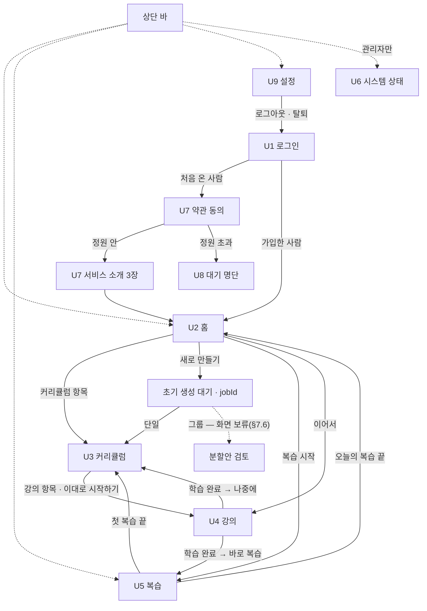
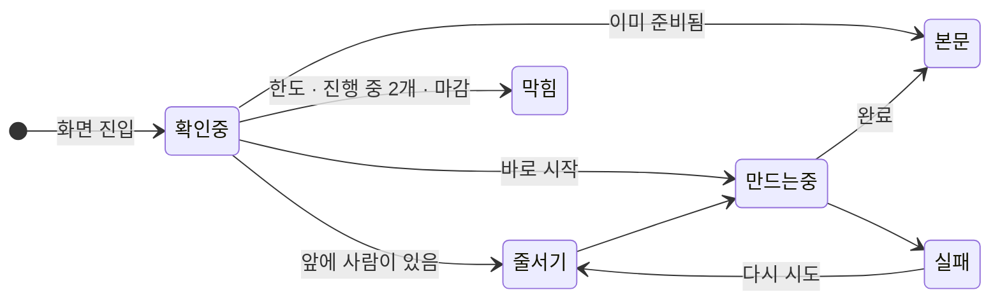

# 06. 화면 — 글로 쓴 와이어프레임

> **실제 사용자가 보는 화면을 글로 그린 와이어프레임이다.** 시각 디자인(색 · 폰트 · 아이콘 · 간격 값)은 다루지 않는다.
> 다루는 것은 **무엇이 · 어떤 순서로 · 어떤 상태에서 · 어떤 문구로** 보이고, **누르면 어디로 가는가**다.
> 데이터는 [05 API](./05-api.md), 용어는 [01 §12](./01-overview.md).

> ⭐ **이 문서는 클로드 디자인의 입력이다.** 그래서 **화면마다 따로 떼어 넘겨도 뜻이 통하게** 썼다 —
> 각 화면 절은 목적 · 진입 · 영역 · 상태 · 동작 · 문구를 **모두 자기 안에** 갖는다. 넘기는 법과 프롬프트는 §15.

> **이 화면들은 공개 서비스의 화면이다.** 사용자는 이 서비스를 처음 보는 **일반 학습자**이고(분야를 가리지 않는다),
> 백엔드가 무엇을 하는지 **알 필요가 없다.** 토큰 · 비용 · 재시도 · 큐 건수 같은 시스템 정보는 사용자 화면에 없다 —
> 그건 **관리자 화면(U6)** 의 몫이다.

---

## 1. 읽는 법

### 1.1 표기

| 표기 | 뜻 |
|---|---|
| **[U3-2]** | 화면 U3 의 2번 영역. **위에서 아래 순서**다. 클로드 디자인에 *"U3-2 를 바꿔줘"* 처럼 부를 이름 |
| `버튼: 승인하기` | 버튼 요소와 **그 위에 적히는 문구 그대로** |
| `입력: 주제` | 입력 요소와 라벨 |
| 「 」 | 화면에 **그대로 나가는 문구** |
| ⟨topic⟩ | 데이터가 들어가는 자리. 괄호 안은 [05](./05-api.md) 의 필드 이름 |
| ◽ 최소판 | **본인 실사용을 시작할 때의 최소판**에도 있어야 하는 요소. 없는 요소는 뒤에 붙인다 (§14) |

### 1.2 예시 데이터

모든 화면은 **같은 예시 사용자 한 명**으로 채운다 — 프레임끼리 숫자가 이어져야 흐름이 읽힌다.

| | 예시 |
|---|---|
| 사용자 | someone@gmail.com · 가입 3주째 |
| 진행 중 커리큘럼 | 「경제 기초」 · 학습 중 · 16강 중 5강 완료 |
| 검토 중 커리큘럼 | 「Kafka 기초」 · 검토 대기 · 오늘 다시 짜기 1/3회 사용 |
| 끝난 커리큘럼 | 「한국사 근현대」 · 완료 · 8/8 |
| 지금 여는 강의 | 6강 「기준금리와 인플레이션」 |
| 오늘의 복습 | 23장 (예정일 넘긴 카드 4장 포함) |
| 오늘 생성량 | 60% 사용 |

---

## 2. 전체 원칙

### 2.1 이 서비스의 UX 가 지키는 것 다섯

| # | 원칙 | 화면에서 어떻게 |
|---|---|---|
| 1 | **처음 온 사람도 3분 안에 첫 커리큘럼** | 로그인 → 동의 → 소개 3장 → 만들기 폼. 중간에 설명을 더 끼우지 않는다 |
| 2 | **기다림을 숨기지 않되, 사용자 말로** | 강의 하나 만드는 데 1~2분 걸린다. *"앞에 2명 · 본문 쓰는 중 · 나가도 계속 만들어요"* 까지만. 토큰 · 비용 · 재시도는 보여주지 않는다. **가짜 퍼센트 막대도 쓰지 않는다** |
| 3 | **막힐 때는 이유 · 언제 풀리는지 · 지금 할 수 있는 것** | 생성 한도 · 진행 중 2개 · 마감으로 막힐 때 세 가지를 같이 말한다 |
| 4 | **학습은 막히지 않는다** | 생성이 막혀도 이미 만든 강의와 복습은 된다. 복습이 밀려도 다음 강의는 열린다 — **상단 바 배지와 U2 첫 줄로만** 알린다 |
| 5 | **흐름은 이끌되 강제하지 않는다** | 강의를 끝내면 바로 복습으로 이끌지만 「나중에」 로 빠질 수 있다. 빠져도 카드는 오늘의 복습에 남는다 |

### 2.2 화면 지도



### 2.3 상단 바 — U2 · U3 · U4 · U5 · U9 · U6

왼쪽에서 오른쪽 순서.

- 서비스 이름(텍스트) 「머금」 — 누르면 U2
- `링크: 홈`
- `링크: 복습` + 오늘 복습할 장수 배지 ⟨cards 개수⟩. 0장이면 배지 없음 ◽ 최소판
- **관리자에게만** `링크: 시스템 상태` ⟨/me role=ADMIN⟩. 일반 사용자에게는 **자리도 없다**
- 오른쪽 끝: `링크: 설정` — 와이어프레임에서는 아이콘 대신 글자로

> **복습을 상단에 두는 이유** — 복습은 커리큘럼에 속하지 않는 **매일의 일**이다.
> 로그아웃은 상단 바에 두지 않고 **설정(U9) 안에** 둔다 — 자주 누르는 버튼이 아니다.

### 2.4 공통 상태

| 상태 | 모든 화면에서 |
|---|---|
| 첫 로딩 | 영역 자리에 **빈 회색 줄**(스켈레톤). 화면 한가운데 스피너를 띄우지 않는다 — 강의 만들기 대기와 헷갈린다 |
| 로그인 만료 · 로그아웃된 세션 (`401`) | 즉시 U1. U1 에 「다시 로그인해 주세요.」 |
| 약관 동의 전 (`403 TERMS_REQUIRED`) | U7 약관 동의로 보낸다 |
| 대기 명단 (`403 ACCOUNT_WAITLISTED`) | U8 로 보낸다 |
| 없는 항목 (`404`) | 본문 자리에 「찾을 수 없어요. 삭제됐거나 볼 수 없는 항목이에요.」 + `링크: 홈으로` |
| 요청이 너무 잦음 (`429 RATE_LIMITED`) | 해당 영역에 「잠시 후 다시 시도해 주세요.」 — 폴링 중이면 **조용히 간격을 늘려** 다시 시도한다 |
| 네트워크 실패 | 해당 영역 안에 「불러오지 못했어요.」 + `버튼: 다시 시도`. 화면 전체를 갈아엎지 않는다 |

### 2.5 되돌릴 수 없는 동작

브라우저 확인창 · 팝업(모달)을 쓰지 않는다. **그 자리에서 한 번 더 묻는다.**

| 동작 | 묻는 방식 |
|---|---|
| 커리큘럼 삭제(검토 중 · 학습 중 · 완료 · 생성 중) | 버튼/링크 자리가 펼쳐진다: 「이 커리큘럼과 강의 자료, 학습 기록, 관련 플래시카드가 모두 삭제돼요. 삭제한 카드의 학습 기록은 앞으로의 맞춤 학습에 반영되지 않아요. 삭제하면 되돌릴 수 없어요.」 `버튼: 삭제하기` `버튼: 취소`. `삭제하기` 를 눌러야 요청하며, 처리 중에는 두 버튼을 잠근다 |
| **회원 탈퇴 · 대기 취소** | 영역이 펼쳐진다: 지워지는 것 목록 + `체크: 모든 학습 기록이 지워지는 것을 확인했어요` → 체크해야 `버튼: 탈퇴하기` 가 눌린다 (§10) |

### 2.6 화면 폭

- ⭐ **U4 강의 · U5 복습은 모바일(390) 우선**이다 — 일반 학습자는 강의를 이동 중에 읽고, 복습은 자투리 시간에 한다. 데스크톱은 **모바일 틀을 가운데 넓힌 것**으로 충분하다.
- **나머지는 데스크톱(1280) 기준**으로 그린다. **U7 가입 · U8 대기 명단은 모바일(390)도 그린다** — 가입은 링크를 받은 휴대폰에서 일어난다.
- 그 밖의 화면은 모바일에서 **한 단으로 쌓이기만** 하면 된다.
- U4 모바일에서 확인할 것: **코드 블록 · 긴 수식 · 그림이 화면 폭을 넘으면 그 블록 안에서만** 가로로 스크롤된다. 본문 전체가 옆으로 밀리면 안 된다.

### 2.7 포커스 · 바뀐 내용 알리기

화면 이동 없이 영역이 바뀌는 곳이 많다. 키보드 · 스크린리더 사용자가 길을 잃지 않게:

- **영역이 바뀌면 포커스를 옮긴다** — U4 대기 → 본문이면 본문 제목으로, 학습 완료 후 [U4-4] 가 바뀌면 그 문구로, 인라인 확인(§2.5)이 펼쳐지면 확인 문구로. 취소하면 원래 버튼으로 돌아간다
- **폴링으로 바뀌는 문구는 읽어 준다** — 「앞에 ⟨2⟩명」 · 단계 변화 · 「평소보다 조금 더 걸리고 있어요.」 는 조용한 알림(aria-live polite)
- **상단 바는 지금 있는 곳을 표시한다** — 현재 화면의 링크를 구분되게

---

## 3. U1 로그인

**목적** — 무엇을 하는 서비스인지 한눈에 알고, 구글 계정으로 들어온다. 계정 만들기 · 비밀번호는 없다.
**진입** — 로그인 안 된 상태로 아무 주소나 열었을 때 · 로그아웃 · 탈퇴 직후 · `401`.
**API** — `GET /auth/google` → 구글 → `/auth/google/callback` → 처음 온 사람은 U7, 가입한 사람은 U2.
**상단 바 없음.**

### 영역

- **[U1-1] 소개** ◽ 최소판
  - 서비스 이름 「머금 · Mogum」 + 슬로건 「배운 건 머금고, 흔들리는 건 다시 한 모금」
  - 제목 한 줄: 「배운 걸 잊지 않게, 복습이 다음 강의를 바꾸는 학습」
  - 설명 두 줄: 「주제만 정하면 AI가 강의를 짜고 만들어요. 복습 결과를 보고 이미 아는 건 짧게, 흔들리는 건 자세히 다음 강의를 만들어요.」
- **[U1-2] 로그인** ◽ 최소판
  - `버튼: Google 계정으로 시작하기`
  - 그 아래 작은 글씨: 「처음이면 가입이 함께 진행돼요.」
- **[U1-3] 알림 자리** — 평소엔 비어 있다
- **[U1-4] 바닥글** — `링크: 이용약관` · `링크: 개인정보처리방침` (로그인 없이 열린다)

### 상태

| 상태 | [U1-3] 문구 |
|---|---|
| 기본 | 없음 |
| 로그인 만료 · 로그아웃된 세션 | 「다시 로그인해 주세요.」 |
| 구글에서 돌아왔는데 실패 | 「로그인하지 못했어요. 다시 시도해 주세요.」 |
| 탈퇴 직후 | 「탈퇴가 끝났어요. 학습 기록을 모두 지웠어요.」 |

---

## 4. U7 가입 — 약관 동의 + 서비스 소개

**목적** — 처음 온 사람이 **한 번만** 거친다. 동의를 받고, 이 서비스가 어떻게 돌아가는지 30초 안에 알려준 뒤 첫 커리큘럼으로 보낸다.
**진입** — 처음 로그인했을 때 · 약관이 바뀐 뒤 다시 들어왔을 때(동의 단계만).
**API** — `POST /me/terms` → 응답의 `status` 가 `ACTIVE` 면 소개로, `WAITLISTED` 면 U8.
**상단 바 없음. 모바일도 그린다.**

### 4.1 1단계 — 약관 동의

- **[U7-1] 머리**
  - 「시작하기 전에 확인해 주세요」
  - 한 줄: 「구글 계정 이메일과 학습 기록을 저장해요. 탈퇴하면 모두 지워요.」
- **[U7-2] 동의 항목**
  - `체크: 모두 동의` — 아래 둘을 한 번에
  - 구분선
  - `체크: [필수] 이용약관` · 오른쪽 `링크: 보기` → P1
  - `체크: [필수] 개인정보 수집 · 이용` · 오른쪽 `링크: 보기` → P2
- **[U7-3] 결정**
  - `버튼: 동의하고 시작하기` — 두 필수 항목을 모두 체크해야 눌린다. 잠겨 있을 때 아래 작은 글씨 「필수 항목에 모두 동의해야 시작할 수 있어요.」
  - 그 아래 `링크: 동의하지 않고 나가기` → 로그인 때 받은 정보를 지우고 U1

### 4.2 2단계 — 서비스 소개 (정원 안일 때)

**카드 3장을 넘겨 본다.** 한 화면에 한 장, 아래에 점 3개(현재 위치)와 `버튼: 다음`. 모바일은 옆으로 밀어서도 넘긴다.

| 장 | 제목 | 설명 |
|---|---|---|
| 1 | 「배우고 싶은 주제를 알려 주세요」 | 「주제와 목적을 적으면 AI가 강의 목록을 짜요. 원하는 속도로 학습하세요.」 |
| 2 | 「강의를 읽고 바로 복습해요」 | 「강의를 끝내면 핵심 카드가 생겨요. 잊을 때쯤 다시 보여드려요.」 |
| 3 | 「복습할수록 강의가 맞춰져요」 | 「이미 아는 개념은 짧게, 흔들리는 개념은 자세히. 다음 강의가 달라져요.」 |

- 3장에서 `버튼: 다음` 자리가 `버튼: 첫 커리큘럼 만들기` 로 바뀐다 → U2 (만들기 폼이 화면 중심에 있는 상태)
- 모든 장 오른쪽 위에 `링크: 건너뛰기` → U2

> **소개는 3장에서 멈춘다.** 생성량 · 다시 짜기 횟수는 **그 상황이 올 때** 그 자리에서 알려준다.

---

## 5. U8 대기 명단

**목적** — 정원이 찼다는 사실과 **지금 몇 번째인지**, 자리가 나면 어떻게 되는지를 알려준다.
**진입** — 동의 직후 정원이 차 있었을 때 · 대기 중인 사람이 다시 로그인했을 때.
**API** — `GET /me` (`waitlistPosition`).
**상단 바 없음. 모바일도 그린다.**

### 영역

- **[U8-1] 안내**
  - 제목 「지금은 정원이 찼어요」
  - 큰 숫자 한 줄: 「대기 ⟨3⟩번째」
  - 설명: 「비용을 감당할 수 있는 만큼만 받고 있어요. 자리가 나면 이 구글 계정으로 바로 쓸 수 있어요.」
  - 설명 한 줄 더: 「따로 알림을 보내지 않아요. 가끔 다시 들러 주세요.」 — 알림 기능이 없다는 걸 숨기지 않는다
- **[U8-2] 할 수 있는 것**
  - `링크: 로그아웃`
  - `링크: 대기 취소하고 정보 지우기` → §2.5 의 확인 후 U1

---

## 6. U2 홈

**목적** — 두 가지의 **출발점**이다. ① 오늘 복습할 것 ② 커리큘럼(이어 하기 · 새로 만들기).
**진입** — 로그인 직후 · 가입 소개 직후 · 상단 바 「홈」 · 오늘의 복습을 끝낸 뒤.
**API** — `GET /reviews/due` · `GET /curriculums` · `GET /curriculum-requests` · `POST /curriculum-requests` · `GET /jobs/{id}` · `POST /jobs/{id}/retry` · `GET /me` (오늘 생성량).

### 영역 (위에서 아래)

- **[U2-1] 오늘의 복습** — 맨 위. 매일 하는 일이라서 ◽ 최소판
  - 큰 숫자 한 줄: 「오늘의 복습 ⟨23⟩장」
  - 예정일을 넘긴 카드가 있으면 한 줄: 「⟨4⟩장은 예정일이 지났어요. 먼저 보여드릴게요.」 ⟨overdueCount⟩
  - `버튼: 복습 시작`
  - 장수는 오늘까지 예정된 카드 전체다. 일일 개수 제한 없이 복습할 수 있고 중간에 나가도 저장한 평가까지 유지된다
- **[U2-2] 내 커리큘럼** ◽ 최소판 *(최소판에는 목록 없이 [U2-3] 폼만)*
  - 소제목 「내 커리큘럼」
  - 아직 결과가 없는 초기 요청은 `GET /curriculum-requests`에서 불러와 대기/실패 상태로 복귀할 수 있어야 한다. 실제 커리큘럼 수/학습 진도에는 포함하지 않는다. 구체적인 배치는 추후 화면 구성에서 정한다
  - 넓은 주제의 전체 목표 · 현재 단계 · 전체 단계 수를 확인할 수 있어야 한다. 구체적인 표시 구성은 §7.6의 보류 대상이다. 아직 생성하지 않은 단계는 학습 중 커리큘럼 수에 넣지 않는다. 앞 단계 완료 후 다음 단계 생성 안내는 끝난 목록을 펼치지 않아도 보인다
  - **진행 중 목록** — 항목 하나에:
    - 제목 ⟨title⟩ · 상태 글자(아래 표)
    - 학습 중이면 진도 막대 + 「⟨5⟩ / ⟨16⟩강」 + `버튼: 이어서 — 6강 기준금리와 인플레이션` ⟨nextLesson⟩ → **U4 로 바로**. 순서상 처음으로 끝나지 않은 강의(U3 의 「다음 강의」 와 같다)
    - 버튼 밖의 항목 자리를 누르면 → U3
  - **끝난 목록** — 기본은 접혀 있다. 「끝난 커리큘럼 ⟨1⟩개 보기」 를 누르면 펼친다
- **[U2-3] 새 커리큘럼 만들기** ◽ 최소판
  - **커리큘럼이 1개 이상이면 접혀 있다** — `버튼: 새 커리큘럼 만들기` 하나만 보이고, 누르면 아래 폼이 펼쳐진다. 처음 온 사용자 · 막힘 문구가 떠 있을 때는 펼친 채로
  - 소제목 「새 커리큘럼 만들기」
  - `입력: 무엇을 배울까요?` — 한 줄 · 100자까지. 자리표시 「예: 경제 기초, 한국사, 파이썬」
  - `입력: 목적` — 한 줄 · 200자까지. 자리표시 「예: 처음 배워요 · 자격증 시험 준비 · 업무에 쓰려고요」
  - 두 입력 아래 작은 글씨: 「입력한 내용은 강의를 만드는 AI에 전달돼요. 개인 정보는 적지 말아 주세요.」
  - 안내 한 줄: 「주제와 목적에 맞춰 강의 목록을 짜요. 수십 초 걸려요.」
  - 기간 · 주당 학습량 입력은 없다. 학습 플랜은 MVP 이후 기능이다
  - **오늘 생성량** — 얇은 막대 하나 + 「오늘 생성량 ⟨60⟩% · 0시에 다시 채워져요」 ⟨quota.usedRatio⟩. **숫자(토큰)는 보여주지 않는다**
  - `버튼: 커리큘럼 만들기`
  - 폼 아래 알림 자리 [U2-3a] — 막혔을 때 문구(§12)

**커리큘럼 상태 글자**

| 조건 | 글자 |
|---|---|
| 짜는 중 ⟨generation.status⟩ | 「짜는 중」 |
| 짜기 실패 | 「짜기 실패」 |
| 검토 전 (`DRAFT` + 강의 있음) | 「검토 대기」 |
| `ACTIVE` | 「학습 중」 |
| `COMPLETED` | 「완료」 |

### 상태

| 상태 | 화면 |
|---|---|
| **처음 온 사용자** (소개 직후) | [U2-1] 「아직 복습할 카드가 없어요. 강의를 하나 끝내면 여기에 카드가 생겨요.」 버튼 없음. [U2-2] 없음. **[U2-3] 이 화면 중심**으로 올라오고 첫 입력 칸에 커서가 있다 |
| 오늘 복습 없음 | [U2-1] 「오늘 복습은 끝났어요.」 · 버튼 없음 |
| 만들기 누름 | 접수된 `jobId`로 초기 생성 대기 상태를 연다. 성공하면 결과 유형/ID에 맞는 단일 또는 그룹 검토로 연결한다. 대기 중에는 커리큘럼/그룹이 아직 없다 (§7.3) |
| 입력 오류 | 해당 입력 아래: 「주제는 100자까지 쓸 수 있어요.」 · 「목적은 200자까지 쓸 수 있어요.」 |
| 막힘 | [U2-3a] 에 §12 문구 |

---

## 7. U3 커리큘럼

**목적** — 한 커리큘럼의 **두 상태를 한 화면에서** 다룬다. 검토 중이면 *보고 시작하기*, 학습 중이면 *진도 보고 다음 강의로*. 넓은 주제의 분할안과 다음 단계 안내도 이 화면 안에 둔다(§7.6).
**진입** — U2 의 항목 · 초기 단일 생성 성공 후 · 대상이 정해진 단계 생성 직후 · 강의를 끝내고 돌아올 때. 초기 생성 대기는 `jobId`로 연결하고 유형별 결과가 생긴 뒤 해당 검토로 진입한다.
**API** — `GET /curriculums/{id}` · `/approve` · `/regenerate` · `DELETE /curriculums/{id}` · `GET /jobs/{jobId}` · `POST /jobs/{jobId}/retry`.

### 7.1 공통 영역

- **[U3-1] 제목 줄** ◽ 최소판
  - 제목 ⟨title⟩ · 상태 글자(§6 표)
  - 한 줄: 「⟨주제⟩ · ⟨목적⟩ · 강의 ⟨16⟩개」
  - 작은 글씨: 「원하는 속도로 학습하세요. 강의 순서는 자유롭게 선택할 수 있어요.」
- **[U3-2] 알림 자리** — 짜는 중 · 실패 · 막힘 문구가 여기 뜬다

### 7.2 검토 대기 (`DRAFT`)

- **[U3-3] 이렇게 짰어요** — 내 복습 기록이 이 커리큘럼을 어떻게 바꿨는지 *(최소판에서는 생략 가능)*
  - 소제목 「이렇게 짰어요」
  - 항목 한 줄씩. ⟨masteryReflection.action⟩ 별 문구:

    | `action` | 문구 |
    |---|---|
    | `EXCLUDED` | 「**기회비용**는 이미 잘 알고 계셔서 별도 강의로 만들지 않았어요.」 |
    | `COMPRESSED` | 「**수요와 공급**은 어느 정도 아셔서 짧게 다뤄요.」 |
    | `EXPANDED` (복습 기록 있음) | 「**가격 탄력성**은 아직 헷갈리실 수 있어서 더 자세히 다뤄요.」 |
    | `EXPANDED` (처음) | 표시하지 않는다 |

  - **표시할 항목이 없을 때**(빈 목록이거나 전부 `EXPANDED` (처음)): 「이번 주제와 관련해 반영할 복습 기록이 없어서 기초부터 짰어요. 복습이 쌓이면 이미 아는 내용은 줄여 드려요.」 — 빈 목록은 학습 이력이 없을 때와, 이력은 있지만 이 주제와 관련된 개념을 찾지 못했을 때([02 §5.4](./02-domain-data.md)) 모두 생긴다. 둘을 구별하지 않는 문구다
- **[U3-4] 강의 목록** ◽ 최소판
  - **권장 학습 순서로 나열한다** — 주차별 묶음이나 완료 예정일은 표시하지 않는다
  - 강의 한 줄에: 순서 번호 · 제목 ⟨title⟩ · 학습 목표 ⟨objective⟩(한 줄, 넘치면 말줄임) · 키워드 글자표 ⟨keywords⟩
  - 검토 중에는 강의가 **눌리지 않는다** — 시작하기 전에는 강의를 만들지 않는다
- **[U3-5] 결정** — 화면 아래에 붙어 있다(스크롤해도 보인다) ◽ 최소판
  - `버튼: 이대로 시작하기` — 가장 강조. 승인되면 **곧바로 U4 1강으로 이동**하고, U4 가 여느 때처럼 1강 만들기를 시작한다. U3 학습 중 화면을 거치지 않는다
  - 강의 목록이 없거나 생성 잡이 `QUEUED` / `RUNNING` 이면 시작 버튼은 잠긴다. 서버의 승인 조건이 최종 기준이며, 다른 탭과의 경합으로 거절되면 상세를 다시 불러온다. 다시 짜기 실패 뒤 이전 목록이 남아 있으면 그 안으로 시작할 수 있다
  - `버튼: 다시 짜기` + 오른쪽 작은 글씨 「오늘 ⟨1⟩ / ⟨3⟩회 사용」 ⟨regenerationsToday⟩
  - 「다시 짜기」 를 누르면 그 자리에서 펼쳐진다:
    - `입력: 무엇을 바꿀까요? (선택)` — 여러 줄. 자리표시 「예: 실무 예제를 더 넣어 주세요. 기초 설명을 더 자세히 해 주세요.」 · 글자 수 「⟨0⟩ / 500」
    - 안내: 「학습 내용과 구성을 바꿀 수 있어요. 학습 일정은 정하지 않아요.」
    - `버튼: 이 내용으로 다시 짜기` · `버튼: 취소`
  - 두 버튼 아래 작은 `링크: 이 커리큘럼 삭제` → §2.5 의 삭제 범위 · 복구 불가 안내와 확인 → 지우고 U2 로 (`DELETE /curriculums/{id}`). 생성 중에도 사용할 수 있다

### 7.3 짜는 중 · 실패

**초기 생성 대기/실패** — 접수 시 생성 작업에 주제/목적만 보존하고 실제 커리큘럼/그룹은 성공 후 만든다. 화면은 URL의 `jobId`로 같은 잡을 2초마다 조회하며, U2는 서버의 미완료 초기 요청에서 복귀할 수 있어야 한다. 대기는 기존 쉬운 진행 문구/복습 링크를 쓰고 내부 잡 종류나 비용을 표시하지 않는다. 실패하면 §12.2의 문구와 허용된 재시도만 제공하며 승인 버튼/커리큘럼 삭제 링크는 없다. 성공 결과의 유형/ID에 따라 단일 U3 검토 또는 그룹 분할안 검토로 연결한다. 초기 요청의 취소/제거 기능은 아직 결정하지 않았고 그룹의 상세 배치는 §7.6의 보류를 유지한다.

아래는 실제 대상 커리큘럼이 있는 단계 상세 생성/다시 짜기의 상태다. 단계 첫 생성은 기존 빈 `DRAFT(step_id)`를 사용한다.

| 상태 | 화면 |
|---|---|
| **짜는 중** | [U3-2] 에 「커리큘럼을 짜고 있어요. 수십 초 걸려요.」 + 줄이 있으면 「앞에 ⟨2⟩명이 기다리고 있어요.」. [U3-3]·[U3-4] 는 **빈 회색 줄**. [U3-5] 시작/다시 짜기 버튼은 잠기고 삭제 링크는 열려 있다. 2초마다 `GET /jobs/{jobId}` |
| **다시 짜는 중** | 위와 같되 [U3-3]·[U3-4] 에 **이전 안이 흐리게** 남는다 — 「새 안이 나오면 바뀌어요.」 |
| **단계 상세 최초 짜기 실패** | [U3-2] 에 §12.2 문구 + `버튼: 다시 시도`(다시 시도 ❌ 면 없다). [U3-4] 는 「강의가 아직 없어요.」. 시작 버튼은 잠기고 삭제 링크는 열려 있다 |
| **다시 짜기 실패 · 이전 안 있음** | [U3-2] 에 §12.2 문구 + 「이전 안으로 시작할 수 있어요.」 + `버튼: 다시 시도`(가능할 때만). [U3-3]·[U3-4] 는 이전 반영 내역 · 강의 목록을 정상 표시한다. `이대로 시작하기` 와 삭제 링크는 열려 있다. 시작하면 예전 실패 잡의 재시도 버튼은 표시하지 않는다 |
| **오늘 다시 짜기 횟수 소진** | `다시 짜기` 잠김 + 「다시 짜기는 하루 3번까지예요. 0시에 다시 할 수 있어요.」 `이대로 시작하기` 와 삭제 링크는 열려 있다 |

### 7.4 학습 중 (`ACTIVE`)

- **[U3-3'] 진도** ◽ 최소판
  - 진도 막대 + 「⟨5⟩ / ⟨16⟩강 완료」
  - `버튼: 다음 강의 — 6강 기준금리와 인플레이션` — **순서상 처음으로 끝나지 않은 강의**
- **[U3-4'] 강의 목록** — 권장 학습 순서대로 나열한다. 강의 한 줄에 **상태 표시**가 붙고 **전부 눌린다** ◽ 최소판

  | 조건 | 표시 |
  |---|---|
  | 완료 | 「완료」 |
  | 만드는 중 ⟨generating⟩ | 「만드는 중」 |
  | 준비됨 ⟨hasMaterial⟩ | 「바로 볼 수 있어요」 |
  | 그 외 | 표시 없음 |

  - **순서를 강제하지 않는다** — 어느 강의든 열 수 있다. 다음 강의만 강조한다
- **[U3-6] 커리큘럼 관리** — 화면 맨 아래, 눈에 덜 띄게
  - `버튼: 이 커리큘럼 삭제` → §2.5 의 삭제 범위 · 복구 불가 안내와 확인 → 삭제 성공 후 U2 로 이동하고 홈/복습 목록을 새로 조회한다

### 7.5 완료

- [U3-3'] 자리에 「모든 강의를 마쳤어요.」
- 분할한 커리큘럼에 다음 단계가 있으면 §7.6의 **다음 단계 생성 카드**를 우선 표시한다. 사용자가 새 주제/목적을 다시 입력할 필요 없이 이어서 생성한다
- 단일 커리큘럼이거나 마지막 단계면 「다음 커리큘럼은 이미 아는 내용을 줄여서 짜요.」 + `링크: 새 커리큘럼 만들기` → U2 (만들기 폼이 펼쳐진 상태) — 복습 기록이 쌓인 지금이 개인화를 보여 줄 때다
- 강의 목록은 그대로 보이고 **여전히 열 수 있다**(다시 읽기). 화면 아래 `버튼: 이 커리큘럼 삭제` 는 학습 중과 같은 확인 절차를 따른다.
- 삭제 성공 시 커리큘럼은 목록에서 사라진다. 다른 탭에서 삭제되어 폴링/자료/복습 요청이 `404` 면 재시도를 멈추고 「삭제됐거나 볼 수 없는 항목이에요.」와 `링크: 홈으로` 를 표시한다. 복습에서는 삭제된 카드를 제거하고 최신 목록 · 남은 장수를 조회한다.

### 7.6 넓은 주제 — 분할안과 순차 생성

**상세 UI 보류 — 사용자 결정.** 그룹 화면이 복잡해지지 않도록 구성은 추후 다시 검토한다. 아래의 구체적인 배치 · 단계 목록 노출 방식 · 문구는 기존 화면안으로 남기며 최종 디자인으로 간주하지 않는다. U2/U3를 활용하는 방향도 이 화면안에 속한다. 분할안 검토, 현재 단계 학습, 완료 후 다음 단계 생성, 중복 생성 방지/복귀의 기능 요구사항은 유지한다. 보류한 레이아웃을 임의로 확정하거나 UI 구현 완료로 기록하지 않는다.

**확정한 흐름** — 넓은 주제는 학습 목표와 선행 지식에 따라 여러 커리큘럼의 분할안을 제안한다. 전체 목표 · 각 단계 제목/범위/목적 · 권장 순서를 먼저 보여주고, **1단계 생성 → 검토/승인 → 학습 완료 → 다음 단계 생성**으로 이어진다. 모든 단계의 상세 강의 목록이나 자료를 미리 생성하지 않는다. 기간/주차/주당 학습량은 배정하지 않는다.

- **분할안 검토** — 안내 「배울 범위가 넓어서 여러 커리큘럼으로 나눴어요. 하나씩 학습하며 이어갈 수 있어요.」. 각 단계에 순서 번호 · 제목 · 배울 내용 · 선행 단계를 표시한다. `버튼: 1단계 커리큘럼 만들기`를 누른 뒤 기존 U3 생성 대기/검토 흐름으로 이어진다. 분할안만 있는 상태에는 `이대로 시작하기`를 표시하지 않는다
- **학습 중** — 제목 아래에 전체 목표와 「⟨1⟩ / ⟨3⟩단계」, 전체 단계 목록을 표시한다. 현재 단계에는 「학습 중 · ⟨5⟩ / ⟨16⟩강」, 완료한 단계에는 「완료」 + 열기, 후속 미생성 단계에는 「이전 단계 완료 후 만들 수 있어요.」를 표시한다. 현재 커리큘럼 안에서는 어느 강의든 열 수 있다
- **다음 단계 생성 카드** — 현재 커리큘럼이 `COMPLETED`이면 「1단계를 마쳤어요. 다음은 ‘웹과 데이터 처리’예요.」 + 다음 단계의 범위/목적 + `버튼: 2단계 커리큘럼 만들기`. 완료 판정은 모든 강의의 학습 완료이며, 카드 복습 완료나 특정 숙련도 도달을 요구하지 않는다. 나중에 생성해도 된다
- **사용자 클릭으로 생성** — 완료 직후 자동 요청하지 않는다. 저장된 다음 단계 정보를 읽어 최신 숙련도로 강의 목록을 생성하고, 기존처럼 새 `DRAFT`를 검토한 뒤 승인한다. 쿼터/킬스위치에 걸리면 기존 안내를 보여주고 다음 단계 생성 자리는 유지한다
- **생성 중/실패/이미 생성됨** — 요청 중 버튼 중복 제출을 막는다. 생성 중이면 같은 단계의 잡을 표시하고, 실패면 기존 재시도 규칙을 적용한다. 해당 단계의 커리큘럼이 이미 있으면 `커리큘럼 보기`로 바꾸며 새 커리큘럼을 중복 생성하지 않는다. 새로고침 · 재로그인 · 다른 탭에서도 서버의 분할안/연결 상태를 다시 읽어 같은 위치로 복귀한다
- **마지막 단계 완료** — 「모든 단계를 마쳤어요.」와 전체 단계의 완료 상태를 표시하고 기존 새 커리큘럼 링크를 제공한다. FSRS 복습은 계속할 수 있다

**모델과 후속 항목** — 전체 목표는 `CurriculumGroup`, 단계별 분할안은 `CurriculumStep`, 실제 학습 목록은 연결된 `Curriculum`에 보관한다([02 §6.2.1](./02-domain-data.md)). 초기 분할안은 잡 I(`CURRICULUM_INITIAL`)의 성공 결과로 저장한다. 생성/조회 API · 분할안 출력/호출 상한 · 분할 개수 상한과 개별 단계 삭제 후 진행 정책은 [05 §2.1](./05-api.md)을 기준으로 구현 전에 확정한다. 이 절은 설계의 확정이며 실제 UI 구현 완료를 뜻하지 않는다.

---

## 8. U4 강의

**목적** — 강의 하나를 **기다렸다가 그 자리에서** 읽고, 끝내면 복습으로 넘어간다.
**진입** — U3 의 강의 항목 · U3 의 「이대로 시작하기」(1강) · U2 의 「이어서」. 주소에 강의 id 가 있어서 **새로고침 · 나갔다 와도 같은 작업에 다시 붙는다**([04 §4.7](./04-jobs-and-cost.md)).
**API** — `POST /lessons/{id}/materials` · `GET /jobs/{jobId}` · `POST /jobs/{jobId}/retry` · `GET /lessons/{id}/material` · `POST /lessons/{id}/complete`.

### 8.1 영역

- **[U4-1] 강의 머리** ◽ 최소판
  - 작은 글씨 경로: 「경제 기초」 — 누르면 U3
  - 제목 「6강 · 기준금리와 인플레이션」
  - 학습 목표 한 줄 ⟨objective⟩
- **[U4-2] 기다리는 영역** — 강의가 아직 없을 때만. 다 되면 **이 영역이 사라지고 그 자리에 [U4-3]** 이 나타난다. 화면 이동은 없다
- **[U4-3] 강의 본문** ◽ 최소판 — 고정 6섹션
  - 「오늘 배울 것」 · 「개념 설명」 · 「예시」 · 「정리」 · 「확인 질문」 · 「다음 시간에는」(마지막 강의는 「마치며」)
  - 본문 위에 **섹션 바로가기**(목차)
  - **수식**(KaTeX)과 **그림**(mermaid)을 렌더한다. 둘 다 이 화면에서만 불러온다(지연 로딩)
  - 그림을 그리지 못하면 그 자리에 회색 상자 + 「그림을 표시하지 못했어요.」 — **본문의 나머지는 그대로 보인다**
  - 코드 블록 · 수식 · 그림은 가로로 넘치면 **블록 안에서만** 스크롤
  - 「확인 질문」 은 질문만 보인다. 답은 없다 — 스스로 떠올려 보는 칸이고, 답을 확인하는 건 복습(U5)의 몫이다
- **[U4-4] 학습 완료** — 본문 맨 아래 ◽ 최소판
  - `버튼: 학습 완료`
  - 저장 중에는 버튼을 잠근다. 응답 유실/네트워크 오류에는 같은 강의의 완료 요청을 다시 보내며, 성공 응답을 받으면 완료 화면으로 바꾼다. 재요청으로 카드의 복습 상태를 새로 시작하지 않는다
  - 이미 완료한 강의면 버튼 대신 「완료한 강의예요」 + `링크: 다음 강의`

### 8.2 기다리는 영역 [U4-2]



| 상태 | [U4-2] 안에 보이는 것 |
|---|---|
| **줄서기** | 「앞에 ⟨2⟩명이 기다리고 있어요.」 ⟨aheadCount⟩ + 아래 단계 목록(전부 ○). `aheadCount` 가 0 이면(다음 차례) 이 문구 없이 단계 목록만 |
| **만드는 중** | 단계 목록 — 현재 단계 강조 ⟨step⟩ |
| **평소보다 오래 걸림** ⟨retried⟩ | 단계 목록 아래 한 줄: 「평소보다 조금 더 걸리고 있어요.」 — **이유(재시도 · 429)는 말하지 않는다** |
| **실패** | §12.2 문구. 재시도 가능한 경우에만 `버튼: 이어서 다시 시도` + 작은 글씨 「이미 끝난 단계는 다시 하지 않아요.」 |
| **본문을 끝까지 만들지 못함** | 실패 화면으로 표시한다. 잘린 본문과 카드 복습/학습 완료 버튼은 제공하지 않는다. 다시 시도하면 개요를 유지하고 본문부터 새로 만든다 |
| **막힘** | §12.1 문구. 기다리는 게 아니라 **시작을 못 한 것**이므로 단계 목록은 없다 |

**만드는 중의 모양 — 위에서 아래** ◽ 최소판에서는 「강의를 만들고 있어요. 1~2분 걸려요.」 한 줄

1. 제목 한 줄: 「강의를 만들고 있어요」
2. 단계 목록 — 세 줄
   - 「강의 구성 — 알고 계신 개념을 확인하는 중」 ✔
   - 「본문 작성」 ● 지금
   - 「복습 카드 만들기」 ○
3. 한 줄: 「보통 1~2분 걸려요. 이 화면을 떠나도 계속 만들어요.」
4. 오늘 복습할 카드가 있으면 `링크: 기다리는 동안 복습하기 (⟨23⟩장)` → U5 오늘의 복습. 0장이면 없다 — **기다림을 학습 시간으로** (원칙 4). 줄서기 상태에도 같은 링크

- 이 화면을 연 채 다른 탭에 가 있으면, 다 됐을 때 **브라우저 탭 제목**이 「(준비됨) 6강 · 기준금리와 인플레이션」 으로 바뀐다. 떠난 뒤에는 U3 강의 목록의 「바로 볼 수 있어요」 로 알 수 있다

> **퍼센트 막대를 쓰지 않는다.** 서버가 아는 것은 *단계*뿐이다. 단계 안의 퍼센트는 지어낸 숫자다.
> **토큰 · 비용 · 재시도 횟수는 없다.** 사용자가 할 수 있는 게 없는 정보다 — 관리자 U6 에 있다.

### 8.3 학습 완료를 누른 뒤

응답을 받으면 **[U4-4] 자리가 바뀐다** — 다른 화면으로 튀지 않는다.

- 「6강을 마쳤어요. 방금 배운 카드 ⟨8⟩장을 바로 복습해 볼까요?」 ⟨reviewCards 개수⟩
- `버튼: 바로 복습하기` — 가장 강조 → U5 **첫 복습**
- `버튼: 나중에` → U3. 작은 글씨로 「카드는 오늘의 복습에 들어가 있어요.」
- `reviewCards` 는 현재 아직 첫 평가를 하지 않은 카드다. 완료 재요청 사이에 다른 탭에서 이미 평가한 카드는 다시 표시하지 않는다. 빈 배열이면 「6강을 마쳤어요.」와 `버튼: 커리큘럼으로` 만 표시하며, 0장 첫 복습을 시작하지 않는다

---

## 9. U5 복습

**목적** — 카드를 한 장씩 보고 **스스로 평가**한다. 평가가 다음 복습 날짜와 다음 강의의 내용을 바꾼다.
**진입** — 두 가지 **모드**가 있다.

| 모드 | 진입 | 카드 | 끝나면 |
|---|---|---|---|
| **첫 복습** | U4 「바로 복습하기」 | 방금 그 강의 카드만 ⟨reviewCards⟩ | U3 |
| **오늘의 복습** | U2 「복습 시작」 · 상단 바 「복습」 | `GET /reviews/due` — 예정일 지난 것부터 | U2 |

**API** — `GET /reviews/due` · `POST /reviews`.
**모바일도 그린다.**

### 9.1 영역

- **[U5-1] 세션 머리** ◽ 최소판
  - 모드 이름: 「첫 복습 · 6강 기준금리와 인플레이션」 또는 「오늘의 복습」
  - 첫 복습일 때만 한 줄: 「방금 읽어서 쉽게 느껴질 수 있어요. 강의를 덮었다고 생각하고 떠올려 보세요.」 — 읽은 직후엔 누구나 기억이 나서 「바로 떠올렸어요」 로 몰리기 쉽다. 판정 규칙(카드마다 복습 2회 이상이어야 「이미 안다」 — [02 §4](./02-domain-data.md))이 막고, 이 문구는 거든다
  - 진행: 「⟨3⟩ / ⟨23⟩」 + 얇은 진행 막대 — **여기는 실제 장수라서 막대를 쓴다**
  - `링크: 그만하기` — 누르면 끝 화면(평가한 것은 이미 저장됐다)
- **[U5-2] 카드** ◽ 최소판 — 화면 가운데, 한 장
  - 앞면: 질문 ⟨question⟩ · 개념 이름을 작은 글자표로 ⟨concept⟩
  - 카드 위 작은 회색 글씨로 **출처** 「경제 기초 › 6강」 ⟨source⟩ — 오늘의 복습은 여러 커리큘럼의 카드가 섞여 나와서, 질문만으로 맥락을 잃지 않게
  - `버튼: 답 보기` (키보드: 스페이스)
  - 누르면: 질문은 위에 남고 아래에
    - **모범 답안** ⟨modelAnswer⟩ — 완성된 문장으로
    - **채점 포인트** ⟨keyPoints⟩ — 작은 체크 목록. 「이게 들어갔으면 맞은 거예요」 — 평가 버튼을 고르는 기준
- **[U5-3] 평가** — 답을 본 뒤에만 나타난다 ◽ 최소판
  - 질문 한 줄: 「얼마나 잘 떠올렸나요?」
  - 버튼 네 개, 가로 한 줄(모바일은 2×2). 모바일 버튼은 **손가락 크기(44px 이상)에 서로 간격**을 둔다 — 잘못 눌러도 되돌릴 수 없다(§16):

    | 버튼 | 값 | 키 |
    |---|---|---|
    | 「기억 안 났어요」 | `AGAIN` | 1 |
    | 「겨우 떠올렸어요」 | `HARD` | 2 |
    | 「떠올렸어요」 | `GOOD` | 3 |
    | 「바로 떠올렸어요」 | `EASY` | 4 |

  - 다음 복습 날짜(「3일 뒤」 등)는 **버튼에 표시하지 않는다** — 서버가 미리 알려주지 않는다
  - 누르면 평가 요청 ID를 만들고 목록에서 받은 카드 버전과 함께 제출한다. 저장 중에는 평가 버튼 · 단축키의 추가 제출을 막고, 성공 응답 후 다음 카드로 넘어간다.
  - 저장 실패 시 넘기지 않고 [U5-2] 아래에 「저장하지 못했어요.」 + `버튼: 다시 시도`. 응답 유실 · 네트워크 오류의 재시도는 같은 요청 ID · 카드 · 등급 · 버전을 유지한다. 성공한 평가를 재전송해도 한 번만 집계한다.
  - 다른 탭에서 먼저 평가한 경우(`REVIEW_ALREADY_PROCESSED`)에는 「이미 평가한 카드예요.」를 조용한 알림으로 읽어 주고 다음 카드로 넘어간다. 이 탭의 평가 요약에는 더하지 않는다. 최신 버전으로 자동 재제출하지 않는다.
  - 요청 ID 충돌(`REVIEW_REQUEST_CONFLICT`)에는 「복습 목록을 다시 불러와 주세요.」 + `버튼: 다시 불러오기`. 자동으로 새 평가를 제출하지 않는다.
  - 처리 후 최신 복습 목록 · 배지 · 남은 카드 수를 조회한다. 새로 조회한 카드를 현재 세션에 추가하지 않고, 현재 세션의 남은 카드 중 이미 처리된 카드를 제외한다.

### 9.2 끝 화면

- 「복습을 마쳤어요.」
- 요약 한 줄: 「⟨23⟩장 · 기억 안 남 ⟨3⟩ · 겨우 ⟨5⟩ · 떠올림 ⟨12⟩ · 바로 ⟨3⟩」 — 한 줄에 들어가게 **버튼 문구를 줄인 이름**이다
- 첫 복습: 「이 카드들은 잊을 때쯤 다시 나와요.」 + `버튼: 커리큘럼으로` → U3
- 오늘의 복습: `버튼: 홈으로` → U2

### 9.3 상태

| 상태 | 화면 |
|---|---|
| 복습할 카드 없음 | U2 에 버튼이 없어 들어오지 않는다. 주소로 직접 오면 「지금 복습할 카드가 없어요.」 + `버튼: 홈으로` |
| 중간에 떠남 | 평가한 카드까지 저장돼 있다. 다시 오면 **남은 카드부터** |

> **평가 문구는 등급 이름이 아니라 경험으로 쓴다.** 「어려움」 이 *카드가 어렵다* 로 읽히면 대충 누르게 되고,
> 평가가 틀리면 다음 강의가 틀리게 맞춰진다([01 §7](./01-overview.md)). 그래서 **버튼 글자 자체가 떠올린 정도**다 —
> 등급 이름을 크게, 경험을 작게 쓰면 사람은 큰 글자만 읽는다. 등급 이름(`AGAIN` …)은 화면에 없다.

---

## 10. U9 설정

**목적** — 계정 정보를 보고, 로그아웃하고, 탈퇴한다.
**진입** — 상단 바 「설정」.
**API** — `GET /me` · `POST /auth/logout` · `DELETE /me`.

### 영역 (위에서 아래)

- **[U9-1] 계정**
  - 「구글 계정」 ⟨email⟩
  - `버튼: 로그아웃` + 작은 글씨 「이 기기에서만 로그아웃돼요.」
- **[U9-2] 오늘 생성량**
  - 막대 + 「⟨60⟩% 사용 · 0시에 다시 채워져요」
  - 설명 한 줄: 「커리큘럼과 강의를 만들 때 써요. 복습은 생성량을 쓰지 않아요.」
- **[U9-3] 약관**
  - `링크: 이용약관` · `링크: 개인정보처리방침`
- **[U9-4] 회원 탈퇴** — 맨 아래, 눈에 덜 띄게
  - `버튼: 탈퇴하기` → 그 자리에서 펼쳐진다 (§2.5):
    - 「탈퇴하면 아래 기록이 모두 지워지고 되돌릴 수 없어요.」
    - 지워지는 것 목록: 「커리큘럼 ⟨3⟩개 · 강의 · 복습 카드 ⟨104⟩장 · 복습 기록」
    - `체크: 모든 학습 기록이 지워지는 것을 확인했어요`
    - `버튼: 탈퇴하기` — 체크해야 눌린다. 잠겨 있을 때 옆에 작은 글씨 「위 내용을 확인했다고 체크해 주세요.」 · `버튼: 취소`
  - 만드는 중인 강의가 있으면 한 줄 더: 「만들고 있던 강의도 멈춰요.」

---

## 11. P1 · P2 이용약관 · 개인정보처리방침

**목적** — 법적 문서를 읽는다. **로그인 없이** 열린다.
**영역** — 제목 · 시행일 · 본문(제목 있는 긴 글) · 맨 아래 `링크: 돌아가기`. 상단 바 없음.

> 본문은 표준 양식을 참고해 쓴다. **법률 검토는 범위 밖**이다.
> 개인정보처리방침에 적을 것 — 수집 항목(구글 계정 이메일 · 학습 기록) · 목적 · 보관 기간(탈퇴 시까지) ·
> 처리 위탁(AI 프로바이더에 **사용자가 입력한 주제 · 목적 · 다시 짜기 요청, 그리고 개념 이름과 숙련도**가 전달된다 — 입력 칸에 개인 정보를 적지 말라는 안내 한 줄).
> 호출별 운영 비용 기록에는 입력 · 응답 본문을 저장하지 않으며, 탈퇴 때 계정 · 작업 · 프로바이더 요청 ID 연결을 제거해 남긴다는 처리도 설명한다([02 §6.8 · §7](./02-domain-data.md)).

---

## 12. 막힘 · 실패 문구 — 한 곳에 모은다

**모든 화면이 이 표를 쓴다.** 문구는 세 부분이다: **무슨 일 · 언제 풀리나 · 지금 할 수 있는 것.**
커리큘럼(U3)과 강의(U4)가 같은 문구를 쓰므로 **실패한 대상을 「강의」 · 「커리큘럼」 으로 부르지 않는다** — 「제대로 만들지 못했어요」 처럼 쓴다.
시스템 용어(토큰 · 큐 · 429 · 킬스위치)는 쓰지 않는다.

### 12.1 요청이 막혔을 때 ([05 §1.2](./05-api.md))

| `code` | 뜨는 곳 | 문구 |
|---|---|---|
| `USER_QUOTA_EXCEEDED` | U2-3a · U3-2 · U4-2 | 「오늘 생성량을 다 썼어요. 0시에 다시 채워져요. 이미 만든 강의와 복습은 계속할 수 있어요.」 |
| `GLOBAL_BUDGET_EXHAUSTED` | 같음 | 「오늘은 새로 만들기가 마감됐어요. 0시에 다시 열려요. 이미 만든 강의와 복습은 계속할 수 있어요.」 |
| `ACTIVE_JOB_LIMIT` | 같음 | 「이미 2개를 만들고 있어요. 하나가 끝나면 시작할 수 있어요.」 |
| `RATE_LIMITED` | 해당 영역 | 「잠시 후 다시 시도해 주세요.」 |
| `REGENERATION_LIMIT` | U3-5 | 버튼을 잠그고 「다시 짜기는 하루 3번까지예요. 0시에 다시 할 수 있어요.」 — 보통 버튼이 먼저 잠긴다 |
| `LESSON_RESTART_LIMIT` | U4-2 | 「오늘은 이 강의를 더 다시 만들 수 없어요. 0시에 다시 만들 수 있어요. 다른 강의를 먼저 들어 보세요.」 — `처음부터 다시 만들기` 를 눌러 이 응답이 오면 버튼 자리를 이 문구로 바꾼다 |
| `CURRICULUM_GENERATING` | U3-5 | 「짜는 중에는 시작할 수 없어요.」 — 역시 버튼이 먼저 잠긴다 |
| `STRUCTURAL_LIMIT` | U2-3 입력 아래 · U3-5 | 길이: 「⟨주제⟩는 ⟨100⟩자까지 쓸 수 있어요.」 — 입력 칸 아래 글자 수 표시가 먼저 막는다 |

### 12.2 만들기가 실패했을 때 ([05 §5](./05-api.md) `failure.code`)

| `code` | 문구 | 다시 시도 |
|---|---|---|
| `DEADLINE_EXCEEDED` | 「만드는 데 너무 오래 걸려서 멈췄어요.」 | ✅ 「이어서 다시 시도」 |
| `LLM_OUTPUT_INVALID` | 「제대로 만들지 못했어요. 다시 시도해 주세요.」 | ✅ |
| `LLM_UNAVAILABLE` | 「지금은 만들 수 없어요. 잠시 후 다시 시도해 주세요.」 | ✅ |
| `USAGE_RECORD_FAILED` | 「처리를 마치지 못했어요. 잠시 후 다시 시도해 주세요.」 | ✅ |
| `JOB_CALL_LIMIT_EXCEEDED` | 「여러 번 시도했지만 완성하지 못했어요.」 — 강의 자료면 「처음부터 다시 만들 수 있어요. 앞서 만든 부분은 버리고 새로 만들어요.」를 덧붙인다 | ❌ 이어서 다시 시도 · 강의 자료는 `버튼: 처음부터 다시 만들기`(강의당 하루 2번) — 호출 횟수 · 비용 수치는 보여주지 않는다 |
| `INPUT_TOO_LARGE` | 「한 번에 처리할 내용이 너무 많아 만들지 못했어요.」 — 다시 짜기 실패라면 「이전 안은 그대로 있어요.」, 강의 자료면 「처음부터 다시 만들면 다르게 짜 볼 수 있어요.」를 덧붙인다 | ❌ 같은 입력을 다시 보내지 않는다 · 강의 자료는 `버튼: 처음부터 다시 만들기`(강의당 하루 2번) |
| `LLM_REQUEST_REJECTED` | 「문제가 생겨서 만들지 못했어요. 잠시 후 다시 시도해 주세요.」 — **우리 버그**다. 관리자 U6 실패율에 잡힌다 | ✅ |
| `PROVIDER_SPEND_CAP` | 「지금은 새로 만들기를 쓸 수 없어요. 이미 만든 강의와 복습은 계속할 수 있어요.」 — 운영자가 크레딧을 채워야 풀린다. 관리자에게 **슬랙 알림**이 간다([04 §9.1](./04-jobs-and-cost.md)) | ❌ |
| `TOPIC_REJECTED` | 「이 주제로는 강의를 만들 수 없어요. 다른 주제로 만들어 주세요.」 — 다시 짜기 중이면 「요청한 내용으로는 다시 짤 수 없어요. 이전 안은 그대로 있어요.」. U3 에는 `링크: 이 커리큘럼 삭제` 가 열려 있다 | ❌ |

- **오늘 처음부터 다시 만들기를 2번 다 쓴 강의** — 버튼을 누르면 `409 LESSON_RESTART_LIMIT` 이 오고, 버튼 자리가 §12.1 의 문구로 바뀐다. 0시(한국)에 다시 만들 수 있다. 홈 · U3 의 「다음 강의」 는 그대로 이 강의를 가리킨다 — 하루면 풀리므로 건너뛰지 않는다([04 §4.9](./04-jobs-and-cost.md)).
- 처음부터 다시 만들기도 새 요청과 똑같이 검사받는다(킬스위치 · 쿼터 · 진행 중 2개) — 막히면 §12.1 문구.

> **다시 시도도 막힐 수 있다** — 새 요청과 똑같이 검사받는다([05 §4](./05-api.md)). 그때는 §12.1 문구로 바뀐다.

---

## 13. U6 시스템 상태 — 관리자 전용

**목적** — 백엔드가 지금 무엇을 하는지 **원자료 그대로** 본다. **관리자만** 들어온다 — 다른 사람은 주소를 알아도 `404` 다.
면접관에게는 관리자 계정으로 보여준다.
**진입** — 상단 바 「시스템 상태」(관리자에게만 보인다).
**API** — `GET /system/status`. **들어올 때 한 번 읽고, `버튼: 새로고침` 으로만 다시 읽는다**.

### 영역 (위에서 아래) — 전부 읽기 전용

- **[U6-1] 머리** — 제목 「시스템 상태」 · 「⟨14:32:05⟩ 기준」(응답 `asOf`를 한국 시각으로 표시) · `버튼: 새로고침`
- **[U6-2] 지금 도는 작업** — 숫자 칸 3개: 「대기 ⟨3⟩ · 가장 오래 ⟨40⟩초」 · 「실행 중 ⟨2⟩ / 실행기 ⟨4⟩」 · 「최근 24시간 작업 시도 실패율 ⟨1⟩%」. 종결 표본이 없으면 「최근 24시간 종결된 작업이 없어요.」
- **[U6-3] 비용** — 「오늘 토큰 ⟨84,000⟩」 · 「오늘 환산 비용 ⟨620⟩원」 + **전역 한도 막대** 「킬스위치까지 ⟨9,380⟩원 남음」. 「비용 미확인 호출 ⟨2⟩건」과 「사용량을 확인하지 못한 호출은 비용 합계에 포함되지 않아요」를 함께 표시한다. 미확인 건수는 과거 날짜까지 포함한다
- **[U6-4] 신뢰성** — 「최근 24시간 · 429 비율 ⟨2⟩% · 호출 재시도 등록 ⟨5⟩회 · 작업 시도 실패율 ⟨1⟩% · 회수 ⟨0⟩건」 + 「성공 ⟨99⟩회 · 실패 ⟨1⟩회」 + 「실패한 채 남은 강의 ⟨0⟩개」(날짜 제한 없음 — 호출 상한 소진 · 입력 초과로 끝나 자료가 없는 강의. 계속 남아 있으면 장애 · 입력 초과가 이어지는지 본다). 작은 설명: 「실패 후 재시도가 성공하면 실패와 성공을 각각 셉니다. 429 비율은 응답 코드가 확인된 호출 기준이에요.」. 비율이 NULL이면 「표본 없음」으로 보이고 0%로 바꾸지 않는다
- **[U6-5] 가입** — 「가입 ⟨14⟩ / 정원 ⟨25⟩ · 대기 명단 ⟨3⟩ · 오늘 활동 ⟨6⟩명」
- **[U6-6] 개념 매칭** — 요약 「합침 ⟨41⟩ · 갈라놓음 ⟨3⟩ · 새로 만듦 ⟨128⟩」 + 표 두 개
  - **경계 근처 판정** — 열: 사용자 · 판정 번호 · 들어온 이름 · 들어온 정의 · 연결된 개념 · 그 개념의 정의 · 유사도. 판정 번호는 되돌리기 SQL 에 쓴다. 표 위 설명: 「임계값을 아슬아슬하게 넘어 합친 판정이에요. 다른 개념을 잘못 합치지 않았는지 정의를 비교해 보세요.」
  - **병합 후보** — 열: 사용자 · 개념 A(번호 · 이름 · 정의) · 개념 B(번호 · 이름 · 정의) · 유사도. 표 위 설명: 「임계값을 아깝게 넘지 못한 쌍이에요. 임계값을 낮출지, 이 쌍만 합칠지 판단하는 자리예요.」
  - **버튼은 없다** — 병합 · 되돌리기 · 대기 명단 승인은 SQL 로 한다

| 상태 | 화면 |
|---|---|
| 데이터 없음 | 각 표에 「아직 기록이 없어요.」 |

> 관리자 화면이라 **시스템 용어를 그대로 쓴다.** 사용자 화면과 반대 규칙이다.

---

## 14. 언제 무엇이 보이나

| 화면 | 최소판 (본인 실사용 시작) | 완성 (공개 전) | 공개 때 더하는 것 |
|---|---|---|---|
| U1 | 로그인만 | ✅ | 바닥글 약관 링크 |
| U2 | [U2-3] 폼 · [U2-1] 오늘의 복습 | ✅ 전부 | 오늘 생성량 막대 |
| U3 | 강의 목록 · 시작 · 다시 짜기 · 짜는 중 | [U3-3] 이렇게 짰어요 · 관리 | — |
| U4 | 본문 · 한 줄 대기 · 학습 완료 | 기다리는 영역 전부 · 목차 · 다듬기 | — |
| U5 | 카드 · 평가 · 끝 | 키보드 · 모바일 | — |
| U6 | — | ✅ | 가입 섹션 |
| U7 · U8 · U9 · P1 · P2 | — | — | ✅ 새로 |

> 와이어프레임은 **공개 시점의 완성형**으로 그리고, ◽ 표시로 최소판 범위를 알려준다. 최소판은 따로 그리지 않는다.
> 생성은 처음부터 비동기라 **최소판에서도** 대기는 `jobId` 폴링이다 — 다만 화면은 「강의를 만들고 있어요. 1~2분 걸려요.」 한 줄이다.

---

## 15. 클로드 디자인에 넘기는 법

### 15.1 넘기는 방식

1. **이 문서 전체를 첨부**한다 — 「§12 문구를 써」 같은 지시가 다른 절을 가리킨다.
2. **화면 하나씩** 요청한다. 한꺼번에 요청하면 앞에서 정한 상단 바 · 예시 데이터가 뒤로 갈수록 흐트러진다.
3. 첫 화면(U4)을 보고 고친 모양이 **나머지의 기준**이 된다.

### 15.2 시작 프롬프트 — 문서 첨부와 함께

```
첨부한 문서(06-screens.md)는 AI 학습 서비스의 화면을 글로 쓴 와이어프레임이야.
이걸 로우파이 와이어프레임으로 그려 줘.

[서비스]
주제를 정하면 AI가 커리큘럼과 강의를 만들어 주고, 강의를 끝내면 복습 카드로 복습하는 서비스야.
복습 결과를 보고 다음 강의가 달라져 — 이미 아는 건 짧게, 헷갈리는 건 자세히.
사용자는 이 서비스를 처음 보는 일반 학습자야 — 경제, 역사, 자격증, 프로그래밍 등 분야를 가리지 않아. 서비스 내부(토큰, 비용, 서버 상태)는 사용자 화면에 나오지 않아.

[그리는 규칙]
- 시각 디자인은 하지 마. 흑백과 회색만. 브랜드 색 · 일러스트 · 장식 아이콘 · 그림자 없음
- 글꼴은 하나, 크기는 3단계(제목 · 본문 · 작은 글씨)만
- 화면 문구는 문서의 「 」 안 문구를 그대로 써. 새로 지어내지 마
- 데이터 자리는 문서 §1.2 의 예시 사용자 값으로 채워
- 영역마다 문서의 번호([U4-2] 같은 것)를 작은 글씨로 붙여 둬
- U4 · U5 는 모바일 390 이 기본이야 (U4 는 본문만 데스크톱 1장, U5 는 데스크톱도 함께). 나머지는 데스크톱 1280, U7 · U8 은 모바일 390 도 함께
- 프레임 이름은 문서 §15.5 목록대로 (예: "U4-② 만드는 중")

[하지 말 것]
- 강의 · 커리큘럼을 **기다리는 화면**에 진행 막대를 넣지 마. 단계 목록으로 보여줘. 문서에 적힌 막대(진도 · 오늘 생성량 · 복습 장수)는 그대로 그려
- 문서에 없는 기능 · 메뉴 · 버튼을 추가하지 마
- 팝업(모달)을 쓰지 마. 되돌릴 수 없는 동작은 그 자리에서 다시 묻는다 (§2.5)
- 사용자 화면에 토큰 · 비용 · 재시도 · 서버 용어를 넣지 마

[진행]
오늘은 U4 강의(§8)만 그려 줘. 프레임은 §15.5 의 U4 8장(①~⑦ 은 모바일, ⑧ 은 데스크톱 본문).
문서만으로 판단이 안 되는 곳은 짐작해서 채우지 말고 목록으로 물어봐.
U4 를 확정한 뒤에 다음 화면으로 넘어갈게.
```

### 15.3 이어서 보낼 프롬프트 — 화면마다

| 순서 | 프롬프트 |
|---|---|
| 2 · U3 | 「U4 에서 정한 상단 바와 규칙을 그대로 두고 U3 커리큘럼(§7)을 그려 줘. 프레임 7장. 검토 대기와 학습 중은 같은 화면의 두 상태야. [U3-3] 문구는 §7.2 표를 그대로 쓰고, [U3-5] 결정 버튼은 스크롤해도 화면 아래에 붙어 있어. 삭제 확인은 팝업이 아니라 버튼 자리가 펼쳐지는 방식이야. 강의 자료 · 학습 기록 · 관련 플래시카드도 삭제되고 복구할 수 없다는 §2.5 문구를 그대로 보여 줘.」 |
| 3 · U5 | 「U5 복습(§9)을 그려 줘. 프레임 3장 × 데스크톱 · 모바일 = 6장. 답을 보기 전에는 평가 버튼이 없어. 평가 버튼 4개는 §9.1 표의 문구 그대로(작은 설명 없음), 모바일은 2×2. 첫 복습 모드에는 머리에 안내 한 줄이 있어. 다음 복습 날짜는 넣지 마.」 |
| 4 · U2 | 「U2 홈(§6)을 그려 줘. 프레임 4장. 위에서부터 오늘의 복습 → 내 커리큘럼 → 새 커리큘럼 만들기. 끝난 커리큘럼은 접혀 있어. ② 평소에서는 만들기 폼도 버튼 하나로 접혀 있어. 학습 중 항목에는 U4 로 바로 가는 「이어서」 버튼이 있어. 오늘 생성량은 숫자 없이 막대와 퍼센트만. ① 처음 온 사용자에서는 만들기 폼이 화면 중심이야.」 |
| 5 · U7 | 「U7 가입(§4)을 그려 줘. 프레임 2장(약관 동의 · 소개 카드 1장째) × 데스크톱 · 모바일 = 4장. 상단 바 없음. 필수 두 개를 체크해야 버튼이 눌려. 소개는 한 화면에 카드 한 장, 아래에 점 3개.」 |
| 6 · U8 · U9 | 「U8 대기 명단(§5, 데스크톱 · 모바일)과 U9 설정(§10, 프레임 2장: 기본 · 탈퇴 펼침)을 그려 줘. 탈퇴는 체크해야 버튼이 눌리는 방식이고, 팝업이 아니야.」 |
| 7 · U1 · P1 | 「U1 로그인(§3, 프레임 2장)과 P1 이용약관(§11, 1장)을 그려 줘. 둘 다 상단 바 없음.」 |
| 8 · U6 | 「마지막으로 관리자 전용 U6 시스템 상태(§13)를 그려 줘. 프레임 2장. 이 화면만 시스템 용어를 그대로 써. 차트 대신 숫자 칸과 표. 버튼은 새로고침 하나뿐이야. 상단 바에는 관리자에게만 보이는 「시스템 상태」 링크가 있어.」 |
| 9 · 점검 | 「전체 프레임을 훑어보고 점검해 줘: 상단 바가 같은 순서 · 같은 문구인지 / 예시 데이터가 화면끼리 이어지는지(U2 의 5/16강과 U3 진도, U2 의 23장과 U5 의 3/23) / 「」 문구가 바뀐 곳 / 문서에 없는 버튼 / 기다리는 화면의 진행 막대 · 팝업 · 사용자 화면의 시스템 용어. 어긋난 곳을 목록으로 알려 주고 고쳐 줘.」 |

### 15.4 공통 규칙 — 요약

- 흑백 · 회색만 · 글꼴 하나 · 크기 3단계
- 「」 문구 그대로 · §1.2 예시 데이터 · 영역 번호 표시
- **U4 · U5 모바일 390 우선**(U4 는 본문만 데스크톱 1장 · U5 는 데스크톱도) · 나머지 데스크톱 1280 · U7 · U8 은 모바일도
- 기다리는 화면의 진행 막대 · 팝업 · 없는 기능 · **사용자 화면의 시스템 용어** 금지 (진도 · 생성량 · 복습 장수 막대는 그린다)

### 15.5 뽑을 프레임 목록

| 화면 | 프레임 | 장 |
|---|---|---|
| U4 | **모바일** — ① 줄서기 ② 만드는 중 ③ 평소보다 오래 걸림 ④ 실패 ⑤ 막힘 — 마감 ⑥ 본문(수식 · 그림 · 그림 실패 상자) ⑦ 학습 완료 후 · ⑧ 본문 — **데스크톱** | 8 |
| U3 | ① 검토 대기(삭제 링크 포함) ② 다시 짜기 펼침 ③ 짜는 중 ④ 짜기 실패 ⑤ 학습 중 ⑥ 삭제 확인 ⑦ 완료 | 7 |
| U5 | ① 앞면 ② 답 보기 + 평가 ③ 끝 화면 — 각각 **데스크톱 · 모바일** | 6 |
| U2 | ① 처음 온 사용자 ② 평소 ③ 오늘 복습 끝 ④ 막힘 — 이미 2개 만드는 중 | 4 |
| U7 | ① 약관 동의 ② 소개 1장째 — 각각 **데스크톱 · 모바일** | 4 |
| U8 | ① 대기 — **데스크톱 · 모바일** | 2 |
| U9 | ① 기본 ② 탈퇴 펼침 | 2 |
| U1 · P1 | U1 ① 기본 ② 다시 로그인해 주세요 · P1 ① 이용약관 *(P2 는 같은 틀)* | 3 |
| U6 | ① 평소 ② 데이터 없음 | 2 |

**모두 38장**이다. 사용자 화면(U6 외) 36장을 먼저 뽑는다.

---

## 16. 이 문서가 정한 것

| 결정 | 이유 |
|---|---|
| **약관 동의를 정원 검사보다 먼저** 받는다 | 대기 명단에 올리려면 이메일을 저장해야 하고, 저장하려면 동의가 먼저다 |
| 사용자 화면에서 **토큰 · 비용 · 재시도 · 큐 건수를 뺀다** | 사용자가 할 수 있는 게 없는 정보다. 원자료는 관리자 U6 |
| 기다리는 화면은 **「앞에 N명」 · 쉬운 단계 이름 · 「평소보다 오래」** 만 | 기다림은 숨기지 않되, 원인은 사용자 몫이 아니다 |
| 생성 한도는 **퍼센트 막대**로 | 한도는 원(비용) 단위지만 표시는 비율이다 (05 `quota.usedRatio`) |
| 로그아웃은 **설정 안에** | 자주 누르는 버튼이 아니다 |
| 소개는 **3장**에서 멈춘다 | 한도 · 규칙은 그 상황이 올 때 그 자리에서 알린다 |
| 대기 명단에 **알림이 없다는 걸 말한다** | 없는 기능을 기대하게 하지 않는다. 대기자 일부를 놓치는 건 **감수한다** — 정원 수십 명 규모에서 알림 발송까지 만들 값이 없다 |
| 평가 버튼은 **경험 문구가 곧 버튼 글자** · 첫 복습에 안내 한 줄 | 읽은 직후엔 「바로 떠올렸어요」 로 몰리기 쉽고, 그 평가가 다음 강의를 줄인다([02 §4](./02-domain-data.md)) |
| 기다리는 동안 **복습으로 가는 링크** | 1~2분 대기를 학습 시간으로 바꾼다 (원칙 4) |
| U2 에서 **다음 강의로 바로** (「이어서」) | 가장 흔한 행동이 3번 눌러야 끝났다 |
| 「이대로 시작하기」 는 **곧바로 U4 1강으로** | 1강 대기(1~2분)를 없앨 수는 없지만 한 번 덜 누르고 바로 시작된다 |
| U2 만들기 폼은 **커리큘럼이 있으면 접는다** | 처음 온 사람에겐 주인공, 다시 온 사람에겐 가끔 쓰는 기능이다 |
| 커리큘럼 **완료 화면에서 다음 커리큘럼으로** 이끈다 | 막다른 길이던 자리가 "이미 아는 건 줄여 준다" 를 보여 줄 가장 좋은 순간이다 |
| 평가 **되돌리기는 없다** (알려진 한계) | 05 에 되돌리기 API 가 없다. 대신 모바일 버튼 크기 · 간격으로 잘못 누르기를 줄인다 |
| 커리큘럼 상태는 **「짜기」**, 강의는 **「만들기」** | 한 대상에 한 동사. 새로 시작하는 버튼(「커리큘럼 만들기」)만 예외 |
| 사용자 문구에서 **「재생성」 → 「다시 짜기」** | 시스템 말보다 사람 말 |
| 초기 생성은 **잡 ID로 대기 → 성공한 유형별 검토로** · U6 **수동 새로고침** · 강의 **순서 강제 없음** | 초기 생성 성공 전에는 실제 커리큘럼/그룹이 없으므로 대기와 결과 검토를 구분한다 |
| **「커리큘럼 삭제」로 연결된 자료 · 학습 기록 · 플래시카드까지 지운다** | 별도 그만둔 상태를 두지 않는다. 생성 중에도 삭제 가능하며, 삭제 범위와 복구 불가를 확인 전에 안내한다 |
| 거절된 주제는 **다시 시도 버튼이 없다** | 같은 주제는 같은 거절이고, 다시 시도는 돈만 쓴다 |
