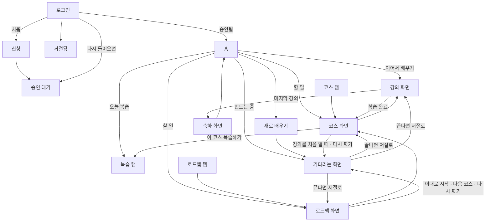

# 06. 화면

> **사용자가 보는 화면을 글로 정의한다** — 어떤 화면이 있고, 화면마다 무엇이 보이고 무엇을 할 수 있으며, 누르면 어디로 가는가.
> 배치 · 문구 · 모양은 사용자가 이 문서를 바탕으로 UI/UX 디자이너와 정한다 — 여기서는 대략만 적고, 이 문서에 그림(시안)은 담지 않는다(README 2026-11-02 · 2026-11-03). 기존 화면 시안(`docs/design/`)은 쓰지 않는다.
> Stitch 로 그린 시안은 [design/](./design/README.md)에 있다 — 참고 자료이고, 이 문서와 다른 곳은 그 README 의 「06 과 다른 곳」에 모았다.
> 화면이 읽고 보내는 것은 [05](./05-api.md), 규칙의 상세는 [02](./02-domain-data.md) · [03](./03-generation.md) — 여기서는 화면에 보이는 만큼만 적고 링크한다.

---

## 1. 읽는 법

- 화면은 번호가 아니라 이름으로 부른다 — 「홈」 · 「코스 화면」 · 「기다리는 화면」.
- 「두지 않는 것」은 일부러 뺀 것이다 — 근거 ADR 이 있다. 디자인에서 더하지 않는다.
- 「감수한다」는 설계에서 알고 받아들인 불편이다.
- 따옴표 안의 문구(「차례를 기다리고 있어요」 등)는 초안이다 — 디자인에서 다듬는다.

## 2. 공통

### 2.1 형태와 모양의 원칙

**브라우저에서 여는 웹이지만 앱처럼 보이게 만든다**(ADR-068).

- 화면 아래에 탭 바가 늘 있어 주요 화면을 오간다. 화면 위에는 제목과 뒤로 가기가 있다.
- **모바일 우선** — 모든 화면을 휴대폰 크기에 먼저 맞추고, 큰 화면에서도 깨지지 않게 한다(ADR-063).
- 설치는 필요 없다. 「홈 화면에 추가」(PWA)는 나중에 더한다.
- **고르는 것은 버튼으로 나란히** — 한눈에 보이고 한 번에 누른다. 「기타」를 고르면 직접 입력 칸이 열린다(ADR-004).
- **서버가 아는 것만 보인다** — 기다리는 동안 진행 단계 · 퍼센트 · 남은 시간 · 대기 순서 숫자를 보이지 않는다(ADR-006 · ADR-089).
- 다크 모드는 넣지 않는다(ADR-064).

### 2.2 화면 목록과 지도

**화면은 세 묶음이다**(ADR-076).

| 묶음 | 화면 |
|---|---|
| 로그인 전 · 승인 전 | 로그인 · 신청 · 승인 대기 · 거절됨(§3) |
| 탭 다섯 | 홈(§4) · 코스 탭 · 로드맵 탭(§12) · 복습 탭(§11) · 내 정보 탭(§13) |
| 탭에서 들어가는 화면 | 새로 배우기(§5) · 기다리는 화면(§6) · 코스 화면(§7) · 로드맵 화면(§8) · 강의 화면(§9) · 축하 화면(§10) · 개인정보처리방침(§14) |

- **검토는 따로 화면을 두지 않는다** — 코스 · 로드맵 화면의 「검토 중」 상태다. 코스를 누르면 상태와 상관없이 늘 같은 화면이 열린다. 상태마다 버튼이 달라 상태별로 설계 · 시험한다.
- **기다리는 화면은 따로 둔다** — 코스 · 로드맵 화면과 합치지 않는다.
- **복습 탭이 곧 복습 화면이다.**
- **승인 대기와 거절됨은 따로 둔다** — 분위기가 달라 문구와 모양을 따로 다듬는다.

### 2.3 탭 바

**아래 탭 바에 다섯 탭 — 홈 · 코스 · 로드맵 · 복습 · 내 정보**(ADR-071).

- **처음 열리는 탭은 늘 홈이다** — 복습만 하러 온 사람도 홈에서 한 번 더 누르는 것은 감수한다.
- 코스와 로드맵을 탭으로 나눈다 — 새로 배우기는 하나인데 탭이 둘이라, 만든 것이 어느 탭에 들어가는지 알려야 한다.
- 목록 탭에서 누르면 같은 브라우저 탭 안에서 화면이 바뀐다 — 위에는 뒤로 가기가 생기고 아래 탭 바는 그대로다. 코스 · 로드맵 화면은 주소가 따로 있어 홈에서 바로 열고, 새로고침해도 그 화면이 열린다.
- 탭이 5개라 휴대폰에서 빽빽한 것, 로드맵을 만들지 않은 사람에게 로드맵 탭이 비는 것은 감수한다.

### 2.4 기다림

**만드는 동안은 모두 같은 기다리는 화면이다**(ADR-006) — 코스 · 로드맵 계획 · 첫 코스 · 다음 코스 · 강의 자료 · 다시 짜기(ADR-085). 떠나도 서버가 끝까지 만든다. 그 화면에 머문 채 기다리는 만들기는 없다 — 다시 짜는 동안 이전 목록을 볼 수 없는 것은 감수한다.

**끝나면 기다리는 화면에서 결과 화면으로 저절로 넘어간다**(ADR-077) — 코스 · 첫 코스 · 다음 코스는 코스 화면(검토 중), 로드맵 계획은 로드맵 화면(검토 중), 강의 자료는 강의 화면. 뒤로 가기를 눌러도 기다리는 화면으로 돌아오지 않는다. 안내를 읽던 중에도 화면이 바뀌는 것은 감수한다.

### 2.5 실패 · 오류

**무엇이 안 됐나 · 이유 · 할 수 있는 것을 함께 알린다**(ADR-088) — 만들기 실패 · 저장 실패 · 연결 끊김 · 없는 화면 모두 같다.

- 이유는 사용자가 할 일이 달라지는 몇 가지로 묶는다 — 정한 묶음은 [05 §1.2](./05-api.md#12-오류--묶음-이름과-서버가-정한-문구).
- 문구는 서버가 경우에 맞게 내려주고, 화면은 그대로 보인다(ADR-145).
- 기술적인 원인(응답이 잘림 · 서버 응답 없음 등)은 보이지 않는다.

### 2.6 보이지 않는 정보

**사용자 화면에 시스템 정보를 보이지 않는다**(ADR-089) — 토큰 · 비용 · 모델 이름 · 다시 시도 횟수 · 오류 code · 대기 순서 숫자. 운영자는 DB · 로그로 본다.

- 크레딧만 내 정보 탭에서 보인다(ADR-113). 만드는 곳에는 이 만들기에 드는 크레딧도 보이지 않고, 모자라면 그때 언제 채워지는지와 함께 안내한다.

### 2.7 되돌릴 수 없는 동작

- 지우기 · 탈퇴는 확인에서 무엇이 사라지고 무엇이 남는지 알린다(ADR-026 · ADR-140) — 범위는 [02 §7](./02-domain-data.md#7-지우기--탈퇴--함께-사라지는-범위).
- 학습 완료는 되돌리지 않는다(ADR-012).

## 3. 로그인 전 화면

**로그인 전 화면은 넷이다**(ADR-091 · ADR-092 · ADR-093 · ADR-094). 가입 규칙은 [01 §4](./01-overview.md#4-누구에게-여나--정원제).

| 화면 | 보이는 것 | 할 수 있는 것 | 두지 않는 것 |
|---|---|---|---|
| 로그인 | 서비스 이름 · 짧은 소개(머금이 무엇인지 · 정원제라는 것) | 구글로 로그인 | 넘겨 보는 소개 여러 장 · 처리방침 링크(신청 · 승인 대기 · 거절됨 · 내 정보 탭에 둔다 — §14 · ADR-062 · ADR-091) |
| 신청 | 어느 구글 계정으로 신청하는지 · 저장하는 정보(「신청하면 구글 이메일 · 이름을 저장해요」 — ADR-062) | 신청(누르면 승인 대기로) · 다른 계정으로 로그인 · 처리방침 보기 | 입력 칸 · 동의 체크 |
| 승인 대기 | 승인을 기다린다는 것 · 승인돼도 따로 알리지 않으니 다시 들어와야 한다는 것 · 신청한 계정 · 신청을 지우는 방법(운영자에게 요청 — ADR-059) | 처리방침 보기 · 로그아웃 | 새로고침 버튼 |
| 거절됨 | 거절됐다는 것 · 신청한 계정 · 신청 정보가 남아 있다는 것과 지우는 방법 | 처리방침 보기 · 로그아웃 | 거절 이유 · 이유를 짐작하게 하는 말 · 다시 신청(ADR-058) |

- 다시 들어오면 상태에 따라 홈 · 승인 대기 · 거절됨으로 간다.
- 신청 화면의 계정 표시는 잘못된 계정으로 신청하는 것을 막는다 — 잘못 신청하면 운영자에게 요청해야 지운다.
- 로그인하기 전에는 처리방침을 볼 수 없는 것은 감수한다.

## 4. 홈

**들어오는 곳** — 로그인한 뒤 처음 열리는 탭. 축하 화면의 「홈으로」.

**다섯 칸을 위에서부터 이 순서로 둔다**(ADR-075).

| 칸 | 보이는 것 | 누르면 |
|---|---|---|
| 1. 오늘 복습 | 오늘 복습할 카드 수 | 「복습 시작」 → 복습 탭 |
| 2. 이어서 배우기 | 배우는 중인 코스 하나와 그 코스의 다음 강의. 진도는 보이지 않는다 | 강의 화면 |
| 3. 할 일 | 검토를 기다리는 강의 목록 · 로드맵 계획, 「다음 코스 만들기」를 누를 수 있게 된 로드맵 | 코스 화면(검토 중) · 로드맵 화면(검토 중 · 진행 중)(ADR-099) |
| 4. 만드는 중 · 실패 | 만드는 중인 것 · 실패한 것 | 기다리는 화면 — 떠나도 여기서 다시 연다 |
| 5. 새로 배우기 입구 | — | 새로 배우기(ADR-073) |

- **이어서 배우기의 코스**(ADR-099) — 배우는 중인 코스 가운데 가장 최근에 강의를 연 코스. 코스 화면을 열거나 「이대로 시작」한 것으로는 바뀌지 않는다. 강의를 연 코스가 없으면 가장 최근에 「이대로 시작」한 코스. 다른 코스는 코스 탭에서 찾는다.
- **「다음 코스 만들기」 버튼은 홈에 두지 않는다** — 로드맵 화면에서 다음 코스의 계획을 보고 누른다(ADR-099).

**스트릭** — 칸이 아니라 홈에 따로 둔다. 홈에만 있고 다른 화면 · 내 정보 탭에는 없다. 홈 안의 자리는 디자인에서 정한다(ADR-097). 세는 날은 [02 §3](./02-domain-data.md#3-학습과-복습)(ADR-016).

| 상태 | 문구(ADR-096) |
|---|---|
| 오늘 채웠다 | 「⟨n⟩일 연속 · 오늘 채웠어요」 |
| 아직이다 | 「⟨n⟩일 연속 · 복습 1장이나 강의 하나로 이어 가요」 |
| 0일 | 「오늘 복습 1장이나 강의 하나로 시작해요」 |

- 지난 며칠의 기록(달력 · 점)은 보이지 않는다(ADR-096).

## 5. 새로 배우기

**들어오는 곳** — 홈의 새로 배우기 입구(ADR-073 · ADR-074).

| | |
|---|---|
| 보이는 것 | 주제(필수) · 지금 수준(필수) · 목적(필수) · 메모(선택) · 로드맵으로 만들기 체크(기본 꺼짐). 보기와 그 뜻은 [03 §1.2](./03-generation.md#12-입력--새로-배우기) |
| 할 수 있는 것 | 만들기 → 기다리는 화면(ADR-006) |
| 두지 않는 것 | 미리 골라 둔 수준 · 목적 — 기본값이 있으면 대부분 그대로 넘어간다 · 강사(말투) 고르기 · 기간 · 주당 학습량(ADR-064) · 남은 크레딧 · 이 만들기에 드는 크레딧(ADR-113) |

- 로드맵 체크 옆에 로드맵이 무엇이고 언제 고르면 좋은지 설명한다(ADR-008). 초안:

  > ☐ **로드맵으로 만들기**
  > 넓은 주제를 여러 코스로 나눠 차례로 배워요. 한 코스를 마치면 그때까지의 복습 결과를 반영해 다음 코스를 만들어요.
  > 이럴 때 좋아요 — 한 번에 배우기 어려운 넓은 주제(예: Spring 백엔드 · 컴퓨터 네트워크) · 기초부터 실무까지 길게 배우고 싶을 때
  > 체크하지 않으면 한 주제를 강의 목록 하나로 만들어요(예: JPA 연관관계 · 트랜잭션 격리 수준).

- 입력은 만든 뒤 바꾸지 않는다(ADR-041).
- 넓은 주제를 체크 없이 만들어도 안내하지 않는다 — 핵심만 담은 코스가 나온다(ADR-008 · ADR-102).

## 6. 기다리는 화면

**들어오는 곳** — 새로 배우기 · 다시 짜기 · 로드맵의 「이대로 시작」 · 「다음 코스 만들기」 · 강의를 처음 열 때 · 홈의 만드는 중.

| | |
|---|---|
| 보이는 것 | 무엇을 만드는 중인지(입력한 주제 · 수준 · 목적, 강의 자료면 강의 제목) · 서버가 실제로 아는 상태 한 줄(「차례를 기다리고 있어요」 → 「강의 목록을 짜고 있어요」 · 「강의 자료를 만들고 있어요」) · 떠나도 된다는 것(「이 화면을 떠나도 계속 만들어요. 홈에서 다시 열 수 있어요.」) · 실패하면 그 이유 |
| 할 수 있는 것 | 떠나기 · 실패했을 때 다시 시도(일시적일 때만) · 버리기(ADR-086 · ADR-174) · 끝나면 결과 화면으로 저절로(ADR-077) |
| 두지 않는 것 | 진행 단계 · 퍼센트 · 남은 시간 · 대기 순서 숫자(ADR-089) · 오래 걸릴 때 안내 · 기다리는 동안 복습하기 · 결과가 들어올 자리 · 만드는 중 취소 |

**버리면 만들기 전으로 돌아간다**(ADR-086) — 홈의 만드는 중에서도 사라진다.

| 실패한 것 | 버리면 |
|---|---|
| 새로 배우기(코스 · 로드맵 계획) | 요청이 사라진다 |
| 첫 코스 · 다음 코스 | 그 코스는 짜기 전으로 남고, 로드맵에 「다음 코스 만들기」가 다시 보인다 |
| 강의 자료 | 아직 열지 않은 강의로 돌아간다 — 다시 열면 다시 만든다 |
| 다시 짜기 | 이전 목록 · 계획으로 돌아간다 — 하지 않은 것과 같다(ADR-085) |

## 7. 코스 화면

**들어오는 곳** — 코스 탭 · 로드맵 화면 · 홈의 할 일 · 기다리는 화면이 끝났을 때. 상태와 상관없이 같은 화면이다(ADR-076 · ADR-101).

| | 검토 중 | 학습 중 | 다 마침 |
|---|---|---|---|
| 언제 | 강의 목록이 막 나왔을 때 | 「이대로 시작」한 뒤 | 모든 강의를 학습 완료했을 때 |
| 보이는 것 | 코스 제목 · 강의 목록(강의마다 제목 · 한 줄 설명 · 다룰 개념 — ADR-020) · 숙련도가 목록을 어떻게 바꿨는지(몇 개를 짧게 다뤘고 몇 개를 다시 짚었는지 — ADR-090) · 강의는 아직 열 수 없다는 것 | 코스 제목 · 강의 목록 · 진도 · 다음에 열 강의(ADR-078 · ADR-080) | 다 마쳤다는 것 · 다 마친 날(ADR-169) · 코스 제목 · 강의 목록 |
| 할 수 있는 것 | 이대로 시작(이 화면이 학습 중으로 바뀐다 — ADR-078) · 다시 짜기(고칠 점을 글로 → 기다리는 화면 — ADR-007 · ADR-085) · 코스 제목 고치기(보이는 이름만 — ADR-007) · 코스 지우기(단일 코스만 — ADR-100) | 강의 열기(앞 강의를 학습 완료한 데까지 — ADR-019) · 학습 완료한 강의 다시 열기 · 이 코스 복습하기(→ 복습 탭에서 이 코스의 오늘 복습할 카드만 — ADR-172) · 코스 제목 고치기 · 코스 지우기(단일 코스만) | 학습 중과 같다 · 로드맵의 코스면 로드맵 화면으로 가기(ADR-101) |
| 두지 않는 것 | 강의 열기 · 강의 빼기 · 순서 바꾸기 · 강의 제목 고치기(ADR-007) · 메모 고치기(ADR-041) | 다시 짜기 · 메모 고치기 · 강의 건너뛰기(ADR-019) · 강의 제목 고치기 · 진도 되돌리기 · 처음부터 다시 하기(ADR-007 · ADR-012) | 학습 중과 같다 |

- **「이대로 시작」 뒤** 1강을 저절로 열지 않는다 — 시작한 상태(진도 0 / n)를 보여 주고, 1강은 다음에 열 강의로 눈에 띄게 보인다. 사용자가 지금 열거나 나중에 홈의 이어서 배우기로 연다(ADR-078).
- 강의를 처음 열면 그 강의의 자료를 만드는 기다리는 화면을 거쳐 강의 화면으로 간다(ADR-011 · ADR-077).
- 숙련도 반영의 판정 이름 · 수치는 보이지 않고, 개념마다 판정을 표시하지도 않는다(ADR-090).
- **지울 때** — 확인에서 「강의는 사라지고 카드는 복습에 나오지 않아요. 그동안의 카드와 복습 기록은 다음 강의를 내 수준에 맞추는 데 계속 쓰여요.」처럼 알린다(ADR-026). 기록까지 지우는 방법은 탈퇴다. 검토 중이면 남는 것이 없다(ADR-100). 지우면 코스 탭으로 간다(ADR-082). 로드맵의 코스는 여기서 지우지 않는다(ADR-027).
- 학습 중인 로드맵의 코스에서 그 로드맵으로 가는 길은 두지 않는다 — 다 마친 코스에만 있다(ADR-101).
- **「이 코스 복습하기」는 이 코스에 오늘 복습할 카드가 있을 때만 몇 장인지와 함께 보인다**(ADR-172). 예정과 상관없이 코스의 카드를 다 보는 방식은 두지 않는다 — 평가가 FSRS 일정을 바꾼다.

## 8. 로드맵 화면

**들어오는 곳** — 로드맵 탭 · 홈의 할 일 · 기다리는 화면이 끝났을 때(ADR-076 · ADR-099).

| | 검토 중 | 진행 중 |
|---|---|---|
| 언제 | 로드맵 계획이 막 나왔을 때 | 계획을 「이대로 시작」한 뒤 |
| 보이는 것 | 로드맵 제목 · 설명(ADR-167) · 로드맵 계획 — 코스마다 제목 · 한두 줄 설명 · 다룰 개념(ADR-010) | 로드맵 제목 · 설명 · 계획과 진행 — 어느 코스까지 마쳤나 · 코스마다 짜기 전 · 만드는 중 · 실패 · 만들어짐(ADR-008 · ADR-072) |
| 할 수 있는 것 | 이대로 시작(→ 첫 코스를 만드는 기다리는 화면 — ADR-079) · 다시 짜기(→ 기다리는 화면 — ADR-009) · 계획의 코스 제목 고치기(보이는 이름만 — ADR-009) | 만들어진 코스 열기 → 코스 화면(ADR-072) · 다음 코스 만들기(앞 코스의 모든 강의를 학습 완료하면 누를 수 있다 — 그 전에는 잠긴 채 「앞 코스를 다 마치면 만들 수 있어요」를 보인다 → 기다리는 화면 — ADR-018 · ADR-171) · 로드맵 지우기(ADR-027) |
| 두지 않는 것 | 메모 고치기(ADR-046) | 계획 다시 짜기(ADR-009) · 메모 고치기 · 로드맵의 코스 하나만 지우기(ADR-027) · 다음 코스 저절로 만들기(ADR-018) |

- **다 마침** — 마지막 코스를 다 마치면 로드맵이 다 마침이 된다(ADR-176). 진행 중과 같이 보이고 다 마쳤다는 것을 함께 보인다. 「다음 코스 만들기」는 보이지 않는다(ADR-171).
- **「이대로 시작」 뒤** 로드맵 화면에 남지 않고 첫 코스를 만드는 기다리는 화면으로 간다. 끝나면 첫 코스의 코스 화면(검토 중)으로 저절로 넘어간다(ADR-079). 코스의 「이대로 시작」과 흐름이 다른 것은 감수한다.
- **지울 때** — 그 안의 코스도 모두 지우고(ADR-027), 로드맵 탭으로 간다(ADR-082).

## 9. 강의 화면

**들어오는 곳** — 코스 화면(순서대로만 — ADR-019) · 홈의 이어서 배우기 · 강의 자료의 기다리는 화면이 끝났을 때.

| | |
|---|---|
| 보이는 것 | 강의 제목 · 강의 자료 — 뼈대와 선택 섹션 · 글 · 코드 · 다이어그램 · 수식([03 §3](./03-generation.md#3-강의-자료와-카드)) |
| 할 수 있는 것 | 학습 완료(되돌리지 않는다 — ADR-012) → 코스 화면, 마지막 강의면 축하 화면(ADR-080 · ADR-081) |
| 두지 않는 것 | 학습 완료 되돌리기 · 강의 자료 다시 만들기(ADR-025) · 이 강의의 카드 보기 · 첫 복습(ADR-014 · ADR-080) · 이미지(ADR-022) |

- 학습 완료하면 코스 화면으로 돌아가 진도가 하나 늘고, 다음 강의가 다음에 열 강의로 눈에 띈다. 다음 강의를 저절로 열지 않는다(ADR-080).
- 방금 생긴 카드는 오늘 복습할 카드에 들어가 복습 탭에서 본다 — 「카드가 복습에 들어갔어요」 알림은 두지 않는다(ADR-080).
- 그림 · 수식이 깨지면 그 자리에 라이브러리의 오류 표시를 그대로 보인다(ADR-023).
- 학습 완료한 강의도 언제든 다시 열어 읽는다.

## 10. 축하 화면

**코스의 마지막 강의를 학습 완료하면 나온다**(ADR-081) — 단일 코스 · 로드맵의 코스 · 로드맵의 마지막 코스 모두 같다. 코스 화면으로 돌아가지 않는다.

| | |
|---|---|
| 보이는 것 | 코스를 마친 것을 알아 주는 문구(「고생했어요」 같은) |
| 할 수 있는 것 | 홈으로 — 누르면 바로 홈으로 간다. 홈에서 방금 생긴 카드의 오늘 복습, 로드맵의 코스였다면 「다음 코스 만들기」(할 일)가 이어진다 |
| 두지 않는 것 | 몇 초 뒤 저절로 넘어가기 · 「다음 코스 만들기」 버튼(로드맵 화면에만 — ADR-099) |

## 11. 복습 탭

**탭이 곧 복습 화면이다 — 누르면 바로 오늘 복습할 첫 카드가 나온다**(ADR-076). 오늘 복습할 카드는 [02 §3](./02-domain-data.md#3-학습과-복습).

| | |
|---|---|
| 보이는 것 | 카드 한 장씩 — 질문, 떠올린 뒤 답(ADR-015) · 평가 버튼마다 다음에 나오는 간격(「1분」 · 「3일」 — ADR-170) · 몇 장 남았는지 · 카드가 없으면 「오늘 복습할 카드가 없어요」 |
| 할 수 있는 것 | 답 보기 · 4단계 스스로 평가(다시 · 어려움 · 좋음 · 쉬움) · 카드 지우기(답이 틀렸거나 질문이 모호할 때 — ADR-065) |
| 두지 않는 것 | 판단 기준(핵심 포인트) · LLM 채점(ADR-015) · 빈칸 · 객관식(ADR-005) · 카드 편집 · 직접 추가 · 오류 신고 · 카드별 복습 멈추기 · 카드 다시 만들기(ADR-064 · ADR-065) |

- **「다시」를 누른 카드는 같은 복습에서 다시 나온다**(ADR-164) — 받은 카드를 다 보면 다시 읽어, 돌아온 카드가 있으면 이어서 보이고 없으면 「오늘 복습할 카드가 없어요」. 「몇 장 남았는지」는 그만큼 늘 수 있다.
- 홈의 「복습 시작」도 이 탭으로 온다 — 홈은 알려 주고, 탭에서는 바로 한다.
- **코스 화면의 「이 코스 복습하기」로 오면 그 코스의 카드만 보인다**(ADR-172) — 같은 화면에 코스 제목을 보이고, 다 보면 「이 코스는 오늘 복습할 카드가 없어요」와 전체 복습으로 가는 버튼. 탭을 다시 누르면 전체 복습이다.
- 카드를 지우는 곳이 여기뿐이라, 틀린 카드를 지우려면 그 카드가 복습에 나와야 한다.

## 12. 코스 탭 · 로드맵 탭

| | 코스 탭 | 로드맵 탭 |
|---|---|---|
| 보이는 것 | 강의 목록이 생긴 모든 코스 — 단일 코스와 로드맵에 속한 코스(ADR-072). 짜기 전 코스는 보이지 않는다 | 로드맵 목록 — 로드맵마다 제목 · 설명(ADR-167) · 진행 한 줄(다 마친 로드맵은 「다 마침」 — ADR-176) |
| 할 수 있는 것 | 코스를 누르면 코스 화면 — 코스를 모아 보는 목록은 여기 하나다(로드맵 화면 · 홈의 할 일 · 기다리는 화면에서도 그 코스 화면으로 간다 — §7) | 로드맵을 누르면 로드맵 화면 |
| 두지 않는 것 | 로드맵에 속한 코스 하나만 지우기(ADR-027) | 로드맵의 코스 목록을 따로 다시 보이기(ADR-072) |

## 13. 내 정보 탭

| | |
|---|---|
| 보이는 것 | 남은 크레딧 · 다음에 채워지는 날(ADR-113) |
| 할 수 있는 것 | 로그아웃 · 탈퇴(승인된 사람만 — ADR-059. 확인에서 무엇을 지우는지 알리고, 탈퇴하면 로그인 화면으로 바로 — ADR-083) · 개인정보처리방침 보기 |
| 두지 않는 것 | 학습 통계 · 로그인 기기 목록 · 원격 로그아웃(ADR-064) · 탈퇴 완료 화면(ADR-083) · 스트릭(ADR-097) |

## 14. 개인정보처리방침

| | |
|---|---|
| 보이는 것 | 처리방침 본문 — 적을 것은 [01 §10](./01-overview.md#10-공개-필수-목록). 나머지는 쓸 때 정한다(ADR-062) |
| 여는 곳 | 신청 · 승인 대기 · 거절됨 · 내 정보 탭 — 로그인 화면에는 두지 않는다(ADR-062 · ADR-091) |

## 15. 정할 것

### 15.1 화면 — 구현 전에 정한다

- 축하 화면에 문구 말고 무엇을 보이나 · 로드맵의 코스일 때 문구를 다르게 하나(ADR-081)
- 코스 탭의 코스 한 줄에 제목 말고 무엇을 보이나 — 상태 · 진도 · 로드맵에 속한 코스인지(ADR-072)
- 「배우는 중인 코스」를 무엇으로 보나 — 학습 중 상태의 코스로 가정했다(ADR-075 · ADR-101)
- 할 일 · 만드는 중을 코스 · 로드맵 탭에서도 보이나(ADR-075)
- 만든 것이 어느 탭에 들어가는지 알리는 방법 · 로드맵이 없을 때 로드맵 탭에 무엇을 보이나
- 구글 로그인의 앱 확인에 로그인 화면의 처리방침 링크가 필요한가 — 필요하면 로그인 화면에 더한다(ADR-091)
- 검토 중인 로드맵을 지울 수 있나 — 지금은 진행 중에만 지우기가 있다(ADR-076 · ADR-100)
- 한 사람이 코스 · 로드맵을 몇 개까지 가질 수 있나
- 복습 중에 다른 탭에 갔다 오면 이어서 보이나(ADR-076) — 다 마쳤을 때 보이는 것은 §11
- 로드맵 자체의 제목을 고칠 수 있나 — 계획의 코스 제목은 고친다(ADR-009)
- 내 정보 탭에 어느 구글 계정인지 보이나

### 15.2 넘어간 것

MVP 에서 따로 다루지 않기로 한 것이다(ADR-102) — 화면에 장치를 두지 않고, 쓰면서 문제가 보이면 고친다.

- 반영할 복습 기록이 없을 때(처음 만드는 코스 등) 숙련도 반영 내역을 어떻게 보이나(ADR-090)

### 15.3 디자인에서 정할 것

배치 · 문구 · 모양은 사용자가 이 문서를 바탕으로 디자이너와 정한다. 정해지면 색 · 글꼴 · 간격 · 컴포넌트 같은 시각 값은 `UI_GUIDE.md` 를 새로 만들어 담는다.

| 것 | 근거 |
|---|---|
| 색 · 글꼴 · 간격 · 컴포넌트 모양 · 아이콘 · 애니메이션 | README 2026-11-03 |
| 홈의 칸이 비었을 때 · 무엇을 가장 눈에 띄게 할지 · 할 일 · 만드는 중이 여러 개일 때 | ADR-075 |
| 진도 · 로드맵 진행 표시 · 짜기 전 코스를 무엇이라 보이나 | ADR-008 · ADR-010 · ADR-141 |
| 강의 목록 · 로드맵 계획의 한 줄 — 제목 · 설명 · 개념이 들어가 무거워진다 | ADR-020 |
| 「이대로 시작」 뒤 다음에 열 강의를 눈에 띄게 | ADR-078 |
| 지금 수준 · 목적의 보기 버튼 · 로드맵 체크 옆 설명 · 축하 · 기다리는 화면의 문구 | ADR-004 · ADR-008 · ADR-006 · ADR-081 |
| 작은 화면 · 큰 화면에서 긴 글 · 코드 · 다이어그램 · 큰 화면의 탭 바 | ADR-063 |
| 구글 로그인 버튼 — 구글의 버튼 규칙을 따른다고 가정했다 | ADR-091 |
| 「지금은 만들 수 없음」 안내의 문구와 자리(새로 배우기 · 강의 열기 · 다시 짜기 · 다음 코스 만들기) | ADR-104 · ADR-116 |
