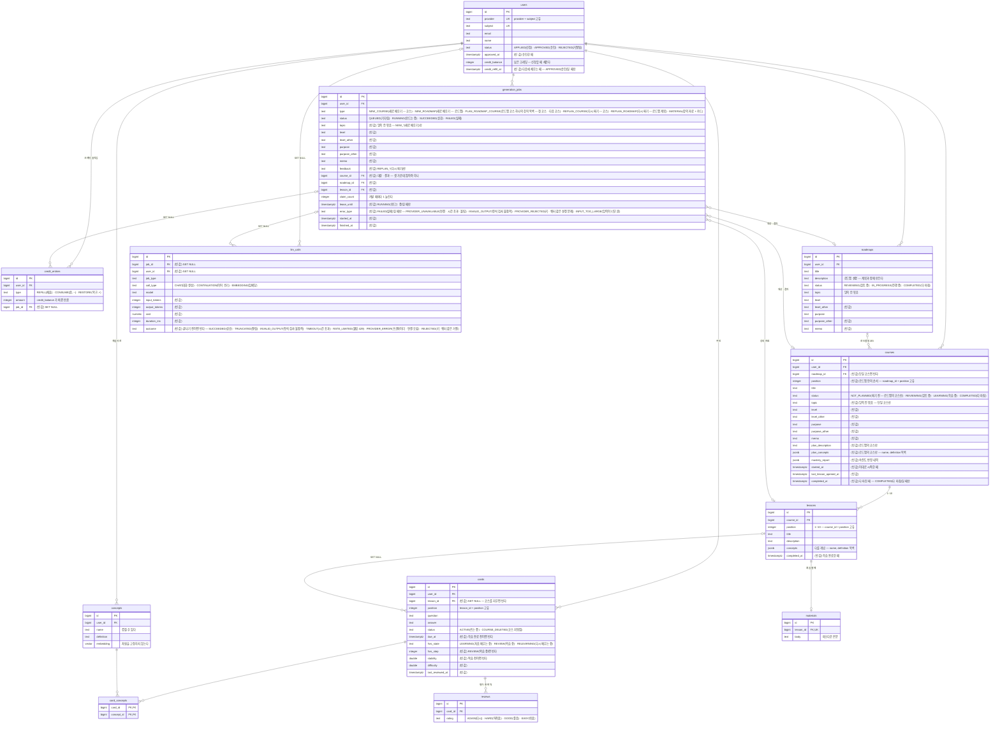

# ERD — 테이블과 칸 한눈에

> 테이블 · 칸 · 연결을 한 장에 모은 **보기용 그림**이다. 칸의 뜻 · 빈 값 규칙 · `CHECK` · 색인 · 지우는 순서는 [02 §8](./02-domain-data.md#8-테이블) 이 단일 출처다 — **02 §8 을 고치면 이 그림도 같은 변경에서 고친다.**
> 이름은 [GLOSSARY](./GLOSSARY.md), 단위는 [02 §1](./02-domain-data.md#1-단위와-관계), 상태 같은 값 목록과 뜻은 [02 §8.7](./02-domain-data.md#87-값-목록).

## 읽는 법

- **모든 테이블에 `id`(bigserial PK) · `created_at` · `updated_at` 이 있다** — 그림에는 `id` 만 적고 시각 둘은 뺐다. `created_at` 이 뜻을 갖는 곳: `users`(신청한 때) · `reviews`(평가한 때) · `generation_jobs`(받은 순서) · `credit_entries`(마지막 채움 뒤의 씀인지 — 복구 조건) · `llm_calls`(한 달 합계).
- 칸 설명 끝의 **(빈 값)** 은 비어 있을 수 있는 칸이다. 언제 비는지는 02 §8.
- **입력 칸 묶음**(`topic` · `level` · `level_other` · `purpose` · `purpose_other` · `memo`)은 `roadmaps` · `courses` · `generation_jobs` 가 같이 쓴다(ADR-137).
- **SET NULL** 이라 적은 연결만 지울 때 저절로 끊긴다 — `cards.lesson_id` · `credit_entries.job_id` · `llm_calls.job_id` · `llm_calls.user_id`(ADR-156). 나머지는 자식부터 지운다(02 §8.6).
- 로그인 세션 테이블(`SPRING_SESSION` · `SPRING_SESSION_ATTRIBUTES`)은 기존 그대로라 그리지 않았다.

## 전체

