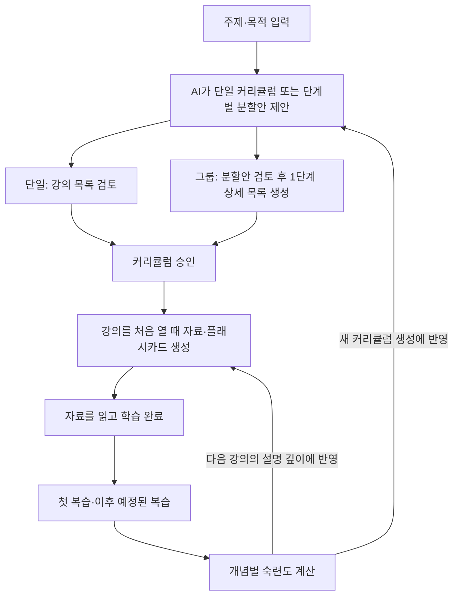
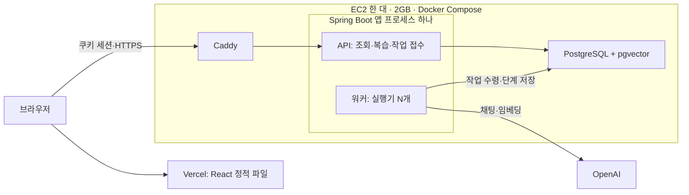

# 머금 · Mogum — 멘토링 설계 리뷰

> **읽는 시간: 약 10~15분.** 서비스 흐름, 주요 설계와 선택 이유, 남은 위험을 설명한다. 상세 문서는 관심 있는 항목만 찾아볼 수 있도록 연결했다.
> **기준일: 2026-10-18.** 아래는 목표 설계이며, 현재 구현·검증 상태는 §9에 별도로 적었다. 상세와 근거는 `01`~`07` 문서가 우선한다.

## 1. 어떤 서비스인가

**주제를 정하면 AI가 커리큘럼과 강의 자료를 만들고, 학습 후 플래시카드로 복습하며, 복습 결과가 다음 강의의 설명 깊이를 바꾸는 학습 서비스다.**

AI로 설명을 얻어도 기억에 남기기는 어렵고, 기존 간격 반복 학습 도구는 플래시카드를 직접 만들어야 한다. 머금은 강의 생성부터 복습까지 연결한다. 핵심 가설은 **이미 아는 개념의 설명은 줄이고, 흔들리는 개념에 분량을 쓰면 반복 학습의 낭비를 줄일 수 있다**는 것이다. 이 효과는 아직 실사용으로 검증하지 않았다.

| 전제 | 설계에 주는 영향 |
|---|---|
| 1인 개발·운영, 월 5만원 기준(LLM 비용 포함) | 서버와 저장소를 최소화하고 생성 비용을 통제한다 |
| 개념·지식형 학습, 모바일 우선 | 읽기와 질문에 답을 떠올리는 복습에 집중한다. 회화·실기 같은 연습형 학습은 받지 않는다 |
| 정원제 공개, 잠정 약 25명 | 최종 정원은 예산과 용량 측정 결과 중 작은 쪽으로 정한다. 25명은 확정 용량이 아니다 |
| 강의 자료 생성에 약 1분 | 요청과 생성을 분리하고, 기다리는 동안 기존 강의·복습을 이용할 수 있게 한다 |

MVP는 **커리큘럼 생성·검토 → 강의 자료 생성·학습 → 플래시카드 복습 → 다음 생성에 반영**까지다. 기간·주당 학습량에 맞춘 일정, 선행 생성, 결제·소셜·모바일 앱은 범위에서 제외한다. 학습 속도와 강의 순서는 사용자가 선택한다.

상세: [서비스 범위와 제외 항목 — 01 §2~§6](./01-overview.md)

## 2. 사용자는 어떻게 학습하는가



1. **주제와 목적을 입력한다.** 첫 생성용 채팅 응답에 단일/그룹 판단과 해당 결과를 함께 받는다. 단일이면 총 1~40강의 목록, 넓은 목표면 단계별 제목·범위·순서의 분할안을 제안한다. 서버는 구조·상한·순서를 검증하고 사용자가 결과를 검토한다.
2. **목록을 검토하고 승인한다.** 승인 전에는 피드백을 붙여 전체를 다시 짤 수 있다. 그룹은 먼저 1단계의 상세 목록을 만들고 같은 검토·승인 흐름을 쓴다. 현재 단계의 모든 강의를 완료하면 다음 단계 생성 버튼을 보여주며, 클릭 시 최신 숙련도를 반영한다. 다음 단계를 자동 생성하거나 복습 완료를 강제하지 않는다.
3. **강의를 열어 학습한다.** 목록 생성 시에는 제목·목표·키워드·순서만 저장한다. 강의 자료와 플래시카드는 해당 강의를 처음 열 때 생성한다. 생성된 자료는 다시 열어도 재사용한다.
4. **학습 완료 후 복습한다.** 이때 플래시카드의 복습 상태가 처음 생기고 즉시 첫 복습으로 안내한다. 답을 떠올린 뒤 모범 답안·채점 포인트를 보고 4단계로 자가평가한다. 첫 복습을 건너뛰어도 오늘의 복습에 남는다.
5. **다음 생성이 달라진다.** 복습 기록으로 개념별 숙련도를 계산해 설명을 생략·축약·상세화한다. 이미 생성한 자료를 소급해서 다시 쓰지는 않는다.

초기 요청은 입력을 생성 작업에 먼저 저장하고 **성공할 때 커리큘럼 또는 그룹을 만든다.** 빈 결과 리소스를 미리 만들지 않는다. 화면을 나갔다 돌아와도 미완료 요청과 작업 결과로 이어가며, 중복 제출은 요청 식별자로 기존 작업에 연결한다. 사용자는 실패한 초기 요청만 지울 수 있다.

상세: [초기·단계 생성 — 03 §2.1](./03-generation.md#21-단일-커리큘럼--그룹-판단--llm-제안과-사용자-검토), [학습·복습 화면 — 06 §10~§11](./06-screens.md)

## 3. 전체 시스템은 어떻게 구성하는가



| 영역 | 선택과 이유 | 감수하는 한계·변경 조건 |
|---|---|---|
| 백엔드 | Java 21·Spring Boot 4·MVC·플랫폼 스레드. 오래 기다리는 생성은 실행기 `N`개로 제한한다 | 수백 개의 긴 대기 연결이 필요한 기능이 생기면 스레드 모델을 재검토한다 |
| 저장소·큐 | PostgreSQL에 도메인 데이터·세션·작업 큐·비용 원장을 두고 pgvector로 개념을 비교한다 | DB가 공통 장애 지점이다. 큐 처리량이 초당 수백 건 규모가 되면 별도 큐를 재검토한다 |
| 화면 | React·TypeScript·Vite, 서버 상태는 TanStack Query. 생성 진행은 2초 폴링한다 | 폴링도 부하다. 용량 측정에서 문제가 관측되면 통신 방식을 재검토한다 |
| 배포 단위 | 화면은 Vercel, API·워커는 같은 JVM, DB는 같은 EC2 | 앱과 DB가 자원·장애를 공유한다. 워커가 API 지연에 영향을 주면 같은 jar를 API/워커 역할로 나눌 수 있게 한다 |

**코드 경계는 `core` ← `api`·`worker`·`infra`다.** `core`는 도메인 규칙·유스케이스·포트를, `infra`는 JPA 엔티티·SQL·외부 SDK 구현을 담당한다. 단일 Gradle 모듈에서 ArchUnit 테스트로 의존 방향을 강제한다.

특히 생성 유스케이스와 유료 호출 포트는 `core.generation`에 모으고 워커·인프라·루트 설정만 참조하도록 한다. API가 다른 유스케이스를 거쳐 임베딩을 호출하는 우회도 막는다. **요청 경로에서 유료 생성이 시작되지 않도록 하는 경계**다.

상세: [기술 선택·패키지 경계·배포 — 04 §1~§3](./04-jobs-and-cost.md)

## 4. 복습 결과는 어떻게 다음 강의를 바꾸는가

### 데이터의 연결

```text
사용자 → 커리큘럼 → 강의 → 강의 자료 → 플래시카드 → 복습 상태·복습 이력
                                      └──────→ 사용자별 개념
사용자 → 커리큘럼 묶음 → 단계 → 필요할 때 실제 커리큘럼 연결(단계당 최대 하나)
```

플래시카드 하나는 주된 개념 하나에 연결된다. 같은 개념의 플래시카드가 여러 커리큘럼에서 만들어져도 그 사용자의 개념으로 묶이므로, 이전 학습을 다른 커리큘럼 생성에도 반영할 수 있다.

### 숙련도 판정은 백엔드가 한다

FSRS(복습 간격을 정하는 알고리즘) 라이브러리가 평가마다 플래시카드 상태와 다음 복습일을 갱신한다. 저장하는 것은 이 원본 상태와 복습 이력이다. **개념 숙련도는 조회할 때 계산한다.** 기억할 확률은 복습하지 않아도 시간이 지나면 내려가기 때문이다.

오늘의 복습에는 한국 날짜로 오늘까지 예정된 플래시카드를 모두 제공하고, 일일 개수 제한은 두지 않는다. 몇 분 뒤 다시 보는 단기 학습 단계는 비우고, 최소 1일의 복습 간격은 라이브러리에 맡긴다. 중간에 나가도 평가한 결과는 저장한다.

판정에는 개념에 연결된 학습 완료 플래시카드들의 `R` 평균(현재 기억할 확률), `S` 평균(기억의 안정성), 최소 복습 횟수를 쓴다. `R`·`S` 평균은 복습한 플래시카드로 계산하지만, 최소 횟수에는 미평가 플래시카드의 0회도 포함한다.

| 판정 | 현재 규칙 | 생성에 반영 |
|---|---|---|
| 충분히 안다 | `R ≥ 0.9`, `S ≥ 7일`, 모든 대상 플래시카드를 최소 2회 복습 | 해당 개념만의 강의는 제외, 자료에서는 생략·한 줄 복기 |
| 어느 정도 안다 | 위 조건 외 `R ≥ 0.6`, `S ≥ 1일` | 커리큘럼 분량 축소, 자료에서는 간단 복기 |
| 상세 설명 필요 | 그 외, 미복습 또는 학습 이력 없음 | 필요한 강의를 구성하고 상세 설명 |

복습 직후의 높은 `R`만으로 생략하지 않도록 `S`와 복습 횟수를 함께 본다. `S`의 7일·1일 기준은 실사용으로 조정할 잠정값이다. LLM은 개념·설명 순서·문장을 구성하고, **생략 여부와 설명 깊이는 공통 `MasteryPolicy`가 정한다.** 근거를 찾지 못하면 상세 설명을 기본으로 둔다.

새 커리큘럼에는 주제·목적의 의미 검색과 키워드 검색으로 관련 개념만 선별해 현재 숙련도를 넣는다. 강의 자료 생성에서는 LLM이 읽기 전용 숙련도 조회 도구로 필요한 개념을 확인한다. 검색 관련도가 높다는 이유로 숙련됐다고 보지는 않는다. 생성 당시의 조회 근거는 남기되 현재 숙련도 캐시로 재사용하지 않는다.

### 개념 이름이 달라도 같은 학습 이력으로 연결한다

`기회비용`과 `Opportunity Cost`가 갈라지면 숙련도가 분산되고, 서로 다른 분야의 `엔트로피`가 합쳐지면 숙련도가 오염된다. 그래서 **이름·별칭의 정규화 비교와 한 줄 정의의 임베딩 유사도**를 함께 쓴다. 이름이 같은 경우와 다른 경우에 별도 임계값을 적용한다.

개념 사전은 사용자별로 두고, 생성·매칭은 한 경로에서 사용자 단위 DB 잠금으로 직렬화한다. 임베딩이 실패하면 이름만 믿고 합치지 않고 별도 개념으로 남긴다. 잘못 합쳐 숙련도를 오염시키는 것보다 중복을 허용하는 쪽을 택했으며, 판정 이력을 남겨 수동 병합·되돌리기에 쓴다. 임계값은 작은 실험 표본에 근거하므로 범용 정확도가 검증된 상태는 아니다.

상세: [숙련도·개념 동일성·관련 개념 선별 — 02 §4~§5](./02-domain-data.md)

## 5. LLM 생성은 어디까지 자율적으로 맡기는가

| 생성 작업 | 처리 방식 |
|---|---|
| 초기 요청 | 첫 생성용 채팅에서 단일/그룹 판단과 강의 목록/분할안을 함께 받는다. 정상 경로의 생성용 채팅은 1회이며 검색 임베딩·오류 재시도는 별도다 |
| 커리큘럼 다시 짜기·단계 상세 생성 | 관련 숙련도와 백엔드 판정을 입력해 강의 목록을 생성하고 반영 결과를 검증한다 |
| 강의 자료 | **① 개요·숙련도 조회 → 백엔드가 설명 깊이·목표 분량 확정 → ② 본문 → ③ 플래시카드 → 개념 매칭·저장** 순서로 처리한다 |

강의 생성에서 도구를 선택하는 자율 구간은 ①뿐이다. 도구도 읽기 전용 숙련도 조회 하나이며, 라운드와 호출 수를 제한한다. 본문·플래시카드는 확정한 입력을 받아 생성하고 DB 변경은 백엔드가 수행한다. **생성의 표현은 LLM에 맡기고, 상태 변경·숙련도 판정·예산은 코드로 통제한다.**

개요와 본문을 분리한 이유는 설명 분량 제어다. 기존 4강 비교 실험에서 개요를 유지한 채 호출을 합쳐도 비용 절감은 거의 없었고, 개요를 없애면 약 19% 저렴했지만 아는 개념과 모르는 개념의 설명 분량 차이가 흐려졌다. 작은 표본의 관측이며 운영 구성에서 다시 확인해야 한다.

본문은 고정 6섹션의 마크다운이며, 플래시카드는 자료당 최대 10장으로 모범 답안·채점 포인트를 포함한다. 충분히 알아 생략한 개념의 플래시카드는 만들지 않도록 프롬프트와 후처리에서 검사한다. 새 미복습 플래시카드 때문에 같은 개념의 생략 판정이 바로 풀리는 것을 막기 위해서다.

본문이 출력 상한에서 잘리면 이어 쓰기를 최대 1회 허용한다. 여전히 잘리거나 필수 섹션 검증에 실패하면 실패로 끝내고, 플래시카드 생성이나 완성 자료 저장으로 넘어가지 않는다. 검증된 단계만 저장하므로 플래시카드 단계에서 실패했다면 본문을 다시 만들지 않고 이어간다. 프롬프트는 버전으로 관리한다.

상세: [생성 단계와 검증 규칙 — 03 §1~§7](./03-generation.md)

## 6. 약 1분 걸리는 생성과 장애는 어떻게 다루는가

API는 소유권·상태·한도를 검사하고 `jobs`에 작업을 넣은 뒤 `202 {jobId}`를 반환한다. 화면은 작업 상태를 조회한다. 워커의 실행기 `N`개는 각자 빈손일 때 작업 하나만 수령한다. `N`은 시작값 4이며 용량 측정으로 확정한다.

작업 수령에는 `FOR UPDATE SKIP LOCKED`를 써 다른 실행기가 잡은 행을 기다리지 않고 다음 작업을 고른다. 수령 시 **리스(점유 유효기간)**와 **수령 회차(`lease_epoch`)**를 부여한다. 저장·리스 갱신은 작업 상태·유효한 리스·같은 회차를 모두 조건으로 하고, 변경 행이 0개면 추가 생성과 결과 저장을 중단한다.

```text
짧은 트랜잭션: 입력 읽기·실행 권한 확인·외부 시도 등록 → 커넥션 반납
외부 LLM 호출: DB 커넥션·행 잠금 없이 대기
짧은 트랜잭션들: 사용량 기록 → 실행 권한 재확인 → 검증된 단계 산출물 저장
```

트랜잭션은 `TransactionRunner`로 드러내고, 트랜잭션 밖에서는 JPA 엔티티 대신 완전히 채운 값 객체를 쓴다. 느린 LLM을 기다리느라 DB 커넥션 풀이 마르고 복습 조회까지 멈추는 것을 막는다.

| 상황 | 설계한 대응 |
|---|---|
| 같은 강의를 동시에 요청 | 활성 작업의 기존 ID를 반환한다. 부분 unique 인덱스가 중복 적재의 최종 방어선이다 |
| 실행기가 죽음 | 리스 만료 후 다른 실행기가 회수해 완료된 단계 다음부터 재개한다. 현재 리스는 5분이다 |
| 회수된 옛 실행기의 응답이 늦게 도착 | 수령 회차 조건으로 결과 저장·추가 호출을 거부한다. 이미 나간 호출의 사용량은 별도로 기록한다 |
| 배포로 정상 종료 | 새 수령을 멈추고 진행 중인 외부 호출 하나를 최대 120초 기다려 기록한 뒤 반납한다. 다음 호출은 시작하지 않는다 |
| 완료 저장과 삭제가 경합 | 같은 커리큘럼 잠금으로 직렬화한다. 대상 존재 확인 후 조건부 작업 UPDATE를 첫 쓰기로 두고 결과·성공 이벤트를 함께 커밋한다 |

초기 생성은 아직 커리큘럼이 없으므로 사용자 사용량 잠금과 계정 존재 확인 뒤 같은 방식으로 권한을 먼저 검사하고 새 결과·연결·성공 이벤트를 함께 커밋한다.

**외부 호출의 정확히 한 번 실행은 보장하지 않는다.** 장애 시 같은 단계가 다시 호출될 수 있고, 회수 시점에 이미 전송된 요청은 취소를 보장할 수 없다. 대신 늦은 실행기의 결과 반영을 막고, 재호출까지 비용 원장·누적 호출 상한에 포함한다. 리스는 백오프·호출 타임아웃·DB 기록 지연의 합보다 길게 유지한다.

상세: [작업 수명주기·펜싱·트랜잭션 — 04 §4~§6](./04-jobs-and-cost.md)

## 7. 생성 비용은 어떻게 제한하는가

**외부 호출 시도마다 전송 전에 `llm_calls`에 등록하고, 응답의 사용량을 그 행에 한 번만 확정한다.** 생성 결과 저장과는 별도 트랜잭션이므로 작업 실패·리스 상실·삭제 뒤에도 확인된 사용량을 남긴다. DB 기록만 재시도할 때는 같은 시도 ID를 쓰고 LLM을 다시 보내지 않는다. SDK 자동 재시도는 끄고 공통 호출 계층에서 재시도한다. 크레딧 소진은 즉시 실패로 분류한다.

| 방어 | 제한하는 것 |
|---|---|
| 생성 구조 | 강의·플래시카드 수, 도구 라운드, 입력·출력 크기, 이어 쓰기·수정 횟수 |
| 작업 전체 누적 호출 상한 | 전송 실패·사용자 재시도·작업 회수를 포함한 채팅/임베딩 시도 수. 재개해도 초기화하지 않는다 |
| 사용자 제한 | 일일 비용 쿼터와 대기·실행 중 작업 최대 2개. 개수 검사와 적재는 사용자 잠금 안에서 함께 수행한다 |
| 전역 킬스위치 | 전체 일일 비용 상한에 도달하면 새 작업 적재를 거부한다. 기존 학습·복습은 계속된다 |

일일 비용 합계는 원장에서 조회하고 날짜는 `Asia/Seoul`을 쓴다. 전송할 전체 요청에는 시스템 프롬프트·누적 대화·도구·응답 스키마까지 포함해 입력 예산을 검사하고, 초과하면 전송 전에 실패시킨다.

**일일 금액을 정확히 지키는 선차감 방식은 아니다.** 이미 적재된 작업은 계속 처리하며, 응답을 잃어 사용량을 모르는 시도는 비용 미확인으로 남는다. 따라서 실행 중·대기 중 작업의 남은 비용과 미확인 과금으로 상한을 넘을 수 있다. 누적 호출 상한은 이 위험을 제한하지만 정확한 청구액을 보장하지 않는다.

실험 프롬프트 v5에서 강의 자료 1건은 46~62초·약 82원이었다. **관측 단가는 최대비용이 아니며 운영 프롬프트의 단가도 아니다.** 초기 생성의 자체 호출·입출력 예산, 사용자 쿼터·킬스위치 금액은 관련 구현과 측정에서 확정해야 한다. 초기 생성 예산이 미확정이므로 전체 비용 천장도 아직 확정되지 않았다.

상세: [호출 규약 — 03 §8](./03-generation.md#8-llm-호출-규약), [비용 방어와 초과 한계 — 04 §7](./04-jobs-and-cost.md#7-비용-통제)

## 8. 인증·삭제·운영에서 지킬 것은 무엇인가

**인증은 Google OAuth와 DB 쿠키 세션을 쓴다.** 세션에는 사용자 ID만 두고 상태·역할은 요청마다 DB에서 읽는다. 승인·탈퇴 같은 변경을 바로 반영해야 해 요청마다 DB를 확인하므로 세션 방식을 택했다. 화면과 API는 같은 등록 도메인의 다른 출처에 두고 CORS·CSRF·쿠키 설정을 맞춘다. 다른 사용자의 리소스는 `404`로 응답한다.

**삭제는 연결된 학습 이력까지 포함한다.** 커리큘럼 삭제 시 자료·플래시카드·복습 상태/이력·관련 개념 판정 기록을 함께 지우고 범위를 안내한다. 연결 작업을 먼저 제거해 늦은 결과가 지운 데이터를 복원하지 못하게 한다. 비용과 생성 한도 기록은 유지하며, 탈퇴 시에는 호출 원장의 계정·작업·프로바이더 요청 ID 연결도 제거한다.

**운영 이력은 현재 상태와 분리한다.** 작업 성공·실패·회수는 상태 전환과 같은 트랜잭션에서 `job_events`에 남긴다. 재시도해도 과거 실패를 지우지 않는다. 관리자 화면은 이 이력과 호출 원장으로 실패율·회수·비용을 보여주며, 사용자 화면에는 비용·토큰·전체 큐 크기를 노출하지 않는다.

**배포·복구의 한계를 받아들인다.** 배포가 활성화되면 `main` 병합 시 GitHub Actions가 이미지를 빌드·검사해 ECR에 올리고 S3·SSM으로 EC2에 배포한다. 서버는 같은 이미지 지문으로 받아 실행한다. 무중단 배포는 공개 후로 미뤄 배포 중 최대 약 2분의 중단을 허용한다. DB는 매일 S3로 백업하고 총 보관은 30일(현재 버전 23일+이전 버전 7일)이다. 서버를 잃으면 마지막 백업 이후 최대 하루의 기록을 잃을 수 있으며, 복구 시 백업 이후의 탈퇴·삭제를 다시 적용해야 한다.

상세: [인증·소유권 — 05 §1](./05-api.md), [삭제·탈퇴 — 02 §6~§7](./02-domain-data.md), [운영 절차](../deploy/README.md)

## 9. 무엇을 구현했고, 무엇을 검증해야 하는가

아래는 기준일의 저장소 코드·기존 검증 기록에 따른 상태다. 문서 작성 과정에서 테스트나 실제 운영 배포를 새로 실행한 것은 아니다.

| 상태 | 내용 |
|---|---|
| 기반 코드·테스트 있음 | 패키지 경계·ArchUnit, Flyway·PostgreSQL 테스트 환경, `TransactionRunner`, 한국 시간 시계, 프론트 기본 구조 |
| 인증 구현·검증 기록 있음 | Google OAuth·DB 세션·CSRF·CORS·소유권 공통 처리. 로컬 실제 Google 로그인 확인 기록이 있으며 현재는 관리자 이메일만 로그인 허용 |
| 배포 코드·검증 기록 있음 | Compose·이미지·자동 배포·백업/복구 스크립트·절차서. 실제 AWS·운영 도메인 배포와 복구 훈련은 아직 확인하지 않음 |
| 핵심 기능 구현 전 | 커리큘럼 도메인, 작업 큐·호출 원장, 생성 파이프라인, 학습·복습, 숙련도 피드백 루프, 비용 통제 |
| 공개 전 검증 예정 | 장애 주입, 운영과 같은 메모리 조건의 용량 측정, 실제 생성 결과 품질 채점, 본인 실사용으로 피드백 루프 확인 |

검증은 세 갈래로 진행한다.

- **정합성:** 실제 PostgreSQL(Testcontainers)과 LLM 스텁으로 중복 요청·동시 수령·리스 상실·프로세스 종료·삭제 후 늦은 응답·원장 기록 실패를 재현한다. FSRS의 `R` 계산은 라이브러리와 SQL 일치 테스트로 확인한다. 기본 테스트에서 실제 유료 API는 부르지 않는다.
- **용량·예산:** 운영과 같은 앱+DB 2GB 조건에서 생성 대기 p95, 복습 API p99, 메모리·커넥션 대기를 측정해 `N`과 정원을 정한다. 통과 기준은 측정 전에 확정한다. 생성 속도만 높이기 위해 복습 응답이 느려지는 결과를 받아들이지 않는다.
- **실제 품질·가설:** 본인의 복습 기록이 다음 생성에 반영되는 사례를 확인한다. 공개 전 실제 강의 표본 10개에서 치명 결함 0개·점수 평균 1.5 이상·모든 항목 평균 1.0 이상을 모두 충족해야 한다. 생성 구성을 고치면 새 표본 10개로 다시 채점하고 이전 실패 기록도 남긴다. 구조 검사 통과나 반영 사례 하나만으로 학습 효과가 입증되는 것은 아니다.

상세: [테스트·용량 측정 — 07](./07-testing.md), [품질 기준·공개 필수 목록 — 01 §9~§10](./01-overview.md), [구현 순서와 진행 기록](./SCHEDULE.md)
