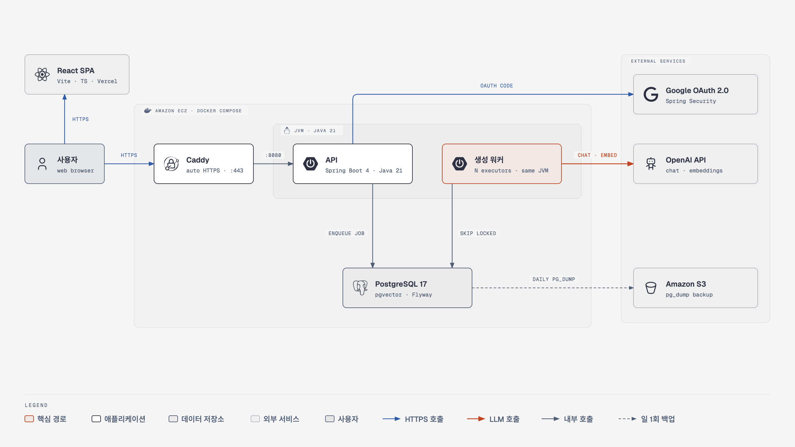
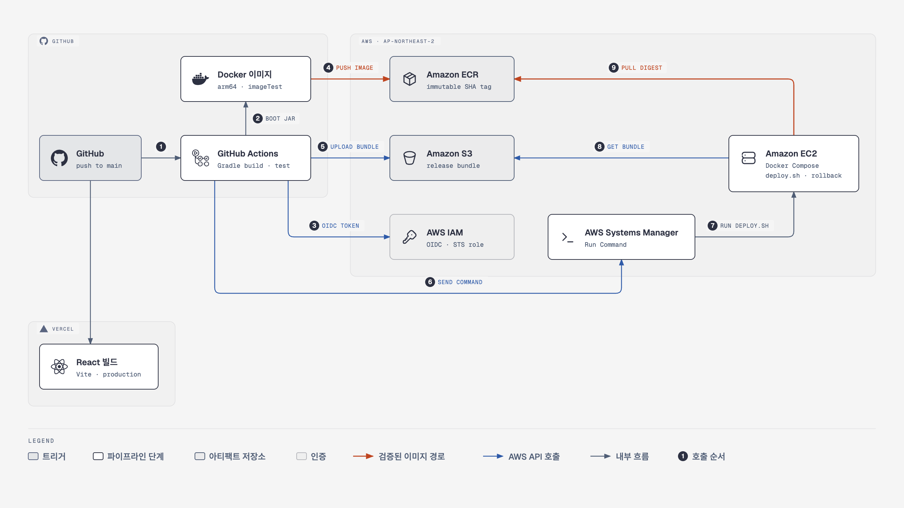
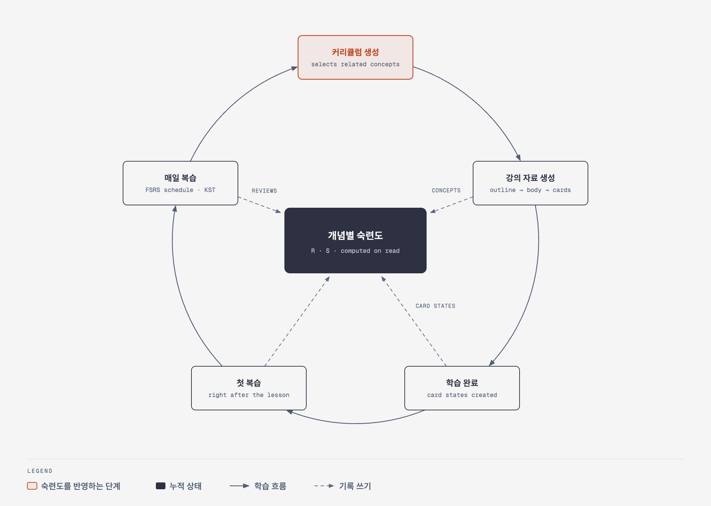
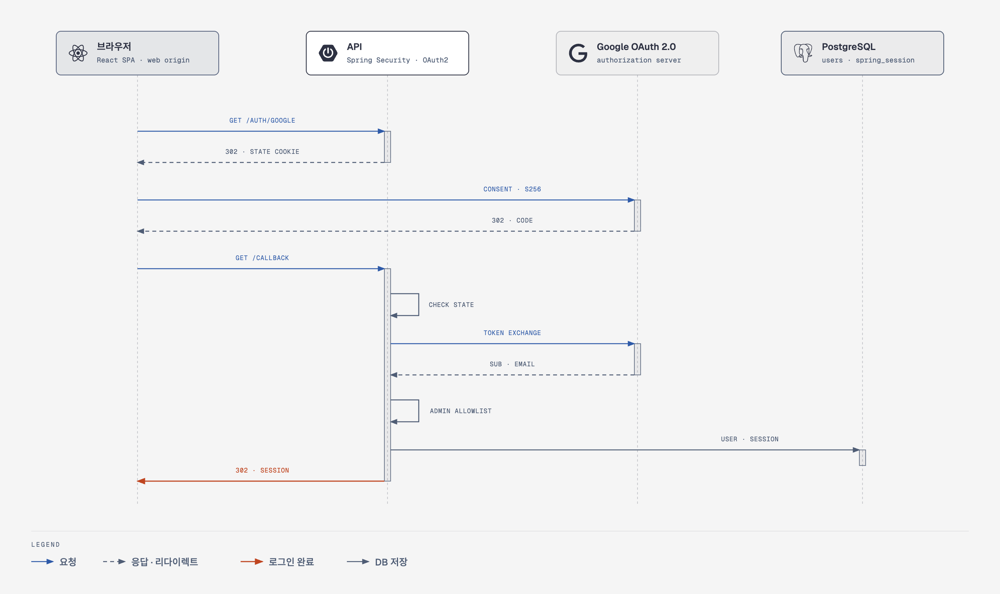
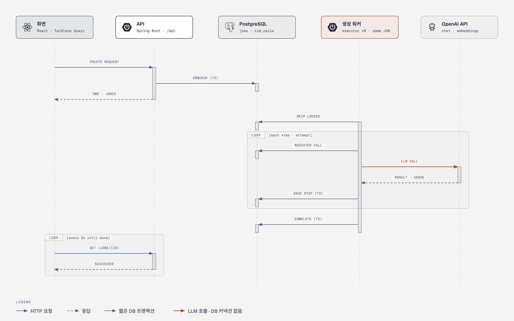
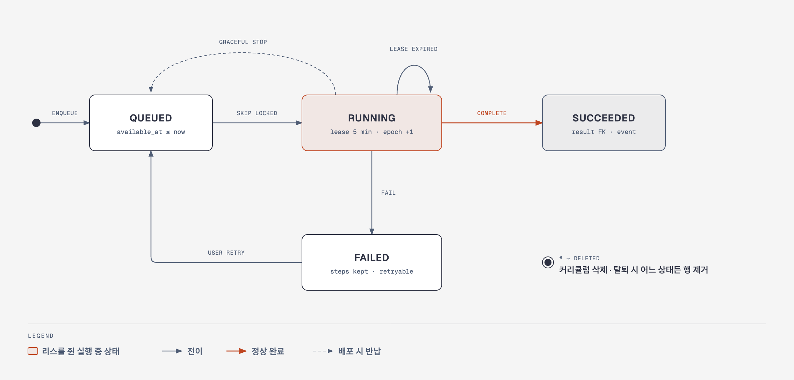
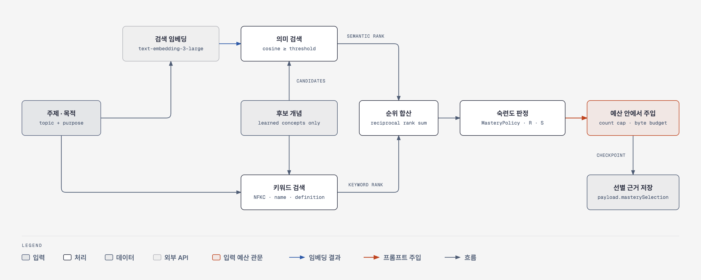

# 다이어그램 모음

머금의 구조와 핵심 흐름을 그림으로 모았다. 그림의 근거와 상세는 각 절에 링크한 설계 문서에 있다 — 그림과 문서가 다르면 문서가 맞다.

| # | 그림 | 설계 문서 | 상태 |
|---|---|---|---|
| 1 | [시스템 아키텍처](#1-시스템-아키텍처) | [ARCHITECTURE 배포](../ARCHITECTURE.md#배포) · [04 §3](../04-jobs-and-cost.md#3-배포) | 배포 구성 구현 · 운영 배포 전 |
| 2 | [CI/CD 파이프라인](#2-cicd-파이프라인) | [04 §3](../04-jobs-and-cost.md#3-배포) · ADR-064 · ADR-065 | 배포 구성 구현 · 운영 배포 전 |
| 3 | [학습 피드백 루프](#3-학습-피드백-루프) | [01 §2](../01-overview.md#2-문제와-가설) · [02 §4](../02-domain-data.md#4-숙련도--저장하지-않는다) | 설계 |
| 4 | [로그인 · 세션 흐름](#4-로그인--세션-흐름) | [05 §1.1](../05-api.md#11-인증--구글-oauth--쿠키-세션db-저장) | 구현 · 테스트 완료 |
| 5 | [생성 요청 처리 흐름](#5-생성-요청-처리-흐름) | [ARCHITECTURE 데이터 흐름](../ARCHITECTURE.md#데이터-흐름) · [04 §5](../04-jobs-and-cost.md#5-트랜잭션-경계--llm-호출-중에는-커넥션을-쥐지-않는다) | 설계 |
| 6 | [생성 잡 수명주기](#6-생성-잡-수명주기) | [04 §4.2](../04-jobs-and-cost.md#42-테이블--상태) · [04 §4.5](../04-jobs-and-cost.md#45-반납--회수--시한) | 설계 |
| 7 | [숙련도 선별 흐름](#7-숙련도-선별-흐름) | [02 §5.4](../02-domain-data.md#54-커리큘럼-숙련도-선별--임베딩-검색--키워드-검색) · ADR-027 | 설계 |

---

## 1. 시스템 아키텍처

화면은 Vercel의 React 정적 파일, API와 생성 워커는 Amazon EC2의 Docker Compose 안 JVM 하나에서 돈다. 유료 LLM 호출은 워커만 하고, 데이터는 PostgreSQL 하나에 둔다.

## 2. CI/CD 파이프라인

`main` push로 GitHub Actions가 빌드 · 테스트 · 이미지 검사를 하고, OIDC 임시 자격으로 이미지는 Amazon ECR, 릴리스 묶음은 Amazon S3에 올린 뒤 AWS Systems Manager로 배포를 지시한다. 서버는 검사한 이미지를 지문으로 받아 앱만 교체한다. 번호는 호출 순서다.

## 3. 학습 피드백 루프

강의 자료 생성 · 학습 완료 · 복습이 남긴 기록에서 개념별 숙련도를 계산하고, 다음 커리큘럼 생성이 그 숙련도를 반영한다. 숙련도는 저장하지 않고 조회할 때 계산한다.

## 4. 로그인 · 세션 흐름

구글 OAuth(PKCE)로 로그인하고, state 대조 · 관리자 목록 확인 뒤 사용자 ID만 담은 새 세션을 PostgreSQL에 저장한다. 세션 쿠키는 API 호스트 전용이다.

## 5. 생성 요청 처리 흐름

API는 잡을 적재하고 바로 응답한다. 워커는 `SKIP LOCKED`로 잡을 수령하고, DB 작업은 짧은 트랜잭션으로 나누며 LLM 호출 중에는 DB 커넥션을 쥐지 않는다. 화면은 2초마다 잡 상태를 조회한다.

## 6. 생성 잡 수명주기

실행 중인 잡은 리스와 수령 회차로 실행 권한을 쥔다. 리스가 만료되면 다른 실행기가 회수하고, 배포 때는 하던 호출을 끝내고 반납하며, 실패한 잡은 사용자 재시도로 실패한 단계부터 다시 시작한다.

## 7. 숙련도 선별 흐름

주제 · 목적의 의미 검색과 키워드 검색으로 사용자가 학습한 관련 개념만 고르고, 판정한 숙련도를 개수 상한과 입력 바이트 예산 안에서 커리큘럼 생성에 주입한다. 검색 설정값은 잠정값이며 공개 후 측정으로 확정한다(ADR-057).

---

## 설계 문서에 Mermaid로 있는 그림

- ERD — [02 §1](../02-domain-data.md#1-erd)
- 생성 파이프라인(잡 I · A · B) — [03 §1](../03-generation.md#1-전체--초기-통합-생성과-상세-생성-ab-툴을-쓰는-곳은-한-군데)
- 패키지 경계 — [04 §2](../04-jobs-and-cost.md#2-패키지-경계)
- 새 잡 적재 검사(킬스위치 · 쿼터 · 진행 중 2개) — [04 §7.1](../04-jobs-and-cost.md#71-세-층과-진행-중-2개)
- 화면 지도 — [06 §2.4](../06-screens.md#24-화면-지도)

## 고치는 방법

- 각 그림의 원본은 같은 폴더의 `.html`(SVG 포함, 파일 하나로 열린다)이다. 원본을 고친 뒤 PNG를 다시 만든다 — SVG 요소만 2배 크기로 캡처한다.
- 스타일은 [diagram-design](https://github.com/cathrynlavery/diagram-design) 기본 스킨이다. 아이콘은 Simple Icons 16.35.0(CC0)과 Tabler Icons(MIT)이며, 브랜드 로고는 각 회사의 상표다. AWS 서비스는 공식 아이콘 대신 일반 아이콘과 정식 서비스 이름으로 표시한다.
