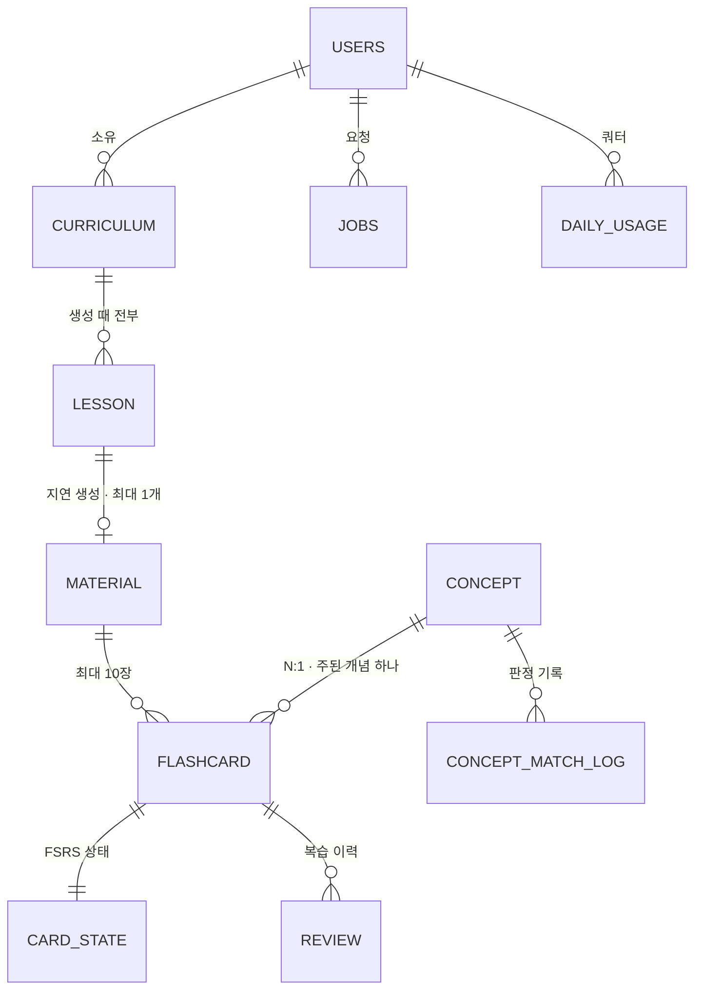
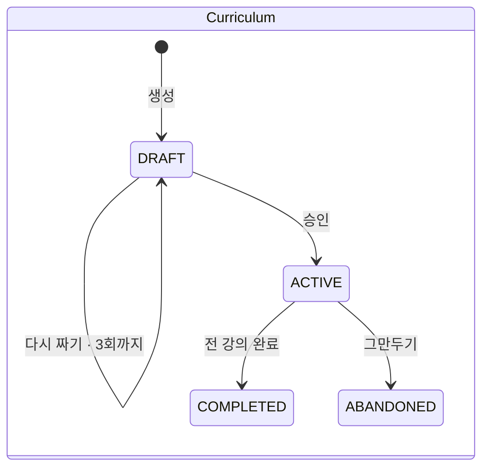
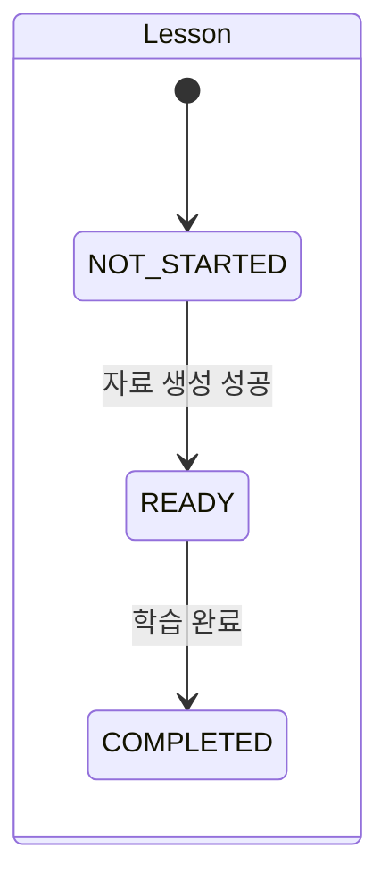
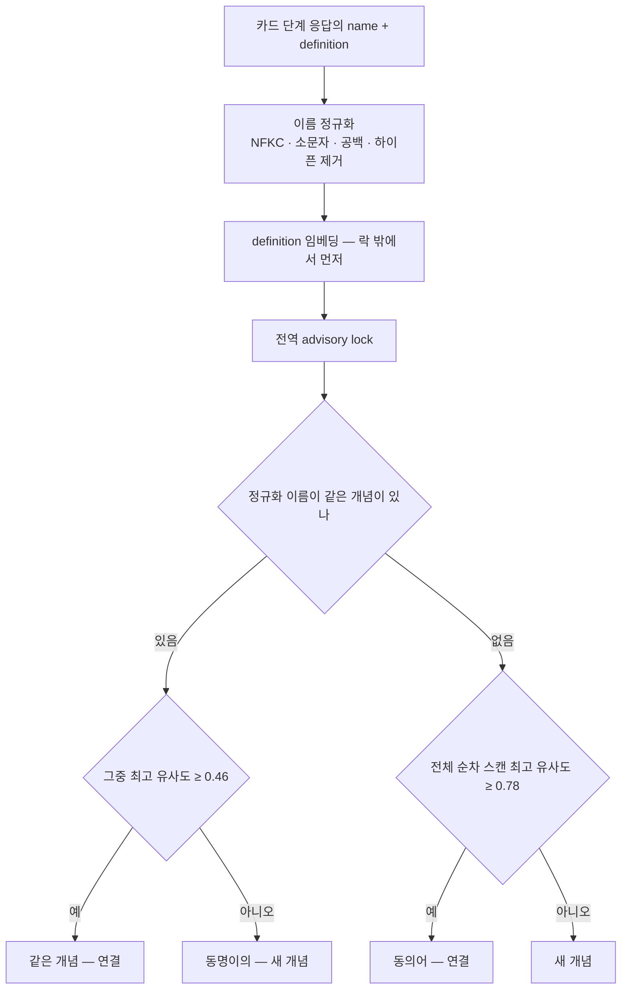

# 02. 도메인 · 데이터

> 엔티티 · 상태 · 숙련도 · 개념 동일성 · 테이블 · 핵심 쿼리. 이름은 [01 §12](./01-overview.md). `jobs` 테이블은 [04 §4](./04-jobs-and-cost.md).
> 마이그레이션은 **Flyway**(버전드 SQL) — `SKIP LOCKED` · 부분 인덱스 · `vector` 같은 Postgres 문법을 그대로 쓴다.

---

## 1. ERD



**없는 것이 설계다.**

| 없는 것 | 왜 |
|---|---|
| `mastery` 테이블 | 시간의 함수라 저장하면 바로 낡는다 — §4 |
| `material_concept` 조인 | 자료의 개념은 `SELECT DISTINCT concept_id FROM flashcard WHERE material_id=?` 로 나온다 |
| 사용자 ↔ 개념 연결 | 개념은 전역 사전이다. 사용자와는 카드로만 이어진다 |
| `Lesson.GENERATING` · `Curriculum.GENERATING` · 미완성 `Material` | **"생성 중 · 실패"는 잡으로 판단한다.** 두 곳에서 관리하면 잡은 실패했는데 강의는 생성 중에 멈춰 있는 사고가 난다 |

## 2. 상태





잡 상태는 [04 §4](./04-jobs-and-cost.md).

## 3. 학습 완료와 카드 상태

**`card_state` 는 학습 완료 트랜잭션에서 만든다** — `fsrs_state='NEW'` · `next_review_at=now()`.

| 다른 시점이면 | 생기는 일 |
|---|---|
| 첫 복습 때 만들면 | 첫 복습을 건너뛴 카드는 상태가 없어 **영원히 복습에 안 뜬다** — 루프가 끊긴다 |
| 자료 생성 때 만들면 | 아직 읽지 않은 강의의 카드가 오늘의 복습에 섞인다 |

학습 완료 응답에 그 강의의 카드를 담아 **즉시 첫 복습**으로 이끈다. 사용자가 건너뛰어도 카드는 이미 오늘의 복습에 있다.

## 4. 숙련도 — 저장하지 않는다

FSRS 의 인출확률 `R` 은 **마지막 복습 이후 경과 시간과 `S` 의 함수**라 아무 일 없어도 시간이 지나면 떨어진다. 저장하면 즉시 낡는다.
그래서 **`card_state` 만 저장하고, 숙련도는 조회 때 계산**한다. 카드 수백 장을 계산해도 1ms 미만이다.

| | 담당 |
|---|---|
| 복습 때 `D` · `S` · 다음 복습일 갱신(**쓰기**) | FSRS 라이브러리 `io.github.open-spaced-repetition:fsrs` · 기본 파라미터 |
| `R` 조회 · 집계(**읽기**) | SQL (§8.3) |

> ⚠️ `R` 공식이 두 곳(라이브러리 · SQL)에 있다 → **일치 테스트**: 같은 `(S, 경과일)` 에서 둘의 `R` 이 같은지. 라이브러리를 올려 상수가 바뀌면 이 테스트가 깨진다. 상수(`factor` · `decay`)는 채택 버전에 맞추고 **테스트가 단일 출처**다.

**숙련도 = 개념 카드들의 `R` 평균 + `S` 평균 + 가장 적게 복습한 카드의 복습 횟수(`minReviewCount`).** 미복습 카드는 평균에서 뺀다.
**`R` 하나로 판정하지 않는다** — 복습 직후엔 누구나 `R ≈ 1` 이다. 그리고 첫 평가 `EASY` 의 초기 `S` 가 약 16일이라 `S` 하한만으로는 *방금 배운 개념* 을 못 거른다.

| 판정 | 조건 | 강의 자료(잡 B ①) | 커리큘럼(잡 A) |
|---|---|---|---|
| 충분히 안다 | `R ≥ 0.9` ∧ `S ≥ 7일` ∧ `minReviewCount ≥ 2` | `SKIP` — 생략 · 한 줄 | `EXCLUDED` — 그 개념만의 강의는 안 만든다 |
| 어느 정도 안다 | `R ≥ 0.6` ∧ `S ≥ 1일` (위 제외) | `BRIEF` — 간단 복기 | `COMPRESSED` — 분량을 줄인다 |
| 흐릿함 · 굳지 않음 | 그 외 | `DETAIL` — 상세 | `EXPANDED` — 늘리거나 나눈다 |
| 카드는 있으나 미복습 | `reviewCount = 0` | `DETAIL` | `EXPANDED` |
| 카드 없음(미학습) | `matched = false` | `DETAIL` | `EXPANDED` |

- 판정은 **프롬프트에 명시한 규칙**이다 — 백엔드는 `R · S · rN` 을 주고 LLM 이 적용한다. 명시적이라 테스트할 수 있다.
- **세 가지 "모름"을 구분한다** — 카드 없음 · 미복습(`R = null`) · 복습했지만 흐릿함. 섞이면 개인화가 엉뚱해진다.
- 🅿️ `S` 하한 7일 · 1일은 잠정값 — 실사용 판정 기록으로 조정한다.

## 5. 개념 — 읽기와 쓰기가 다르다

| 작업 | 이름 | 어디서 | 누가 | 하는 일 |
|---|---|---|---|---|
| 읽기 — 전량 | `loadUserMastery` | 커리큘럼 생성 | 백엔드(LLM 호출 전) | 사용자의 전체 개념 + 숙련도를 프롬프트에 넣는다 |
| 읽기 — 지정 | `lookupMastery` | 강의 자료 ① | LLM(툴) | LLM 이 이름을 지정한 개념만 조회. **정규화 이름 일치만** 쓴다 |
| **쓰기** | `resolveConcepts` | 강의 자료 생성 후처리 | 백엔드 | 개념을 확정 · 생성하고 같은 개념인지 판정해 카드에 잇는다. **이름 정규화와 임베딩 비교는 여기서만** |

> 읽기 경로(`lookupMastery`)는 동의어를 못 잡는다 — LLM 은 이름만 넘긴다. 이 실패는 **안전한 쪽**이다(`DETAIL` 로 가서 과하게 설명할 뿐 틀리지 않는다).

### 5.1 동일성 판정 — 정의를 임베딩한다

| 틀리는 방향 | 예 | 결과 |
|---|---|---|
| 동의어가 갈라짐 | `기회비용` / `Opportunity Cost` | 숙련도가 나뉜다 — **병합하면 된다** |
| 동명이의가 합쳐짐 | `엔트로피`@열역학 / `엔트로피`@정보이론 | 숙련도가 오염된다 — **되돌릴 수 없다** |

**임베딩 대상은 `definition`(한 줄 정의) 하나다.** 이름을 넣으면 같은 문자열이 같은 벡터가 되어 동명이의를 못 가르고, 이름은 정규화 비교에서 이미 쓰인다.
LLM 에게 *"같은 개념인가"* 를 묻지 않는다 — 매번 답이 달라지고 테스트할 수 없다.



| 분기 | 임계값 | 근거 |
|---|---|---|
| 이름이 같다 — 같은 개념 또는 동명이의 | **0.46** | 표기 변이는 정규화가 흡수했으니 남는 건 둘뿐. 낮게 두면 동명이의가 합쳐진다 |
| 이름이 다르다 | **0.78** | 유사 개념(`명목금리`/`실질금리`)이 합쳐지는 것을 막는다 |

- 값은 실측 47쌍(같은 이름 27 · 다른 이름 20) × 모델 4개 비교에서 나왔다. `text-embedding-3-large` 만 두 분기 모두 마진이 양수(+0.009 · +0.047)였다. 라벨은 초안 — 확정 후 다시 계산한다.
- 후보가 여럿이면 **가장 가까운 하나(argmax)** 가 임계값을 넘을 때만 연결한다.
- 임베딩 실패 시 **이름 정규화 매칭으로 폴백**하고 `embedding = NULL` 로 저장한다. NULL 행은 스캔에서 빠지고 `concept.embedding.missing` 으로 본다. 배치로 채우지 않는다.

### 5.2 유일성은 테이블이 아니라 코드가 만든다

- 동명이의를 허용하려고 **`name` · `name_normalized` 에 unique 를 걸지 않는다.** 유일성은 `resolveConcepts` **한 곳**의 규칙이다.
- 두 잡이 동시에 같은 개념을 만들 수 있으므로 **전역 advisory lock 하나**로 쓰기를 직렬화한다 — 이름 단위 락으로는 `인플레이션` / `inflation` 이 동시에 들어오는 동의어 경합을 못 막는다. 락 구간은 스캔 + INSERT 수 ms 뿐이다.
- `embedding` 은 **차원 미지정 `vector`**, 인덱스 없음(수백 행 순차 스캔이 100% 정확하고 1분짜리 호출 뒤에 붙는다). `embedding_model` 이 같은 행끼리만 비교한다.

### 5.3 병합 — 두 줄

표기 쌍이 갈리는 것을 대가로 받아들였으므로 병합 절차가 있어야 한다. 후보는 U6 의 *병합 후보* 목록(이름 다름 분기 · 임계값 −0.05 안에서 새로 만든 쌍).

```sql
BEGIN;
UPDATE flashcard SET concept_id = :keep WHERE concept_id = :drop;
DELETE FROM concept WHERE id = :drop;
COMMIT;
```

두 줄로 끝나는 이유 — 복습 이력이 개념이 아니라 **카드**에 붙어 있고, 숙련도를 저장하지 않아 재계산할 것이 없다. 관리 UI 는 만들지 않는다.

---

## 6. 테이블

### 6.1 `users`

| 컬럼 | 타입 | 비고 |
|---|---|---|
| `id` | `bigserial` PK | |
| `google_sub` | `text` **unique** | 구글 계정 식별자 — 이메일은 바뀔 수 있다 |
| `email` | `text` | 표시 · 관리자 판정 |
| `status` | `text` | `PENDING`(약관 전) / `ACTIVE` / `WAITLISTED` |
| `role` | `text` | `USER` / `ADMIN` — 설정의 관리자 이메일 목록으로 로그인 때 정한다 |
| `terms_agreed_at` · `terms_version` | `timestamptz` · `text` | 약관 버전이 바뀌면 다시 동의 |
| `created_at` | `timestamptz` | 대기 명단 순서 |

**세션 테이블** — `spring_session` · `spring_session_attributes`(Spring Session JDBC 의 스키마). 프레임워크가 쓰는 테이블이지만 **Flyway 마이그레이션에 넣는다**(자동 생성은 끈다). 로그인 성공 때 인증 주체 이름(`principal_name`)을 `users.id` 로 둔다 — 탈퇴 때 그 사용자의 세션을 한 번에 지우려고.
만료 세션은 라이브러리의 정리 작업이 지운다 — **배치 금지의 유일한 예외**다([04 §3.2](./04-jobs-and-cost.md)).

### 6.2 `curriculum` · `lesson`

| `curriculum` | 비고 |
|---|---|
| `user_id` · `topic` · `purpose` · `weeks` | 입력. 기간 1~8주 |
| `title` | LLM 이 지은 제목 |
| `status` | `DRAFT` / `ACTIVE` / `COMPLETED` / `ABANDONED` |
| `regeneration_count` | 다시 짜기 횟수(한도 3) |
| `mastery_reflection` | `jsonb` — 잡 A 의 개념별 판단. U3 에서 *"이미 아셔서 별도 강의로 만들지 않았어요"* 로 보인다 |

| `lesson` | 비고 |
|---|---|
| `curriculum_id` · `order_no` · `week` | |
| `title` · `objective` | |
| `keywords` | **`text[]`** — 배열이라 개념과 조인할 수 없다. 타입이 *"키워드는 개념이 아니다"* 를 강제한다 |
| `status` | `NOT_STARTED` / `READY` / `COMPLETED` |

- 커리큘럼 생성은 **빈 `DRAFT`(강의 0개)를 먼저 만들고** 그 id 로 잡을 적재한다. 워커가 강의를 채운다.
- 다시 짜기는 `lesson` 을 **지우고 새로 만든다** — `DRAFT` 에는 자료가 없어 안전하다. 버전을 보관하지 않는다.

### 6.3 `material` · `flashcard`

| `material` | 비고 |
|---|---|
| `lesson_id` | **unique** — 강의당 최대 1개. **완성품만** 저장한다 |
| `body` | `text` — 마크다운 6섹션 |
| `outline` · `mastery_findings` | `jsonb` — *왜 이렇게 나왔나* 의 근거 |
| `truncated` | `boolean` — 이어 쓰기 후에도 상한에 닿았나 |
| `prompt_version` · `model` | `text` — 품질 채점과 전후 비교용 |

| `flashcard` | 비고 |
|---|---|
| `material_id` · `concept_id` | 개념은 **N:1 — 주된 하나** |
| `type` | `UNDERSTAND` / `APPLY` / `TERM` — 종류별 등급 분포를 보려고. 지난 이력에는 나중에 붙일 수 없다 |
| `question` | 분야 · 대상을 질문 안에 넣는다 |
| `model_answer` | 모범 답안 — 단답 한 문장 · 설명형 2~4문장, *"~해요 · ~예요"* |
| `key_points` | `jsonb` 문자열 배열 1~3개 — 자기 채점 기준 |

### 6.4 `concept` · `concept_match_log`

| `concept` | 비고 |
|---|---|
| `name` | **unique 없음** |
| `name_normalized` | 인덱스 있음 |
| `definition` | 임베딩 입력 |
| `embedding` | `vector` **차원 미지정** · 인덱스 없음 · NULL 가능 |
| `embedding_model` | |

| `concept_match_log` | 비고 |
|---|---|
| `created_at` · `concept_id` | 판정 결과로 연결 · 생성된 개념 |
| `candidate_id` | 비교한 최고 후보. 없었으면 NULL |
| `branch` | `SAME_NAME` / `DIFF_NAME` |
| `similarity` | `real` |
| `action` | `LINKED` / `SPLIT` / `CREATED` |
| `borderline` | 임계값 −0.05 구간이었나 |

판정마다 한 행(자료 1건에 최대 10행) — U6 의 경계 판정 · 병합 후보가 **쌍의 목록**이라 카운터 메트릭으로는 안 된다.

### 6.5 `card_state` · `review`

| `card_state` | 비고 |
|---|---|
| `flashcard_id` | PK · FK · 1:1 |
| `user_id` | **비정규화** — 오늘의 복습 조회가 4단 조인이 되지 않게 |
| `fsrs_state` · `fsrs_step` | 라이브러리 `Card` 의 `state` · `step` — 빠지면 학습 단계(1분 · 10분)가 매번 처음부터 돈다 |
| `difficulty` · `stability` | `NEW` 에서는 NULL |
| `last_reviewed_at` · `next_review_at` · `review_count` | `review_count = 0` = 미복습 |

| `review` | 비고 |
|---|---|
| `flashcard_id` · `user_id` · `rating` · `reviewed_at` | |
| `is_first` | 그 카드의 첫 복습이었나 — 하루 한도에서 뺀다 |

`review` 는 지금 읽는 곳이 없어도 둔다 — **지나가면 복구할 수 없고**, 안 쌓으면 FSRS 개인화의 트리거(로그 수천 건)가 영원히 안 온다.
`POST /reviews` 하나가 `card_state` 갱신과 `review` 삽입을 **한 트랜잭션**으로 한다. `is_first` 는 갱신 전 `review_count = 0` 이었는지로 채운다.

### 6.6 `daily_usage`

| 컬럼 | 비고 |
|---|---|
| `user_id` | **NULL 인 행이 전역**(킬스위치 합계) |
| `usage_date` | `(now() AT TIME ZONE 'Asia/Seoul')::date` — 서버 기본(UTC)이면 한국 시간 오전 9시에 리셋된다 |
| `input_tokens` · `output_tokens` · `embedding_tokens` · `cost` | 단가가 달라 분리 |

```sql
CREATE UNIQUE INDEX idx_usage_key ON daily_usage (COALESCE(user_id, 0), usage_date);
```

리셋에 스케줄러를 쓰지 않는다 — 날짜가 바뀌면 행이 없고 upsert 가 0부터 시작한다.

---

## 7. 계정 — 정원 · 탈퇴

**가입 정원 검사는 약관에 동의할 때 한 번.** 동의가 먼저인 이유 — 대기 명단에 올리려면 이메일을 저장해야 하고, 저장하려면 동의가 필요하다.

```sql
SELECT pg_advisory_xact_lock(hashtext('signup'));          -- 마지막 자리를 둘이 같이 먹지 않게
SELECT count(*) FROM users WHERE status = 'ACTIVE';        -- < U_max 면 ACTIVE, 아니면 WAITLISTED
```

- 대기 순번 = `count(*) WHERE status='WAITLISTED' AND created_at < :mine` + 1. 승인은 관리자 SQL `UPDATE users SET status='ACTIVE' WHERE id=?`.
- 이미 가입한 사람은 정원이 줄어도 밀려나지 않는다. 동의하지 않고 나가면 `PENDING` 행을 지운다.

**회원 탈퇴 — 한 트랜잭션**

```sql
BEGIN;
DELETE FROM spring_session WHERE principal_name = :u::text;        -- 모든 기기의 세션부터 끊는다(속성 행은 FK 로 함께)
DELETE FROM review      WHERE user_id = :u;
DELETE FROM card_state  WHERE user_id = :u;
DELETE FROM flashcard   WHERE material_id IN (…이 사용자의 material…);
DELETE FROM material    WHERE lesson_id  IN (…이 사용자의 lesson…);
DELETE FROM lesson      WHERE curriculum_id IN (SELECT id FROM curriculum WHERE user_id = :u);
DELETE FROM curriculum  WHERE user_id = :u;
DELETE FROM jobs        WHERE user_id = :u;
DELETE FROM daily_usage WHERE user_id = :u;                         -- 전역 행은 남는다
DELETE FROM users       WHERE id = :u;
COMMIT;
```

- 남는 것 — `concept`(전역 사전, 개인 정보 없음) · `concept_match_log` · 전역 `daily_usage`(쓴 돈은 쓴 돈이다).
- **진행 중이던 잡은 따로 멈추지 않는다** — 행이 지워지면 워커의 다음 쓰기가 `0 rows` 가 되어 리스를 잃은 것과 같은 경로로 멈춘다([04 §4.4](./04-jobs-and-cost.md)).
- ⚠️ **사용자 소유 테이블을 새로 만들면 이 목록에 넣는다.** 탈퇴 테스트가 사용자 소유 테이블이 전부 비었는지 센다.

---

## 8. 핵심 쿼리

### 8.1 오늘의 복습 — 하루 50장, 첫 복습은 한도 밖

```sql
CREATE INDEX idx_cardstate_due ON card_state (user_id, next_review_at);
CREATE INDEX idx_review_today  ON review (user_id, reviewed_at);
```

```sql
-- :todayStart = 오늘 00:00 Asia/Seoul · :remaining = 50 − (첫 쿼리 결과)
SELECT count(*) FROM review
 WHERE user_id = :u AND reviewed_at >= :todayStart AND NOT is_first;

(SELECT * FROM card_state                       -- 첫 복습 — 한도 밖, 전부
  WHERE user_id = :u AND next_review_at <= now() AND review_count = 0
  ORDER BY next_review_at)
UNION ALL
(SELECT * FROM card_state                       -- 나머지 — 남은 한도만큼, 오래 밀린 순
  WHERE user_id = :u AND next_review_at <= now() AND review_count > 0
  ORDER BY next_review_at LIMIT :remaining);
```

> 한도는 *"오늘 이미 푼 수"* 를 세야 선다 — `LIMIT 50` 한 줄은 조회 한 번당 50장이다. 첫 복습을 빼는 이유 — 강의 직후 10장이 한도를 먹으면 기존 카드가 밀린다.
> 🅿️ 50장은 빨리 넘기는 카드 기준이다. 설명형 카드는 한 장에 30초~1분이라 실사용에서 세션 시간을 재서 조정한다.

### 8.2 개념 매칭

```sql
-- 이름이 같은 후보 중 최고 — sim ≥ 0.46 이면 연결, 아니면 동명이의 신규
SELECT id, 1 - (embedding <=> :q) AS sim FROM concept
 WHERE name_normalized = :norm AND embedding IS NOT NULL AND embedding_model = :model
 ORDER BY embedding <=> :q LIMIT 1;

-- 전체 중 최고 — sim ≥ 0.78 이면 동의어 연결, 아니면 신규
SELECT id, 1 - (embedding <=> :q) AS sim FROM concept
 WHERE embedding IS NOT NULL AND embedding_model = :model
 ORDER BY embedding <=> :q LIMIT 1;
```

```sql
SELECT pg_advisory_xact_lock(hashtext('concept-write'));   -- 전역 락 하나 · 트랜잭션 끝에 자동 해제
```

### 8.3 숙련도 — `R` · `S` · `minReviewCount`

```sql
SELECT c.id, c.name, c.definition,
       AVG( POWER(1 + :factor * EXTRACT(EPOCH FROM (now() - cs.last_reviewed_at))
                                / 86400.0 / cs.stability, :decay) ) AS r,
       AVG(cs.stability)    AS s,                 -- 일 단위
       MIN(cs.review_count) AS min_review_count   -- 첫 복습만 한 카드가 있으면 1 → SKIP 금지
  FROM concept c
  JOIN flashcard f   ON f.concept_id = c.id
  JOIN card_state cs ON cs.flashcard_id = f.id
 WHERE cs.user_id = :u AND cs.review_count > 0
 GROUP BY c.id, c.name, c.definition
 ORDER BY r DESC NULLS LAST
 LIMIT 500;
```

- 카드는 있으나 미복습인 개념은 `WHERE` 에서 빠져 결과에 없다 → 백엔드가 *미복습* 으로 판정한다.
- 커리큘럼 생성의 전량 주입은 200개에서 **경보만** 올리고 자르지 않는다(`mastery.injected.count`). 500 은 컨텍스트 폭주를 막는 하드 상한(R 높은 순으로 자른다).
