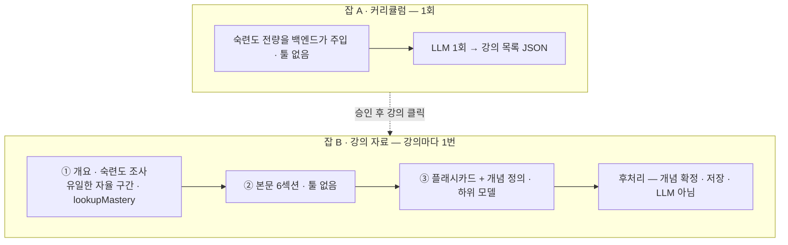

# 03. 생성 파이프라인 · LLM 호출 규약

> 무엇을 몇 번 부르고, 실패하면 어떻게 하고, 호출 하나를 어떤 규칙으로 감싸는가.
> 프롬프트 원문은 [`prompts/v5/`](../prompts/v5/) (v5 확정본). 잡 수명주기 · 리스는 [04](./04-jobs-and-cost.md).

---

## 1. 전체 — LLM 이 도는 곳은 잡 두 종류, 툴을 쓰는 곳은 한 군데



| | 모델 | `max_tokens` | 단일 시도 타임아웃 | 관측(실측 6~18회) |
|---|---|---|---|---|
| 잡 A 커리큘럼 | 중상위 `gpt-5.6-terra` | 4,000 | 50s | p50 15.9s · 최대 24.4s · 약 35원 |
| ① 개요 | 중상위 | 2,500 | 30s | 2회(툴 1 + 결론 1) · 합 약 7.6s · 약 20원 |
| ② 본문 | 중상위 | **8,000** | **100s** | p50 31.8s · 최대 34.9s · 약 57원 |
| ③ 카드 | 하위 `gpt-5.6-luna` | 6,000 | 60s | p50 17.4s · 최대 21.2s · 약 5원 |
| 임베딩 | `text-embedding-3-large` | — | 10s | 개념당 0.13~1.1s |

- 두 모델 모두 `reasoning_effort=none`. 포트는 모델명이 아니라 **등급**(`ModelTier`: 중상위 / 하위)을 받는다 — 매핑은 설정.
- 잡 B 1건 = **LLM 최소 3 · 최대 8회**(재요청 포함), 실측은 15건 모두 **4회**. 강의 자료 1건 **46~62초 · 약 82원**.
- 타임아웃 규칙: `max(p95 × 2, 최댓값 × 1.5, 상한을 다 쓰는 시간 × 1.2)` 를 10초 단위로 올림. **세 번째 항이 없으면 상한에 닿기 전에 타임아웃이 끊어 이어 쓰기가 영원히 안 돈다.** 표본이 작아 **잠정값** — 실사용 기록으로 다시 계산한다.

---

## 2. 잡 A — 커리큘럼

- **LLM 1회 · 툴 없음.** 숙련도는 백엔드가 `loadUserMastery` 로 **전량** 읽어 프롬프트에 넣는다. 다시 짜기가 잦은 단계라 툴 왕복으로 비용이 흔들리면 안 된다.
- 개념은 `이름 R·S·rN` 으로 적는다 — 예: `기회비용 0.91·12d·r2 / 인플레이션 미복습`. `R` 만 주면 복습 직후 개념이 전부 *안다* 로 보이고, `rN` 이 없으면 `EXCLUDED` 규칙을 적용할 수 없다. 미복습은 `0.0` 이 아니라 `미복습` 으로 적는다.
- **콜드 스타트** — 섹션을 빼지 않고 `(없음 — 이 사용자의 학습 이력이 아직 없습니다)` 를 명시한다. 그래야 `masteryReflection: []` 이 오고 커버리지 메트릭이 정확히 0 으로 찍힌다.
- 결정 규칙은 [02 §4](./02-domain-data.md) 의 `EXCLUDED` / `COMPRESSED` / `EXPANDED`. **강의를 빼서 커리큘럼을 짧게 만들지 않는다** — 아낀 분량은 모르는 개념의 심화로 돌린다. 총 강의 수는 구조 상한(주당 3~5강 · 40강 이하) 안.
- 다시 짜기 피드백(500자 이내)은 잡 입력으로 한 줄 붙이고 **구조 상한 · 결정 규칙 아래**에 둔다 — 피드백이 *"40강 넘게"* 를 요구해도 상한이 이긴다.

```json
{
  "title": "경제 기초 4주",
  "masteryReflection": [ { "concept": "기회비용", "R": 0.91, "S": 12, "action": "EXCLUDED" } ],
  "lessons": [ { "order": 1, "week": 1, "title": "경제학의 출발점 — 기회비용",
                 "objective": "기회비용과 희소성으로 선택의 대가를 설명할 수 있다",
                 "keywords": ["기회비용", "희소성", "한계효용"] } ]
}
```

`keywords` 는 자유 텍스트다 — 이 경로에서는 개념을 만들지 않는다. `masteryReflection` 은 저장해서 U3 에 *"이미 아셔서 별도 강의로 만들지 않았어요"* 로 보인다.

---

## 3. 잡 B ① — 개요 · 숙련도 조사 (유일한 자율 구간)

| 항목 | 값 |
|---|---|
| 툴 | `lookupMastery` 하나 · 읽기 전용 · 한 번에 개념 최대 20개 |
| 툴 라운드 | 최대 3 |
| **총 LLM 호출** | **4회** — 툴 라운드 · 강제 종결 · 파싱 재요청이 **같은 4회를 나눠 쓴다** |
| 출력 | JSON — `masteryFindings` + `outline`(소절별 분량 지정 포함) |

**툴 응답** — 세 가지 *모름* 을 구분한다.

```json
[
  { "name": "기회비용",  "matched": true,  "R": 0.91, "S": 12, "cardCount": 7, "reviewCount": 23, "minReviewCount": 2 },
  { "name": "인플레이션", "matched": true,  "R": null, "S": null, "cardCount": 3, "reviewCount": 0,  "minReviewCount": 0 },
  { "name": "한계효용",  "matched": false }
]
```

- 매칭은 **정규화 이름 일치만**, 후보는 이 사용자가 카드를 가진 개념만. 동명이의로 후보가 여럿이면 **전부 돌려주고** 각각 `definition` 을 붙인다 — LLM 이 문맥으로 고른다.

**종료**

| 조건 | 동작 |
|---|---|
| 툴 없이 최종 JSON | 정상 종료 |
| 라운드 3에도 툴 호출 | **툴을 빈 목록으로 보내** 1회 더 — *"지금까지 정보로 결론을 내라"* |
| `outline` 은 있는데 `masteryFindings` 가 비었거나 깨짐 | 모든 개념을 `DETAIL` 로 두고 **진행** |
| `outline` 을 못 얻음 | 잡 `FAILED`(`LLM_OUTPUT_INVALID`) |

> **상한 초과를 실패로 처리하지 않는다.** 숙련도는 부가 정보고 개요가 필수다. 실패 판정은 *"개요가 나왔나"* 하나 — 그렇지 않으면 콜드 스타트 구간에서 잡이 계속 죽는다.

개요는 **소절마다 분량을 정한다** — *상세 약 800자 · 간단 약 250자 · 생략 한 줄*. 총량은 맞추지 않는다(§4).

> **왜 ①과 ②를 한 번에 부르지 않나 — 실측했다.** 강의 4개로 비교하니, 개요를 남긴 채 합치면 절감이 **약 0%**(73.6 → 73.2원)였다 — 계획 출력은 그대로고, 합친 시스템 프롬프트가 툴 라운드에도 실려 입력 절감이 작다.
> 계획을 빼고 합치면 **약 19%** 싸졌지만(59.4원) 덜 써서 나온 돈이었고, **아는 개념과 모르는 개념의 분량이 비슷해졌다**(SKIP 소절이 DETAIL 평균보다 길어진 강의도 있었다). 계획 단계가 분량 제어 — 이 서비스의 개인화 — 를 만든다.

---

## 4. 잡 B ② — 본문

- 입력: ①의 `outline` + 강의 정보 + **다음 강의 한 줄**(예고용) + 용어 규칙. **②는 재설계하지 않고 살만 붙인다.**
- **고정 6섹션** — `## 오늘 배울 것` · `## 개념 설명` · `## 예시` · `## 정리` · `## 확인 질문` · `## 다음 시간에는`(마지막 강의는 `## 마치며`)

| 섹션 | 쓰는 것 |
|---|---|
| 오늘 배울 것 | 2~3줄 도입 |
| 개념 설명 | 개요 순서대로, 판정(`SKIP` · `BRIEF` · `DETAIL`)대로 분량이 다르다 |
| 예시 | **비우지 않는다.** 모양은 주제가 정한다 — 프로그래밍은 코드, 수학 · 과학은 수식과 풀이, 경제 · 역사 · 법은 사례, 그 외는 비유 · 상황. **코드는 프로그래밍 주제에서만** |
| 정리 | 핵심 3~5개 |
| 확인 질문 | 2~3개. 시험 준비가 목적이면 그 유형에 가깝게 |
| 다음 시간에는 | 예고 2~3문장. 마지막 강의는 커리큘럼을 돌아본다 |

- **말투 — 강사처럼**: 강의하듯 존댓말, 어려운 용어는 쉬운 말로 먼저 풀고 용어를 붙인다, 필요하면 설명 중간에 비유 · 짧은 예시.
- **분량은 개요가 소절마다 정하고 총량은 맞추지 않는다.** 총량을 묶으면 가장 많이 줄어드는 강의가 *설명이 가장 필요한 강의*다. 강의가 계속 길면 본문을 줄이지 않고 커리큘럼이 강의를 나누게 한다. 지표는 길이 분포 · 잘림률 · 이어 쓰기율.
- 수식 `$…$` · `$$…$$`(KaTeX). 그림은 ` ```mermaid ` **자료당 최대 2개, 이해를 돕는 경우만**(흐름 · 관계 · 연표 · 분류 · `xychart` 추이). 이미지 · 외부 그림은 쓰지 않는다.
- mermaid 는 백엔드가 검사하지 않는다. 프론트가 `securityLevel: 'strict'` 로 렌더하고 실패하면 **그 자리만** 「그림을 표시하지 못했어요」 로 바꾼다.

**잘렸을 때 — 이어 쓰기 1회** (`stopReason = MAX_TOKENS`)

1. 잘린 본문을 이전 답변으로 두고 *"끊긴 곳부터 끝까지"* 를 **사용자 메시지**로 요청한다(`continue.txt`). 결과를 이어 붙인다.
2. 이어 쓰기는 재요청 몫(단계당 1)을 쓴다 — 호출 상한은 그대로.
3. 그래도 잘리면 **실패 아님** — `material.truncated = true` 로 저장하고 진행한다.

> ⚠️ **잘린 응답을 같은 상한으로 처음부터 다시 부르지 않는다** — 또 잘리고 이미 쓴 토큰을 버린다. 모든 단계에 같은 규칙.

---

## 5. 잡 B ③ — 플래시카드

| 항목 | 값 |
|---|---|
| 입력 | ②의 본문 전문 |
| 카드 수 | 최대 10장 |
| 종류 | **이해형(`UNDERSTAND`) · 적용형(`APPLY`) 위주, 용어형(`TERM`) 최대 2장** — *"~을 설명하라"* 허용 |
| 답 | **모범 답안**(단답 한 문장 · 설명형 2~4문장, 쉬운 말, *"~해요 · ~예요"*) + **채점 포인트** 1~3개 |
| 맥락 | 질문만 읽어도 분야 · 대상을 안다 — *"경제에서 기준금리를 올리면 …"*. *"이 강의에서"* 는 쓰지 않는다 |
| 개념 | 카드마다 **주된 개념 하나**(N:1) + 개념마다 **구별되는 한 줄 정의** |

```json
{
  "cards": [
    { "type": "UNDERSTAND", "question": "경제에서 기준금리를 올리면 물가가 내려가는 과정을 설명하라",
      "modelAnswer": "기준금리가 오르면 대출 이자도 올라요. 소비와 투자가 줄고 수요가 줄면서 물가 상승이 둔해져요.",
      "keyPoints": ["대출 이자 상승", "소비 · 투자 감소", "수요 감소로 물가 상승 둔화"], "concept": "기준금리" }
  ],
  "concepts": [ { "name": "기준금리", "definition": "중앙은행이 정해 시중 금리의 기준이 되는 정책 금리" } ]
}
```

> 쉬움의 원인은 *단답이냐 서술이냐* 가 아니라 **무엇을 묻느냐**다 — 답이 하나로 정해지는 질문만 요구하면 LLM 이 용어 묻기로 몰린다.
> 하위 모델 품질이 채점(C1~C5)에서 낮으면 중상위로 올린다.

**후처리 — LLM 아님**: 이름 정규화 → 정의 임베딩(락 밖) → 전역 락 안에서 매칭 · 생성 → 카드 저장 · 판정 기록. 상세는 [02 §5](./02-domain-data.md).

---

## 6. 프롬프트 공통 규칙

- 시스템: 역할 · **출력 형식 계약**(JSON 스키마 또는 6섹션) · **용어 규칙**([01 §12](./01-overview.md) 금지 표현). 사용자: 컨텍스트 · 지시.
- **개념 이름 표기** — 원어 약어 · 기호가 표준이면 원어(`GDP` · `DNA` · `pH`) · 인명 · 작품 · 법령 · 코드 식별자는 원문 · 그 외는 그 분야에서 널리 쓰는 한국어 · 두 표기가 떠오르면 더 흔한 하나. *"한국어로만"* 을 강제하지 않는다 — 막을 것은 영문 이름이 아니라 **같은 개념의 두 번째 표기**다.
- **개념 정의** — 다른 개념과 구별되는 문장. 두루뭉술하면 유사 개념이 합쳐진다.
- few-shot 예시는 넣지 않는다(매 호출 입력 토큰). 품질 문제가 실제로 보이면 그때.
- 프롬프트를 바꾸면 **버전을 올린다**(`prompts/v6/` …). `material.prompt_version` 으로 전후를 비교한다.

## 7. 파싱 · 실패

| 단계 | 실패 | 처리 |
|---|---|---|
| ① | 툴 인자 파싱 실패 | 1회 재요청 → 실패 시 툴을 빼고 강제 종결 |
| ① | 최종 JSON 파싱 실패 | 정리 → 1회 재요청 → 실패 시 `FAILED` |
| ② | 상한 도달 | 이어 쓰기 1회 → 그래도면 기록 후 진행 |
| ② | 섹션 누락 | 1회 재요청 → 실패 시 `FAILED` |
| ③ | JSON 파싱 실패 | 정리 → 1회 재요청 → 실패 시 `FAILED` |

**정리** = ` ```json ` 펜스와 앞뒤 설명 문장을 벗기는 것. **재요청은 단계당 1회** — 같은 형식으로 계속 실패할 때 비용이 무한히 나가지 않게.
**단계 산출물을 저장한다** — ③에서 실패하면 재시도는 ③부터 한다. 8,000 토큰짜리 본문을 다시 만들지 않는다([04 §4.6](./04-jobs-and-cost.md)).

---

## 8. LLM 호출 규약

### 8.1 포트 — 1턴 단위

```java
// core
public interface LlmClient { LlmResponse call(LlmRequest request); }

public record LlmRequest(
        ModelTier tier,          // 중상위 / 하위 — 모델명이 아니다
        String system,
        List<Turn> turns,        // 누적 대화. 라운드 루프는 유스케이스가 소유한다
        List<ToolSpec> tools,    // 빈 목록 = 툴 없음 = 강제 종결
        int maxTokens,
        Duration timeout,
        long userId,             // usage 의 주인
        JobRef job               // jobId · step · claimedEpoch — 리스 갱신 · 잡 카운터 · MDC
) {}

public record LlmResponse(StopReason stopReason,   // END_TURN / MAX_TOKENS / TOOL_USE / OTHER
                          String text, List<ToolCall> toolCalls, Optional<Usage> usage) {}
```

- **포트가 1턴인 이유** — 루프를 포트 안에 넣으면 라운드가 감춰져 4회 상한과 `agent.tool.rounds` 가 사라진다.
- `stopReason` 은 우리 enum 으로 정규화한다 — `MAX_TOKENS` 가 이어 쓰기 판정의 원천이다.
- `JobRef` 를 요청에 싣는다. `ThreadLocal` 로 숨기지 않는다 — 테스트가 나빠진다.
- 참고 구현: [`reference-code/`](../reference-code/) (1단계 하네스의 OpenAI 어댑터).

### 8.2 `GuardedLlmClient` — 모든 호출을 같은 규칙으로 감싼다

호출마다 예외 없이 할 일 — **재시도 · `usage` 기록 · 리스 갱신(펜싱 · 잡 카운터).** 잡 하나에 최대 8번 반복된다. 유스케이스에 늘어놓으면 한 군데서 빠지고, 그게 리스 갱신이면 잡을 뺏긴다.

```java
class GuardedLlmClient implements LlmClient {
    public LlmResponse call(LlmRequest req) {
        for (int attempt = 1; ; attempt++) {
            Outcome out = attempt(req);                          // 어댑터 + 타임아웃
            jobs.renewLease(req.job(), out);                     // 시도마다 · lease_epoch 조건 · 0 rows → LeaseLostException
            out.usage().ifPresent(u -> usage.record(req, u));    // 사후 기록 — 사용자 · 전역
            if (out.isSuccess())                     return out.response();
            if (!out.retryable() || attempt > 2)     throw out.asFailure();
            sleep(out.backoff(attempt));                         // 상한 60초
        }
    }
}
```

> **트랜잭션 경계는 드러내고(`TransactionRunner`) 이건 감싼다.** 판단 기준은 *"매번 달라지는가"* — 트랜잭션 범위는 호출마다 다르고, 이 넷은 모든 호출에 똑같다.

**카운터가 둘이다** — *대화 진행 호출*(모델이 응답한 호출, ①의 4회 상한 · 유스케이스 소유)과 *전송 실패 재시도*(429 · 5xx · 타임아웃, 호출당 2회 · `GuardedLlmClient` 소유).
429 를 4회에서 깎으면 *"바쁠수록 결과 품질이 떨어지는"* 결합이 생긴다.

### 8.3 응답 분류 (OpenAI)

응답을 읽어 분류하는 일은 **어댑터(`infra`)** 가 하고, `core` 는 정규화된 결정(재시도 · 대기 시간 · 즉시 실패 사유)만 본다.

| 응답 | 재시도 | 실패 코드 |
|---|---|---|
| `429` 한도 초과(`rate_limit_exceeded`) | ✅ `retry-after` · `x-ratelimit-reset-*` 만큼 + 지터. **60초를 넘으면 단계 실패로 끊는다** | `LLM_UNAVAILABLE` |
| `429` **크레딧 소진(`insufficient_quota`)** | ❌ **즉시 실패** — 충전 전까지 계속 실패한다 | `PROVIDER_SPEND_CAP` |
| `500` · `502` · `503` · 연결 실패 · 읽기 타임아웃 | ✅ 지수 백오프(base 1s · ×2 · full jitter) | `LLM_UNAVAILABLE` |
| 서버 쪽 타임아웃(`504`) | ⚠️ **1회만** — 생성돼 과금됐을 수 있다 | `LLM_UNAVAILABLE` |
| `400` · `401` · `403` · `404` · `413` | ❌ — 요청이 틀렸다(우리 버그) | `LLM_REQUEST_REJECTED` |

- 모든 대기의 **상한 60초** — 리스 부등식의 전제([04 §4.3](./04-jobs-and-cost.md)).
- 지터가 필수다 — 같은 429 를 같은 시각에 받은 호출들이 같은 시각에 다시 몰린다.
- **SDK 자동 재시도는 끈다(`maxRetries(0)`)** — SDK 가 안에서 3번 시도하면 시도 경계가 사라져 리스 계산이 깨진다.
- 분류는 HTTP 상태만으로 하지 않는다 — 같은 `429` 에 *기다리면 되는 것* 과 *기다려도 안 되는 것* 이 섞여 있다.

### 8.4 토큰 회계 — 더하기만 한다

- 선차감이 없으니 호출 전 토큰 추정도 없다. 응답의 `usage` 를 **사용자 · 전역 `daily_usage` 와 잡 카운터**에 더한다.
- 입력 · 출력을 **분리** 기록한다(단가가 다르다). 캐시 토큰이 와도 정가 입력으로 계산한다(과소계상 방지).
- `usage` 가 없는 응답은 비용을 0 으로 적지 않는다 — `llm.call.no_usage` 만 올린다. **장부가 실제보다 적을 수 있다는 사실을 숨기지 않는다.**
- 단가 표는 설정으로 둔다(달러 · 원 환율 포함).

### 8.5 임베딩 — 규약이 다르다

```java
public interface EmbeddingClient { Optional<float[]> embed(String text); }   // 실패 = empty
```

| | 채팅 | 임베딩 |
|---|---|---|
| 타임아웃 · 재시도 | 단계별 · 2회 | **10s · 3회**(멱등이라 관대해도 안전) |
| 백오프 | base 1s · 상한 60s | base 0.5s · 상한 2s |
| 리스 갱신 | 시도마다 | **개념 하나 끝날 때마다**(호출부 `resolveConcepts`) — 개념 10개를 갱신 없이 돌면 리스를 넘길 수 있다 |
| 실패 | 단계 실패 | **이름 정규화로 폴백** · `embedding = NULL` |

`Optional` 반환이 설계다 — 예외를 던지면 호출부가 폴백을 잊는다. 임베딩이 없어도 자료 생성은 끝나야 한다.

### 8.6 넣지 않는 것

| 항목 | 왜 |
|---|---|
| 스트리밍 응답 | 화면은 폴링이라 흘려줄 경로가 없고, 응답 도중 오류라는 실패 경로가 하나 는다 |
| 프롬프트 캐싱 | 최소 길이에 못 미치면 에러 없이 조용히 빠진다. ①의 누적 입력(`agent.round.input.tokens`)을 보고 이득이 크면 켠다 |
| 토큰 버킷 | [04 §8](./04-jobs-and-cost.md) — 한도 헤더 게이지로 감시만 한다 |

---

## 9. 메트릭 (생성 · 호출 계층)

| 메트릭 | 태그 | 쓰임 |
|---|---|---|
| `llm.call.duration` | step · tier · outcome | 타임아웃 재계산 근거 |
| `llm.call.attempts` · `llm.call.retry` | step · reason | 재시도가 실제로 나는가 · 무슨 오류인가 |
| `llm.backoff.wait` | reason | 429 가 처리량을 얼마나 깎나 |
| `llm.tokens` | step · direction | 비용 |
| `llm.call.no_usage` | step | 장부에 없는 호출 |
| `llm.timeout` | step | 타임아웃 값이 맞나 |
| `llm.ratelimit.remaining` | type | 응답 헤더 게이지 — 레이트리미터 트리거(여유 3배) 감시 |
| `agent.tool.rounds` | — | 상한 3에 닿나 |
| `agent.round.input.tokens` | round | 캐싱 판단 |
| `agent.mastery.coverage` | path | 참조 개념 중 숙련도 보유 비율 — 콜드 스타트 증거 |
| `mastery.injected.count` · `.tokens` | — | 200 도달이 top-K 트리거 |
| `llm.parse.failure` | step | 재요청 빈도 |
| `material.truncated` · `material.continued` | — | 잘림률 · 이어 쓰기율 |
| `concept.match.result` · `.borderline` | action · branch | 임계값 조정 근거 |
| `concept.embedding.missing` | — | 임베딩 폴백 |
| `job.step.duration` | step | *"왜 오래 걸렸나"* |
