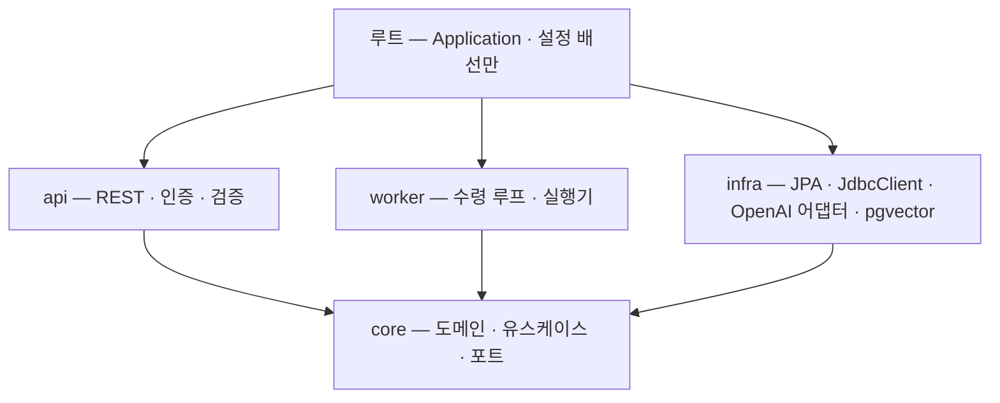
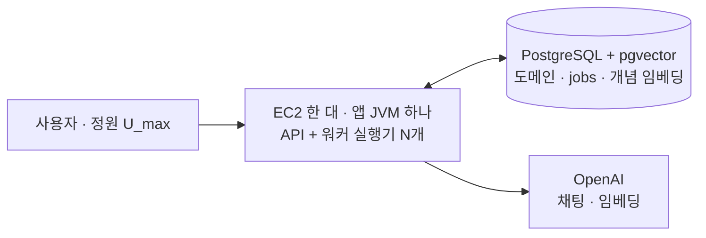
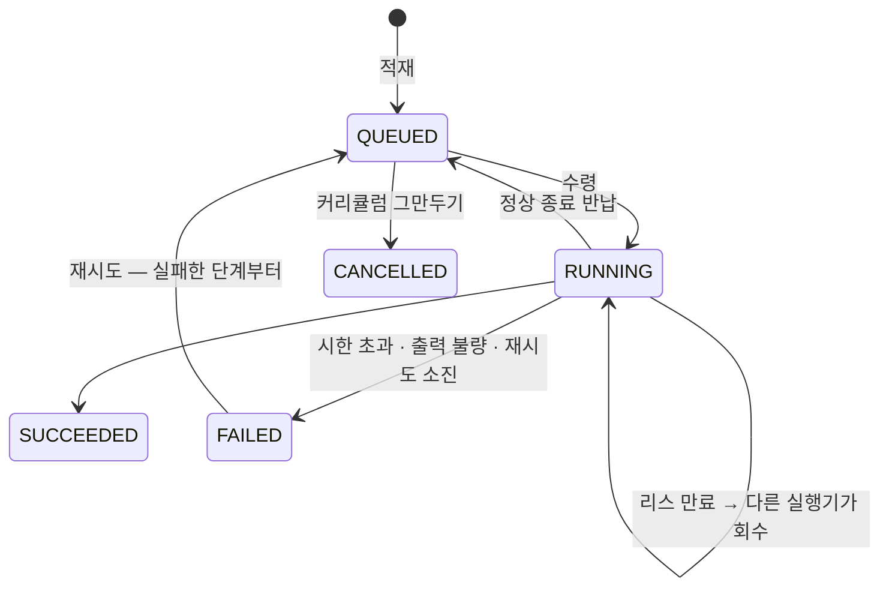
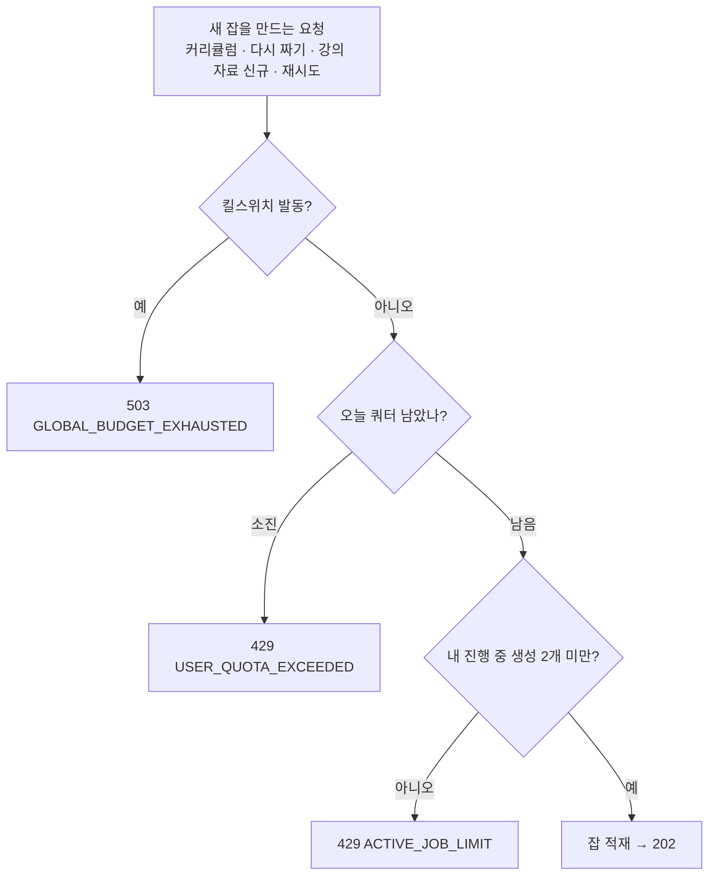

# 04. 서버 구조 · 생성 작업 · 비용 통제

> 기술 선택 · 패키지 경계 · 배포 · 잡 수명주기 · 트랜잭션 경계 · 비용 통제 · 관측.
> 이 문서의 전제는 하나다 — **LLM 호출은 느리고(수 초~1분), 매번 돈이 나가고, 실패한다.**

---

## 1. 기술 선택 — 무엇과 비교했고 언제 틀리나

| 영역 | 선택 | 비교한 것 | 이 선택이 틀리는 때 |
|---|---|---|---|
| 언어 · 런타임 | **Java 21**(LTS) | Java 17 · Kotlin | — (1단계 하네스 · SDK 를 21 에서 검증했다) |
| 프레임워크 | **Spring Boot 3 · Spring MVC** · 플랫폼 스레드 | WebFlux · 가상 스레드 | 초당 수만 건의 가벼운 요청 · 오래 기다리는 연결 수백 개 |
| LLM | **OpenAI 공식 SDK + 자체 포트** | Spring AI · Anthropic | 프로바이더를 상시 여럿 지원해야 할 때 |
| 저장소 | **PostgreSQL 하나 + pgvector** | MySQL + 벡터 DB · Redis | 개념 수십만 · 큐 초당 수백 건 |
| 큐 | **`jobs` 테이블 + `FOR UPDATE SKIP LOCKED`** | Redis ZSET · Kafka | 초당 수백 건(hot row · VACUUM) |
| 마이그레이션 | Flyway | Liquibase | — |
| 경계 강제 | **단일 Gradle 모듈 + ArchUnit** | 멀티모듈 | 규칙이 버거워지거나 배포 단위가 갈릴 때 |
| 관측 | Micrometer · Prometheus · Grafana(**로컬**) · 운영은 관리자 화면 U6 | OpenTelemetry 트레이싱 | 메트릭 + 로그로 *"왜 오래 걸렸나"* 에 답하지 못할 때 |
| 부하 · 장애 테스트 | k6 + LLM 스텁 서버 · Testcontainers(Postgres) | 실제 API 부하 | — |
| 배포 | AWS EC2 한 대 · 앱 프로세스 하나 | 2대 · 쿠버네티스 | 예산이 늘거나 워커가 API 를 방해할 때 |

> **가상 스레드를 쓰지 않는다.** 가상 스레드는 CPU 일을 늘리지 않고 *동시에 기다릴 수 있는 수* 를 늘린다.
> 이 구조에서 오래(약 1분) 기다리는 작업은 **워커 실행기 `N` 개**로 묶여 있고, API 요청은 수 ms~수십 ms 라 플랫폼 스레드로 충분하다.
> (1단계에서 JFR 로 SDK 경로에 pinning 이 없는 것까지 확인한 뒤 내린 결정이다.) 다시 볼 조건 — 오래 기다리는 연결이 수백 개 동시에 생기는 기능.

---

## 2. 패키지 경계



| 패키지 | 책임 | 참조해도 되는 곳 |
|---|---|---|
| `core` | 도메인 · 유스케이스 · **포트**(`LlmClient` · `EmbeddingClient` · `JobStore` · `UsageLedger` · `TransactionRunner` …). 생성 유스케이스는 `core.generation`, 적재 유스케이스는 `core.job` | 없음 |
| `infra` | 포트 구현 — JPA 리포지토리 · `jobs` 명시적 SQL · 어댑터 · pgvector | `core` |
| `api` | 컨트롤러 · 인증 · DTO | `core` (단 `core.generation` · `LlmClient` 제외) |
| `worker` | 수령 루프 · 실행기 · 단계 실행 | `core` |

**ArchUnit 규칙 — 첫 커밋에 쓴다.** 코드가 쌓인 뒤 붙이면 이미 깨져 있고, 그때는 규칙을 무르게 된다.

```java
@Test void api는_생성을_직접_실행하지_않는다() {   // 1분짜리 요청이 조용히 되살아나는 것을 막는다
    noClasses().that().resideInAPackage("..api..")
        .should().dependOnClassesThat().resideInAPackage("..core.generation..")
        .orShould().dependOnClassesThat().areAssignableTo(LlmClient.class).check(CLASSES);
}
@Test void api는_worker를_모른다()      { noClasses().that().resideInAPackage("..api..").should().dependOnClassesThat().resideInAPackage("..worker..").check(CLASSES); }
@Test void api와_worker는_infra를_모른다() { noClasses().that().resideInAnyPackage("..api..", "..worker..").should().dependOnClassesThat().resideInAPackage("..infra..").check(CLASSES); }
@Test void core는_바깥을_모른다()        { noClasses().that().resideInAPackage("..core..").should().dependOnClassesThat().resideInAnyPackage("..api..", "..worker..", "..infra..").check(CLASSES); }
@Test void core는_인프라_기술을_모른다() {
    noClasses().that().resideInAPackage("..core..").should().dependOnClassesThat().resideInAnyPackage(
        "org.springframework.web..", "org.springframework.data..",
        "org.springframework.transaction..",   // @Transactional 금지 — §5
        "com.openai..").check(CLASSES);
}
```

`core` 가 써도 되는 것 — `jakarta.persistence`(엔티티) · `@Service`. 쓰면 안 되는 것 — `@Transactional` · Spring Web · LLM SDK.

---

## 3. 배포

**한 프로세스가 API 와 워커를 함께 돌린다**(`app.role=all`). 로컬 · 운영 모두 같다. 나눌 수 있는 배선은 처음부터 넣어 둔다 — §3.1.



| | 로컬(Docker Compose) | 운영(AWS) |
|---|---|---|
| 구성 | 앱 · Postgres · LLM 스텁 · Prometheus · Grafana | 앱 · Postgres |
| 관측 | Grafana | **관리자 화면 U6**(DB 만 읽는다) — 1GB 에 관측 스택을 올리면 앱이 죽는다 |
| LLM | 스텁(테스트) · 실제 API(실사용 전 확인) | 실제 API |

- 🅿️ **AWS 계정 생성일을 먼저 확인한다** — 2025-07-15 이전 계정은 *월 750시간 합산*, 이후 계정은 *크레딧 방식* 이라 예산 계산이 갈린다.
- 🅿️ Postgres 를 같은 인스턴스에 둘지 RDS 로 뺄지는 실제 메모리 사용량을 보고 정한다. 백업 방식(자동 백업 vs `pg_dump`)도 같이.
- 공개 운영에 더하는 것 — 도메인 · HTTPS(구글 콜백 · `Secure` 쿠키) · DB 백업 · 장애 · 킬스위치 알림(🅿️ 수단).

### 3.1 역할 전환 — 비상용 배선

**같은 jar 를 실행 인자만 바꿔 역할별로 띄울 수 있게 한다.** 평소에는 `all` 하나로 돈다.

```
java -jar app.jar                                   # app.role=all (기본) — 지금
java -jar app.jar --app.role=api                    # 나눌 때 — 웹 서버 · 컨트롤러만
java -jar app.jar --app.role=worker \
     --spring.main.web-application-type=none         #          수령 루프 · 실행기만
```

| `app.role` | 웹 서버 · 컨트롤러 | 수령 루프 · 실행기 `N` | 정상 종료 반납 |
|---|---|---|---|
| `all` (기본) | ✅ | ✅ | ✅ |
| `api` | ✅ | ❌ | — |
| `worker` | ❌ | ✅ | ✅ |

- 구현은 루트 설정에서 빈 등록을 켜고 끄는 것뿐이다(`@ConditionalOnExpression` 등). 역할 판단을 `api` · `worker` · `core` 코드 안에 넣지 않는다.
- **이건 평소 기능이 아니라 비상용 배선이다.** *"트리거 없이 미리 만들지 않는다"* 의 예외로 둔 이유 — 비용이 수십 줄인데, 장애 때 *"코드를 고쳐 다시 배포"* 와 *"실행 인자만 바꾸기"* 의 차이가 크다.
- 나누는 조건 — **워커가 API 응답을 느리게 만드는 것이 관측될 때**(예: 복습 조회 지연이 생성 중에만 튄다). 프로세스를 나누는 실험(격리 측정)은 하지 않는다.

**나눠도 그대로인 것** — 잡 수령(`SKIP LOCKED`) · 리스 · 수령 회차 펜싱 · 반납(`worker_id` 는 프로세스마다 유일) · 진행 중 2개 · 정원 · 개념 쓰기 잠금(전부 DB advisory lock) · 쿼터 · 킬스위치(DB) · **로그인 세션(DB)**. 우리 스케줄러가 없어 *같은 배치가 두 번 도는* 문제도 없다(세션 정리는 §3.2).

**나눌 때 같이 바꾸는 것**

| 항목 | 바뀌는 것 |
|---|---|
| 동시 실행 | 실제 동시 호출 = `N × 워커 프로세스 수`. 한도 계산(§8) · U6 의 실행기 수를 같이 고친다 |
| 우리 API 레이트리밋 | 프로세스 메모리 버킷이다 — **API 프로세스가 하나**면 그대로. API 를 여러 개로 늘리면 버킷이 쪼개진다(Redis 재도입 조건) |
| 메모리 | 한 대(1GB)에 JVM 둘이면 빠듯하다 — 인스턴스 크기를 같이 본다 |
| 배포 순서 | 워커를 먼저 내리면 잡을 반납하고, 새 워커가 이어받는다 |

### 3.2 배치 금지의 예외 하나 — 만료 세션 정리

로그인 세션은 Spring Session JDBC 로 Postgres 에 둔다([05 §1.1](./05-api.md)). 이 라이브러리는 **만료된 세션 행을 주기적으로 지우는 작업**을 스스로 돈다(기본 1분마다).

- **예외로 받아들인다.** 우리가 만든 배치가 아니라 라이브러리의 정리이고, `DELETE … WHERE 만료` 라 **멱등**이다 — 프로세스를 나눠 둘이 함께 돌아도 결과가 같다.
- 도메인 로직(숙련도 · 쿼터 · 잡 회수)에는 여전히 스케줄러를 쓰지 않는다. 이 예외를 근거로 다른 배치를 들이지 않는다.
- 주기는 설정(`spring.session.jdbc.cleanup-cron`)으로 늦출 수 있다 — 25명 규모면 시간 단위로 충분하다.

---

## 4. 생성 작업 — `jobs` 테이블이 큐다

### 4.1 왜 잡인가

처리량 때문이 아니다(정원 약 25명이면 동시 생성은 몇 건이다). **돈이 드는 1분짜리 작업을 한 번만, 끝까지 하려면** 진행 중인 작업이 DB 에 한 줄씩 있어야 한다.

| 필요 | 잡 행이 주는 것 |
|---|---|
| 새로고침 · 두 번 누르기로 **같은 강의가 두 번 생성**되지 않게 | 강의당 활성 잡 하나(부분 unique 인덱스) — 재클릭은 기존 잡에 연결 |
| 사용자당 **진행 중 생성 2개** 세기 | `count(*)` 한 줄 |
| 카드 단계에서 실패해도 **앞 단계 비용(약 76원 · 94%)을 버리지 않게** | 단계 산출물을 잡에 저장 → 실패한 단계부터 재개 |
| 배포 · 프로세스 죽음 뒤에도 **진행 중 작업을 잃지 않게** | 반납 · 리스 만료 회수 |
| 화면이 떠났다 돌아와도 **같은 작업에 다시 붙게** | `jobId` · 진행 단계 · 대기 순번 |

### 4.2 테이블 · 상태

| 컬럼 | 타입 | 비고 |
|---|---|---|
| `id` · `user_id` | | |
| `type` | `text` | `CURRICULUM` / `MATERIAL` |
| `curriculum_id` · `lesson_id` | FK **nullable** | `CHECK` 로 type 과 짝을 강제 — polymorphic `target_id` 는 FK 를 못 건다 |
| `status` | `text` | `QUEUED` / `RUNNING` / `SUCCEEDED` / `FAILED` / `CANCELLED` |
| `enqueued_at` | `timestamptz` | **불변** — 큐 대기 시간 메트릭 |
| **`available_at`** | `timestamptz` | *"이 시각 이후 수령 가능"* — `QUEUED` 면 적재 시각, `RUNNING` 이면 **리스 만료 시각** |
| `claimed_at` · `worker_id` | | 마지막 수령 · 누가(호스트 + PID + 기동 시각, 프로세스마다 유일) |
| `started_at` | `timestamptz` | 첫 수령 시각 — **잡 시한 10분의 기준** |
| `step` | `smallint` | 완료한 단계 — 재개 지점 |
| `payload` | `jsonb` | 단계 산출물 · 다시 짜기 피드백. **완료 시 비운다** |
| `input_tokens` · `output_tokens` · `llm_calls` · `retries` · `rate_limited` | `int` | 잡 누적 — 리스 갱신에 얹어 더한다. U4 `retried` · U6 신뢰성의 원천 |
| `failure_code` · `failure_reason` | `text` | [05 §5](./05-api.md) |
| **`lease_epoch`** | `bigint` | **수령 회차(fencing token).** 수령마다 +1 |

```sql
CREATE INDEX idx_jobs_claim ON jobs (available_at) WHERE status IN ('QUEUED', 'RUNNING');
CREATE UNIQUE INDEX idx_jobs_one_active_per_lesson     ON jobs (lesson_id)     WHERE status IN ('QUEUED','RUNNING') AND lesson_id IS NOT NULL;
CREATE UNIQUE INDEX idx_jobs_one_active_per_curriculum ON jobs (curriculum_id) WHERE status IN ('QUEUED','RUNNING') AND curriculum_id IS NOT NULL;
CREATE INDEX idx_jobs_user_active ON jobs (user_id) WHERE status IN ('QUEUED', 'RUNNING');
```

완료 · 실패 행은 인덱스에 들어오지 않는다 → **행을 지우지 않아도** 수령 성능이 그대로다(삭제는 배치를 부른다).



### 4.3 수령 · 실행기 · 리스

```sql
UPDATE jobs
   SET status = 'RUNNING', claimed_at = now(), started_at = COALESCE(started_at, now()),
       available_at = now() + interval '5 minutes', worker_id = :me, lease_epoch = lease_epoch + 1
 WHERE id = (SELECT id FROM jobs
              WHERE status IN ('QUEUED', 'RUNNING') AND available_at <= now()   -- 대기 잡 또는 리스 만료 잡
              ORDER BY available_at
                FOR UPDATE SKIP LOCKED
              LIMIT 1)
RETURNING *;
```

이 한 문장이 FIFO · 동시 수령 방지 · **죽은 잡 회수** · 펜싱 회차 증가를 한다. 회수용 스케줄러가 없다.
⚠️ **`SKIP LOCKED` 를 빼면 실행기들이 같은 행에서 줄을 선다** — 기능 테스트는 통과하고 부하에서만 드러난다.

**실행기 `N` 개가 각자 빈손일 때만 잡 하나를 집어 끝까지 처리한다.** 그래서 동시에 도는 잡 = 동시 LLM 호출 ≤ `N`. 잡을 `N` 보다 많이 집으면 기다리는 동안 리스와 시한이 탄다. 빈 큐면 잠시 쉰다(🅿️ 폴링 주기).

**리스 5분 · LLM 시도가 끝날 때마다 갱신**(잡 카운터와 같은 문장).

```sql
UPDATE jobs SET available_at = now() + interval '5 minutes',
                llm_calls = llm_calls + 1, retries = retries + :isRetry, rate_limited = rate_limited + :was429,
                input_tokens = input_tokens + :in, output_tokens = output_tokens + :out
 WHERE id = :id AND lease_epoch = :claimedEpoch;   -- 0 rows → 잡을 뺏겼다 → 즉시 중단
```

**리스 부등식** — 살아 있는 실행기의 잡을 뺏기지 않으려면 갱신 사이의 최대 공백이 리스보다 짧아야 한다.

```
호출 1회의 최악(재시도 2회) = 100 + 60 + 100 + 60 + 100 = 420초  >  300초   ✗  → 갱신을 "호출"이 아니라 "시도"마다
리스 300초  >  백오프 상한 60 + 시도 타임아웃 최대 100 = 160초                         ✓
임베딩 구간은 개념 하나마다 갱신 — 공백 약 46초                                        ✓
```

> ⚠️ **타임아웃 · 백오프 상한 중 하나만 올려도 식이 깨진다. 타임아웃을 올리면 리스도 같이 올린다.**

### 4.4 `jobs` 는 JPA 엔티티가 아니다 — 쓰기는 전부 명시적 SQL

JPA `@Version` 으로 펜싱하면 단계 산출물을 저장할 때마다 버전이 올라 **멀쩡한 실행기가 매 잡마다 자기 잡을 버린다.** detached 엔티티를 merge 하면 리스 갱신이 더한 카운터가 옛 값으로 덮인다.
그래서 `jobs` 는 `infra` 가 `JdbcClient` 로 다루고 `core` 는 `JobStore` 포트만 안다. 도메인 테이블은 JPA 그대로다.

| 쓰기 | 조건 | `0 rows` 면 |
|---|---|---|
| 수령 | `SKIP LOCKED` · 회차 +1 | 빈 큐 |
| 리스 갱신 · 카운터 · 단계 산출물 · 완료 · 실패 | `lease_epoch = :claimed` | **즉시 중단**(`LeaseLostException`). 완료면 트랜잭션 전체 롤백 |
| 반납(정상 종료) | `worker_id = :me` · 회차 +1 | 들고 있던 잡이 없다 |
| 취소(커리큘럼 그만두기) | `status = 'QUEUED'` | 대기 잡이 없다 |
| 재시도(API) | `status = 'FAILED'` | `409 JOB_NOT_FAILED` |

**완료 트랜잭션은 `jobs` 의 `UPDATE` 를 맨 앞에 둔다** — 회차가 틀렸으면 자료 · 카드 · 개념을 쓰기 전에 롤백된다. 펜싱이 탈퇴까지 덮는다(행이 지워지면 다음 쓰기가 `0 rows`).

**막는 것과 못 막는 것** — 회수된 옛 실행기는 다음 호출 전에 스스로 멈춘다. 못 막는 것은 **회수 시점에 이미 나간 호출 1회**다. `job.reclaimed` · `job.lease.lost` 로 실제 빈도를 본다. **정확히 한 번은 보장하지 않는다**(at-least-once).

### 4.5 반납 · 회수 · 시한

| 상황 | 동작 |
|---|---|
| **정상 종료(SIGTERM · 배포)** | 수령을 멈추고 들고 있던 잡을 반납 — `status='QUEUED'` · `available_at = enqueued_at`(원래 순서 자리) · `started_at = NULL`(시한 새로) · `worker_id = NULL` · 회차 +1. 훅은 `SmartLifecycle.stop()`. 진행 중이던 시도 1회는 펜싱으로 버려진다 |
| **예고 없는 죽음(`kill -9` · OOM)** | 반납할 기회가 없다 → 리스 5분 만료 뒤 다음 수령이 회수 · **끝낸 단계 다음부터** 재개 |
| **잡이 안 끝난다** | 잡 시한 **10분**(`started_at` 기준). 시도 경계와 수령 직후에 검사 → 스스로 `FAILED`(`DEADLINE_EXCEEDED`). 산출물은 남아 재시도 때 재개 |

### 4.6 단계 산출물 · 재시도 · 완료

```json
{ "outline": {}, "masteryFindings": [], "body": "## 오늘 배울 것 …", "cards": [] }
```

- 단계가 끝날 때마다 `step` · `payload` 를 저장한다(짧은 트랜잭션). `Material` 은 **성공 시에만** 만든다.
- 완료 — 같은 트랜잭션에서 `status='SUCCEEDED'` · `payload='{}'` · `available_at=NULL` 후 `Material` · `Flashcard` · 개념 · `Lesson.READY`. payload 를 비우는 것이 배치 없이 용량을 지키는 방법이다.
- **재시도는 같은 행을 되살린다** — `status='QUEUED'` · `available_at=now()` · `started_at=NULL` · 실패 사유 비움. 새 행을 만들면 산출물이 따라오지 않는다. 무한 반복은 쿼터가 막는다.

### 4.7 중복 생성 방지

1. API 가 강의의 활성 잡을 찾는다 — 있으면 그 `jobId` 를 `202` 로 돌려준다. 최근 잡이 `FAILED` 면 **그 잡을 재시도**한다.
2. 없으면 적재한다. 동시 요청 둘이 1을 함께 통과해도 **부분 unique 인덱스가 하나를 실패**시키고, API 가 그 예외를 잡아 기존 잡을 돌려준다. **제약이 최종 방어선이다.**
3. 중복 요청은 에러가 아니다 — 두 번 누르는 건 정상 행동이고 결과가 같다.

---

## 5. 트랜잭션 경계 — LLM 호출 중에는 커넥션을 쥐지 않는다

1분짜리 응답을 기다리며 커넥션을 쥐면 풀이 금방 마르고 **복습 조회까지 멈춘다.**

```java
var ctx    = tx.inTransaction(() -> load(jobId));   // 커밋 · 반납
var result = llmClient.call(ctx);                    // 커넥션 없음
             tx.inTransaction(() -> save(result));   // 커밋 · 반납
```

- `core` 는 `@Transactional` 대신 **`TransactionRunner` 포트**를 쓴다(구현은 `TransactionTemplate`) — 어노테이션은 경계를 메서드 뒤에 숨겨 커넥션을 LLM 호출 너머로 끌고 간다. 덤으로 self-invocation 프록시 함정이 없다.
- 대가 — 트랜잭션 밖 엔티티는 detached → **리포지토리 포트는 완전히 로딩된 데이터를 돌려준다.** `spring.jpa.open-in-view=false`.

---

## 6. 동시 실행 `N`

| | |
|---|---|
| 뜻 | 실행기 수 = 동시에 도는 잡 = 동시 LLM 호출 상한 |
| 값 | 🅿️ **용량 측정에서 정한다**([07 §2](./07-testing.md)). 시작값 4 |
| 역할 | 서버 자원(메모리 · 커넥션)을 묶는다. **비용은 묶지 않는다** — 늦게 쓸 뿐 총량은 같다. 비용은 §7 이 묶는다 |
| 대가 | 실행기가 다 차면 새 잡은 앞선 잡 하나가 끝날 때까지 기다린다(선점 없음). 대기는 `QUEUED` 와 대기 순번으로만 드러난다 |

---

## 7. 비용 통제

### 7.1 세 층과 진행 중 2개

| 층 | 수단 | 걸리는 곳 |
|---|---|---|
| 1. 구조 상한 | 기간 1~8주 · 주당 3~5강 · 총 40강 · 단계별 `max_tokens` · 이어 쓰기 1회 · 카드 10장 · 툴 라운드 3 · 다시 짜기 3회 | 요청 검증 · 프롬프트 |
| 2. 사용자 | **일일 토큰 쿼터** · **진행 중 생성 ≤ 2** | API 진입(잡 적재 전) |
| 3. 전역 킬스위치 | 서비스 전체 일일 비용 상한 | API 진입(잡 적재 전) |



**진행 중 2개는 사용자 단위 락 안에서 센다** — 락 없이 세면 연타 두 번이 둘 다 *1개* 를 보고 통과한다.

```sql
SELECT pg_advisory_xact_lock(hashtext('enqueue'), :userId::int);   -- (int,int) 형태 — 개념 쓰기 락과 키 공간이 안 겹친다
SELECT count(*) FROM jobs WHERE user_id = :userId AND status IN ('QUEUED', 'RUNNING');   -- ≥ 2 → 429
-- 같은 트랜잭션에서 INSERT
```

같은 강의 재클릭(기존 잡 반환)은 새 잡이 아니라서 걸리지 않는다.

### 7.2 킬스위치

- 발동하면 **새 잡 적재를 전부 거부**한다. 이미 적재된 잡(대기 · 실행 중)은 **끝까지 간다** — 사용자가 기다리고 있고, 도중에 끊으면 이미 쓴 돈이 버려진다.
- 학습 · 복습은 계속된다. 화면은 *"오늘은 새로 만들기가 마감됐어요"* 로 정직하게 보인다.
- 리셋은 스케줄러 없이 **한국 날짜**가 바뀌면 0부터(`daily_usage`).

### 7.3 사후 기록 — 초과분은 유계다

검사는 **적재 전에만** 하고 비용은 **호출 뒤에** 기록한다. 그래서 상한에 닿은 순간 이미 적재된 잡은 남은 호출을 다 쓴다. 대신 그 양이 묶여 있다.

```
초과분 ≤ (진행 중 잡 수) × 잡 1건 최대비용
진행 중 잡 수 ≤ 2 × 활성 사용자 ≤ 2 × U_max
사용자 한 명 몫 ≤ 2 × 잡 1건 최대비용
```

- 잡 1건 실측 약 82원, 최대(재시도 · 재요청 · 이어 쓰기를 다 쓴 경우)는 🅿️ 실사용 기록으로 확인한다.
- 대가 — 상한을 **정확히** 지키지 못한다. 응답을 못 받은 호출은 장부에 없다(`llm.call.no_usage`).
- 선차감은 동시성이 커져 초과분 자체가 예산을 넘볼 때 필요하다 — 그 전에는 넣지 않는다.

---

## 8. 레이트리미터를 만들지 않는다 — 계산

프로바이더 한도는 API 키 전체에 걸린다. **우리 워크로드가 닿는가**를 실측 토큰으로 계산했다.

| | 우리 (`N` = 4) | OpenAI Tier 1 (`gpt-5.6-terra`) | 여유 |
|---|---|---|---|
| 분당 토큰 | 강의 1건 ≈ 1.5만 토큰 / 약 1분 → **약 6.4만** | 50만 | **약 8배** |
| 분당 요청 | 잡당 분당 약 4회 → **약 16** | 500 | **약 30배** |

- 대신 둘로 대응한다 — **실행기 `N`**(동시 호출 상한)과 **429 백오프**(`retry-after` 존중 · 지터).
- 응답 헤더 `x-ratelimit-remaining-*` 를 게이지(`llm.ratelimit.remaining`)로 남겨 추정을 **실측으로 감시**한다.
- **다시 넣는 조건** — 여유가 3배 아래로 내려간다 · 429 가 실제로 관측된다. `N` 을 크게 올리거나 정원을 늘릴 때 이 표를 다시 계산한다. 계정 등급(Tier 2 이상)은 사용액과 기간으로 자동으로 오른다.

---

## 9. 관측

| 계측점 | 남기는 것 |
|---|---|
| API | 엔드포인트별 지연 p50 · p95 · p99 · `api.reject{code}`(쿼터 · 진행 중 2개 · 킬스위치 · 레이트리밋) |
| 큐 | 대기 시간(`now() − enqueued_at`) · 대기 건수 · 실행 중 건수 |
| 잡 | `job.step.duration` · `job.reclaimed` · `job.released` · `job.lease.lost` · `job.write.fenced` · `job.deadline.exceeded` · 실패 코드별 건수 · 재개된 단계 |
| 중복 | 기존 잡에 연결된 생성 요청 수 — *막은 중복* |
| 비용 | 누적 토큰 · 비용 · 쿼터 소진 · 킬스위치 발동 · `llm.call.no_usage` |
| 커넥션 풀 | 활성 · 대기 — §5 규칙이 지켜지는 증거 |
| 호출 · 생성 | [03 §9](./03-generation.md) |

- **로그 상관은 `jobId`** — 적재 직후와 수령 직후 MDC 에 `jobId` · `step` 을 넣는다. *"왜 오래 걸렸나"* 는 `job.step.duration` 으로 단계를 찾고 `jobId` 로 로그를 긁는다.
- 운영 서버에는 Prometheus 가 없다 → **U6 는 DB 만 읽는다**(`jobs` 카운터 · `daily_usage` · `concept_match_log` · `users`).
- 운영 기록은 **주 1회 스냅숏**으로 남긴다 — 포트폴리오의 실사용 증거([01 §8](./01-overview.md)).

---

## 10. 🅿️ 아직 정하지 않은 값

| 항목 | 어디서 |
|---|---|
| 실행기 `N` · 워커 폴링 주기 | 용량 측정 ([07 §2](./07-testing.md)) |
| 정원 `U_max` 최종값 | 용량 측정 vs 예산 중 작은 쪽 |
| 잡 1건 최대비용 · 사용자 일일 쿼터 값 · 전역 킬스위치 금액 | 실사용 단가 기록 |
| AWS 계정 방식 · Postgres 배치 · 백업 · 알림 수단 | 배포 준비 |
| 타임아웃 재계산 · 백오프 상한 60초 적정성 | 실사용 기록 · 429 주입 테스트 |
